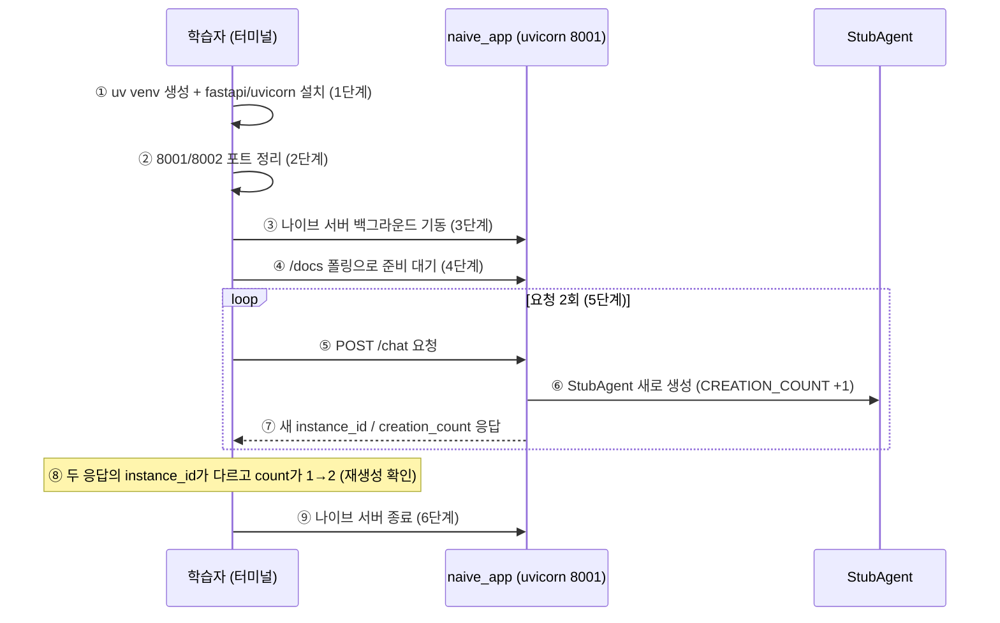
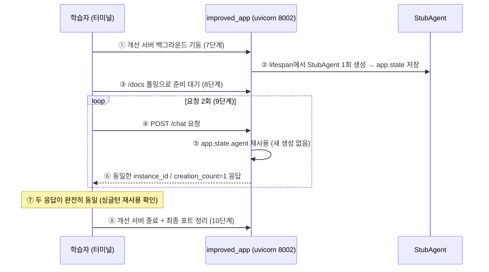
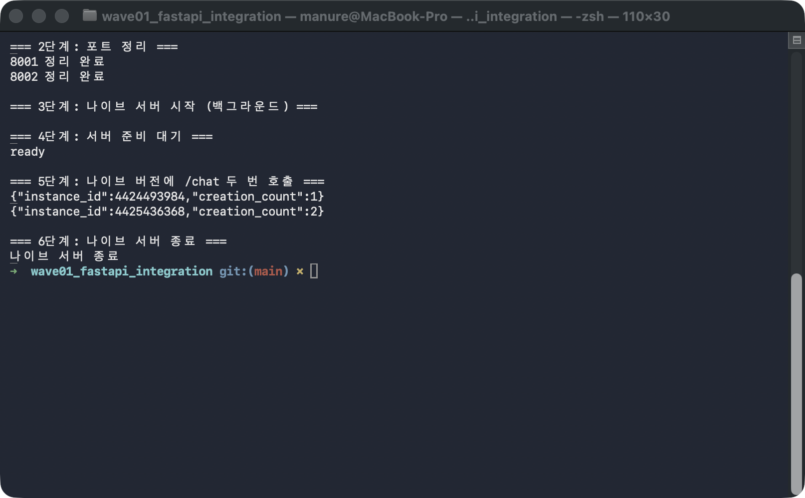
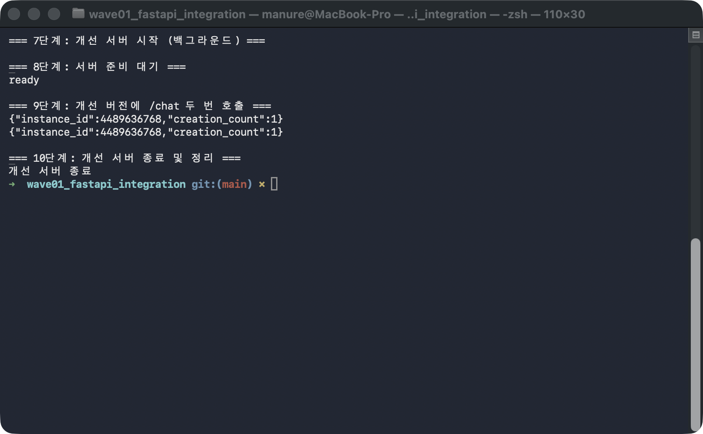

# followup.md — 한 줄씩 따라 실행하기

나이브 버전(`naive_app.py`)과 개선 버전(`improved_app.py`)을 순서대로 띄우고 `/chat`을
2번씩 호출한 뒤 정리하는 과정을, **한 줄씩 직접 터미널에 입력**하며 따라가 볼 수 있도록
단계별로 쪼갠 문서다.

각 단계 아래 "실행 결과 예시"는 실제로 이 환경에서 한 줄씩 직접 실행해서 캡처한 **진짜
결과**다. `instance_id`는 파이썬 객체의 메모리 주소(`id()`)라서 실행할 때마다 숫자 자체는
달라지지만, **비교해야 할 것은 숫자가 아니라 패턴**이다 — 아래 "무엇을 확인해야 하는가"를
먼저 읽고 시작하자.

## 필요한 파일

이 폴더(`wave01_fastapi_integration/`)에 아래 파일들이 이미 준비돼 있어야 한다 — 새로
작성할 필요는 없고, 각 단계에서 어떤 코드가 실행되는지 참고용으로 열어보면 된다.

| 파일 | 역할 |
|------|------|
| `stub_agent.py` | 실제 에이전트 대신 쓰는 `StubAgent`. 생성될 때마다 전역 `CREATION_COUNT`를 1 증가시키고 `id()`를 저장한다. |
| `naive_app.py` | `POST /chat` 핸들러 **안에서** `StubAgent()`를 매번 생성하는 나이브한 버전 (3~6단계에서 실행). |
| `improved_app.py` | `lifespan`에서 서버 시작 시 `StubAgent()`를 1회만 생성해 `app.state.agent`에 저장하고 재사용하는 개선된 버전 (7~10단계에서 실행). |

추가로 아래 도구가 설치돼 있어야 한다(1단계에서 직접 확인·설치한다):

- [uv](https://docs.astral.sh/uv/) — 가상환경(venv) 생성과 패키지 설치에 사용 (`curl -LsSf https://astral.sh/uv/install.sh | sh`로 설치)
- Python 3 (`fastapi`/`uvicorn`은 1단계에서 uv venv 안에 설치한다)
- `curl`, `lsof` (macOS/Linux 기본 제공)

## 무엇을 확인해야 하는가

| | `instance_id` | `creation_count` |
|---|---|---|
| **나이브** (`naive_app.py`) | 요청마다 **달라져야** 정상 | 요청마다 **1씩 증가**해야 정상 |
| **개선** (`improved_app.py`) | 두 요청 모두 **똑같아야** 정상 | 두 요청 모두 **1로 고정**돼야 정상 |

숫자 값 자체(`4423134288` 같은)는 실행 환경마다 다르다 — 신경 쓰지 않아도 된다. 내가 실행한
값과 여러분이 실행한 값이 달라도 정상이다. **"나이브는 바뀌고 개선은 안 바뀐다"는 패턴만
같으면 성공이다.**

## 전체 흐름 시퀀스 다이어그램

0~10단계를 직접 치기 전에, 이 문서가 안내하는 두 흐름 — **나이브 구간**(1~6단계: 요청마다 Agent 재생성)과 **개선 구간**(7~10단계: lifespan 싱글턴) — 을 고수준(무슨 일이 일어나는가) 다이어그램으로 먼저 조망한다.

<a id="naive-high"></a>

### 나이브 구간 (1~6단계) — 고수준



| 번호 | 제목 | 내용 | 수행 주체 | 결과물/효과 | 기타 |
|---|---|---|---|---|---|
| ① | 환경 준비 | uv로 venv를 만들고 fastapi/uvicorn을 그 안에 설치 | 학습자 | 시스템 파이썬을 건드리지 않는 실습 환경 | 이후 모든 `python3`는 이 venv에서 실행 |
| ② | 포트 정리 | 이전 실습이 남긴 프로세스를 8001/8002에서 제거 | 학습자 | 깨끗한 포트 상태 | 정리할 게 없어도 항상 "정리 완료" 출력 |
| ③ | 서버 기동 | naive_app을 uvicorn으로 8001 포트에 백그라운드 기동 | 학습자 | 나이브 서버 대기 상태 | `&`로 백그라운드 실행 |
| ④ | 준비 대기 | `/docs` 응답이 올 때까지 폴링 | 학습자 (curl 루프) | `ready` 출력 = 서버 준비 완료 | 보통 1초 이내 |
| ⑤ | 요청 전송 | `/chat` 엔드포인트에 POST 요청 (2회 반복) | 학습자 (curl) | 핸들러 진입 | |
| ⑥ | Agent 재생성 | 핸들러 **안에서** StubAgent를 매번 새로 생성 | naive_app 핸들러 | CREATION_COUNT 증가 + 새 객체 | 실제 코드라면 MCP subprocess가 매번 재기동 |
| ⑦ | 응답 | 방금 만든 agent의 instance_id/creation_count 반환 | naive_app | 요청마다 다른 값 | |
| ⑧ | 재생성 확인 | 두 응답의 instance_id가 다르고 count가 증가함을 확인 | 학습자 | "요청마다 재생성" 낭비의 증거 | 이 실습의 관찰 포인트 |
| ⑨ | 정리 | 나이브 서버 종료 | 학습자 | 개선 구간을 위한 깨끗한 상태 | |

<a id="improved-high"></a>

### 개선 구간 (7~10단계) — 고수준



| 번호 | 제목 | 내용 | 수행 주체 | 결과물/효과 | 기타 |
|---|---|---|---|---|---|
| ① | 서버 기동 | improved_app을 uvicorn으로 8002 포트에 백그라운드 기동 | 학습자 | 개선 서버 기동 시작 | venv·포트 정리는 나이브 구간 ①②에서 이미 완료 |
| ② | 싱글턴 생성 | lifespan 훅에서 StubAgent를 **정확히 1회** 생성해 app.state에 저장 | improved_app lifespan | 프로세스당 인스턴스 1개 | 요청이 오기 **전**에 일어남 |
| ③ | 준비 대기 | `/docs` 응답이 올 때까지 폴링 | 학습자 (curl 루프) | `ready` 출력 | 8단계 |
| ④ | 요청 전송 | `/chat` 엔드포인트에 POST 요청 (2회 반복) | 학습자 (curl) | 핸들러 진입 | 나이브 ⑤와 같은 호출 (포트만 다름) |
| ⑤ | 싱글턴 재사용 | 핸들러가 app.state의 기존 agent를 꺼내 씀 — 새 생성 없음 | improved_app 핸들러 | CREATION_COUNT 변화 없음 | |
| ⑥ | 응답 | 항상 같은 instance_id/creation_count=1 반환 | improved_app | 요청 횟수와 무관하게 동일 값 | |
| ⑦ | 싱글턴 확인 | 두 응답이 완전히 동일함을 확인 | 학습자 | 싱글턴 재사용의 증거 | |
| ⑧ | 정리 | 개선 서버 종료 + 8001/8002 최종 확인 | 학습자 | 포트 원상 복구 | 10단계 |

### 두 쌍을 겹쳐 읽으면 드러나는 차이

서버 기동(나이브 ③/개선 ①)·준비 대기(나이브 ④/개선 ③)·curl 호출(나이브 ⑤/개선 ④)·종료(나이브 ⑨/개선 ⑧)는 두 구간에서 포트 번호만 다를 뿐 같은 명령이다. 갈라지는 지점은 **StubAgent 생성이 언제 일어나는가** 하나 — 나이브는 생성(⑥)이 요청 루프 **안**에 있어 요청 수만큼 반복되고(`creation_count` 1→2), 개선은 생성(②)이 루프 **밖**(서버 기동 직후 lifespan)으로 빠져 단 1회로 고정된다. 그 차이가 5단계와 9단계의 실제 캡처 — 나이브 ⑦은 매번 다른 `instance_id`(4424493984 → 4425436368), 개선 ⑥은 항상 같은 `instance_id`(4489636768) — 로 그대로 드러난다.

---

## 0단계 — 실습 폴더로 이동

```bash
cd wave01_fastapi_integration
```

(이미 이 폴더에서 시작한다면 건너뛴다.)

---

## 1단계 — uv로 가상환경(venv) 만들고 fastapi/uvicorn 설치

> 🔗 다이어그램: [나이브 고수준](#naive-high) ①환경 준비

시스템 파이썬을 건드리지 않도록, 실습 폴더 안에 uv로 가상환경을 만들고 그 안에
패키지를 설치한다.

```bash
uv venv .venv
source .venv/bin/activate
uv pip install fastapi uvicorn
```

**실행 결과 예시**:

```
Using CPython 3.14.6
Creating virtual environment at: .venv
Activate with: source .venv/bin/activate
Resolved 13 packages in 170ms
Prepared 2 packages in 36ms
Installed 13 packages in 12ms
 + annotated-doc==0.0.5
 + annotated-types==0.8.0
 + anyio==4.15.1
 + click==8.5.0
 + fastapi==0.141.1
 + h11==0.16.0
 + idna==3.20
 + pydantic==2.13.5
 + pydantic-core==2.46.5
 + starlette==1.6.0
 + typing-extensions==4.16.0
 + typing-inspection==0.4.4
 + uvicorn==0.53.0
```

설치가 잘 됐는지 확인한다:

```bash
python3 -c "import fastapi, uvicorn; print('fastapi', fastapi.__version__); print('uvicorn', uvicorn.__version__)"
```

**실행 결과 예시**:

```
fastapi 0.141.1
uvicorn 0.53.0
```

(버전 숫자는 실행 시점에 따라 달라도 무방하다.)

> ⚠️ 이후 단계의 `python3` 명령은 모두 이 venv가 활성화된 셸에서 실행해야 한다.
> 터미널을 새로 열었다면 이 폴더에서 `source .venv/bin/activate`를 다시 실행한 뒤
> 이어가자. `uv`가 없다면(`command not found`) 위 "필요한 파일" 섹션의 설치 안내를 참고.

---

## 2단계 — 8001/8002 포트 정리

> 🔗 다이어그램: [나이브 고수준](#naive-high) ②포트 정리

전에 실습하다 남은 프로세스가 포트를 물고 있을 수 있으니 먼저 비운다.

```bash
lsof -ti:8001 | xargs kill -9 2>/dev/null; echo "8001 정리 완료"
lsof -ti:8002 | xargs kill -9 2>/dev/null; echo "8002 정리 완료"
```

**실행 결과 예시**:

```
8001 정리 완료
8002 정리 완료
```

(정리할 게 없어도 `xargs`가 조용히 넘어가므로 항상 "정리 완료"가 찍힌다 — 정상이다.)

---

## 3단계 — 나이브 버전 서버를 백그라운드로 띄우기

> 🔗 다이어그램: [나이브 고수준](#naive-high) ③서버 기동

```bash
python3 -m uvicorn naive_app:app --port 8001 --log-level warning &
```

`&`를 붙여 백그라운드로 실행한다 — 이 터미널을 계속 다른 명령에 쓸 수 있다. 명령 직후
`[1] 12345` 같은 잡(job) 번호와 PID가 한 줄 찍힌다.

---

## 4단계 — 서버가 뜰 때까지 대기

> 🔗 다이어그램: [나이브 고수준](#naive-high) ④준비 대기

```bash
for i in $(seq 1 30); do
  curl -s -o /dev/null "http://localhost:8001/docs" && echo "ready" && break
  sleep 0.3
done
```

**실행 결과 예시**:

```
ready
```

(보통 1초 이내에 뜬다. `ready`가 안 뜨고 반복만 계속되면 3단계가 실패한 것이니 위 명령의
에러 메시지를 확인한다.)

---

## 5단계 — 나이브 버전에 `/chat` 두 번 호출

> 🔗 다이어그램: [나이브 고수준](#naive-high) ⑤요청 전송 ⑥Agent 재생성 ⑦응답 ⑧재생성 확인

```bash
curl -s http://localhost:8001/chat -X POST; echo
curl -s http://localhost:8001/chat -X POST; echo
```

**실행 결과 예시** (실제 캡처):

```
{"instance_id":4424493984,"creation_count":1}
{"instance_id":4425436368,"creation_count":2}
```

👉 **확인 포인트**: `instance_id`가 두 줄에서 **서로 다르고**, `creation_count`가
**1 → 2로 증가**했다 — `/chat` 핸들러 안에서 매번 `StubAgent()`를 새로 생성하고 있다는
증거다(`naive_app.py`의 `agent = StubAgent()` 줄).

**2~6단계를 실제로 실행한 화면**:



---

## 6단계 — 나이브 서버 종료

> 🔗 다이어그램: [나이브 고수준](#naive-high) ⑨정리

```bash
lsof -ti:8001 | xargs kill -9 2>/dev/null; echo "나이브 서버 종료"
```

**실행 결과 예시**:

```
나이브 서버 종료
```

---

## 7단계 — 개선 버전 서버를 백그라운드로 띄우기

> 🔗 다이어그램: [개선 고수준](#improved-high) ①서버 기동 ②싱글턴 생성

```bash
python3 -m uvicorn improved_app:app --port 8002 --log-level warning &
```

---

## 8단계 — 서버가 뜰 때까지 대기

> 🔗 다이어그램: [개선 고수준](#improved-high) ③준비 대기

```bash
for i in $(seq 1 30); do
  curl -s -o /dev/null "http://localhost:8002/docs" && echo "ready" && break
  sleep 0.3
done
```

**실행 결과 예시**:

```
ready
```

---

## 9단계 — 개선 버전에 `/chat` 두 번 호출

> 🔗 다이어그램: [개선 고수준](#improved-high) ④요청 전송 ⑤싱글턴 재사용 ⑥응답 ⑦싱글턴 확인

```bash
curl -s http://localhost:8002/chat -X POST; echo
curl -s http://localhost:8002/chat -X POST; echo
```

**실행 결과 예시** (실제 캡처):

```
{"instance_id":4489636768,"creation_count":1}
{"instance_id":4489636768,"creation_count":1}
```

👉 **확인 포인트**: `instance_id`가 두 줄에서 **완전히 동일**하고, `creation_count`는
**계속 1**이다 — `lifespan`에서 서버 시작 시 딱 1번 만든 `app.state.agent`를 두 요청 모두
재사용하고 있다는 증거다(`improved_app.py`의 `agent = app.state.agent` 줄, 새로 생성하지
않음).

**7~10단계를 실제로 실행한 화면**:



---

## 10단계 — 개선 서버 종료 및 최종 정리

> 🔗 다이어그램: [개선 고수준](#improved-high) ⑧정리

```bash
lsof -ti:8002 | xargs kill -9 2>/dev/null; echo "개선 서버 종료"
lsof -ti:8001 | xargs kill -9 2>/dev/null || true
lsof -ti:8002 | xargs kill -9 2>/dev/null || true
```

**실행 결과 예시**:

```
개선 서버 종료
```

---

## 최종 비교표 — 내가 실행한 결과 vs 여러분이 실행한 결과

| 항목 | 나이브(예시 캡처) | 개선(예시 캡처) | 여러분의 실행 결과 |
|---|---|---|---|
| 요청1 `instance_id` | 4424493984 | 4489636768 | _(직접 채워보기)_ |
| 요청2 `instance_id` | 4425436368 | 4489636768 | _(직접 채워보기)_ |
| `instance_id` 요청1=요청2? | ❌ 다름 | ✅ 같음 | ? |
| `creation_count` 흐름 | 1 → 2 (증가) | 1 → 1 (고정) | ? |

숫자는 달라도 되지만, **"나이브 행은 ❌/증가, 개선 행은 ✅/고정"** 이 패턴만 여러분의
결과에서도 그대로 나오면 이 실습은 성공이다. 만약 개선 버전에서도 `instance_id`가
바뀐다면 `improved_app.py`의 `lifespan`이 제대로 동작하지 않는다는 뜻이니 코드를
다시 살펴보자.

> 🔗 다이어그램: 이 표의 나이브 행은 [나이브 고수준](#naive-high) ⑧재생성 확인, 개선 행은 [개선 고수준](#improved-high) ⑦싱글턴 확인을 표로 대조하는 것이다.
