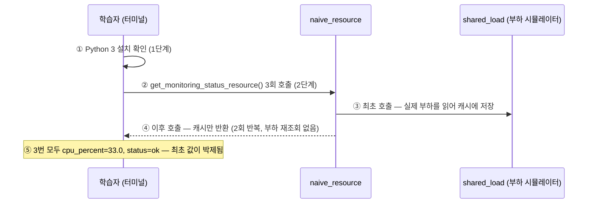
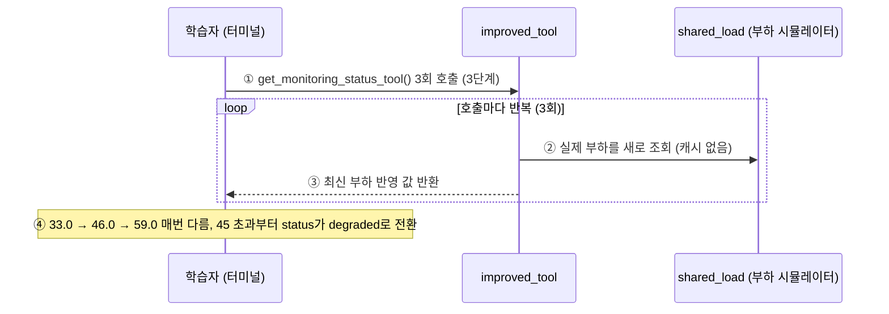
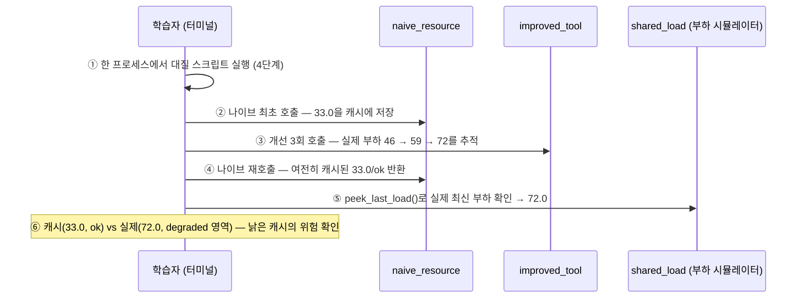
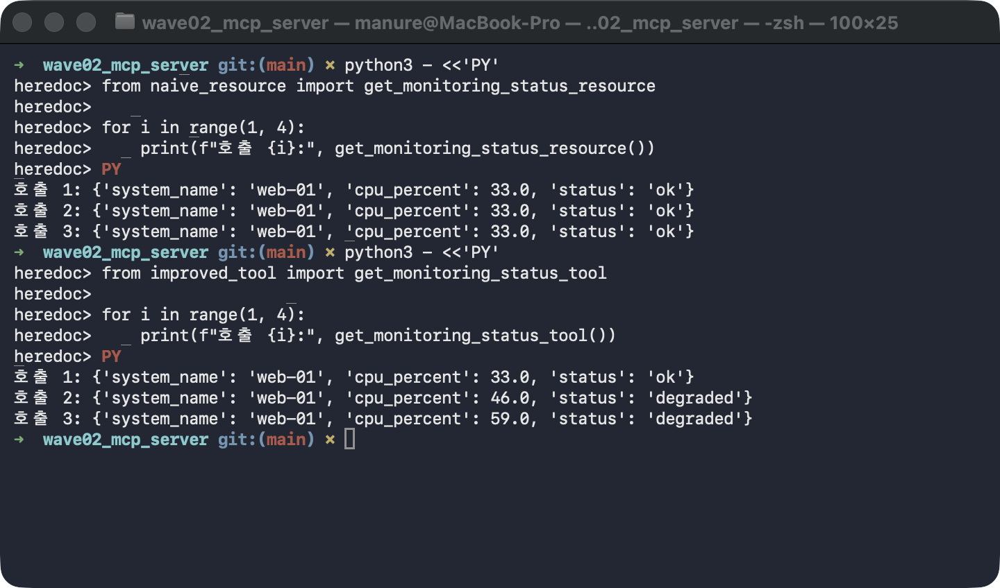
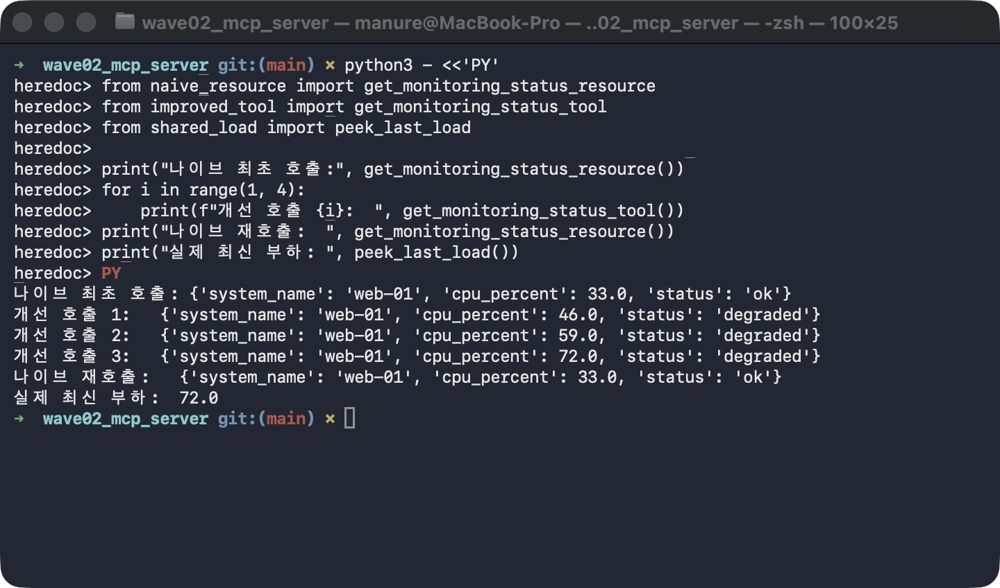

# followup.md — 모니터링 상태 조회: Resource 오분류 vs Tool 분류를 한 줄씩 확인하기

같은 Read-Only 조회 함수를 두 가지 방식으로 구현한 코드를 직접 호출해본다 — Resource처럼
"정적 문서"로 취급해 캐싱하는 버전(버그)과, Tool처럼 "동적 행위"로 취급해 매번 다시
계산하는 버전(올바름). 명령 몇 줄이면 "Read-Only냐 아니냐"가 아니라 **"결과가 시점마다
달라지는가"**가 Tool/Resource를 가르는 기준임을 눈으로 확인할 수 있다.

## 필요한 파일

| 파일 | 역할 | 어느 단계에서 쓰이나 |
|---|---|---|
| `naive_resource.py` | 모니터링 상태를 Resource처럼(잘못) 구현한 버전 — 최초 호출에서만 실제 부하를 읽어 캐싱하고, 이후엔 캐시만 반환 | 2·4단계 |
| `improved_tool.py` | 같은 조회를 Tool로(올바르게) 구현한 버전 — 호출할 때마다 실제 부하를 새로 조회 (캐시 없음) | 3·4단계 |
| `shared_load.py` | 두 구현이 공유하는 "실제 시스템 부하" 시뮬레이터 — 직접 실행하지는 않지만 위 두 파일이 import하며, 4단계에서 `peek_last_load()`로 최신 부하를 직접 들여다본다 | 2~4단계 (간접) |

추가로 필요한 것: Python 3 (표준 라이브러리만 사용 — 패키지 설치가 전혀 없다).

## 무엇을 확인해야 하는가

이 실습의 핵심은 딱 하나 — **같은 조회를 3회 반복했을 때 결과가 달라지는지 여부**다.

| 대상 | 호출 방식 | 정상 패턴 |
|---|---|---|
| 나이브(Resource식 캐싱) | 3회 연속 호출 | `cpu_percent`가 3번 모두 **동일** — 최초 호출 시점에 멈춘 낡은 값(= 오분류가 만드는 버그의 증상) |
| 개선(Tool식 재계산) | 3회 연속 호출 | `cpu_percent`가 3번 모두 **다름** — 매번 최신 부하를 반영하고, 부하가 오르면 `status`도 `ok` → `degraded`로 따라 바뀜 |

> 부하 시뮬레이터가 결정적(deterministic)이라, 아래 "실행 결과 예시"의 숫자(33.0, 46.0,
> 59.0, 72.0)는 당신의 터미널에서도 똑같이 나온다. 다만 기억할 것은 숫자 자체가 아니라
> **"3번 모두 같은가 / 3번 모두 다른가"라는 패턴**이다.

## 전체 흐름 시퀀스 다이어그램

0~4단계를 직접 치기 전에, 이 문서의 세 흐름 — **나이브**(2단계: Resource식 캐싱), **개선**(3단계: Tool식 재계산), **대질**(4단계: 한 프로세스 안에서 두 구현을 번갈아 호출) — 을 고수준 다이어그램으로 먼저 조망한다.

<a id="naive-high"></a>

### 나이브 (Resource식 캐싱, 1~2단계) — 고수준



| 번호 | 제목 | 내용 | 수행 주체 | 결과물/효과 | 기타 |
|---|---|---|---|---|---|
| ① | 환경 확인 | 외부 패키지가 없으므로 Python 3만 확인 | 학습자 | 실습 준비 완료 | 표준 라이브러리만 사용 |
| ② | 나이브 3회 호출 | Resource처럼(잘못) 구현된 조회 함수를 3번 연속 호출 | 학습자 (heredoc 스크립트) | 호출 1~3의 출력 3줄 | |
| ③ | 캐시 생성 | 최초 호출에서만 실제 부하를 읽어 캐시에 저장 | naive_resource | 캐시에 33.0 박제 | Resource의 "정적 문서" 전제를 따른 구현 |
| ④ | 캐시 반환 | 2·3번째 호출은 부하를 다시 읽지 않고 캐시만 반환 | naive_resource | 호출 시점과 무관한 낡은 값 | |
| ⑤ | 패턴 확인 | 3번 모두 같은 값임을 확인 | 학습자 | 오분류가 만드는 버그의 증상 | 이 흐름의 관찰 포인트 |

<a id="improved-high"></a>

### 개선 (Tool식 재계산, 3단계) — 고수준



| 번호 | 제목 | 내용 | 수행 주체 | 결과물/효과 | 기타 |
|---|---|---|---|---|---|
| ① | 개선 3회 호출 | Tool의 전제대로 캐시 없이 구현된 조회를 3번 연속 호출 | 학습자 (heredoc 스크립트) | 호출 1~3의 출력 3줄 | 나이브 ②와 같은 호출 패턴 |
| ② | 부하 재조회 | 호출할 때마다 실제 부하를 새로 읽음 | improved_tool | 호출 시점의 최신 값 | 캐시 자체가 없음 |
| ③ | 값 반환 | 최신 부하와 그에 따른 status 반환 | improved_tool | 매번 달라지는 값 | |
| ④ | 패턴 확인 | 3번 모두 다른 값 + status 전환을 확인 | 학습자 | 동적 조회는 Tool이 맞다는 증거 | 이 흐름의 관찰 포인트 |

<a id="confront-high"></a>

### 대질 (한 프로세스 안에서 캐시 vs 실제 부하, 4단계) — 고수준



| 번호 | 제목 | 내용 | 수행 주체 | 결과물/효과 | 기타 |
|---|---|---|---|---|---|
| ① | 대질 시작 | 두 구현과 peek를 **같은 프로세스**에서 번갈아 호출 | 학습자 (heredoc 스크립트) | 2·3단계와 달리 상태가 이어지는 실험 | |
| ② | 캐시 생성 | 나이브 최초 호출이 그 시점 부하를 캐시에 박제 | naive_resource | 캐시 = 33.0 | |
| ③ | 부하 진행 | 개선 쪽이 3회 호출되며 실제 부하가 흘러감 | improved_tool + shared_load | 실제 부하 46 → 59 → 72 | |
| ④ | 낡은 캐시 반환 | 나이브를 다시 호출해도 캐시 그대로 | naive_resource | 여전히 33.0/ok | 이 실습의 결정적 장면 |
| ⑤ | 실제 부하 확인 | 시뮬레이터의 최신 값을 부작용 없이 조회 | shared_load (peek_last_load) | 실제 최신 부하 72.0 | |
| ⑥ | 어긋남 확인 | 캐시 값과 실제 부하의 괴리를 대조 | 학습자 | "시스템 정상" 오판 위험의 증거 | 장애 대응 Agent가 33.0/ok를 믿으면 위험 |

### 세 흐름을 겹쳐 읽으면 드러나는 차이

나이브·개선 두 흐름은 호출 명령의 모양(heredoc으로 같은 조회를 3회)이 완전히 같고, 갈라지는 지점은 **호출마다 실제 부하를 다시 읽는가** 하나다 — 나이브는 부하 조회(③)가 최초 1회뿐이라 이후 출력(④)이 33.0에 멈추고, 개선은 부하 조회(②)가 루프 안에 있어 출력(③)이 33.0→46.0→59.0으로 흘러간다. 대질 흐름은 이 차이를 **한 프로세스 안에서** 충돌시킨 것으로, 개선 ③이 실제 부하를 72.0까지 끌고 간 뒤에도 나이브 ④가 여전히 33.0/ok를 반환하는 순간 — 캐시(33.0) vs 실제(72.0)의 괴리(⑥) — 이 "Read-Only냐"가 아니라 "결과가 시점마다 달라지는가"로 Tool/Resource를 갈라야 하는 이유를 보여준다.

## 0단계 — 이동

```bash
cd wave02_mcp_server
```

## 1단계 — Python 확인

외부 패키지가 전혀 필요 없으므로 Python 3만 있으면 된다.

```bash
python3 --version
```

**실행 결과 예시**:

```
Python 3.11.15
```

(3.x 버전이면 충분하다.)

## 2단계 — 나이브(Resource식 캐싱) 구현을 3회 호출

"조회 기능이니 정적 데이터처럼 다뤄도 되지 않을까"라는 직관을 그대로 코드로 옮긴 버전을
3번 연속 호출한다. Resource는 "한 번 만들어지면 바뀌지 않는 문서"를 전제로 하므로, 이
전제를 따르면 자연스럽게 "최초 조회 시 캐싱" 구현이 된다 — 그 캐싱이 어떤 결과를 낳는지
직접 본다.

```bash
python3 - <<'PY'
from naive_resource import get_monitoring_status_resource

for i in range(1, 4):
    print(f"호출 {i}:", get_monitoring_status_resource())
PY
```

**실행 결과 예시**:

```
호출 1: {'system_name': 'web-01', 'cpu_percent': 33.0, 'status': 'ok'}
호출 2: {'system_name': 'web-01', 'cpu_percent': 33.0, 'status': 'ok'}
호출 3: {'system_name': 'web-01', 'cpu_percent': 33.0, 'status': 'ok'}
```

`cpu_percent`가 3번 모두 `33.0`으로 동일하다 — 최초 호출 때 읽은 값이 캐시에 박제된 채
그대로 반환되고 있다. 실제 시스템 부하는 배경에서 계속 변하는데도 `status`는 영원히
`ok`다.

## 3단계 — 개선(Tool식 매번 재계산) 구현을 3회 호출

같은 조회를 Tool의 전제("호출 시점마다 값이 달라지는 동적 행위")대로 캐시 없이 구현한
버전을 3번 연속 호출한다.

```bash
python3 - <<'PY'
from improved_tool import get_monitoring_status_tool

for i in range(1, 4):
    print(f"호출 {i}:", get_monitoring_status_tool())
PY
```

**실행 결과 예시**:

```
호출 1: {'system_name': 'web-01', 'cpu_percent': 33.0, 'status': 'ok'}
호출 2: {'system_name': 'web-01', 'cpu_percent': 46.0, 'status': 'degraded'}
호출 3: {'system_name': 'web-01', 'cpu_percent': 59.0, 'status': 'degraded'}
```

이번에는 `cpu_percent`가 `33.0 → 46.0 → 59.0`으로 매번 다르다 — 호출할 때마다 실제
부하를 새로 조회하기 때문이다. 부하가 45를 넘어서자 `status`도 `ok` → `degraded`로 따라
바뀐다.

> 첫 호출 값이 2단계와 같은 `33.0`인 것은 우연이 아니다 — 이 단계는 새 Python
> 프로세스라서 부하 시뮬레이터도 처음부터 다시 시작하기 때문이다. 비교할 것은 첫 값이
> 아니라 "**2단계는 3번 모두 같고, 3단계는 3번 모두 다르다**"는 패턴이다.

2단계(캐시에 박제된 `33.0` 3연속)와 3단계(`33.0 → 46.0 → 59.0`으로 매번 갱신)를 연이어
실행한 실제 화면:



## 4단계 — 한 프로세스 안에서 대질: 캐시는 멈춰 있고 실제 부하는 흘러간다

2·3단계는 각각 별도 프로세스였다. 이번에는 **같은 프로세스 안에서** 두 구현을 번갈아
호출해, 실제 부하가 흘러가는 동안 캐시가 얼마나 낡아가는지 직접 대질한다. 마지막 줄의
`peek_last_load()`는 시뮬레이터가 기억하는 "실제 최신 부하"를 부작용 없이 들여다본다.

```bash
python3 - <<'PY'
from naive_resource import get_monitoring_status_resource
from improved_tool import get_monitoring_status_tool
from shared_load import peek_last_load

print("나이브 최초 호출:", get_monitoring_status_resource())
for i in range(1, 4):
    print(f"개선 호출 {i}:  ", get_monitoring_status_tool())
print("나이브 재호출:  ", get_monitoring_status_resource())
print("실제 최신 부하: ", peek_last_load())
PY
```

**실행 결과 예시**:

```
나이브 최초 호출: {'system_name': 'web-01', 'cpu_percent': 33.0, 'status': 'ok'}
개선 호출 1:   {'system_name': 'web-01', 'cpu_percent': 46.0, 'status': 'degraded'}
개선 호출 2:   {'system_name': 'web-01', 'cpu_percent': 59.0, 'status': 'degraded'}
개선 호출 3:   {'system_name': 'web-01', 'cpu_percent': 72.0, 'status': 'degraded'}
나이브 재호출:   {'system_name': 'web-01', 'cpu_percent': 33.0, 'status': 'ok'}
실제 최신 부하:  72.0
```

여기가 이 실습의 결정적 장면이다: 개선(Tool) 쪽이 `46.0 → 59.0 → 72.0`으로 실제 부하를
따라가는 동안, 나이브(Resource) 쪽을 다시 호출하면 여전히 `33.0`에 `status: ok`를
반환한다 — **실제 부하는 이미 `72.0`(degraded 영역)인데도.** 장애 대응 Agent가 이 값을
믿는다면 "시스템 정상"이라고 판단하게 되는, 오분류가 만드는 실제 위험이 이 한 화면에
담겨 있다.



## 최종 비교표

| 항목 | 이번 실행에서 캡처된 값 | 당신의 실행 결과 | 판정 기준 |
|---|---|---|---|
| 2단계 나이브 호출 1~3 `cpu_percent` | 33.0 / 33.0 / 33.0 | | 세 값이 모두 같으면 캐싱 버그 재현 성공 (❌ 오분류의 증상) |
| 3단계 개선 호출 1~3 `cpu_percent` | 33.0 / 46.0 / 59.0 | | 세 값이 모두 다르면 ✅ (동적 조회는 Tool이 맞는 이유) |
| 4단계 나이브 재호출 `cpu_percent` / `status` | 33.0 / `ok` | | — |
| 4단계 실제 최신 부하 | 72.0 | | 재호출 값과 실제 부하가 어긋나 있으면 "캐시가 낡았다"는 결정적 증거 |

당신의 터미널에서 나온 값을 "당신의 실행 결과" 칸에 옮겨 적고, 나이브 쪽은 3번 모두
같은지 / 개선 쪽은 3번 모두 다른지 / 4단계에서 재호출 값과 실제 부하가 어긋나는지를
직접 대조해보면 이 실습이 끝난다.
