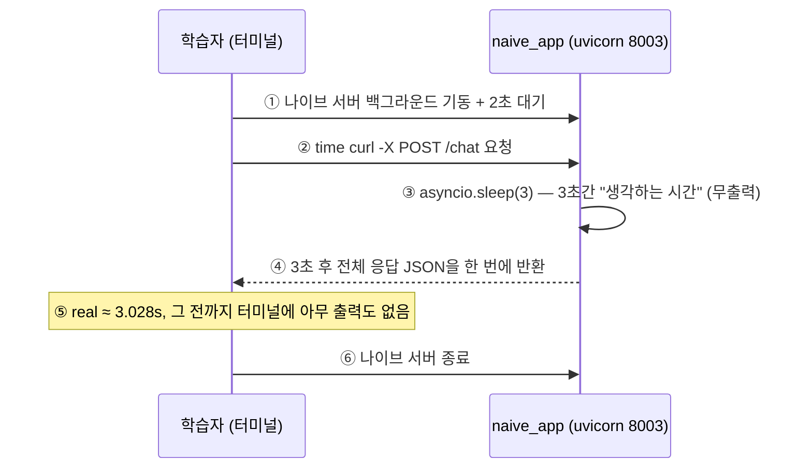
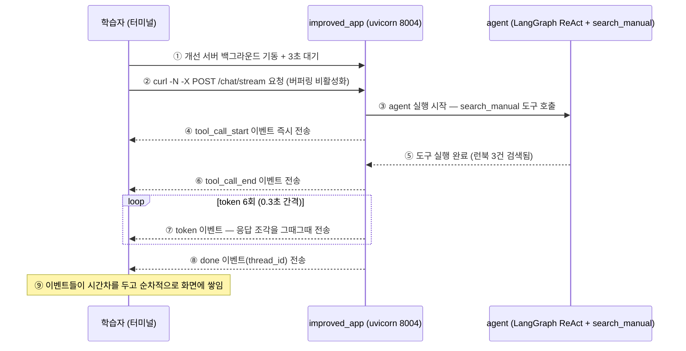
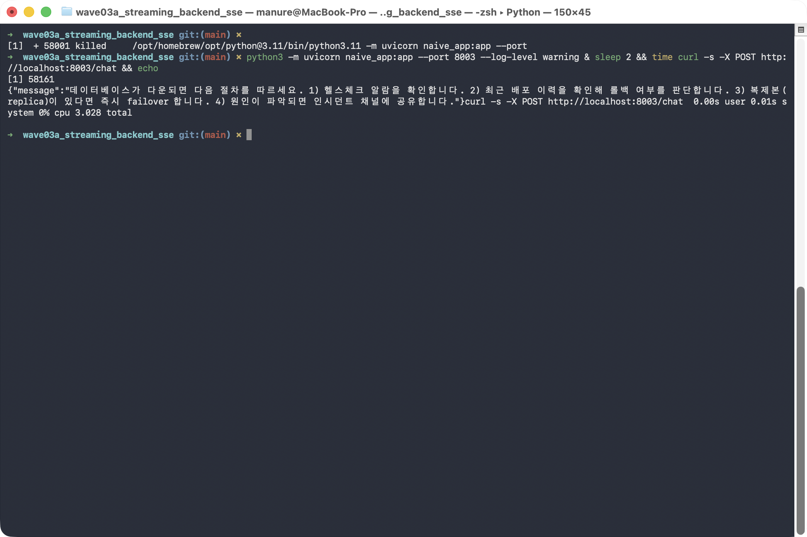
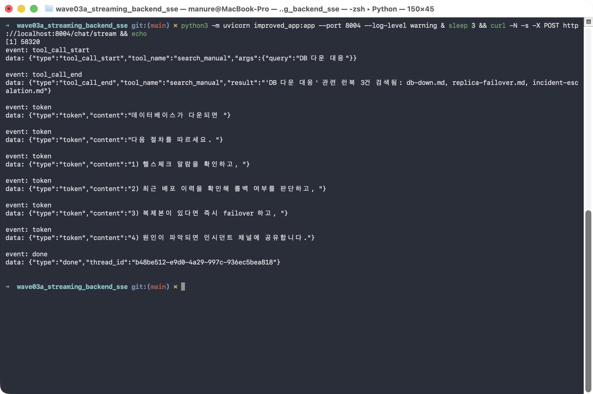

# followup.md — 단발성 응답 vs SSE 스트리밍, 직접 눈으로 비교하기

같은 질문("데이터베이스 다운 시 대응 절차")에 대해 서버가 **한 번에 통째로 응답**할 때와
**이벤트를 실시간으로 조각조각 흘려보낼 때**, 클라이언트 터미널 화면이 실제로 어떻게
다르게 보이는지 두 시나리오를 직접 실행하며 비교한다.

## 필요한 파일

| 파일 | 역할 | 어느 단계에서 쓰이나 |
|---|---|---|
| `naive_app.py` | `/chat` — `asyncio.sleep(3)`으로 "생각하는 시간"을 흉내내고, 끝나야 전체 응답을 한 번에 반환 | 2단계 |
| `improved_app.py` | `/chat/stream` — 실제 LangGraph agent의 이벤트를 SSE로 실시간 전송하는 FastAPI 엔드포인트 | 3단계 |
| `agent.py` | 실제 `langgraph.prebuilt.create_react_agent`로 만든 진짜 ReAct 에이전트(LLM 자리에만 결정론적 fake 모델을 꽂음, 나머지는 실제 LangGraph 코드) | 3단계 (improved_app.py가 import) |
| `schemas/stream.py` | SSE로 내보낼 이벤트 4종(`TokenEvent`/`ToolCallStartEvent`/`ToolCallEndEvent`/`DoneEvent`)의 Pydantic 정의 | 3단계 (improved_app.py가 간접 사용) |
| `streaming/sse_formatter.py` | Pydantic 이벤트 → SSE 표준 문자열(`event: ...\ndata: ...\n\n`) 변환 | 3단계 |
| `streaming/event_converter.py` | LangGraph의 `astream` 이벤트를 위 4종 SSE 이벤트로 변환 | 3단계 |

추가로 필요한 것: Python 3.11+, [uv](https://docs.astral.sh/uv/)(가상환경 생성·패키지 설치용,
`curl -LsSf https://astral.sh/uv/install.sh | sh`로 설치), `fastapi`/`uvicorn`,
`langgraph`/`langchain-core`(1단계에서 uv venv 안에 설치), `curl`.

## 무엇을 확인해야 하는가

| 시나리오 | 호출 방식 | 정상 패턴 |
|---|---|---|
| 나이브 (`/chat`) | `time curl -X POST` | **3초 동안 터미널에 아무 출력도 없다가** 그 뒤 전체 JSON이 한 번에 출력됨. `real` 측정값이 약 3초 |
| 개선 (`/chat/stream`) | `curl -N -X POST` (버퍼링 비활성화) | `tool_call_start` → `tool_call_end` → `token`(6회, 약 0.3초 간격) → `done` 이벤트가 **시간차를 두고 순차적으로** 출력됨 |

> `done` 이벤트의 `thread_id`는 매 실행마다 새로 생성되는 UUID라 실행할 때마다 값이
> 다르다. **UUID 값 자체가 아니라 "이벤트가 한 번에 몰려오는가 / 시간차를 두고
> 순서대로 오는가"라는 패턴을 비교**해야 한다. `token` 이벤트의 문구 자체(`"데이터베이스가
> 다운되면 "` 등)는 `agent.py`에 고정된 문자열이라 실행할 때마다 동일하다.

## 전체 흐름 시퀀스 다이어그램

0~4단계를 직접 치기 전에, 이 문서의 두 흐름 — **나이브**(2단계: `/chat` 단발성 응답)와
**개선**(3단계: `/chat/stream` SSE 스트리밍) — 을 고수준 다이어그램으로 먼저 조망한다.

<a id="naive-high"></a>

### 나이브 (`/chat` 단발성 응답, 2단계) — 고수준



| 번호 | 제목 | 내용 | 수행 주체 | 결과물/효과 | 기타 |
|---|---|---|---|---|---|
| ① | 서버 기동 | 포트를 정리하고 naive_app을 백그라운드로 기동, 2초 대기 | 학습자 | 나이브 서버 준비 완료 | 2단계 |
| ② | 요청 전송 | `/chat`에 POST 요청을 `time`으로 감싸 전송 | 학습자 (curl) | 핸들러 진입 | |
| ③ | 사고 시간 시뮬레이션 | 핸들러 내부에서 `asyncio.sleep(3)`으로 3초 대기 | naive_app | 이 동안 클라이언트에 아무 바이트도 전송되지 않음 | 이 실습의 관찰 포인트 |
| ④ | 통째 응답 | 3초가 지난 뒤 전체 JSON을 한 번에 반환 | naive_app | `real ≈ 3.028s` | |
| ⑤ | 패턴 확인 | 3초간 무출력 후 한 번에 출력됨을 확인 | 학습자 | 단발성 응답의 증거 | 최종 비교표 1·2행 |
| ⑥ | 정리 | 나이브 서버 종료 | 학습자 | 개선 구간을 위한 깨끗한 상태 | |

<a id="improved-high"></a>

### 개선 (`/chat/stream` SSE 스트리밍, 3단계) — 고수준



| 번호 | 제목 | 내용 | 수행 주체 | 결과물/효과 | 기타 |
|---|---|---|---|---|---|
| ① | 서버 기동 | improved_app을 백그라운드로 기동, 3초 대기 | 학습자 | 개선 서버 준비 완료 | 3단계 |
| ② | 요청 전송 | `/chat/stream`에 `-N`(버퍼링 비활성화) 플래그로 POST 요청 | 학습자 (curl) | SSE 스트림 수신 시작 | 나이브 ②와 달리 버퍼링을 끔 |
| ③ | 에이전트 실행 | 실제 LangGraph ReAct agent가 `search_manual` 도구 호출 시작 | improved_app → agent.py | 도구 실행 트리거 | |
| ④ | tool_call_start 전송 | 도구 호출이 시작됐다는 이벤트를 즉시 스트림으로 전송 | improved_app | 클라이언트에 첫 이벤트 도착 | 나이브엔 대응되는 중간 신호가 없음 |
| ⑤ | 도구 실행 완료 | `search_manual`이 런북 3건을 검색해 반환 | agent (도구) | 검색 결과 확보 | |
| ⑥ | tool_call_end 전송 | 도구 실행 결과를 이벤트로 전송 | improved_app | 두 번째 이벤트 도착 | |
| ⑦ | token 스트리밍 | 응답 문장을 6조각으로 나눠 0.3초 간격으로 전송 | improved_app | token 이벤트 6회 | 화면이 계속 채워짐 |
| ⑧ | done 전송 | 스트림 종료를 알리는 이벤트 + thread_id | improved_app | 스트림 종료 | thread_id는 매 실행마다 새 UUID |
| ⑨ | 패턴 확인 | 이벤트가 시간차를 두고 순서대로 도착함을 확인 | 학습자 | SSE 스트리밍의 증거 | 최종 비교표 3·4행 |

### 두 흐름을 겹쳐 읽으면 드러나는 차이

서버 기동(①)과 요청 전송(②)은 두 흐름에서 모양이 같다. 갈라지는 지점은 **요청과 응답
사이에 일어나는 일을 클라이언트가 볼 수 있는가**다. 나이브는 ③사고 시간 시뮬레이션이
핸들러 안에 통째로 감춰져 있어 3초 뒤 ④응답 한 번으로 끝나고, 개선은 같은 시간 동안
벌어지는 일(도구 호출 → 결과 → 응답 조각 생성)을 ③~⑧ 하나씩 이벤트로 흘려보낸다. 그
결과 나이브의 "3초 무출력"이 개선에서는 `tool_call_start → tool_call_end → token×6 →
done`이 시간차를 두고 쌓이는 화면으로 바뀐다.

## 0단계 — 이동

```bash
cd wave03a_streaming_backend_sse
```

## 1단계 — uv로 가상환경(venv) 만들고 의존성 설치

시스템 파이썬을 건드리지 않도록, 이 폴더 안에 uv로 가상환경을 만들고 필요한 패키지를
그 안에 설치한다.

```bash
uv venv .venv
source .venv/bin/activate
uv pip install fastapi uvicorn langgraph langchain-core
python3 -c "import fastapi, uvicorn, langgraph, langchain_core" && echo "IMPORT OK"
```

**실행 결과 예시** (설치 로그 중간은 생략):

```
Using CPython 3.14.6
Creating virtual environment at: .venv
Activate with: source .venv/bin/activate
Resolved 43 packages in 96ms
Installed 43 packages in 36ms
 + annotated-doc==0.0.5
 ...
 + zstandard==0.25.0
IMPORT OK
```

> ⚠️ 이후 단계의 `python3` 명령은 이 venv가 활성화된 셸에서 실행해야 한다. 터미널을
> 새로 열었다면 이 폴더에서 `source .venv/bin/activate`를 다시 실행한 뒤 이어가자.

## 2단계 — 나이브: 단발성 응답 (`/chat`)

포트를 정리하고, 서버를 백그라운드로 띄운 뒤, 서버가 뜰 시간(2초)만큼 기다렸다가 요청을
보낸다. `time`으로 감싸 실제 소요 시간을 함께 측정한다.

```bash
lsof -ti:8003 | xargs kill -9 2>/dev/null
python3 -m uvicorn naive_app:app --port 8003 --log-level warning &
sleep 2 && time curl -s -X POST http://localhost:8003/chat && echo
```

**실행 결과 예시** (실제로 방금 실행해서 얻은 값):

```
{"message":"데이터베이스가 다운되면 다음 절차를 따르세요. 1) 헬스체크 알람을 확인합니다. 2) 최근 배포 이력을 확인해 롤백 여부를 판단합니다. 3) 복제본(replica)이 있다면 즉시 failover 합니다. 4) 원인이 파악되면 인시던트 채널에 공유합니다."}
real    0m3.028s
user    0m0.004s
sys     0m0.007s
```

`curl` 명령을 친 순간부터 **3초 동안 터미널에 아무것도 안 찍히다가**, `real 0m3.028s`가
찍히는 순간 전체 JSON이 통째로 나타난다.



다음 시나리오로 넘어가기 전에 나이브 서버를 종료한다.

```bash
lsof -ti:8003 | xargs kill -9 2>/dev/null
```

## 3단계 — 개선: SSE 스트리밍 (`/chat/stream`)

같은 방식으로 개선 서버를 띄우고, 이번엔 `-N`(버퍼링 비활성화) 플래그를 붙여 요청한다.

```bash
python3 -m uvicorn improved_app:app --port 8004 --log-level warning &
sleep 3 && curl -N -s -X POST http://localhost:8004/chat/stream && echo
```

**실행 결과 예시** (실제로 방금 실행해서 얻은 값):

```
event: tool_call_start
data: {"type":"tool_call_start","tool_name":"search_manual","args":{"query":"DB 다운 대응"}}

event: tool_call_end
data: {"type":"tool_call_end","tool_name":"search_manual","result":"'DB 다운 대응' 관련 런북 3건 검색됨: db-down.md, replica-failover.md, incident-escalation.md"}

event: token
data: {"type":"token","content":"데이터베이스가 다운되면 "}

event: token
data: {"type":"token","content":"다음 절차를 따르세요. "}

event: token
data: {"type":"token","content":"1) 헬스체크 알람을 확인하고, "}

event: token
data: {"type":"token","content":"2) 최근 배포 이력을 확인해 롤백 여부를 판단하고, "}

event: token
data: {"type":"token","content":"3) 복제본이 있다면 즉시 failover 하고, "}

event: token
data: {"type":"token","content":"4) 원인이 파악되면 인시던트 채널에 공유합니다."}

event: done
data: {"type":"done","thread_id":"b48be512-e9d0-4a29-997c-936ec5bea818"}
```

`tool_call_start`/`tool_call_end`는 실제 `search_manual` 도구가 실제로 호출·실행된
결과이고, `token` 6개는 0.3초 간격으로 하나씩 도착한다 — 나이브와 달리 화면이 계속
채워지는 것이 보인다.



시나리오를 마쳤으니 개선 서버도 종료한다.

```bash
lsof -ti:8004 | xargs kill -9 2>/dev/null
```

## 4단계 — 포트 정리 확인

```bash
lsof -ti:8003 -ti:8004
```

**실행 결과 예시**: 아무 줄도 출력되지 않아야 정상이다(두 포트 모두 정상 해제됨).

## 최종 비교표

| 항목 | 이번 실행에서 캡처된 값 | 당신의 실행 결과 | 판정 기준 |
|---|---|---|---|
| 나이브 `real` 시간 | 0m3.028s | | 약 3초면 ✅ (`asyncio.sleep(3)` 그대로 체감 대기시간이 됨) |
| 나이브: 3초 동안 중간 출력이 있었나 | 없음(무출력) | | 없어야 ✅ (이게 이번 실습이 해결하려는 문제) |
| 개선: 이벤트 도착 순서 | tool_call_start → tool_call_end → token×6 → done | | 이 순서대로면 ✅ |
| 개선: `done`의 `thread_id` | `b48be512-e9d0-4a29-997c-936ec5bea818` | | 값은 달라도 되고, UUID 형식이면 ✅ |

당신의 터미널에서 나온 실제 `real` 값과 이벤트 순서를 "당신의 실행 결과" 칸에 옮겨 적고,
나이브 쪽엔 중간 출력이 없는지 / 개선 쪽엔 이벤트가 시간차를 두고 순서대로 오는지를
직접 대조해보면 이 실습이 끝난다.
