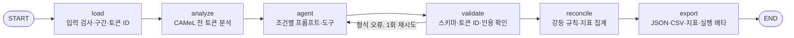

# Tashkeel Check — 프로젝트 계획 및 진행 기록

- 프로젝트/레포 이름: `tashkeel-check`
- 마지막 업데이트: 2026-10-20
- 현재 단계: 단계 1 구현 완료, 실험(EXP-001·002) 미실행. 사업 구조를 걸프 영어권 최종 사용자·사람 검수 없음으로 바꾸고 사업성 검토를 다시 추정함(ADR-008). 판매는 KYC·컴플라이언스 팀에 멀티 에이전트 API 우선(ADR-009). 인터뷰와 사람 검수는 추후 과제. 과제 2 요건에 따라 단계 1.5(서비스화: 웹 화면·API·Postgres·최소 MCP)를 계획에 추가함(ADR-012). 단계 1.5 전 리팩토링 완료(ADR-013, 동작 동일 확인). M0 항목 2·3 완료(실제 모델 C1·C2 첫 실행 통과, temperature 0 미지원 확인). M0 관찰을 바탕으로 EXP-002 전에 채점 정의와 합성 문서를 고침(ADR-014: 모호 판정 규칙은 유지, 일반 단어 미처리는 보조 지표, 중립 토큰 제외, 토큰 단위 집계, 보류 후보 적중률, 합성 문서 synthetic-v1). M0 항목 5(목표값·중단 기준)는 사용자 결정 대기. **단계 1.5는 미구현**
- 문서 역할: 현재 계획, 진행 상황, 실험, ADR, 트러블슈팅을 관리하는 작업용 기준 문서. 외부용 소개는 `README.md`, 사업 근거는 `사업성 검토 아랍어 문서 검증 도구.md`, 시장 조사 기록은 `docs/market/`에 있다.

> **작업을 시작하기 전에 이 문서를 읽는다. 작업 중 계획·범위·구조·데이터·평가 방식이 바뀌면 해당 본문을 최신 상태로 수정하고, 변경 이력에 이유와 영향을 기록한다. 중요한 기술적 결정은 ADR에, 문제와 해결 과정은 트러블슈팅에, 측정 결과는 실험 기록에 남긴다. 작업을 마칠 때 체크리스트와 다음 작업을 갱신한다.**
>
> 완료 여부는 실제 구현·실행·확인 결과를 기준으로 쓴다. 실행하지 않은 실험이나 검증을 완료했다고 기록하지 않는다.

### 근거 표기

| 표시 | 뜻 |
| --- | --- |
| [확인] | 이 프로젝트에서 직접 실행하거나 조회한 결과 |
| [문헌○] | 조사로 확인한 외부 자료. 인용 전에 원문을 다시 확인한다 |
| [제안] | 아직 확정·검증하지 않은 설계안이나 수치 |
| [가설] | 실험으로 확인할 추정 |
| [미확인] | 아직 모르는 값 |

## 1. 정의와 목표

> **정의:** 아랍어를 못 읽는데 아랍어 문서에 책임을 지는 사람을 위한 검수 도구. 아랍어 → 영어 번역에서 독법이나 표기가 갈리는 구간, 특히 고유명사와 짧은 필드를 드러내고, 근거 없이 확정하지 않는다.

번역기가 아니다. 제품이 약속하는 것은 "정확한 번역"이 아니라 "모호 구간을 얼마나 잡아내는가"다. 사업 판단과 시장·경제성 추산은 `사업성 검토 아랍어 문서 검증 도구.md`에 있다.

### 1.1 해결하려는 문제

**한 문장:** 아랍어를 못 읽는 사람이 아랍어 서류에 책임을 질 때, 번역이 어디에서 하나를 "골랐는지" 알 수 없다. 특히 이름이 신분증·등기 표기와 달라지면 거래나 등록이 막히는데, 고른 자리가 있었다는 사실 자체가 독자에게 보이지 않는다.

문제는 세 층으로 쌓여 있다. 어느 한 층만 풀어서는 해결되지 않는다.

| 층 | 내용 | 근거 |
| --- | --- | --- |
| 언어 | 아랍어는 단모음을 생략해서 같은 철자에 여러 독법이 생긴다. 문맥이 있는 본문은 최신 LLM이 대부분 풀 것으로 본다. 문맥으로 풀리지 않는 곳은 인명·회사명·지명과 표의 셀, 서명란 같은 짧은 필드다 | [가설, 미측정] |
| 업무 | 서류의 이름 표기는 아랍어 실력이 아니라 외부 근거로 확정된다. ADGM 공증 안내는 위임장의 이름을 UAE 거주자는 Emirates ID, 비거주자는 여권에 적힌 대로 쓰라고 한다. 사우디 중앙은행은 이카마의 아랍어·영문 이름이 맞지 않으면 거래를 허용하지 않는다. 같은 아랍어 이름이 여러 로마자로 쓰인다. Wikidata에서 سعيد رشيد القبيسي의 레이블은 "Saeed Rashid Al Qubaisi", 별칭은 "Saeed Rashed Al-Qubaisi"다. 음성 전사 관행이 제각각이라 데이터베이스 간 이름 대조에 혼란이 생긴다는 ICAO 자료가 있다 | [문헌○] ADGM, SAMA(S77), ICAO. [확인] Wikidata |
| 도구 | 번역하는 LLM은 모호한 곳을 표시하지 않고 하나로 정해 넘길 수 있다. 이 프로젝트는 이것을 "모호성 은폐"라 부른다. 의도적 조작이 아니라 specification gaming의 한 형태다. 읽는 사람은 아랍어를 모르니 그 선택이 있었다는 사실조차 알 수 없다. 사람 번역가도 대안 표기를 표시하지 않는 것은 마찬가지다 | [가설, 질문 Q1] |

**누구의 문제인가 (ADR-008, ADR-009):**

- 1순위: 걸프 법인 고객을 받는 은행·핀테크·결제사의 KYC·컴플라이언스 팀. 온보딩 서류 묶음의 아랍어 상업등기·정관에 적힌 회사명, 대표자·실소유자 이름이 여권 사본과 같아야 한다. 이름은 같거나 다르거나 둘 중 하나인 이진 기준이고, 근거(여권)가 같은 묶음 안에 있다 [가설].
- 2순위: 걸프에 진출한 외국 중소기업·창업자. 상업등기, 정부 서신, 현지 상대방 계약을 내부 검토용으로 읽는다. 사내 아랍어 인력이 없다.
- 대상이 아닌 사람: 아랍어를 읽는 사람이 있는 조직(문제가 없다), 번역사무소(대체 대상), 법원·관청 제출용 문서(면허 번역사가 해야 한다).

비용은 틀린 표기 자체보다 늦게 발견하는 데서 생긴다. 사우디의 영문 이름 수정은 무료이고 몇 분이면 끝나지만, 발견이 늦으면 계좌 개설 거부나 등록 지연으로 이어진다 [문헌○, S152~S159]. 손실 금액과 빈도를 보여 주는 공개 자료는 없다 [미확인].

**지금 있는 수단으로 안 되는 이유:**

| 수단 | 왜 부족한가 |
| --- | --- |
| 사람 번역가 | 장당 사우디 약 2.4만 원, UAE 약 6.0만 원. 내부 검토용에는 과하고, 대안 표기를 표시하지 않는다 |
| 범용 LLM 좌석 | 싸고 빠르지만 모호한 곳을 말없이 찍는다 [가설]. "모호하면 표시하라"는 지시만으로 충분한지가 EXP-002의 핵심이고, 충분하다면 이 도구의 존재 이유가 사라진다 |
| 이름 매칭·스크리닝 벤더 | 두 영문 이름이 같은 사람인지 점수를 낸다. 문서 속 아랍어 이름을 근거와 함께 영문 표기로 읽는 앞단은 하지 않는다 |

### 1.2 서비스 목표

핵심 약속은 "정확한 번역"이 아니라 **"확인해야 할 곳을 빠뜨리지 않고, 근거와 함께 알려 준다"**다. 보증의 세기는 "전수 검토를 건너뛰어도 된다"가 아니라 "어디를 확인해야 하는지 안다"다(ADR-008). 목표마다 6절의 지표를 붙여, 말이 아니라 측정으로 달성 여부를 판정한다.

| 번호 | 목표 | 지표 (6절) | 판정 기준 |
| --- | --- | --- | --- |
| G1 | **드러낸다.** 독법·표기가 갈리는 구간을 빠뜨리지 않고 표시한다 | 말없이 찍음 비율(주 지표), 이름 미처리 수(일반 단어 미처리는 보조, ADR-014) | C0 대비 유의하게 낮아야 한다. 목표값은 EXP-002 전에 정한다 [제안] |
| G2 | **근거 없이 확정하지 않는다.** 고유명사는 문서(단계 2부터는 서류 묶음) 안에 근거가 있을 때만 확정하고 인용을 붙인다 | 근거 없는 확정 비율, 고확신 무근거 확정 토큰 수, 근거 검증 실패 수 | 근거 없는 확정은 0이 목표다. 코드가 보류로 고쳐 주지 않고 실패로 센다(4.5절) |
| G3 | **전부 보류로 도망가지 않는다.** 근거가 있으면 확정하고, 모호하지 않은 곳에는 표시를 붙이지 않는다 | 과잉 표시 토큰 수, 보류율, 근거 채택 검증 통과율, 단계 2의 묶음 근거 확정률 | G1·G2를 과잉 보류로 맞추면 실패로 본다. 확정률 목표는 합성 KYC 묶음에서 정한다 [제안] |
| G4 | **지시만 준 범용 LLM보다 낫다.** 그렇지 않으면 단독 제품이 아니라 공개 벤치마크·연구 산출물로 마무리한다 | C1 대 C2·C3의 말없이 찍음 비율, 반복 간 일치율 | C1이 C2·C3와 반복 간 범위 안에서 같으면 "지시만으로 충분" [제안, 사용자 확정 필요] |
| G5 | **업무 흐름에 맞는 출력.** 결과는 근거 위치가 붙은 확인 대기 목록이고, KYC 담당자가 여권을 보고 항목을 닫을 수 있다. 판매 형태는 API다 | 항목당 근거 위치·인용 유무, 보류 후보 적중률(보류한 이름의 후보에 실제 표기가 드는가, ADR-014), 비용·지연(문서당) | 단계 2에서 정한다. 가격 천장은 번역료의 20% [가정] |
| G6 | **측정한 범위에서만 약속한다.** 합성 문서, Wikidata 실명, 공개 이중언어 문서로 잰 값만 말하고, 실제 고객 서류의 포착률로 일반화하지 않는다 | 실행마다 데이터 범위·모델·프롬프트 해시 기록(6.3절) | 기록이 없는 결과는 보고하지 않는다 |

**목표가 아닌 것 (단계 1~3 공통):**

- 번역 문장의 품질을 높이거나 평가하는 것
- 법원·관청 제출용 공인 번역을 대체하는 것
- 스캔본 문자 인식, 사람 검수, 한국어 출력
- 이름이 아닌 모호 구간의 최종 판단. 이것은 고객이 하고, 번역가에게 넘기는 연결은 추후 과제다

**사업 판정과의 연결:** G4가 첫 관문이다. 범용 LLM이 지시만으로 이름 모호성을 잡으면 가격 천장이 LLM 좌석 값으로 내려가고 경제성이 사라진다(사업성 검토 3절). 그다음이 G2·G3의 묶음 근거 확정률(KYC 판매 문구를 정함)이고, 마지막이 단계 3의 멀티 에이전트 비교("독립된 두 번째 확인"을 판매 문구에 넣을지 정함, ADR-009)다.

### 1.3 단계 1에서 답할 질문

| ID | 질문 | 데이터 | 실험 |
| --- | --- | --- | --- |
| Q0 | 형태소 분석기가 실제 걸프 인명에서 독법 후보를 얼마나 내는가, 그 후보가 실제 영문 표기를 포함하는가 | 실제(Wikidata) | EXP-001 |
| Q1 | 에이전트가 정말 말없이 찍는가 | 합성 문서 | EXP-002 C0 |
| Q2 | "모호하면 표시하라"는 지시만으로 해결되는가 | 합성 문서 | EXP-002 C1 대 C0 |
| Q3 | 형태소 분석기를 주면 더 잡는가 | 합성 문서 | EXP-002 C2·C3 대 C1 |

어느 질문도 답을 가정하지 않는다. Q0의 결과가 Q3의 해석을 좌우한다. 분석기가 이름에서 후보를 거의 못 내면 C2·C3의 이득은 일반 단어에서만 나올 수 있다.

## 2. 전체 계획에서의 위치

원칙: **기능은 적게, 측정은 많이.** 단계 1의 단일 에이전트는 제품 시제품이 아니라 1.3절 질문에 답하는 실험 장치이고, 단계 3에서 멀티 에이전트 구조를 정당화할 때 비교 대상이 되는 베이스라인이다.

| 단계 | 내용 | 사업 검증 순서와의 관계 |
| --- | --- | --- |
| 1 (지금) | Q0 실측 + 단일 에이전트 실험 장치(조건 C0~C3) | 사업 판정의 첫 관문. EXP-001이 이름 후보 열거 성공률을, EXP-002가 무료 LLM 대체 위험(지시만으로 충분한가)을 잰다 |
| 1.5 (과제 2 서비스화, 미구현) | 단일 문서 검수 웹 화면 + API + Postgres 저장 + 최소 MCP(툴·리소스·프롬프트). 같은 그래프를 서비스 경로에서 호출할 뿐, 실험 설계와 단계 1 코드는 바뀌지 않는다(ADR-012) | 과제 2 결과물. 단계 2 API·화면(M4)의 단일 문서 부분집합을 앞당긴 것이고 사업 판정과는 무관하다 |
| 2 | 서류 묶음 근거 검색(KYC 온보딩 묶음), 이름 사전, API(주력)·업로드 화면. 합성 KYC 묶음과 공개 이중언어 문서로 측정 | 단계 1 판정을 통과한 뒤. 사람 검토는 추후 과제(ADR-008, ADR-009) |
| 3 | 멀티 에이전트(번역자 / 격리된 검증자 / 중재자)를 단계 1과 같은 지표로 비교. 나으면 판매할 형태가 된다 | 단계 2 이후. "독립된 두 번째 확인"이라는 판매 문구는 이 비교가 통과해야 쓴다(ADR-009) |
| 별도 | 문자 인식(스캔본) 오류 측정 | 모음 기인 오류와 섞이지 않게 따로 |

주요 기능 선정(F1~F14), 기술 스택·시스템 구성(API 초안 포함), 마일스톤 M0~M6은 [docs/개발-계획.md](docs/개발-계획.md)에 있다. 요약: 제품은 "서류 묶음을 받아 이름별 확인 대기 목록을 돌려주는 API"이고, 스택은 단계 1 것에 FastAPI·Postgres(+pgvector)·Docker를 더하며, EXP-001·002 관문(약 3~4주) 통과 뒤 묶음 근거 검색 → API → 멀티 에이전트 비교 순으로 약 10~11주를 쓴다 [제안].

사업 검증 순서(중단 기준 기록 → EXP-001 → EXP-002 → 공개 이중언어 문서 측정 → UAE 번역료 재확인)는 사업성 검토 문서 "다음 순서"를 따른다. 인터뷰, 사람 검수를 쓰는 사전 감사, 무료 진단은 할 수 없어 추후 과제다(ADR-008).

## 3. 범위

### 단계 1에 넣는 것

- **입력:** 텍스트가 살아 있는 아랍어 문서(구간 단위로 나눌 수 있는 일반 텍스트). 스캔본은 뺀다. 문자 인식 오류가 섞이면 틀린 원인이 모음인지 인식인지 구분할 수 없다.
- **에이전트가 하는 일:**
  1. 아랍어 → 영어 번역
  2. 독법이 갈리는 구간마다 후보, 채택한 독법, 이유, 확신도를 내거나 기권
  3. 고유명사마다 로마자 후보, 채택 표기, 근거를 내고, 근거가 없으면 보류
- **도구:** 형태소 분석기(CAMeL Tools) 하나
- **측정:** 6절 지표 전부를 실행마다 기록

### 단계 1에서 뺀 것

필요해 보여도 추가하지 않는다.

- 스캔 PDF와 문자 인식
- 묶음 내 서류 검색, RAG, 벡터 DB. 같은 사람이 나오는 서류 묶음이 있어야 시험할 수 있는데 공개 자료로는 구하기 어렵다(ADR-003)
- 이름 사전(고객별 확정 표기 저장)
- 사람 검토를 위한 중단·재개(LangGraph interrupt). 보류 목록은 결과 파일로만 낸다
- 웹 화면(→ 단계 1.5로 이동, ADR-012. 실험 조건 C0~C3에는 여전히 영향 없음), 인증·보안, 한글 표기, 멀티 에이전트
- 번역 문장 품질 평가

### 정한 것 (2026-10-20, 사용자 확정, 과제 2 반영 — ADR-012)

- 기본 구조는 기존 계획대로 두고, 제공 ZIP(`all_total_vue_student/`)에서는 쓸 만한 패턴만 가져온다. ZIP 구조를 레포 루트에 복제하지 않는다.
- 웹 화면은 만든다. 챗봇 형태는 쓰지 않는다. 아랍어 텍스트를 붙여 넣으면 번역과 이름별 확인 대기 목록, 지표가 표로 나오는 폼 화면이다.
- 저장소는 Postgres(ADR-011 유지). ZIP의 SQLite 세션 저장소는 쓰지 않는다.
- LLM 층은 기존 LangChain `init_chat_model` + `create_agent` + `ToolStrategy`(ADR-006) 유지. ZIP의 httpx 직접 호출 방식과 Ollama 백엔드는 넣지 않는다. 가짜 모델은 서비스에서 명시적으로 켤 때만 쓴다(키가 없다고 조용히 가짜로 떨어지지 않음).
- 서비스 입력 범위는 단일 문서(단계 1과 같음). 묶음 업로드(F5~F7 전체)는 단계 2에 남긴다.
- 구현은 사용자가 다시 지시할 때 한다. 아래 단계 1.5 관련 설계는 전부 [제안]이다.

### 정한 것 (2026-10-20, 사용자 확정)

- 사업 구조(ADR-008): 영어-아랍어만 본다. 한국 고객·채널·한국어 출력은 뺀다. 고객은 번역가를 부르던 비용을 아끼려는 걸프(사우디·UAE) 영어권 최종 사용자이고, 번역사무소는 고객이 아니다.
- 인터뷰와 사람 검수(제품 안의 검수, 아랍어 검수자를 쓰는 사전 감사)는 할 수 없다. 추후 과제로 두고, 사업 판단은 공개 자료 추정과 자동 측정으로 한다.
- 판매 대상과 형태(ADR-009): 1순위는 걸프 법인 고객을 받는 은행·핀테크·결제사의 KYC·컴플라이언스 팀이고, API로 판다. 2순위는 걸프 진출 외국 중소기업 셀프서브 웹(체험·유입용)이다. 단일 에이전트는 중간 단계이고, 판매할 형태는 격리된 검증 에이전트를 둔 멀티 에이전트 API다(단계 3 비교 뒤). 이 프로젝트는 미니 프로젝트용으로 이어서 갱신한다.

### 정한 것 (2026-10-13, 사용자 확정)

- LLM: OpenAI. 기본 모델 `openai:gpt-6.1-sol`, `.env`의 `MODEL`로 바꾼다(ADR-006)
- EXP-001 판단 기준: M5(방언 허용) 50%
- 고확신 무근거 확정 기준: 확신도 0.8
- EXP-002 규모: 평가 문서 30개 × 반복 3회(개발 문서 10개는 디버깅용)
- RAG·벡터 DB: 단계 2용 틀만 만들고 단계 1 조건에는 붙이지 않는다(ADR-007)

### 확인한 것 (2026-10-20, M0 항목 3)

- `temperature`: `gpt-6.1-sol`은 0을 받지 않는다(400 `unsupported_value`, "Only the default (1) value is supported") [확인]. `TEMPERATURE`는 설정하지 않고 모든 실행이 기본값 1로 돈다. 같은 입력에도 결과가 실행마다 달라질 수 있으므로, 실행 간 변동은 6.2절의 반복 간 일치율로만 본다

### 아직 정하지 않은 것

- G1·G3 목표값, EXP-002 중단 기준(M0 항목 5, 9절 "다음 작업"의 초안). 모호 판정 규칙은 유지하기로 했다(ADR-014)

## 4. 시스템 구조

### 4.1 설계 원칙

| 원칙 | 이유 |
| --- | --- |
| 분석기는 모든 조건에서 항상 실행하고, 조건은 LLM에게 보여 주는 방식만 바꾼다 | 측정이 LLM의 호출 여부에 따라 달라지면 조건을 비교할 수 없다 |
| 처분 누락 확인과 지표 계산은 코드가 한다 | LLM에게 자기 누락을 세게 하면 같은 실패가 한 단계 뒤에서 반복된다 |
| LLM은 대상을 토큰 ID로 지목한다 | 아랍어 문자열을 다시 쓰면 함자 하나만 달라도 토큰과 맞춰지지 않아 가짜 누락이 생긴다 |
| 고유명사는 근거 없이 확정하지 않는다 | "가장 흔한 표기"는 근거가 아니다. 단계 1에서 유효한 근거는 같은 문서 안의 라틴 문자 표기뿐이다 |
| 인용은 코드가 원문과 대조한다 | 구조화 출력은 형식이 맞아도 사실 검증이 필요하다(참고 사이트 개념 사전) |
| 조건 사이에서 한 번에 하나만 바꾼다 | 여러 요소를 한꺼번에 바꾸면 무엇이 효과를 냈는지 모른다(참고 사이트 LangSmith 실패 사례) |
| LLM이 필요 없는 검증·계산은 일반 함수로 둔다 | 모든 노드를 agent로 만들 필요는 없다(참고 사이트 LangGraph 실무 사례) |
| 분석기를 설치하지 못하면 LLM으로 대체하지 않고 멈춘다 | 분석기가 LLM과 독립된 신호라는 점이 Q3의 전제다 |

참고 사이트: [ai-flow-learning-lab](https://ai-flow-learning-lab.vercel.app/). 단계 1은 그중 01 기본 체인(C0), 05 조건 분기와 반복(그래프), 06 Agent·Tool(C2), LangSmith 관찰·실험 비교를 쓴다. 02~04(RAG, Vector DB, Parent–Child)는 단계 2의 묶음 검색, 06의 사람 승인은 단계 2의 사람 검토, 07(Multi-Agent)은 단계 3에서 쓴다.

### 4.2 그래프



| 노드 | 하는 일 | LLM |
| --- | --- | --- |
| load | 유니코드 NFC, 원문 보존, 구간 분할, 토큰 ID 부여, 라틴 문자 구간 표시 | 없음 |
| analyze | 모든 아랍어 토큰을 분석. 토큰별 분석 수(0 포함), 후보(모음 표기, 로마자, lemma, 품사, 뜻), 모호 여부, noun_prop 분석 여부를 저장 | 없음 |
| agent | 조건별 동작(4.4절) | 있음 |
| validate | 스키마 검사, 토큰 ID 실재 확인, 인용 문자열이 원문에 있는지 확인. 형식 오류면 1회 재시도(`MAX_RETRIES = 1`), 그래프에 `recursion_limit` 설정 | 없음 |
| reconcile | 강등 규칙(4.5절) 적용, 6절 지표 계산 | 없음 |
| export | 구간별 결과 JSON, 고유명사 대조표 CSV, 지표 JSON, 실행 메타 저장 | 없음 |

**모호 판정 규칙(analyze) [제안, EXP-001 전에 고정]:** 격어미와 탄윈을 뺀 모음 표기가 서로 다른 후보가 둘 이상이면 모호로 본다. 격어미만 달라도 표기가 갈리므로 원시 분석 수로 판정하면 본문 명사 대부분이 모호로 잡힐 것으로 본다 [가설]. 원시 분석 수는 따로 기록한다.

### 4.3 산출물 형식

- `segments.json`: 구간마다 아랍어 원문, 영어 번역, 항목 목록
- `proper_nouns.csv`: 아랍어 원문, 토큰 ID, 로마자 후보와 후보 출처(analyzer / llm), 채택 표기, 처분, 근거 위치, 분석기 분석 수
- `metrics.json`: 6절 지표
- `run_meta.json`: 조건, 모델 ID와 버전, 프롬프트 해시, 문서 ID, seed, 분석기·DB 버전, 토큰 사용량, 실행 시간

### 4.4 실험 조건

같은 문서, 같은 모델, 같은 설정(지원하면 temperature 0)으로 돌린다. 평가 문서 30개를 문서마다 3회 반복한다 [확정].

| 조건 | LLM에 주는 것 | 출력 | 직전 조건 대비 바뀐 것 | 답하는 질문 |
| --- | --- | --- | --- | --- |
| C0 기본 번역 | "영어로 번역하라" | 자유 텍스트 | — | Q1 |
| C1 지시 | C0 + 처분 규칙 지시 | 구조화 출력(4.5절) | 지시와 출력 형식 | Q2 |
| C2 지시 + 도구 | C1 + `analyze_tokens` 툴(호출 여부는 LLM이 정함) | 구조화 출력 | 도구 | Q3 |
| C3 지시 + 결과 주입 | C1 + analyze 결과를 프롬프트에 항상 포함 | 구조화 출력 | 도구 대신 결과 주입 | Q3 보조 |

- C0는 참고 사이트 01 기본 체인(`prompt | model | parser`)으로, C1~C3는 골격의 `create_agent`(`response_format` 사용)로 만든다.
- C0 → C1은 지시와 출력 형식을 함께 바꾼다. 구조화 출력이 없으면 처분을 셀 수 없기 때문이다. 이 점을 한계로 기록한다.
- C3는 "도구를 주는 것"과 "결과가 항상 보이는 것"의 차이를 본다. 탐지를 LLM 판단에 맡기면 모호성 은폐가 한 단계 앞에서 반복될 수 있다는 가설을 확인한다.

### 4.5 출력 스키마와 강등 규칙 (C1~C3)

```json
{
  "translation": [{"segment_id": "s03", "english": "..."}],
  "items": [{
    "token_ids": [41, 42],
    "type": "proper_noun",
    "candidates": [{"reading": "مُسَلَّم", "romanized": "Musallam", "source": "analyzer"}],
    "decision": "hold",
    "adopted": null,
    "reason": "...",
    "confidence": 0.4,
    "evidence": null
  }]
}
```

| 유형 | 허용 처분 |
| --- | --- |
| 일반 단어 (`word`) | 채택(`adopt`, 이유·확신도 필수) / 기권(`abstain`) |
| 고유명사 (`proper_noun`) | 근거 채택(`evidence_adopt`, `evidence`에 구간 ID와 인용 필수) / 보류(`hold`, 후보 나열) |

reconcile이 코드로 적용하는 규칙:

- 고유명사에 근거 없이 `adopt`를 쓰면 "근거 없는 확정"으로 센다. 보류로 바꿔 주지 않는다. 실패를 지우지 않기 위해서다.
- `evidence_adopt`의 인용이 원문에 없거나 채택 표기와 맞지 않으면 보류로 내리고 "근거 검증 실패"로 센다.
- 존재하지 않는 토큰 ID를 가리키는 항목은 무효 항목으로 센다.
- 정답 고유명사와 분석기 모호 토큰 가운데 어느 항목에도 덮이지 않은 것은 "미처리"로 결과에 넣고 센다. 중립 토큰(합성 문서의 지명·국가명·발급 기관·법인 형태)은 처분을 기대하지도 감점하지도 않는다(ADR-014).
- 한 토큰을 여러 항목이 덮으면 고유명사 항목을 대표로 판정한다. 정답 이름 상태와 근거 없는 확정 집계가 같은 기준을 쓴다(ADR-014).
- LLM이 말한 확신도는 기록만 하고 판정에 쓰지 않는다.

### 4.6 툴 (단계 1)

LLM이 호출하는 툴은 하나다. 나머지는 노드 안의 일반 함수다. 단계 2용 `search_bundle`은 틀만 있고 꺼져 있다(ADR-007). 상세는 [docs/툴-설계.md](docs/툴-설계.md).

| 이름 | 입력 | 출력 | 호출 시점 | 실패 시 |
| --- | --- | --- | --- | --- |
| `analyze_tokens` | `token_ids: list[int]` | 토큰마다 `token_id`, `surface`, `analysis_count`, `candidates[{diac, romanized, lemma, pos, gloss}]`, `ambiguous` | C2에서 LLM이 정함 | 없는 ID는 해당 ID에 오류 항목을 돌려준다. 분석기 예외는 오류 결과로 돌려주고 툴 로그에 남긴다. LLM 추정으로 대신 채우지 않는다 |

일반 함수: 정규화, 토큰화, `romanize`(모음 표기 아랍어 → ASCII 로마자), `match_spelling`(표기 일치 판정, 정규화 규칙을 EXP-001 개발용 표본에서 고친 뒤 고정), 강등 규칙, 지표 계산.

툴 설계 문서에는 툴마다 이름, 입력과 출력 스키마, 호출 시점, 실패했을 때의 동작을 적는다.

**MCP 노출 [제안, 단계 1.5, 미구현]:** 과제 2가 MCP Tool·Resource·Prompt를 요구하므로 최소 범위로 둔다. 실험 경로(CLI `run`, `exp001`, `exp002`)는 지금처럼 in-process 툴을 쓴다(ADR-004: 분석기는 코드에서 항상 돈다). 서비스 경로에서 `USE_MCP_TOOLS=true`일 때만 C2의 `analyze_tokens`를 MCP 서버의 같은 이름 툴로 바꿔 끼우고(`build_graph`의 `extra_tool_factories` 경로), 툴 로그에 `via: "mcp"`를 남긴다. 노출 항목은 툴 `analyze_tokens`, 리소스 `document://synthetic/{split}/{doc_id}`(합성 문서, gold 제외), 프롬프트 `review_instructions(condition)`(`prompts.system_prompt`) 세 개다. MCP 서버가 죽으면 작업을 실패로 기록하고 in-process로 대체하지 않는다.

### 4.7 기술 스택

코드 골격은 `~/Documents/skala_langgraph`의 노트북을 따른다 [확인].

| 구성 | 골격에서 확인한 방식 | 단계 1에서 쓰는 방식 |
| --- | --- | --- |
| 모델 | `init_chat_model("<provider>:<model>")`. 노트북마다 Gemini, OpenAI를 씀 | `init_chat_model("openai:gpt-6.1-sol")`. 모델 문자열은 `.env`의 `MODEL`(ADR-006) |
| Agent | `create_agent(model, tools, system_prompt, response_format)` | C1~C3 |
| 그래프 | `StateGraph(TypedDict)`, `add_edge`, `add_conditional_edges`, `draw_mermaid` | 4.2절 그래프 |
| 체인 | `prompt | model | StrOutputParser()` | C0 |
| 추적 | `@traceable`, `.env`의 `LANGSMITH_API_KEY`·`LANGSMITH_TRACING`·`LANGSMITH_PROJECT` | 실행마다 6.3절 메타데이터. 키가 없으면 추적만 꺼지고 나머지는 동작 |
| 키 없을 때 | 연습 모드(가짜 모델) | 가짜 모델(스크립트된 tool call)로 그래프와 reconcile 테스트. 실제 실험은 키가 필요 |
| 벡터 DB | Qdrant 메모리 모드, `langchain_qdrant` | 단계 2 틀(`rag/bundle.py`)에만 쓴다. 단계 1 조건에는 붙이지 않음(ADR-003, ADR-007). 제품 경로에서는 M3에서 Postgres pgvector로 교체(ADR-011) |
| 웹·API [제안, 단계 1.5, 미구현] | 골격에 없음. 제공 ZIP(`all_total_vue_student/`)의 FastAPI lifespan·`/health`·SSE(`graph.astream(stream_mode="updates")` → `data: [DONE]`) 패턴, Vue 3 CDN 무빌드 HTML + `EventSource` 진행 표시 | FastAPI가 정적 HTML을 직접 서빙(ZIP의 프록시 서버는 쓰지 않음). 그래프 노드가 동기이므로 작업은 스레드에서 돌리고, 진행은 노드 단위 이벤트만 SSE로 보낸다. 토큰 스트리밍은 구조화 출력에 의미가 없어 넣지 않는다 |
| 저장 [제안, 단계 1.5, 미구현] | ZIP은 SQLite(`session_store.py`) | 쓰지 않는다. Postgres + SQLAlchemy 2 + psycopg 3 + Alembic(ADR-011). 단계 1.5에서는 `documents`·`jobs`·`runs`·`name_items` 네 테이블만. `results/` 파일 쓰기는 유지 |
| MCP [제안, 단계 1.5, 미구현] | ZIP의 FastMCP 서버 + stdio 클라이언트(서버별 세션·lock, `find_prompt`·`find_resource_template`), `with_retry` | 4.6절 "MCP 노출". 서비스 경로에서만 |

- Python 3.11 이상(camel-tools 1.6.0 요구 사항), uv, pytest.
- CAMeL Tools 1.6.0과 기본 형태소 DB calima-msa-r13. DB는 `camel_data`로 내려받는다. 패키지 이름은 공식 문서에서 확인한다.
- calima-msa-r13은 GPL v2다(ADR-005). README에 적는다.

### 4.8 저장소 구조 [확인, 2026-10-13 구현, 2026-10-20 리팩토링 반영]

계획 초안의 `scripts/`는 CLI 하위 명령(`uv run tashkeel <명령>`)으로 바꿨다.

```text
pyproject.toml, uv.lock      Python 3.11, uv. ruff·mypy·pytest 설정(ADR-013)
.env.example                 골격 .env와 같은 키 이름 + MODEL, 판단 기준, 실험 규모, DATA_DIR·RESULTS_DIR
.pre-commit-config.yaml      ruff·mypy 훅(uv.lock 버전 사용)
.github/workflows/ci.yml     ruff·mypy·pytest(live·camel 제외)
src/tashkeel_check/
  config.py                  설정(검증하는 pydantic 모델, 환경 변수는 load_settings만 읽음), 조건, LangSmith
  errors.py                  TashkeelError → InputError(400·종료 2) / ConfigError·AnalyzerUnavailable(503·종료 3)
  text.py                    정규화, 구간·토큰 ID
  analyzer.py                CAMeL 래퍼, 격어미 제거, 모호 판정
  romanize.py                romanize, match_spelling (v0)
  schemas.py                 구조화 출력 AgentOutput
  prompts.py                 C0~C3 프롬프트
  tools.py                   analyze_tokens
  fake.py                    가짜 모델(연습 모드, 테스트)
  graph.py                   StateGraph
  reconcile.py               강등 규칙, 지표
  results.py                 결과 형식 ReviewResult(파일·API·DB 공통 계약, 모르는 키는 오류)
  export.py                  JSON·CSV·run_meta (ReviewResult에서 씀)
  runner.py                  Reviewer(그래프 한 번 빌드, 문서마다 재사용), run_document(편의 래퍼), LangSmith
  cli.py                     run / fetch-wikidata / make-synthetic / bundle-search / exp001 / exp002
  data/                      names.py(이름 정렬), wikidata.py, synthetic.py
  experiments/               exp001.py, exp002.py
  rag/                       bundle.py (단계 2 틀)
data/wikidata/  data/synthetic/{dev,eval}/  data/bundles/sample/
results/                     평가 실행 결과는 보존, results/debug/는 git 제외
tests/                       golden/(골든 스냅숏 160건), golden_cases.py, test_llm_inputs.py(LLM 입력 해시)
docs/                        요구사항-분석.md, 아키텍처-설계.md, 툴-설계.md, experiments/
```

단계 1.5에서 추가할 것 [제안, 미구현]:

```text
src/tashkeel_check/
  web/                       app.py(FastAPI·엔드포인트·SSE·정적 파일), jobs.py(스레드 실행·진행 큐·DB 저장),
                             db.py(엔진·세션·DATABASE_URL), models.py(documents·jobs·runs·name_items),
                             static/index.html(Vue 3 폼 화면)
  mcp/                       server.py(FastMCP 툴·리소스·프롬프트), client.py(stdio + with_retry),
                             tools.py(MCP 툴을 graph ToolFactory로 감쌈)
alembic/, alembic.ini        초기 마이그레이션 1개
docker-compose.yml, Dockerfile   app + postgres(pgvector 이미지, M3 대비)
run.sh                       키·포트·DB 검사 → alembic upgrade → uv run tashkeel serve → /health 대기
tests/test_web_api.py, tests/test_mcp.py
docs/과제2-테스트-기록.md    기능별 입력·결과, 예외 테스트(실행한 것만)
```

CLI에 `tashkeel serve` 하위 명령, `config.py`에 `DATABASE_URL`·`LLM_BACKEND`(`openai` 기본, `fake`는 명시)·`USE_MCP_TOOLS`(기본 false)·`WEB_HOST`/`WEB_PORT`를 더한다. 의존성 추가 후보: `fastapi`, `uvicorn[standard]`, `sqlalchemy>=2`, `psycopg[binary]`, `alembic`, `fastmcp`, `mcp`, dev에 `httpx`. `runner.Reviewer`에 노드 진행 콜백(`on_node`)을 더하고 내부를 `graph.stream`으로 바꾼다(결과 동일, 골든 테스트로 확인). 서비스는 기동할 때 `Reviewer`를 하나 만들어 두고, `InputError`·`ConfigError`를 400·503으로 바꾸며, 응답은 `ReviewResult`를 그대로 쓴다. 과제 안내 파일과의 대응표는 README에 둔다.

주요 명령:

| 명령 | 하는 일 |
| --- | --- |
| `uv run tashkeel run --doc data/synthetic/dev/dev_001.json --condition all --fake` | 문서 1개를 C0~C3로 실행(연습 모드), `results/debug/`에 JSON·CSV |
| `uv run tashkeel run --doc ... --condition C2` | 실제 OpenAI 모델로 실행(키 필요) |
| `uv run tashkeel fetch-wikidata` | Wikidata 스냅숏과 이름 풀 |
| `uv run tashkeel make-synthetic` | 합성 문서 dev 10개·eval 30개와 샘플 묶음 |
| `uv run tashkeel exp001 --split dev` | EXP-001 |
| `uv run tashkeel exp002 --split eval --yes` | EXP-002(360회, 비용 발생) |
| `uv run pytest -m "not live"` | 테스트(골든 포함). `live` 마커는 실제 OpenAI를 부르므로 키가 있으면 `uv run pytest`가 비용을 낸다 |
| `uv run ruff check . && uv run ruff format --check . && uv run mypy` | 린트·서식·타입 검사(CI와 같음) |

## 5. 데이터

### 5.1 실제 데이터: Wikidata 걸프 인명

| 항목 | 내용 |
| --- | --- |
| 조회 | SPARQL. 국적(P27)이 UAE·사우디·카타르·쿠웨이트·바레인·오만인 사람(Q5) 가운데 아랍어와 영어 레이블이 모두 있는 항목 |
| 규모 [확인, 2026-10-13] | 공식 WDQS 개수 조회 7,683개(그중 영어 별칭 있는 항목 3,304개). 저장한 스냅숏은 QLever 미러에서 받은 7,678개(별칭 있는 항목 3,303개). 미러의 갱신 시차로 보인다 [가설] |
| 스냅숏 [확인] | `data/wikidata/gcc_persons.json`(조회 2026-10-13T06:03Z, 엔드포인트 `https://qlever.dev/api/wikidata`), 쿼리 `query.rq`. 공식 WDQS가 요청 제한(TS-002)으로 받지 못해 같은 Wikidata 데이터를 QLever 미러로 받았다. `tashkeel fetch-wikidata --endpoint wdqs`로 공식 엔드포인트에서 다시 받을 수 있다 |
| 이름 풀 [확인] | `data/wikidata/name_tokens.json`. 레이블 정렬 성공 5,613명, 실패 2,065명. 이름 단위 3,338개 |
| 이용 조건 | Wikidata 구조화 데이터는 CC0 [문헌○] |
| 용도 | EXP-001(Q0 실측), 합성 문서의 이름 토큰 풀 |
| 재현 | 쿼리 파일, 조회 날짜, 엔드포인트, 결과 스냅숏을 `data/wikidata/`에 저장. 나라별 원자료는 `raw/`에 캐시(git 제외) |

**정렬 규칙 v0의 거르기 [확인, 구현]:** 별칭이 부분 이름이면 단위 수만 같고 엉뚱한 짝이 생긴다(예: الصباح ↔ "al Ahmad"). 그래서 이름 단위마다 영문 첫 글자가 아랍어 첫 글자(관사 뒤)와 대응해야 하고, 영문 표기는 두 글자 이상의 ASCII여야 한다. ASCII 조건은 여권 MRZ가 A~Z만 쓴다는 ICAO 자료를 따랐다 [문헌○]. 학술 음역("Makabūla")과 머리글자("M")는 이 조건으로 빠진다. 이 거르기가 EXP-001 결과에 주는 영향은 dev 표본에서 확인한다.

주의:

- 공개 인물(왕족, 관료, 운동선수 등) 위주라 일반 고객 서류의 이름 분포와 다를 수 있다 [가설].
- 레이블이 그 사람의 여권 표기라는 보장은 없다. "실제로 쓰이는 영문 표기"로만 쓴다.
- 레이블에 직함("H.E. Dr")이나 설명("of Dubai")이 섞여 있다 [확인]. 정규화로 걷어 내고, 걷어 내지 못한 쌍은 정렬 실패로 센다.
- 회사명 조회는 하위 클래스를 따라가는 쿼리가 시간 초과(HTTP 504)로 실패했다 [확인]. 단순한 쿼리로 다시 시도하고, 안 되면 단계 1에서 뺀다.
- 개발용 표본(고정 seed, 토큰 300개 [제안])으로 정규화·정렬·`match_spelling` 규칙을 고친 뒤 고정하고, 나머지로 한 번만 측정한다.

### 5.2 합성 문서: 실제 업무 규칙 기반

합성 문서는 아래 규칙만 반영한다. 출처가 없는 서식은 지어내지 않는다.

| ID | 규칙 | 출처 |
| --- | --- | --- |
| R1 | 위임장은 아랍어 또는 아랍어·영어 이중 언어로 쓰고, 분쟁 시 아랍어본이 우선한다 | [Virtuzone](https://virtuzone.com/blog/poa/), [ADGM 공증 FAQ](https://assets.adgm.com/download/assets/ADGM+Notary+Public+-+FAQs+23122024.pdf/295b27ce45cc11efb265024ee1b41222) [문헌○] |
| R2 | 위임인·대리인의 이름은 Emirates ID(거주자) 또는 여권(비거주자) 표기와 같아야 한다 | ADGM 공증 FAQ [문헌○] |
| R3 | 법인이 당사자면 상업 면허상의 상호, 법인 형태, 면허 발급 기관, 등록 번호, 주소와 서명자의 국적·신분증 번호·자격을 적는다 | ADGM 공증 FAQ [문헌○] |
| R4 | 걸프 인명은 이름 + بن/بنت + 아버지 이름 (+ 할아버지 이름) + 가문명(주로 ال 접두) 구조가 흔하다 | Wikidata 레이블 예: راشد بن حميد النعيمي [확인] |
| R5 | 같은 아랍어 이름에 영문 표기가 여럿 있다 | Wikidata 별칭 [확인], [ICAO 관련 자료](https://platform.keesingtechnologies.com/transliteration-of-arabic-in-mrtds/) [문헌○] |

- 상업 면허 인쇄 서식(필드 배치, 번호 형식)은 출처를 찾지 못했다 [미확인]. R3에 나온 필드만 쓴다.
- **생성:** 결정적 스크립트(seed 고정)가 템플릿에 5.1절 이름 토큰을 조합해 넣는다. 조합한 전체 이름이 Wikidata 레이블과 같으면 버린다. 실존 인물은 들어가지 않는다.
- **문서 유형:** 위임장(개인 위임인 → 대리인, 회사 관련 권한), 법인 당사자 정보가 들어간 확인서.
- **근거 배치 (synthetic-v1, ADR-014):** 이름의 영문 근거 줄(문서 안 근거)을 역할마다 붙인다. 위임장은 위임인·회사·대리인, 확인서는 회사·직원·서명자다. 문서마다 배치를 "없음(아랍어만)", "일부 역할만", "전부" 가운데 하나로 두고, 문서 유형마다 세 배치를 같은 수에 가깝게 나눈다. "일부 역할만"은 실제 서류 묶음에 신분증 표기가 있는 사람과 없는 사람이 섞인다는 가정에서 넣었다 [가설]. 실제 분포 자료가 없어 세 배치를 같은 수로 둔 것은 설정값이다 [제안].
- **구성 [확인, 2026-10-20 생성]:** eval 30개는 없음·일부·전부 각 10개, 근거 없는 이름이 든 문서 20개, 근거 없는 이름 61개(토큰 174개), 근거 있는 이름 토큰 151개. dev 10개는 4·4·2. 이전 synthetic-v0(문서 단위로 약 50% 이중 언어, `main` 59130fe까지)은 eval 30개 중 18개가 전부, 12개가 없음이었고 섞인 문서가 없었다.
- **정답 라벨:** 생성기가 함께 낸다. 이름 토큰 ID, 문서 안 근거 유무와 위치, Wikidata상 영문 표기 수, 분석기 모호 여부, 중립 토큰(지명·국가명·발급 기관·법인 형태).
- **표시:** 파일 머리와 메타데이터에 합성 데이터임을 적는다.
- **분할:** 개발용(프롬프트 디버깅, seed 1001)과 평가용(seed 2002)을 다른 seed로 만든다. 평가용은 조건 비교에 한 번만 쓴다. 개발 10개, 평가 30개 문서 [확정].
- **한계:** 템플릿의 아랍어 문장은 사람이 검수하지 않는다(팀 내 아랍어 검수자 [미확인]). 측정 대상이 이름이라 문장 오류의 영향은 제한적이라고 본다 [가설]. 결과는 "합성 문서 기준"으로만 보고하고 실제 서류 성능으로 일반화하지 않는다.

## 6. 측정

### 6.1 EXP-001 — Q0: 분석기가 고유명사에서 내는 후보 (실제 데이터)

- **단위:** 정렬된 (아랍어 토큰, 실제 영문 표기 집합) 고유 쌍
- **정렬 규칙 [제안]:** بن/بنت ↔ bin/bint, ال+X ↔ Al X / Al-X / AlX / El X, عبد + X ↔ Abdul X / Abdel X / 붙여 쓴 형태. 정렬하지 못한 이름은 빼고 개수를 보고한다.

| 지표 | 정의 |
| --- | --- |
| M1 | 분석이 0개인 토큰의 비율 |
| M2 | 토큰당 분석 수 분포 (0 / 1 / 2~5 / 6 이상) |
| M3 | 모호 판정 규칙(4.2절)으로 모호인 토큰의 비율 |
| M4 | noun_prop 분석이 하나라도 있는 토큰의 비율 |
| M5 | 분석기 후보의 로마자 가운데 하나라도 실제 영문 표기와 일치하는 토큰의 비율. 엄격 일치와, 걸프 방언 대응(ق ↔ g)을 허용한 일치를 따로 낸다 |
| M6 | 아랍어 토큰당 실제 영문 표기 수 분포와 2개 이상인 비율 |

- 이름 위치(이름 / 아버지 이름 / 가문명)별, 빈도 상위·하위별로 나눠 본다.
- 가설: 가문명(ال 접두)은 분석기 사전에 없는 경우가 많다 [가설]. 걸프 방언 발음을 따른 표기(예: القرق → Gurg)는 표준 아랍어 분석기 후보에 없다 [가설].
- 판단 [확정, 2026-10-13 사용자]: M5(방언 허용)가 50% 미만이면 분석기를 이름 독법의 근거로 쓰지 않고 일반 단어 탐지기로만 쓴다. 이름은 LLM 추출과 외부 근거(단계 2)에 의존한다고 계획에 적는다.

### 6.2 EXP-002 — Q1~Q3: 조건 비교 (합성 문서)

**정답 기준:** 고유명사가 나올 때마다, 문서 안 근거가 있으면 기대 처분은 근거 채택(인용 포함), 없으면 보류다. 일반 단어의 정답 독법은 아랍어 검수자 없이 정할 수 없으므로 처리 여부만 센다.

| 지표 | 정의 | 조건 |
| --- | --- | --- |
| 말없이 찍음 비율 (주 지표) | 근거 없는 고유명사 가운데 표시도 보류도 없이 하나로 옮긴 비율 | C0~C3 |
| 근거 없는 확정 비율 | 항목은 냈지만 근거 없이 `adopt`한 비율 | C1~C3 |
| 보류율 | 근거 없는 고유명사 가운데 보류한 비율 | C1~C3 |
| 근거 채택 검증 통과율, 근거 검증 실패 수 | 문서 안 근거가 있는 고유명사에서 | C1~C3 |
| 미처리 수 | 정답 고유명사와 분석기 모호 토큰(중립 토큰 제외) 가운데 처분이 없는 것. **이름 미처리(`n_unprocessed_names`)가 G1 지표이고 일반 단어 미처리(`n_unprocessed_ambiguous_words`)는 보조다.** 모호 판정 규칙이 문맥으로 풀리는 일반 단어를 많이 잡기 때문이다(ADR-014) | C1~C3 |
| 과잉 표시 토큰 수 | 고유명사도 분석기 모호 토큰도 하나도 덮지 않는 항목이 덮은 토큰 수(중립 토큰 제외). 항목을 쪼개거나 묶어도 값이 같다(ADR-014) | C1~C3 |
| 고확신 무근거 확정 토큰 수 | 확신도 0.8 이상 [확정]으로 근거 없이 확정한 토큰 수. 한 토큰을 여러 항목이 덮으면 고유명사 항목을 대표로 판정한다(ADR-014) | C1~C3 |
| 보류 후보 적중률 | 근거 없는 이름 가운데 보류한 토큰에서, 보류 항목의 후보에 문서가 실제로 쓴 표기(`english_used`, 신분증 표기 역할)가 든 비율. 담당자가 후보에서 고르기만 하면 되는지를 본다(G5, ADR-014) | C1~C3 |
| 문서 내 표기 불일치 수 | 같은 정규화 아랍어 이름이 서로 다른 표기로 옮겨진 경우 | C0~C3 |
| 도구 사용 | 호출 수, 모호 토큰 중 조회된 비율, 조회한 토큰 중 모호 토큰 비율 | C2 |
| 비용·지연 | 입력·출력 토큰, 실행 시간, 문서당 | 전체 |
| 반복 간 일치율 | 같은 문서 3회 실행의 처분 일치 | 전체 |

- **C0 판정 규칙 [제안, 실행 전 고정]:** 번역문에 그 이름의 후보 표기가 둘 이상 나오거나 불확실 표시("[?]", "or", "/" 등)가 붙어 있으면 표시한 것으로 본다. 후보 표기는 분석기 로마자와 Wikidata 표기의 합집합이다. 자동 판정 결과 20건을 사람이 확인한다. 이 확인은 영어 번역문만 보면 되고 아랍어 검수가 아니다. 이것도 할 수 없으면 자동 판정 결과만 보고하고 그 한계를 적는다.
- **분해:** Wikidata 표기가 2개 이상인 이름과 1개인 이름, 분석기 분석이 0개인 이름과 1개 이상인 이름을 나눠 본다.
- **보고:** 조건별 값과 반복 간 범위를 함께 낸다. 표본이 작으면 그렇게 적는다. 문서 단위 부트스트랩 구간 [제안].
- **해석:** Q1은 C0의 말없이 찍음 비율, Q2는 C1 대 C0, Q3는 C2·C3 대 C1이다. 전부 보류해서 지표를 맞추는 경우는 과잉 표시 토큰 수와 근거 채택 검증 통과율로 드러난다.

### 6.3 실행마다 기록할 것

LangSmith 메타데이터와 로컬 `run_meta.json`에 같은 값을 남긴다: 조건, 모델 ID·버전, 프롬프트 해시, 문서 ID, seed, 분석기·DB 버전, 탐지 후보 수, 처분별 개수, 미처리 수, 분석기가 후보를 못 낸 고유명사 수, 툴 호출 수, 토큰 사용량, 실행 시간. LangSmith 키가 있으면 평가용 문서를 Dataset으로, 조건별 실행을 Experiment로 묶는다.

## 7. 산출물과 문서 규칙

| 산출물 | 내용 |
| --- | --- |
| `docs/요구사항-분석.md` | 기능 요구사항, 비기능 요구사항, 범위 밖 항목. 요구사항마다 충족하는 노드나 툴을 연결 |
| `docs/아키텍처-설계.md` | 4절 요약, mermaid 그래프, 조건 C0~C3 |
| `docs/툴-설계.md` | 툴마다 이름, 입력·출력 스키마, 호출 시점, 실패 시 동작. 일반 함수의 정규화·일치 규칙 |
| `docs/개발-계획.md` | 단계 1~3을 제품 관점으로 묶은 주요 기능 선정(F1~F14, 선정 기준·우선순위), 기술 스택·시스템 구성(구성도, API 초안, 데이터 경계), 마일스톤 M0~M6과 테스트 전략 |
| `docs/experiments/EXP-001.md`, `EXP-002.md` | 12절 형식의 실험 기록 |
| `docs/market/` | 시장 조사 기록(가격·고객 수, 긍정 근거), 출처 목록(`sources.csv`), 사업성 검토 경제성 재계산 스크립트(`recalc_economics.py`, 긍정 근거 시나리오 `recalc_upside.py`, 수요·공급 계산 `recalc_demand_supply.py`, ADR-008 이후 현재 구조의 추정 `recalc_gulf.py`). 수요·공급·경쟁 보고서는 `reports/`, 그 조사 노트 다섯 갈래는 `research_notes/`에 있다. 사업성 검토의 가정을 출처 있는 값으로 바꾸는 근거 |
| 코드·데이터·테스트 | 명령 한 줄로 EXP-001, 명령 한 줄로 합성 문서 1개 실행(JSON·CSV 출력) |

문서는 과제 보고서에 들어가므로 각각 한두 쪽으로 짧게, 결론부터 쓴다. 구현하다 설계가 바뀌면 문서도 같이 고친다.

문서 표현 규칙:

- "번역기 정확도가 떨어진다"는 일반 주장은 쓰지 않는다.
- "reward hacking" 대신 "모호성 은폐(specification gaming의 한 형태)"라고 쓴다.
- 제품이 약속하는 것은 "모호 구간을 얼마나 잡아내는가"다.
- 확인한 사실과 가정을 구분하고, 출처 없는 수치는 만들지 않는다.
- 합성 문서 결과를 실제 서류의 오류율이나 포착률로 쓰지 않는다.

테스트:

- analyze, reconcile, romanize, match_spelling은 LLM 없이 도는 단위 테스트를 둔다.
- 그래프 전체는 가짜 모델(스크립트된 tool call)로 결정적 테스트를 둔다. 강등 규칙, 미처리 집계, 인용 검증, 토큰 ID 검증을 확인한다.
- 실제 LLM이 필요한 테스트는 pytest 마커(`live`)로 분리한다. 번역 문장이 아니라 처분 종류, 근거 유무, 미처리 수 같은 구조만 확인한다.

## 8. 단계별 체크리스트

### 단계 1 — 실험 장치 (우선순위 순)

- [x] uv 환경(Python 3.11), camel-tools 1.6.0 설치, calima-msa-r13 내려받기 (2026-10-13)
- [x] Wikidata 조회 코드와 스냅숏 (QLever 미러, TS-002)
- [x] 정규화, 토큰 ID, romanize, match_spelling과 단위 테스트
- [ ] EXP-001 개발용 표본으로 규칙 고정 → 나머지로 측정 → 실험 기록. 코드와 사전 등록은 끝, **실행하지 않음**(2026-10-13 사용자 지시)
- [x] 합성 문서 생성기와 정답 라벨(dev 10개 seed 1001, eval 30개 seed 2002). 2026-10-20 synthetic-v1로 바꿈(근거 배치 없음·일부·전부, ADR-014)
- [x] 그래프(load → analyze → agent → validate → reconcile → export)와 조건 C0~C3, OpenAI 연결
- [x] 가짜 모델 결정적 테스트, analyze·reconcile 단위 테스트 (50개 통과, live 1개는 키가 없어 건너뜀)
- [x] 문서 3종: [요구사항 분석](docs/요구사항-분석.md), [아키텍처 설계](docs/아키텍처-설계.md), [툴 설계](docs/툴-설계.md)
- [x] 단계 2 틀: 묶음 검색(RAG·벡터 DB), 꺼짐(ADR-007)
- [ ] M0 실행 전 고정(`docs/개발-계획.md` 3.2절). 항목 2(실제 모델로 dev_004·dev_001 C1·C2, 모두 첫 시도에 스키마 통과), 항목 3(temperature 0 미지원), 항목 4(모호 판정 규칙은 유지하고 지표 보고 방식을 바꿈, ADR-014)는 2026-10-20 완료. 항목 5(G1·G3 목표값·EXP-002 중단 기준)는 사용자 결정 대기
- [x] EXP-002 전 채점 정의·합성 문서 수정(ADR-014, 2026-10-20): 중립 토큰 제외, 과잉 표시·근거 없는 확정 토큰 단위, 보류 후보 적중률, synthetic-v1, 집계에서 조건에 없는 지표를 None으로. 골든 재생성, 테스트 230개 통과(live 제외)
- [ ] EXP-002 실행·기록. 코드와 사전 등록은 끝, **실행하지 않음**(사용자 지시. 2026-10-20 기준 `.env`에 OpenAI 키는 있음)

### 단계 1.5 전 리팩토링 (ADR-013, 2026-10-20 완료)

- [x] 골든 스냅숏 160건(dev 10 × C0~C3 × 분석기 2종 × 응답기 2종)과 LLM 입력 해시 고정 테스트. 만드는 과정에서 C0 대조의 해시 seed 의존 버그를 찾아 고침(TS-003)
- [x] ruff·mypy·pytest-cov·pre-commit, GitHub Actions CI(live·camel 제외). ruff format 일괄 적용 커밋은 `.git-blame-ignore-revs`에 등록
- [x] 설정 검증(pydantic), `data_dir`·`results_dir`, 예외 체계와 CLI 종료 코드, logging과 `--verbose`
- [x] `Reviewer`(그래프 한 번 빌드), 결과 형식 `ReviewResult`, `reconcile._structured` 분해
- [x] 동작 동일 확인: 골든·LLM 입력 해시가 R1 이후 바뀌지 않음, dev_004 C0~C3 산출 파일이 리팩토링 전 코드(71704ee)와 바이트 단위로 같음(`run_meta.json`의 `elapsed_s` 제외)
- [x] CI 첫 실행과 `main` 병합(PR #1, 2026-10-20). PR과 병합 뒤 `main`에서 모두 통과: ruff·mypy, 테스트 141개(live·camel 84개 제외)

### 단계 1.5 — 과제 2 서비스화 (ADR-012, 전부 미구현, 사용자 지시 후 착수)

- [ ] API와 작업 실행: `GET /health`, `GET /v1/samples`, `GET /v1/samples/{doc_id}`, `POST /v1/reviews`(텍스트 또는 segments, 조건 기본 C3; 빈 입력·아랍어 토큰 0개·조건 오류는 400), `GET /v1/jobs/{id}`, `GET /v1/jobs/{id}/events`(SSE 노드 진행), `GET /v1/jobs/{id}/result`, `GET /v1/jobs`. 입력 텍스트는 빈 줄·줄 단위로 구간 분할(`text.split_segments` 신설)
- [ ] Postgres: `documents`·`jobs`·`runs`·`name_items`, Alembic 초기 마이그레이션, `docker-compose.yml`(pgvector 이미지). 결과는 DB와 `results/` 양쪽에
- [ ] 화면: 입력 textarea + 샘플 선택 + 조건 선택 → 진행 6단계(재시도 횟수 표시) → 구간별 원문·번역(항목 토큰 강조), 확인 대기 목록 표(아랍어·후보와 출처·채택 표기·처분·근거 인용·플래그), 지표 요약, 오류·재시도 기록, 최근 작업 목록. 읽기 전용(사람 검토·사전 등록 없음)
- [ ] MCP 최소 3종(4.6절): 툴 `analyze_tokens`, 리소스 `document://synthetic/{split}/{doc_id}`, 프롬프트 `review_instructions(condition)`. `USE_MCP_TOOLS=true`일 때 C2 서비스 경로에서 사용, `/v1/samples`도 리소스에서 읽음
- [ ] `tashkeel serve`, `run.sh`(uv 기준), `Dockerfile`. 분석기 로드 실패나 `LLM_BACKEND=openai`인데 키 없음이면 기동 거부
- [ ] 테스트: `test_web_api.py`(TestClient + 가짜 모델, DB는 `DATABASE_URL`이 닿을 때만 `db` 마커), `test_mcp.py`(stdio로 띄워 3종 호출, 없는 토큰 ID·없는 문서 오류)
- [ ] `docs/과제2-테스트-기록.md`: 기능별 입력·결과, 예외 테스트(빈 입력, 아랍어 없음, 조건 오류, 형식 오류 재시도, 키 없음 기동 거부, DB 불통, MCP 서버 다운), 화면 캡처(`docs/images/`). 실행한 것만 적는다
- [ ] `all_total_vue_student/` 정리(사용자 확인 후 삭제, 출처는 ADR-012에 기록됨)

### 단계 2 — 제품화와 공개 문서 측정 (단계 1 판정 통과 뒤, ADR-008)

- [ ] 묶음 내 서류 검색 툴: 아랍어 철자 정확 일치로 이중 언어 필드 찾기, 로마자 유사 일치, 필요하면 벡터 검색(pgvector, ADR-011)
- [ ] 이름 사전(정규화 아랍어 키 + 고객 ID, 정확 일치, 담당자가 보류 항목을 닫을 때만 등록, 같은 고객의 적중은 근거 출처 `glossary`로 자동 확정, ADR-010)
- [ ] API(주력): 서류 묶음을 받아 이름별 영문 표기, 근거 위치, 확정·보류, 서류 간 표기 불일치를 돌려줌. 보류는 근거 위치가 붙은 확인 대기 항목으로 설계(ADR-009). 저장은 Postgres + Alembic(ADR-011)
- [ ] 업로드 화면(셀프서브 체험용)
- [ ] 합성 KYC 온보딩 묶음 생성기: 아랍어 상업등기 + 영문 여권 MRZ + 정관, 정답은 생성기가 냄 [제안]
- [ ] 공개 이중언어 문서(공식 영문본을 정답으로)에서 EXP-002 지표 재측정 [제안, 문서 공개 여부·이용 조건 미확인]
- [ ] 추후 과제: 보류 항목의 사람 검토(interrupt), 실제 고객 서류로 재측정, SOC 2, 설치형 배포 시 형태소 DB 교체(`glf-01` 검토)

### 단계 3 — 멀티 에이전트 비교 (판매할 형태)

- [ ] 번역자 / 격리된 검증자(번역 결과를 보지 않고 원문과 근거만 봄) / 중재자(근거 없으면 보류) 구조를 같은 데이터·지표로 단계 1과 비교
- [ ] 단일 에이전트(C2·C3)보다 말없이 찍는 비율이 낮을 때만 멀티 에이전트를 판매 형태로 확정한다. 아니면 단일 에이전트 API로 판다

## 9. 현재 상태와 다음 작업

### 완료 (2026-10-20): EXP-002 전 채점 정의·합성 문서 수정 (ADR-014)

M0 관찰(아래)에서 채점 정의 문제 4건과 합성 문서 구성 문제가 드러나, 사용자가 "지금 채점지·답지를 다시 구성하는 게 낫지 않나"라고 묻고 제안 7건 전부를 승인했다. 브랜치 `exp/grading-data-v2`, 커밋 3개(채점 `8307e24`, 생성기 `9057f7b`, 집계 `2d15fda`).

- 채점 [확인]: 중립 토큰을 미처리·근거 없는 확정에서 뺐다. 과잉 표시와 근거 없는 확정을 토큰 단위로 바꾸고 키 이름에 `_tokens`를 붙였다(`n_over_flag_tokens`, `n_unsupported_adopt_tokens`, `n_high_conf_unsupported_tokens`). 보류 후보 적중률(`hold_candidate_hit_rate`)을 더했다. 모호 판정 규칙은 C2 툴 결과와 C3 프롬프트에 들어가는 LLM 입력이라 바꾸지 않았고, 일반 단어 미처리를 보조 지표로 내렸다
- 골든 비교 [확인]: 같은 dev 문서(v0)에서 골든을 다시 만들어 기존과 비교했다. C1~C3 120건에서 위 지표와 미처리 목록만 바뀌었고 C0 40건은 그대로였다
- 합성 문서 [확인]: synthetic-v1. eval 30개를 근거 배치 없음·일부·전부 10/10/10으로 만들었다(5.2절). dev·eval·샘플 묶음과 골든을 다시 만들었다. LLM 입력 해시 가운데 사용자 메시지 해시만 dev 문서 변경으로 갱신했고, 프롬프트·출력 스키마·툴 스키마 해시는 그대로다
- 집계 [확인]: `exp002` 집계가 조건에 없는 지표(C0의 보류율·근거 채택 통과율)를 0.0으로 보고하던 것을 None으로 고쳤다. 연습 모드 `exp002 --split dev --fake --repeats 1`로 새 지표가 집계되는 것을 확인했다
- 검사 [확인]: ruff·mypy 통과, 테스트 230개 통과(live 제외)
- 평가 데이터 사용: eval 문서는 구성 개수만 셌고 어떤 모델도 돌리지 않았다. 배치 비율은 실제 분포 자료가 없어 같은 수로 둔 것이고, 모델 결과를 보고 고른 것이 아니다
- 하지 않은 것: push·PR·병합(사용자 결정), 새 v1 문서로 실제 모델 실행

### 완료 (2026-10-20): M0 항목 2·3 — 실제 모델 첫 실행과 temperature 확인

사용자 지시로 M0(`docs/개발-계획.md` 3.2절) 가운데 항목 2·3만 했다. 항목 4·5는 사용자 결정이다. 산출물은 `results/m0/dev_004/{C1,C2}/`(git 밖, 보존). 코드는 바꾸지 않았다. **이 실행은 synthetic-v0 문서(`main` 59130fe)로 했다.** ADR-014 뒤 dev_001·dev_004는 다른 문서가 되었고, 아래 지표도 ADR-014 이전 정의(항목 단위 과잉 표시 등)로 센 값이다.

- temperature [확인]: `make_model` 경로로 `temperature=0`을 보내면 400 `unsupported_value`, 설정하지 않으면 정상 응답이다. langchain-openai 1.7.1은 `gpt-5*` 모델에서만 temperature를 조용히 빼고 `gpt-6.1-sol`에는 그대로 보내므로, 미지원이 숨지 않고 오류로 드러난다. `TEMPERATURE`는 계속 비워 둔다(3절)
- 실제 모델 실행 [확인]: `uv run tashkeel run --doc data/synthetic/dev/dev_004.json --condition C1|C2 --out results/m0/dev_004/<조건>`. 둘 다 첫 시도에 스키마를 통과했다(`valid_output: true`, `attempts: 1`, `errors: []`). 10구간 전부 번역, 무효 항목 0, 근거 검증 실패 0, 정답 이름 토큰 8개 모두 근거 채택 정답. C2는 분석기 툴을 1회 호출했다. M0 통과 기준(C1·C2가 스키마대로 나온다)을 이 문서 1개에서 충족했다

| | C1 | C2 |
| --- | --- | --- |
| LLM 호출 / 툴 호출 | 1 / 0 | 2 / 1 (토큰 19개 조회) |
| 토큰 입력 / 출력 | 1,170 / 3,524 | 5,366 / 3,021 |
| 실행 시간 | 51.9초 | 49.5초 |
| 항목(처분) | 20 (일반 단어 채택 12, 이름 근거 채택 8) | 21 (일반 단어 채택 18, 이름 근거 채택 3) |
| 미처리(모호 일반 단어) / 과잉 표시 | 19 / 7 | 11 / 6 |
| 툴: 모호 토큰 재현율 / 정밀도 | — | 0.42 / 0.58 |

관찰 [문서 1개, 조건별 1회, temperature 1. 측정 아님]:

- 주 지표를 이 문서로는 잴 수 없다. dev_004의 정답 이름 토큰 8개가 모두 문서 안 근거를 가져(`n_gold_without_evidence: 0`) 말없이 찍음 비율·보류율이 `null`이다. 근거 없는 이름에서 실제 모델이 보류하는지는 아직 모른다 [미확인]
- C1과 C2의 차이(미처리 19 대 11 등)는 각 1회이고 temperature를 고정할 수 없어 조건 효과로 읽지 않는다
- 미처리 토큰은 모두 일반 단어와 흔한 지명이었다. C1: من، دائرة، وعنوانها، دبي، الإمارات، بأن، إماراتي، ويحمل، سفر، رقم، لديها، وقد، بناءً، على(2)، دون، أدنى، مسؤولية، التاريخ. 모호 판정 규칙이 일반 단어를 많이 잡는다는 앞의 관찰(57개 중 26개)과 같은 방향이다. 항목 4(규칙 유지 여부) 결정 자료다
- `suspected_missed_names` 5개(السيد، إماراتي، بناءً، على ×2)는 두 조건 모두 같았고, 모두 이름이 아니다. 분석기가 이 일반 단어들에 noun_prop 분석을 낸다(예: على → عَلِيّ, السيد → "Al-Sayyid") [확인, 분석기 직접 호출]. 이 지표는 지금 정의로는 거짓 양성이 많다
- dev_004는 이중언어 문서 3개(dev_004·005·007) 가운데 하나라 이름의 답이 문서 안 영문 줄(s03·s05·s08)에 있다. 두 조건 모두 그 줄을 그대로 인용했고, C2는 이름을 분석기에 한 번도 조회하지 않았다(`gold_names_queried: 0`). 이 문서로는 C1과 C2가 갈릴 이유가 없다. 근거 없는 이름이 있는 dev 문서는 dev_001·002·003·006·008·009·010이다
- 규칙과 모델이 "설명할 단어"를 다르게 고른다. 규칙상 모호 26개 가운데 이름은 كمال 1개이고 25개가 일반 단어다. C1이 주석을 단 단어 12개 가운데 규칙상 모호는 5개(تقر، يعمل، أعطي، طلبه، الصفة)뿐이고, 나머지 7개(إقرار، المرخصة، السيد، محاسب، الإقرار، المفوض، مدير)는 과잉 표시로 집계됐다. 모든 단어 항목은 확신도 0.85~1.0의 채택이었고 문맥상 맞다. 이 규칙대로면 미처리·과잉 표시 수가 모델 행동보다 규칙과 모델의 기준 차이를 잴 수 있다 [가설]. 1.1절 가설(본문 모호성은 LLM이 문맥으로 풀고, 문제는 이름·짧은 필드)과도 측정 대상이 어긋난다
- 항목 단위가 모델 선택에 따라 달랐다. C1은 이름을 토큰별 8항목, C2는 전체 이름 3항목으로 냈고, C2는 جواز سفر·بناءً على·المفوض بالتوقيع 같은 구도 한 항목으로 냈다. 토큰 기준 지표(미처리, 근거 정답)는 영향이 없지만 과잉 표시 수는 항목 단위라 이 선택만으로 바뀐다. 단어 항목의 `adopted`도 C1은 로마자+뜻("iqrār (declaration)"), C2는 영어 뜻("Declaration")이었다
- 생성기의 중립 토큰(기관·도시·국가: دائرة، دبي، الإمارات 등)이 과잉 표시와 의심 누락 계산에서는 빠지는데 미처리 계산에서는 빠지지 않는다(`reconcile.py`의 `universe`). 미처리 C1 19개 가운데 3개, C2 11개 가운데 3개가 이것이다. 의도인지 확인이 필요하다 [가설: 누락]. 바꾸면 지표 정의 변경이라 골든을 다시 만들고 기록한다(ADR-013)
- 토큰 사용량: temperature 확인 2회 포함 합계 약 13,100토큰. 모델 단가를 확인하지 않아 금액은 적지 않는다
- 합성 문서 구성 [확인, 2026-10-20 집계]: 모든 문서가 "이름 전부 근거 있음"이거나 "전부 근거 없음"이고, 한 문서 안에 둘이 섞인 문서가 0개다(dev 10개 중 근거 있는 문서 3, eval 30개 중 18). 주 지표의 분모인 eval의 근거 없는 이름은 120개 중 44개(토큰 148개)이고 문서 12개에 몰려 있다. 그래서 (1) 같은 문서에서 일부는 확정하고 일부는 보류해야 하는 경우(KYC 묶음에서 흔할 것으로 보는 경우 [가설])를 재지 않고, (2) 문서 단위 부트스트랩이 문서 12개로 돌아 구간이 넓어질 수 있다 [추정]. 구간이 넓으면 G4 중단 기준("C1이 C2·C3의 범위 안")이 표본 부족만으로도 충족될 수 있다. EXP-002 실행 전이라 eval을 다시 만들어도 평가 데이터로 튜닝하는 것이 아니다
- dev_001 추가 실행 [확인, 사용자 지시]: 근거 없는 이름 5개(13토큰)가 있는 문서로 C1·C2를 각 1회 돌렸다(`results/m0/dev_001/`). 둘 다 첫 시도에 스키마 통과. **두 조건 모두 이름 13토큰을 전부 보류했다**(말없이 찍음 0, 보류율 1.0, 근거 없는 확정 0). 번역문에도 "[Mishari/Meshari]"처럼 후보를 괄호로 남겼다. 보류 항목의 후보에 생성기가 실제로 쓴 표기가 13토큰 모두 들어 있었다(`match_spelling` 기준, 따로 집계). C1은 1회 호출 5.6천 토큰 61초, C2는 툴 1회(이름 토큰 13개 중 4개 조회) 포함 9.3천 토큰 57초
- 해석 [관찰, 문서 1개·각 1회]: 지시만 준 C1이 이미 이 문서의 주 지표를 다 맞혔다. G4(지시만으로 충분하면 단독 제품이 아니다)에 불리한 첫 신호다. 다만 근거 없는 이름만 있는 문서라 "근거 없으면 보류"라는 지시를 그대로 따르면 되는 쉬운 경우이고, C0(지시 없음)에서 모델이 정말 말없이 찍는지(Q1)는 아직 모른다. C0도 후보를 표시한다면 이 프로젝트가 전제한 모호성 은폐가 이 모델에서는 약하다는 뜻이 된다 [가설]
- 채점 문제 하나 더 [확인, 코드 확인]: C1이 이름 토큰까지 덮는 절 단위 단어 항목("the named man appeared before the notary", 확신도 0.99 채택)을 따로 냈다. 토큰 상태는 이름 항목을 먼저 보므로(`_primary`) 보류로 집계됐지만, 항목 단위인 `n_high_conf_unsupported`는 이 단어 항목을 1로 셌다. 이 항목은 이름 표기를 정하지 않았으므로 거짓 양성이다. 겹치는 항목이 있을 때 항목 단위 지표와 토큰 상태가 어긋난다
- 규모 외삽 [계산, dev_004 기준]: 실행당 약 50초, 토큰 4.7천(C1)~8.4천(C2). eval 문서 평균 길이(582자)가 dev_004(554자)와 비슷하므로, `exp002`가 순차 실행이라 360회면 약 5시간, 토큰 약 200만 안팎이다. C0·C3의 실제 사용량은 미확인
- `.env`의 `LANGSMITH_TRACING=true`인데 키가 비어 있다. CLI는 `configure_tracing`이 추적을 끄지만, 이를 거치지 않은 temperature 확인 스크립트에서는 langsmith가 전송을 시도해 401로 거부됐다(확인 문장 "Reply with the single word: OK"만 담긴 요청). 단계 1.5 서비스도 기동할 때 `configure_tracing`을 불러야 한다

### 완료 (2026-10-20): 단계 1.5 전 리팩토링 (ADR-013)

사용자가 "리팩토링부터 할지, 프로젝트부터 할지"를 묻고 실무에서 쓸 수 있는 코드를 원했다. 마감이 없어 리팩토링을 먼저 하고 동작은 바꾸지 않기로 했다. 브랜치 `refactor/production-baseline`, 커밋 단위로 한 종류씩.

- 진단 [확인]: src 약 2,500줄, 모듈 경계 분명, 테스트 51개 통과. 부족한 점은 린트·타입 검사·CI 없음, 결과가 타입 없는 dict, 경로가 레포 위치(`ROOT`)에 묶임, 예외 체계 없음, 라이브러리 print, 실행마다 그래프 재빌드, 170줄짜리 `reconcile._structured`였다
- 안전망: 골든 스냅숏 160건과 LLM 입력 해시(시스템 프롬프트, 구조화 출력 스키마, 툴 스키마, 사용자 메시지) 고정 테스트를 먼저 만들었다. 이 과정에서 C0 대조가 해시 seed에 따라 달라지는 버그를 찾아 고쳤다(TS-003). 리팩토링 중 골든과 해시 고정값은 한 번도 바뀌지 않았다 [확인]
- 결과 [확인]: ruff·mypy 통과, 테스트 224개 통과(live 제외), CAMeL DB 없이도 133개 통과(CI 조건). dev_004 C0~C3 산출 파일이 리팩토링 전 코드와 바이트 단위로 같다(`elapsed_s` 제외)
- 계획과 달라진 점: `pydantic-settings` 대신 pydantic `BaseModel` + `load_settings()`로 했다. `BaseSettings`는 생성할 때마다 환경 변수를 읽는데, CLI의 `load_dotenv`가 `.env`를 `os.environ`에 써 넣어 테스트 결과가 실행 순서에 따라 달라지기 때문이다(ADR-013)
- 동작이 달라진 곳(골든 밖): CLI가 키 없음·설정 오류·입력 오류를 traceback 대신 한 줄 메시지와 종료 코드(3·3·2)로 낸다. `.env`를 레포 위치가 아니라 작업 디렉터리에서 위로 찾는다. 빈 환경 변수 값은 설정하지 않은 것으로 본다. `ENABLE_BUNDLE_SEARCH`가 `true` 외에 `1`·`yes`도 참으로 읽는다. 로그 줄에 수준(INFO 등)이 붙는다
- CI [확인]: 사용자 지시로 브랜치를 push하고 PR #1로 CI를 돌린 뒤 `main`에 병합(merge commit)했다. PR과 병합 뒤 `main`에서 모두 통과(테스트 141개, live·camel 제외). 서식 커밋 해시를 `.git-blame-ignore-revs`가 가리키므로 squash·rebase 대신 merge commit을 썼다. 로컬 `main`에만 있던 이전 커밋 8개도 이때 함께 push했다
- 확인하지 않은 것: `pre-commit install`(사용자 선택)
- 주의: `.env`에 키가 있으면 `uv run pytest`가 `live` 테스트로 실제 API를 부른다. 이번 점검에서도 두 번 불렀다. 평소에는 `uv run pytest -m "not live"`를 쓴다

### 완료 (2026-10-20): 과제 2 요건 검토와 계획 반영 (ADR-012)

과제 2 안내("제공 ZIP의 구조를 재활용해 새 AI 서비스를 개발")를 받고, 사용자가 "크게 바뀌는 것이 있는가"와 "LLM은 어떻게 할지"를 물었다. 제공 ZIP(`all_total_vue_student/`, untracked)의 구성을 파일 단위로 확인했고(실행은 하지 않음), 계획 문서만 갱신했다. **코드는 바꾸지 않았다.**

ZIP 구성 확인 결과 [확인, 읽기만]:

| 가져올 패턴 | 쓸 곳 |
| --- | --- |
| `server.py`: lifespan에서 모델·그래프를 한 번 만들어 `app.state`에 둠, `/health`, SSE(`graph.astream(stream_mode="updates")` → `data: {json}` → `data: [DONE]`) | 검수 작업 API와 진행 표시 |
| `web_chat.html`: Vue 3 CDN 무빌드, `EventSource`로 노드 이벤트를 받아 `STEP_LABELS`로 진행 줄 표시, 헤더에 `/health` 결과 | 채팅 말풍선은 버리고 폼 화면으로 재구성 |
| `mcp_server.py` + `agent/mcp_client.py`: FastMCP 툴·리소스·프롬프트 등록, stdio 서브프로세스 클라이언트(서버별 세션 + lock, `find_prompt`·`find_resource_template`) | 4.6절 MCP 노출 |
| `agent/retry.py` `with_retry` | MCP 툴 호출 재시도 |
| `run.sh`: 백엔드·키 검사, 포트 점유 확인, `/health` 대기, 종료 시 정리 | uv 기준으로 다시 씀. 프록시 서버(`web_demo_server.py`)는 불필요 |
| `fake_llm.py`의 "첫 호출에 일부러 실패 → 재시도 확인", `doc/regression_test_queries.md` 형식 | 예외 테스트 기록 |

버리는 것: 채팅 라우팅(`route`·`chat_answer`), 장애 규칙·runbook·`monitoring.json`, `ollama_llm.py`, `supervisor_v1.py`, `mcp_server_docs.py`(장식용 서버), `session_store.py`(SQLite), `web_demo_server.py`.

바뀌지 않는 것: 주제·목표 G1~G6, 그래프 `load → analyze → agent → validate → reconcile → export`, 조건 C0~C3, reconcile 지표, 데이터, EXP-001·002 설계. 과제의 STEP 2(주제 선정)는 1절이 이미 답한다. ZIP의 `route → plan → research → write → validate → finalize` 흐름은 기존 그래프와 구조가 대응되므로 그래프를 바꿀 이유가 없다.

결정은 3절 "정한 것 (과제 2 반영)"과 ADR-012에 있다. 크게 바뀌는 것은 산출 형태뿐이다: 단계 2·선택으로 미뤄 둔 웹 화면·API·MCP가 단계 1.5로 당겨지고, 결과물 요구(README 실행 방법, 실행 화면, 기능별 테스트 입력·결과, 예외 테스트 결과)가 늘어난다.

### 완료 (2026-10-20): 판매 대상과 형태 결정 (ADR-009)

사용자가 미니 프로젝트용으로 프로젝트를 이어 갱신하기로 하고, "어떻게 누구에게 파는 게 유리한가"를 물었다. [사업성 검토](사업성%20검토%20아랍어%20문서%20검증%20도구.md)의 고객·판매 형태·경제성과 `docs/market/recalc_gulf.py` 8절을 더했다.

- 1순위: 걸프 법인 고객을 받는 KYC·컴플라이언스 팀에 API. 이름이 신분증과 같아야 하는 이진 기준이고, 근거(여권 사본)가 온보딩 묶음에 이미 있으며, 이 문제에 돈이 흐르고(LSEG Risk Intelligence £579m 등), 문서 속 이름을 근거와 함께 읽는 앞단 제품이 없다 [문헌○·가설]
- 2순위: 중소기업 셀프서브 웹(체험·유입용). 보류: 로펌 실사팀, 외국계 법인 HR
- API 고객이 월 200장이면 손익분기 10.5곳(급여) / 1.3곳(대학생 팀). 2년차 SOC 2를 넣고 5년차 40곳이면 급여 있는 팀 5년 누적 +4.53억 원(NPV −0.72억 원), 대학생 팀은 10곳에서 +2.01억 원(NPV +0.09억 원) [계산, 가정 포함]
- 판매할 형태는 격리된 검증 에이전트를 둔 멀티 에이전트 API다. 단계 3 비교를 통과해야 "독립된 두 번째 확인"을 판매 문구로 쓴다
- 새 위험: SOC 2가 사실상 입장권, 보류가 KYC 업무 흐름에 맞는지, 은행 정책상 공인 번역 요구 여부 [가설·미확인]

### 완료 (2026-10-20): 사업 구조 변경과 재추정

사용자 결정(ADR-008)에 따라 [사업성 검토](사업성%20검토%20아랍어%20문서%20검증%20도구.md)를 다시 썼다. 계산은 `docs/market/recalc_gulf.py`(저장소 밖에서 `python3 -I <경로>`, 이전 사우디 기본 시나리오를 assert로 재현)이고, UAE 자료는 이전 판에서 가져와 sources.csv S181~S186으로 등록했다. 수요 숫자는 모두 공개 자료 × [가정]이다.

- 고객 모수: 사우디 비아랍권 외국인 보유 등기 23,907곳 + UAE 17,566~70,000곳 = 걸프 4.1만~9.4만 곳 [계산, 비율은 가정]
- 연 지출 규모: 모수 기업 평균 월 1~2장이면 39억~229억 원. 이전의 월 5장은 Statista 사우디 번역 시장(요약)과 견주면 과하다 [계산]
- 사람 검수를 빼서 장당 공헌이익이 4,563원(사우디)~11,633원(UAE), 이익률 94~97%가 됐다. 손익분기는 걸프 가중 가격에서 105곳(급여 있는 2명) / 13곳(대학생 팀) [계산]
- 기본 시나리오(5년차 100곳): 급여 있는 팀 5년 누적 −6.00억 원, NPV −2.64억 원. 대학생 팀 +2.33억 원, NPV +0.26억 원. 급여 있는 팀은 5년차 400곳이어야 누적 +4.61억 원 [계산]
- 관문: EXP-002에서 지시만으로 충분하면 가격 천장이 LLM 좌석(월 29,240원)으로 내려가 손익분기 690곳 / 87곳, 급여 있는 팀은 400곳에서도 −7.69억 원 [계산]
- 공급: 셀프서브 첫 판매까지 약 3.5~7개월, 현금 약 539만~1,124만 원(엔지니어 인건비 포함 약 4,705만~5,290만 원). 엔터프라이즈 인증은 선택 [계산, 가정 포함]
- 판정: 급여를 주는 사업으로는 아직 아니다. 대학생 팀 조건에서는 숫자가 서지만, EXP-002 통과와 판매 경로가 전제다

### 완료 (2026-10-20): 수요·공급·경쟁 조사

[docs/market/reports/아랍어 문서 검수 수요 공급 분석.md](docs/market/reports/아랍어%20문서%20검수%20수요%20공급%20분석.md), 계산 `docs/market/recalc_demand_supply.py`(저장소 밖에서 `python3 -I <경로>`로 실행, 기존 기본·바우처 시나리오를 assert로 재현), 출처 [sources.csv](docs/market/sources.csv)의 S110~S180. 사용자가 경쟁사 IR·공시, 컨설팅 리포트, 기사 스크랩으로 수요·경쟁·pain point와 공급(구현 시간·비용)을 계산하고 "이 프로젝트를 해야 하는 비즈니스적 이유"를 정리하라고 했다. 조사 노트 다섯 갈래는 `docs/market/research_notes/`에 있다.

- 이 도구 형태에 고객이 돈을 냈거나 내겠다는 직접 증거는 이번에도 0건이다. 한국 쪽 설문·기사·세미나는 언어를 상위 애로로 꼽지 않는다 [문헌○]
- 반면 아랍어 원문의 양과 법적 무게를 늘리는 사우디 규정은 늘었다: 근로계약 아랍어 우선, 2026-04-15부터 Qiwa 계약 기준 사우디화율, 2025-04-03 상호법, 2026년 영문 이름 수정 전자 서비스(Muqeem·Absher) [문헌○]
- 같은 일(이름 독법 후보 + 근거 + 보류)을 하는 제품은 검색 범위 안에서 0곳, 인접 제품은 43곳이다. 가장 그럴듯한 진입자는 HUMAIN의 투자를 받은 Arabic.AI(구 Tarjama)다 [문헌○]
- 상장사 선례: Straker의 단독 검증 제품 Verify는 반기 구독 증분 NZ$0.2m에 그쳐 플랫폼(arbitr)에 흡수되는 중이다. 고정 구독으로 파는 법률 AI(RELX Legal)는 기초 성장 10%다 [문헌○]
- 공급: 유료 파일럿까지 현금 약 299만 원(인건비 포함 약 4,465만 원), 사우디 외국계 기업 대상 엔터프라이즈 준비에 3.55억~4.15억 원과 6~12개월 [계산, 가정 포함]
- 새로 드러난 위험: 장당 공헌의 부호를 검수자 시급이 정한다. 사우디 기준 가격(4,873원)에서는 시급 약 31달러가 넘으면 장마다 적자다. 날짜 없는 ProZ 프로필의 시급(35~45달러)이면 바우처 흑자 조합도 5년 누적 −2.55억 원이 된다 [계산, 시급은 요약·근거 약함]
- 바우처 경로의 약한 고리: 관찰된 사우디 대상 통번역 바우처 이용은 연 약 4.8건이다(단일 조회). 바우처 손익분기 56곳의 1/12이다 [계산]
- 결론: 지금 수익 사업이라는 이유는 성립하지 않는다. 남는 이유는 (1) 결정적 검증 비용 약 230만 원이 기본 시나리오 필요 자금 8.28억 원의 0.28%라는 옵션 가치, (2) 아랍어 이름의 모호성 은폐를 재는 측정 자체의 연구·과제 가치다. 빈 틈새, 검증 계층으로의 이동, 바우처는 그 검증이 확인해 줘야 성립하는 가설이다. 상업 경로는 단독 SaaS보다 부품(API·OEM)일 가능성이 크다 [가설]

### 완료 (2026-10-16): 사우디 시장 조사 — 가격과 고객 수

[docs/market/사우디-가격-고객수-조사.md](docs/market/사우디-가격-고객수-조사.md), 출처 [sources.csv](docs/market/sources.csv). 범위는 사용자가 정했다: 가격과 고객 수만, 공개 자료와 공개 요약만, 사우디 기준.

- 사우디 공인 번역 공개 가격은 375단어 한 장 기준 중앙값 62.5리얄(약 2.4만 원)이다. 사업성 검토의 두바이 기준(150디르함, 약 6.0만 원)의 41%이고, 20% 규칙이면 장당 약 4,900원(−59%)이다 [문헌○, 업체 5곳]
- 한국 업체의 아랍어→한국어 번역료는 단어당 중앙값 230원으로 사우디 현지 아랍어↔영어의 3.5배다. 어느 쪽을 가격 기준으로 삼을지는 구매자와 출력 언어에 달려 있다 [문헌○, 12곳]
- 번역 단가는 하락 방향이고, 폭은 공개 자료에 없다 [문헌○]
- 사우디에 있는 한국 쪽 고객 후보는 70여 곳(KOTRA)~251곳(수출입은행 정상 법인, 재확인 필요)이다. 사업성 검토의 "1,000개사"는 이라크·이란을 포함한 7개국 수출 기업 수라 사우디 고객 수로 쓸 수 없다 [문헌○]
- 사우디 쪽 상한은 외국인 보유 상업등기 38,640건(2025년 2분기)이다. 아랍어권 투자자 비중이 커서 실제 대상은 더 적다 [문헌○ / 비율은 미확인]
- 사업성 검토를 사우디 기준으로 다시 계산했다(아래)

### 완료 (2026-10-16): 사업성 검토 사우디 기준 재계산

`사업성 검토 아랍어 문서 검증 도구.md`를 개정했다. 이전 판(UAE 기준)은 커밋 `ecff159`에 있다. 계산은 `docs/market/recalc_economics.py`로 재현한다.

계산 방식:

- 이전 판의 경제성 모델을 먼저 재현했다. 기본·비관·민감도·대학생 팀 수치는 재현됐다 [확인]
- 낙관 수치(+64.3억 원)는 재현되지 않았다. 같은 입력으로 계산하면 +71.4억 원이다 [확인]
- 재현된 방식에 사우디 값을 넣었다. 바꾼 값은 다음과 같다 [가정 포함]
  - 장당 가격 12.5리얄(4,873원)
  - 검수자 시급 41.7리얄(16,248원). 이전 판과 같은 환산 방식이다
  - 5년차 한국 고객 약 25곳. 후보 251곳에 10% 침투율을 적용했다

결과:

- 장당 공헌이익은 약 2,900원(60%)이다
- 손익분기는 고객 약 270곳이다. 사우디의 한국 쪽 후보 전체보다 많다
- 기본 시나리오는 5년 내내 적자다. 5년 누적은 약 −8.3억 원, NPV는 약 −3.1억 원이다
- 시나리오별 NPV는 비관 −3.3억 원, 낙관 +0.9억 원이다
- 5년 누적이 0이 되려면 장당 가격이 번역료의 73%(약 17,800원)이거나, 5년차 해외 고객이 약 1,100곳이어야 한다
- 대학생 팀 조건에서는 5년 누적이 약 +0.05억 원이다
- 참고 계산: 한국 본사가 한국어로 읽는다면 가격 기준이 국내 아랍어→한국어 번역료가 된다. 이때 손익분기는 약 71곳이다
- "1,000개사"를 바로잡았다. 산업통상부 2026-03-05 자료의 1,063개사로, 이라크·이란을 포함한 7개국 수출 기업이고 사우디만 센 수치는 없다

### 완료 (2026-10-16): 사업성 긍정 근거 조사

[docs/market/긍정-근거-조사.md](docs/market/긍정-근거-조사.md), 출처 [sources.csv](docs/market/sources.csv)의 S70~S107. 사용자가 "비즈니스적으로 조금이라도 의미가 있다는 근거"를 찾으라고 했다. 반대 증거도 같이 적었다.

- 문제는 있다. GPT-4o는 모음 없는 아랍어 고유명사의 모음 복원에서 아랍어만 주면 36.7~55.9%만 맞혔다. 이름 표기 차이로 법원 결정이 파기되거나 은행 거래가 막힌 공식 사례·규정이 있다 [문헌○]
- 같은 문제(아랍어 이름 변이)에 돈을 내는 이름 스크리닝 시장은 크다. 다만 은행·정부가 데이터와 엔진을 묶어 산다 [문헌○]
- 사우디 번역업 상업등기는 1년 새 20% 늘었고, 아랍어 특화 AI 번역사 Tarjama는 2025년 매출 2,000만 달러에 1,500만 달러를 투자받았다 [문헌○]
- 숫자를 흑자로 돌리는 조합이 하나 있다. 한국 중소 수출기업에 수출바우처(국고 70%)로 팔고, 5년차 한국 고객이 중동 수출기업 1만4천 곳의 약 1%(140곳)면 5년 누적 약 +3.8억 원, NPV 약 −0.2억 원이다. 손익분기는 56곳이다 [계산, 가정 포함]
- 그 조합의 전제는 모두 미확인이다: 도구가 바우처 통번역 메뉴("통·번역을 목적으로 하는 서비스")로 인정되는지, 아랍어 원문을 매달 받는 한국 기업이 그만큼 있는지, 한국 고객이 영어 출력을 받아들이는지. 한국어 검수가 필요하면 5년 누적이 다시 −0.5억 원이 된다 [미확인]
- 이 도구 형태에 돈을 낸다는 직접 증거는 없다. 가장 가까운 상장사 사례(Straker의 단독 검증 제품)는 채택이 예상보다 느렸고, "모호할 수 있다"고 지시만 해도 LLM의 모호성 인식이 빠르게 좋아졌다는 2026년 연구가 있다 [문헌○]
- 사업 판정은 바뀌지 않는다. 다음 확인의 순서가 바뀐다(아래 사업 쪽 다음 작업)
- 이전 조사에서 "찾지 못했다"고 쓴 헤럴드경제 2026-03-08 기사는 있었다. 시장 조사와 사업성 검토의 해당 문장을 고쳤다

### 완료 (2026-10-13)

- 방향 전환: 음성 근거 기반 모음 검수 계획을 삭제하고 아랍어 문서 검수로 다시 씀(ADR-001)
- 단계 1 실험 장치 구현(8절 체크리스트). 실제 확인한 것:
  - camel-tools 1.6.0과 calima-msa-r13 설치, 분석기 호출 [확인]
  - 테스트 50개 통과, 실제 OpenAI 호출 테스트 1개는 키가 없어 건너뜀 [확인]
  - 연습 모드(가짜 모델)로 합성 문서 `dev_004`를 C0~C3 모두 실행해 JSON·CSV·지표·메타가 나오는 것 [확인]
  - `exp002`가 `--yes` 없이는 실행 계획(360회)만 보여 주고 멈추는 것 [확인]
  - 묶음 검색 틀이 샘플 묶음에서 출처가 붙은 결과를 내는 것 [확인]. 검색 품질은 재지 않았다
- Wikidata 스냅숏과 이름 풀, 합성 문서 dev 10개·eval 30개(이중 언어 21개), 샘플 묶음 생성 [확인]

### 구현 중 본 것 (측정 아님)

- 연습 모드 실행에서 `dev_004`의 아랍어 토큰 57개 가운데 26개가 모호 판정 규칙(격어미 제거 후 후보 ≥ 2)에 걸렸다 [관찰, 문서 1개]. 격어미를 빼도 접어(و، ب 등) 분석 차이로 후보가 갈리는 것으로 보인다 [가설]. 이 규칙대로면 C1~C3에서 LLM이 처분해야 할 일반 단어가 많아 "미처리(일반 단어)" 수가 커질 수 있다. 규칙을 바꾸려면 EXP-002 실행 전에 정해야 한다.
- CAMeL 데이터 목록에 걸프 아랍어 DB(`morphology-db-glf-01`, CC BY 4.0, 8.0MB)가 있다 [확인, `camel_data -l`]. 라이선스가 GPL이 아니고 걸프 방언용이라 이름 후보 비교 대상으로 검토할 만하다 [제안, 미채택].

### 실행 환경 (2026-10-13, 이 장비)

| 항목 | 결과 |
| --- | --- |
| Python·도구 | Python 3.11.15, uv, 주요 패키지는 `uv.lock`(langchain 1.4.5, langgraph 1.2.15, langsmith 0.14.8, langchain-openai 1.7.1, camel-tools 1.6.0) |
| 디스크 | 여유 약 619GB |
| API 키 | 2026-10-13: OpenAI·LangSmith 키 없음. 2026-10-20: `.env`에 OpenAI 키가 있다(`MODEL=openai:gpt-6.1-sol`). LangSmith 키는 없다 |

### 아직 하지 않은 것

- EXP-001, EXP-002 실행(사용자 지시로 보류)
- 실제 모델의 실패율, 그리고 한 문서 안에서 확정과 보류를 나누는지. synthetic-v0의 dev_004·dev_001 C1·C2를 각 1회만 돌렸고(위 M0), 섞인 문서는 아직 돌리지 않았다 [미확인]
- 실제 모델로 C0·C3 실행
- C0 판정 규칙의 사람 확인(20건)

### 다음 작업

과제 2 서비스화(단계 1.5, 사용자 지시 후 착수, 8절 체크리스트 순서):

1. API와 작업 실행(`web/app.py`, `web/jobs.py`, `runner.Reviewer`의 `on_node` 콜백. 응답 형식은 `results.ReviewResult`, 오류는 `errors`로 400·503) → 2. Postgres(`web/db.py`, `web/models.py`, Alembic, `docker-compose.yml`) → 3. 화면(`web/static/index.html`) → 4. MCP(`mcp/`) → 5. `tashkeel serve`·`run.sh`·`Dockerfile` → 6. 테스트와 `docs/과제2-테스트-기록.md`, 화면 캡처 → 7. README 실행 방법·변경 파일 설명 갱신, 4.8절을 [확인]으로 바꿈.

실험(기존):

1. ~~`.env`에 `OPENAI_API_KEY`를 넣는다~~ (2026-10-20 확인: 있음). LangSmith 추적을 쓰려면 `LANGSMITH_API_KEY`를 더한다.
2. ~~M0 항목 2·3: 실제 모델로 dev 문서 1개를 C1·C2로 돌리고 temperature를 확인한다~~ (2026-10-20 완료, 위 M0). dev_001 C1·C2도 실행해 둘 다 이름을 전부 보류했다. 다음 확인 [제안]: 새 dev 문서(synthetic-v1) 가운데 "일부 역할만" 배치 문서 하나(예: dev_005, 위임장, 회사만 근거 있음)를 C0·C1로 돌려, 지시 없이도 후보를 표시하는지(Q1)와 한 문서 안에서 확정·보류를 나누는지 본다(2회 호출).
3. ~~M0 항목 4: 모호 판정 규칙과 묶인 지표 정의, 합성 문서 보강~~ (2026-10-20 완료, ADR-014). M0 항목 5: G1·G3 목표값과 EXP-002 중단 기준을 정한다. 초안 [제안]: G4 중단 = C1의 말없이 찍음 비율이 C2·C3의 반복 간 범위 안이면 "지시만으로 충분". G1 = C2·C3의 말없이 찍음 비율이 C0보다 낮고 문서 부트스트랩 95% 구간이 겹치지 않으며 0.1 이하. G2 = 근거 없는 확정 0, 고확신 무근거 확정 토큰 0. G3 = 근거 채택 검증 통과율 0.9 이상.
4. EXP-001: dev로 규칙 고정 → main 1회.
5. EXP-002: `uv run tashkeel exp002 --split eval --yes`(360회).

사업 쪽(ADR-008 이후, 인터뷰·사람 검수 없이):

1. EXP-002의 중단 기준을 실행 전에 정한다. 제안: C1(지시만)의 말없이 찍음 비율이 C2·C3와 반복 간 범위 안에서 같으면 "지시만으로 충분"으로 보고, 단독 판매 대신 공개 벤치마크·연구 산출물로 마무리한다.
2. 공개 이중언어 문서 후보(사우디 법령 공식 영역본, 상장사 아랍어·영어 공시의 이사 이름, UAE 법령 포털)의 공개 여부와 이용 조건을 확인한다. 사람 라벨 없이 실제 문서를 잴 유일한 경로다.
3. UAE 번역료(장당 150디르함, 이전 판 값)를 다시 확인한다. 걸프 가중 가격의 42%가 이 값에 달려 있다.
4. 합성 KYC 온보딩 묶음(아랍어 상업등기 + 영문 여권 MRZ + 정관)을 생성기로 만들고, 묶음 근거 검색(`rag/bundle.py` 틀)으로 상업등기 이름이 여권 표기로 확정되는 비율과 근거 없는 확정 비율을 잰다(ADR-009).
5. 단계 3 멀티 에이전트를 같은 지표로 비교한다. 격리된 검증 에이전트가 단일 에이전트보다 말없이 찍는 비율을 낮추지 못하면 단일 에이전트 API로 판다.

추후 과제(할 수 없음): 실무자 인터뷰, 아랍어 검수자를 쓰는 사전 감사, 이름 외 보류 구간의 번역가 연결, 무료 체험과 판매 경로 시험, 엔터프라이즈 인증. 이전 구조의 사업 작업(수출바우처 요건, 한국어 출력 확인, 검수자 단가, 수출입은행 법인 수 재확인)은 ADR-008로 범위에서 빠졌다.

### 사용자가 정할 것

- `uv run pre-commit install`로 커밋 훅을 켤지
- 단계 1.5 구현 착수 시점. `all_total_vue_student/`를 언제 삭제할지(지금은 untracked로 둠)
- MCP를 C2 서비스 경로에 실제로 끼울지(`USE_MCP_TOOLS`), 아니면 MCP 서버를 외부 노출용으로만 두고 `/v1/samples`의 리소스 조회로 연동 확인을 갈음할지
- 실험 실행 시점과 API 비용 한도. dev_004 기준 외삽으로 EXP-002는 약 5시간, 약 200만 토큰(9절 M0)
- EXP-002 중단 기준과 G1·G2·G3 목표값(위 다음 작업 실험 3번 초안). 실험 전에 정해야 결과를 보고 기준을 맞추는 일을 막는다
- `exp/grading-data-v2` 브랜치(ADR-014)를 push·PR·병합할지
- 개발 계획(`docs/개발-계획.md`) M0 시작일, M4의 업로드 화면(F11) 포함 여부
- 경제성의 기본 가정을 급여 있는 2명으로 둘지 대학생 팀으로 둘지. 판정이 둘 사이에서 갈린다
- 긍정 근거 조사에서 보인 방향 전환 선택지(이름 스크리닝 업체에 독법 후보를 부품으로 공급, 라벨 일치 검증)를 검토할지. 지금 범위 밖이다

### 위험 목록

| 위험 | 대응 |
| --- | --- |
| camel-tools가 설치되지 않는다 | LLM으로 대체하지 않고 멈춘다. Python 버전을 바꿔 다시 시도하고 기록한다 |
| Wikidata 인명이 고객 서류 이름 분포와 다르다 | 결과에 데이터 범위를 적고, 실제 서류(단계 2)에서 다시 잰다 |
| 합성 문서가 실제보다 쉽거나 어렵다 | "합성 문서 기준"으로만 보고한다 |
| C0의 자동 판정이 틀린다 | 규칙을 실행 전에 고정하고 20건을 사람이 확인한다 |
| 전부 보류로 지표를 맞춘다 | 과잉 표시 수를 함께 본다 |
| LangSmith로 문서 원문이 나간다 | 단계 1은 합성·공개 데이터만 쓴다. 실제 서류 전에는 마스킹이나 추적 제외 정책을 정한다 |
| GPL DB를 배포 경로에 넣게 된다 | ADR-005 |
| 범용 LLM이 지시만으로 이름 모호성을 잡는다 | EXP-002 중단 기준을 먼저 적고, 해당하면 단독 판매 대신 공개 벤치마크·연구 산출물로 마무리한다(ADR-008) |
| 사람 검수가 없어 실제 서류의 포착률을 잴 수 없다 | 공개 이중언어 문서의 공식 영문본을 정답으로 쓰고, 결과를 "공개 문서 기준"으로만 보고한다 |
| KYC 고객이 보안 인증(SOC 2)을 먼저 요구한다 | 미니 프로젝트 범위에서는 다음 단계로 적는다. 경제성에는 2년차 SOC 2 첫해 비용을 넣었다(ADR-009) |
| 보류가 KYC 업무 흐름(재현율·경보 효율)에 맞지 않는다 | 보류를 근거 위치가 붙은 확인 대기 항목으로 설계하고, 합성 KYC 묶음에서 확정률을 함께 본다 |
| 멀티 에이전트가 단일 에이전트보다 낫지 않다 | 단계 3 비교가 통과할 때만 멀티 에이전트를 판매 형태로 쓴다 |

## 10. 계획 변경 이력

> **계획이 바뀌면 이력만 추가하지 말고 관련 본문도 수정한다.**

| 날짜 | 변경 내용 | 이유 | 영향/관련 기록 |
| --- | --- | --- | --- |
| 2026-10-13 | 이전 계획(음성 근거 기반 아랍어 모음 검수)을 전부 삭제하고, 아랍어 문서 검수 계획으로 다시 씀. 단계 1을 단일 에이전트 실험 장치로 정의 | 사업성 검토에서 방향을 바꿈. 사용자가 이전 계획 삭제를 요청 | ADR-001~006. 이전 계획은 git 기록(커밋 `f3d70cf`까지)에만 있다. README와 `AGENTS.md`의 초기 개발 방향 문장도 고침 |
| 2026-10-13 | 단계 1 구현: 그래프·조건 C0~C3·대조 노드·CLI·테스트·문서 3종, Wikidata 스냅숏, 합성 문서 40개. 모델 OpenAI(`gpt-6.1-sol`), 판단 기준 50%·0.8, 평가 30개 × 3회 확정. RAG·벡터 DB 틀 추가(꺼짐). 실험은 돌리지 않음 | 사용자 지시("만들기만, 실험은 하지 말 것") | ADR-006 갱신, ADR-007 추가, TS-002. `scripts/` 대신 CLI 하위 명령. 정렬 규칙에 첫 글자 대응·ASCII 거르기 추가(5.1절) |
| 2026-10-16 | 시장 조사 추가: 가격과 고객 수만, 사우디 기준, 공개 자료와 공개 요약만. 기록 `docs/market/` 신설 | 사업성 검토의 가격·고객 수가 대부분 근거 없는 가정이었음. 범위는 사용자 지시 | 가격 기준이 두바이 대비 41%로, 한국 쪽 고객 풀이 70~251곳으로 나옴. 코드·실험 계획은 바뀌지 않음 |
| 2026-10-16 | 사업성 검토를 사우디 기준으로 재계산하고 "1,000개사" 서술을 산업통상부 원 출처(1,063개사, 7개국 수출 기업)로 바로잡음 | 사용자 지시 | 경제성 판정이 "4년차 연 흑자"에서 "5년 안에 연 흑자 없음"으로 바뀜(NPV −1.9억 → −3.1억 원). 시장성 판정은 중간에서 낮음으로. 이전 판은 커밋 `ecff159`. 코드·실험 계획은 바뀌지 않음 |
| 2026-10-16 | 사업성 긍정 근거 조사 추가(`docs/market/긍정-근거-조사.md`, `recalc_upside.py`). `recalc_economics.py`는 출력을 `main()`으로 감싸 불러 쓸 수 있게 함(출력 동일 확인). 헤럴드경제 2026-03-08 기사를 "찾지 못했다"고 쓴 문장을 고침 | 사용자 지시("의미가 있다는 근거를 찾아봐") | 사업 판정은 그대로. 수출바우처 경로가 유일한 흑자 조합으로 나와, 사업 쪽 다음 작업 1번에 바우처 요건 확인을 넣고 인터뷰 질문을 늘림. 코드·실험 계획은 바뀌지 않음 |
| 2026-10-20 | 수요·공급·경쟁 조사 추가(`docs/market/reports/`, `research_notes/`, `recalc_demand_supply.py`, 출처 S110~S180). 사업성 검토에 보강 메모와 베링랩 확인 결과를 넣음 | 사용자 지시(경쟁사 IR·공시, 컨설팅 리포트, 기사 스크랩으로 수요·공급을 계산하고 해야 하는 이유 정리) | 사업 판정은 그대로(지금 수익 사업 아님). 해야 하는 이유를 "검증 비용 약 230만 원의 옵션 가치"와 "측정의 연구·과제 가치"로 정리. 검수자 시급이 단위 경제의 부호를 정하는 위험으로 드러나 사업 쪽 다음 작업 3번으로 올림. 코드·실험 계획은 바뀌지 않음 |
| 2026-10-20 | 사업 구조 변경(ADR-008): 한국 고객 제외, 걸프 영어권 최종 사용자, 사람 검수 없음. 인터뷰·사람 검수는 추후 과제. 사업성 검토를 다시 쓰고 `recalc_gulf.py`와 출처 S181~S186을 추가. 단계 2를 제품화·공개 문서 측정으로 바꿈 | 사용자 결정("한국어일 이유 없음", "번역사무소는 고객이 아님", "인터뷰·사람 검수 불가, 최대한 추정") | 장당 공헌이익 94~97%, 손익분기 105곳(급여) / 13곳(대학생 팀). 기본 시나리오 NPV −2.64억 / +0.26억 원. EXP-002가 사업 판단의 첫 관문이 됨. 사업 쪽 다음 작업을 비대면 작업으로 교체. 단계 1 코드·실험 설계는 바뀌지 않음 |
| 2026-10-20 | 판매 대상·형태 결정(ADR-009): 1순위 KYC·컴플라이언스 팀에 API, 2순위 중소기업 셀프서브. 판매 형태는 멀티 에이전트 API(단계 3 비교 뒤). 사업성 검토 1·3·4절과 `recalc_gulf.py` 8절 추가. 단계 2·3 범위와 체크리스트 수정 | 사용자 질문("어떤 식으로 누구한테 파는 게 이득이야? 단일 에이전트는 중간 단계")과 반영 지시. 미니 프로젝트용 갱신 | API 고객 손익분기 10.5곳(급여) / 1.3곳(대학생 팀). 단계 2에 합성 KYC 묶음 생성기·API 주력 추가, 묶음 근거 검색이 핵심 기능으로 올라감. SOC 2를 새 위험으로 추가. 단계 1 코드·실험 설계는 바뀌지 않음 |
| 2026-10-20 | 제품 저장소를 SQLite + 파일 + Qdrant에서 Postgres + pgvector 하나로 바꿈(ADR-011). 원문 파일은 파일시스템·객체 저장소. `docs/개발-계획.md` 2.1·2.2·2.4·3.2절 수정, 2.5절 데이터 모델 초안 신설. 4.7절·8절·2절 요약 갱신 | 사용자 질문("Postgres로 가능한가, 배포까지 생각하면")과 결정(pgvector 통합, 원문은 파일) | M3에 Qdrant → pgvector 교체와 의존성 제거, M4에 Alembic 추가. 코드·단계 1 실험 설계·`results/` 파일 기록은 바뀌지 않음 |
| 2026-10-20 | `docs/개발-계획.md`에 "고유명사 확정 규칙"(문서 → 묶음 → 고객 사전 → 보류), 단계 3 에이전트 역할 표(번역자 / 격리된 검증자 / 중재자, 중재자는 규칙 함수), 이름 사전 규칙 추가. ADR-010 추가, 단계 2 체크리스트의 이름 사전 항목 갱신 | 사용자 질문(에이전트 역할 분배, 확정 로직 유무, 저장 기능 유무)과 결정(사전 적중은 고객 단위 자동 확정) | 단계 2 스키마 확장 `Evidence.source`·`document_id` [제안]. 코드·단계 1 실험 설계는 바뀌지 않음 |
| 2026-10-20 | `docs/개발-계획.md` 신설: 주요 기능 선정(F1~F13), 기술 스택·시스템 구성(FastAPI·SQLite·Qdrant·Docker 추가, API 초안, 구성도), 개발 계획(M0~M6, 약 10~11주). 2절·7절에 요약과 링크 추가 | 사용자 지시("주요 기능 선정, 기술 스택 및 시스템 구성 설계, 개발 계획 수립") | 단계 1 코드·실험 설계는 바뀌지 않음. 제품 경로의 스택·API·기간은 전부 [제안]. M2(EXP-002)를 제품화 관문으로 명시. 사용자가 정할 것에 M0 시작일, 화면·MCP 범위 추가 |
| 2026-10-20 | 과제 2 요건 반영(ADR-012): 단계 1.5(서비스화: 단일 문서 검수 웹 화면·API·Postgres·최소 MCP) 신설. 3절 범위의 "웹 화면"을 1.5로 이동, 4.6·4.7·4.8절에 설계 [제안] 추가, 8절 체크리스트·9절 다음 작업 추가. `docs/개발-계획.md`에 M1.5 추가, F14(MCP)를 단계 1.5의 툴·리소스·프롬프트 3종으로 구체화(같은 날 "mcp 할거고" 결정과 합침), README에 과제 파일 대응표 추가 | 과제 2 안내(제공 ZIP 구조 재활용) + 사용자 결정(기존 구조 유지, ZIP은 패턴만, 폼 화면, Postgres, LangChain LLM 층 유지, 단일 문서) | 실험 설계·단계 1 코드·실험 기록은 바뀌지 않음. 개발 계획 M4의 단일 문서 부분이 앞당겨짐. SQLite는 채택하지 않음. **코드 변경 없음, 단계 1.5는 미구현** |
| 2026-10-20 | 1절을 문제 정의와 서비스 목표로 다시 씀. 1.1을 언어·업무·도구 세 층과 대상 고객, 기존 수단의 한계로 구조화. 1.2 "서비스 목표" G1~G6을 신설해 6절 지표와 판정 기준을 연결하고, 목표가 아닌 것을 명시. 질문 표는 1.3으로 번호 이동 | 사용자 지시("해결하고자 하는 문제 및 서비스 목표 정의") | 정의·범위·실험 설계는 바뀌지 않음. ADR-008·009와 사업성 검토에 흩어진 내용을 한곳에 모음. G1·G3·G4의 목표값은 [제안]이며 EXP-002 전에 사용자 확정 필요. 2절·ADR-002의 "1.2절" 참조를 "1.3절"로 고침 |
| 2026-10-20 | 단계 1.5 전 리팩토링(ADR-013): 골든 테스트·LLM 입력 해시 테스트, ruff·mypy·pre-commit·CI, 설정 검증과 `data_dir`·`results_dir`, 예외 체계(`errors.py`), logging, `Reviewer`, 결과 형식 `ReviewResult`(`results.py`), `reconcile` 분해. C0 대조 버그 수정(TS-003) | 사용자 질문("리팩토링부터? 프로젝트부터?", 실무 수준 코드 요구, 마감 없음) | 실험 설계·프롬프트·스키마·지표 정의는 바뀌지 않음(해시 고정 테스트로 확인). TS-003 수정으로 C0의 `n_inconsistent_names`·`flagged` 판정이 seed와 무관해짐(EXP-002 미실행이라 기존 결과 영향 없음). 단계 1.5는 `Reviewer`·`ReviewResult`·`errors`·`Settings` 위에 만든다. 4.8절·8절·9절 갱신 |
| 2026-10-20 | M0 항목 2·3 실행: 실제 모델(`gpt-6.1-sol`)로 dev_004 C1·C2를 돌려 둘 다 첫 시도에 스키마 통과, C2 툴 호출 확인. temperature 0이 거부돼(기본값 1만 허용) `TEMPERATURE`를 설정하지 않기로 함. 3절에 "확인한 것" 추가, 8절 체크리스트·9절 상태와 다음 작업 갱신, README 알려진 한계와 `.env.example` 주석 갱신 이어서 결과 해석과 dev_001 C1·C2 추가 실행(두 조건 모두 이름 전부 보류), 합성 문서 구성 집계(섞인 문서 0개)를 9절 M0 관찰에 기록 | 사용자 지시("run items 2 and 3", "결과해석", dev_001 실행 동의) | C1이 이미 주 지표를 맞혀 G4에 불리한 첫 신호(문서 1개). 채점 정의 문제 4건(일반 단어 모호, 중립 토큰, 항목 단위 과잉 표시, 겹치는 항목)과 시험지 보강 [제안]이 EXP-002 전 결정 사항으로 추가됨. 모든 실행이 temperature 1이라 실행 간 변동은 반복 간 일치율로만 본다(EXP-002 설계는 이미 3회 반복이라 바뀌지 않음). dev_004에는 근거 없는 이름이 없어 주 지표는 아직 실제 모델로 확인하지 못함. 코드·프롬프트·지표 정의는 바뀌지 않음 |
| 2026-10-20 | EXP-002 전 채점 정의·합성 문서 수정(ADR-014): 중립 토큰 제외, 과잉 표시·근거 없는 확정을 토큰 단위로(`_tokens` 키), 보류 후보 적중률 추가, 일반 단어 미처리를 보조 지표로, 합성 문서 synthetic-v1(근거 배치 없음·일부·전부), 집계에서 조건에 없는 지표를 None으로. 1.2·4.5·5.2·6.2·8·9절과 EXP-002 사전 등록, `data/synthetic/README.md` 갱신 | M0 관찰에서 지표가 채점 정의의 버릇을 재는 곳 4건과 섞인 문서 0개를 찾음. 사용자 승인("전부 ㄱㄱ") | 모호 판정 규칙·프롬프트·스키마는 그대로(LLM 입력 해시로 확인). eval 근거 없는 이름 44 → 61, 그런 문서 12 → 20. 골든 재생성 2회, M0 기록은 v0 문서·이전 정의 기준. EXP-002 규모·비용은 그대로. 브랜치 `exp/grading-data-v2`, push 안 함 |
| 2026-10-20 | MCP 서버(`analyze_tokens`·`search_bundle` 노출)를 선택 항목에서 범위로 올림. `docs/개발-계획.md`에 F14 추가, 2.1절 스택 표와 M4에 반영, 3.5절에서 해당 결정 항목 삭제. 사용자가 정할 것 갱신 | 사용자 결정("mcp 할거고") | M4 작업량이 늘어남(기간 재추정은 안 함). 단계 1 코드·실험 설계는 바뀌지 않음 |

추가 형식: `날짜 / 바뀐 내용 / 변경 이유·근거 / 일정·범위·평가에 미치는 영향 / 관련 ADR·실험`.

## 11. ADR — 기술적 의사결정 기록

> **결정이 바뀌면 기존 기록을 지우지 말고 새 ADR을 추가하여 연결한다.**

### ADR-001 — 음성 모음 검수에서 아랍어 문서 검수로 방향을 바꾸고 이전 계획을 삭제한다

- 날짜: 2026-10-13
- 상태: 채택
- 배경과 문제: 이전 계획은 TTS 데이터 팀을 위한 음성 근거 기반 모음 검수였다. 사업성 검토에서 구매자를 "아랍어를 못 읽는데 아랍어 문서에 책임을 지는 사람"으로, 언어쌍을 아랍어 → 영어로 다시 정했다.
- 검토한 대안: 이전 계획을 보류로 남기고 새 계획을 추가 / 두 계획을 병행.
- 결정: 이전 계획 본문을 삭제하고 이 문서를 새로 쓴다. 이전 ADR은 이어받지 않는다.
- 선택 이유와 근거: 사용자 요청. 두 계획이 한 문서에 있으면 작업자가 범위를 잘못 읽는다.
- 영향: 이전 데이터(ClArTTS, ArVoice 등)와 모델 조사는 쓰지 않는다. 필요하면 git 기록에서 찾는다.

### ADR-002 — 단일 에이전트를 기능은 적고 측정은 많은 실험 장치로 만들고, 조건 C0~C3로 비교한다

- 날짜: 2026-10-13
- 상태: 채택
- 배경과 문제: Q1~Q3(1.3절)에 답해야 하고, 단계 3의 멀티 에이전트 비교에 쓸 베이스라인이 필요하다.
- 검토한 대안: 제품 시제품부터 구현 / 탐지 노드를 강제하는 단일 구성만 구현.
- 결정: 같은 그래프에서 LLM에게 보여 주는 것만 바꾸는 조건 C0~C3를 둔다(4.4절). 분석기·검증·집계는 모든 조건에서 같은 코드로 돈다.
- 선택 이유와 근거: 조건이 설정값이라 기능을 늘리지 않고 질문마다 비교 대상을 만들 수 있다. 한 번에 한 요소만 바꾼다.
- 영향: 조건 × 문서 × 반복만큼 LLM 비용이 든다.
- 재검토 조건: C2와 C3의 차이가 반복 간 범위 안이면 단계 2부터 하나로 줄인다.

### ADR-003 — 단계 1의 도구는 형태소 분석기 하나로 하고, RAG·벡터 DB·이름 사전은 실제 서류 묶음이 들어오면 붙인다

- 날짜: 2026-10-13
- 상태: 채택. 같은 날 ADR-007로 보완(묶음 검색의 틀은 먼저 만들되 단계 1 조건에는 붙이지 않음)
- 배경과 문제: 묶음 내 서류 검색은 같은 사람이 여러 서류에 나오는 묶음이 있어야 시험할 수 있다. 공개 자료로는 구하기 어렵다.
- 검토한 대안: 합성 참고 자료 묶음으로 검색 툴까지 구현.
- 결정: 단계 1은 CAMeL 분석기만 쓴다. 벡터 DB, 임베딩, 텍스트 분할, 이름 사전은 단계 2로 미룬다.
- 선택 이유와 근거: 합성 묶음에서는 검색이 근거를 찾는지가 생성기 설계에 달려 측정 의미가 약하다. 기능을 줄이면 측정에 집중할 수 있다.
- 영향: 단계 1의 고유명사 근거는 같은 문서 안의 라틴 문자 표기뿐이다. 골격의 Qdrant 부분은 쓰지 않는다.
- 재검토 조건: 무료 진단에서 실제 서류 묶음을 받을 때. 과제 요건상 RAG가 반드시 필요할 때(그 경우 단계 2 설계를 앞당긴다).

### ADR-004 — 분석기는 항상 실행하고, 처분 확인과 지표는 코드가 한다

- 날짜: 2026-10-13
- 상태: 채택
- 배경과 문제: 측정하려는 실패가 "LLM이 모호한 곳을 말없이 넘기는 것"이다. 탐지나 누락 확인을 LLM에 맡기면 같은 실패가 측정 단계에서 반복된다.
- 검토한 대안: 분석기를 툴로만 제공 / LLM이 자기 처분을 요약.
- 결정: analyze 노드는 모든 조건에서 돈다. LLM은 토큰 ID로 지목하고, reconcile이 강등 규칙과 지표를 코드로 계산한다(4.5절).
- 영향: 결과가 LLM 호출 여부와 무관하게 비교 가능하다. LLM의 확신도는 판정에 쓰지 않는다.

### ADR-005 — CAMeL Tools 기본 DB(GPL v2)는 내부 측정에만 쓴다

- 날짜: 2026-10-13
- 상태: 채택
- 배경과 문제: CAMeL Tools 코드는 MIT지만 기본 형태소 DB calima-msa-r13은 GPL v2다([공식 문서](https://camel-tools.readthedocs.io/en/latest/api/morphology/database.html), 사업성 검토 문서).
- 결정: 단계 1의 연구·측정에 쓴다. 고객 환경 설치 등 배포 형태로 넘어가기 전에 법률 검토를 한다. README에 적는다.
- 재검토 조건: 배포형 제품을 설계할 때.

### ADR-006 — 골격의 LangChain·LangGraph·LangSmith 방식을 따르고, 모델은 OpenAI를 설정값으로 둔다

- 날짜: 2026-10-13
- 상태: 채택
- 배경과 문제: 코드 골격(`~/Documents/skala_langgraph`)이 `init_chat_model`, `create_agent`, `StateGraph`, `@traceable`, `.env` 형식을 쓴다. 노트북마다 모델 제공사가 다르다(Gemini, OpenAI). 사용자가 OpenAI를 쓰기로 정했다.
- 결정: 골격의 방식을 그대로 쓴다. 기본 모델은 `openai:gpt-6.1-sol`이다. OpenAI 모델 문서가 균형형으로 소개하는 모델이다([문헌○](https://developers.openai.com/api/docs/models), 2026-10-13 조회). `.env`의 `MODEL`로 바꿀 수 있고, 한 실험 안에서는 모든 조건에 같은 모델을 쓴다. 모델 ID는 실행마다 기록한다. 구조화 출력은 모델과 무관하게 같은 방식이 되도록 `ToolStrategy`로 고정한다. `temperature`는 지원 여부를 확인하지 못해 기본값으로는 보내지 않는다.
- 영향: 실제 실행에는 `OPENAI_API_KEY`가 필요하다. 키가 없으면 연습 모드(가짜 모델)로만 돈다.
- 재검토 조건: 첫 실행에서 구조화 출력이나 tool call이 안정적으로 나오지 않을 때.

### ADR-007 — 서류 묶음 검색(RAG·벡터 DB)은 틀만 먼저 만들고 꺼 둔다

- 날짜: 2026-10-13
- 상태: 채택(ADR-003 보완)
- 배경과 문제: 사용자가 RAG와 벡터 DB의 틀을 먼저 만들어 두기를 원했다. 단계 1 조건에 붙이면 C0~C3 비교가 흔들린다(ADR-003).
- 결정: `rag/bundle.py`에 묶음 검색을 만든다. 아랍어 철자 정확 일치(이중 언어 줄의 라틴 표기 회수), 로마자 유사 일치(`match_spelling`), Qdrant 메모리 벡터 검색(Child로 찾고 Parent를 돌려줌)을 합치고, 결과마다 출처를 붙인다. 임베딩은 키가 있으면 `text-embedding-3-small`, 없으면 골격과 같은 연습용 문자 n-gram이다. `ENABLE_BUNDLE_SEARCH=true`와 `--bundle`을 함께 줄 때만 `search_bundle` 툴이 붙고, `exp002`는 쓰지 않는다.
- 영향: 검색 품질은 재지 않았다. 묶음 밖 인용을 `verify_evidence`가 아직 검증하지 못한다(단계 2 작업).
- 재검토 조건: 실제 서류 묶음을 받을 때.

### ADR-008 — 사업 구조를 걸프 영어권 최종 사용자·사람 검수 없음으로 바꾸고, 인터뷰와 사람 검수는 추후 과제로 둔다

- 날짜: 2026-10-20
- 상태: 채택
- 배경과 문제: 수요·공급 조사에서 한국 쪽 고객 모수가 작았다(닿을 수 있는 7~25곳, 손익분기 270곳). 한국 쪽 자료는 언어를 애로로 꼽지 않았다. 아랍어 검수자 시급이 장당 손익의 부호를 정한다는 위험도 드러났다. 사용자는 한국어일 이유가 없고, 번역사무소는 고객이 될 수 없으며(대체 대상), 인터뷰와 사람 검수는 할 수 없다고 정했다.
- 검토한 대안: 한국 고객 유지(수출바우처·한국어 출력) / 번역사무소·법률 AI·이름 매칭 업체에 부품으로 공급 / 사람 검수를 포함한 걸프 최종 사용자 판매.
- 결정: 언어쌍은 아랍어 → 영어 그대로 둔다. 고객은 번역가를 부르던 비용을 아끼려는 걸프(사우디·UAE) 영어권 최종 사용자다. 제품에 사람 검수를 넣지 않는다. 보류된 이름은 고객이 신분증·영문 등기 같은 외부 근거로 확정하고, 이름 외 보류 구간은 고객이 판단한다. 사업 판단은 공개 자료 추정과 자동 측정(EXP-001·002, 공개 이중언어 문서)으로 한다.
- 선택 이유와 근거: 이름 표기는 아랍어 실력이 아니라 외부 근거로 확정된다(1.1절). 그래서 사람 검수 없이도 핵심 주장이 성립한다. 사람 검수를 빼면 장당 원가가 API 비용뿐이라 손익분기가 걸프 가중 가격에서 105곳(급여) / 13곳(대학생 팀)으로 내려간다(`docs/market/recalc_gulf.py`). 번역사무소에 팔면 대체하려는 대상에게 파는 셈이 된다.
- 비용·성능·구조에 미치는 영향: 단계 2에서 사람 검토(interrupt)가 빠지고 API·업로드 화면과 공개 문서 측정이 들어온다. 실제 고객 서류의 포착률은 잴 수 없고, 결과는 "합성 문서·공개 문서 기준"으로만 보고한다. "전수 검토를 건너뛰어도 된다"는 보증이 "어디를 확인해야 하는지 알려 준다"로 약해진다. 이전 구조의 사업 작업(바우처, 한국어 출력, 검수자 단가)은 범위에서 빠진다. 단계 1 코드와 실험 설계는 바뀌지 않는다.
- 재검토 조건: EXP-002에서 지시만으로 충분하다는 결과가 나올 때. 인터뷰나 아랍어 검수자를 쓸 수 있게 될 때. 공개 이중언어 문서를 구할 수 없을 때.
- 관련 코드·실험·트러블슈팅: `사업성 검토 아랍어 문서 검증 도구.md`(2026-10-20 개정), `docs/market/recalc_gulf.py`, EXP-001, EXP-002
- 대체하거나 대체된 ADR: 없음. ADR-001의 고객 정의(아랍어를 못 읽는데 책임을 지는 사람)는 그대로 두고 지역과 판매 형태를 좁힌다.

### ADR-009 — 1순위 고객을 KYC·컴플라이언스 팀으로, 판매 형태를 멀티 에이전트 API로 둔다

- 날짜: 2026-10-20
- 상태: 채택
- 배경과 문제: ADR-008로 고객을 걸프 영어권 최종 사용자로 넓혔지만 세그먼트 우선순위와 판매 형태가 없었다. 사용자가 미니 프로젝트용으로 프로젝트를 이어 갱신하기로 하고, "어떻게 누구에게 파는 게 유리한가"를 물었다. 사용자는 단일 에이전트를 중간 단계로 본다.
- 검토한 대안: 걸프 진출 외국 중소기업 셀프서브 우선 / 국제 로펌 실사팀 / 외국계 법인 HR / 번역 플랫폼·법률 AI에 부품 공급(번역사무소는 ADR-008에서 제외).
- 결정: 1순위는 걸프 법인 고객을 받는 은행·핀테크·결제사의 KYC·컴플라이언스 팀이고, API로 판다. 서류 묶음 단위 종량에 월 최소 금액을 붙인다. 2순위는 중소기업 셀프서브 웹으로, 체험·유입용이다. 로펌과 HR은 보류한다. RegTech·KYC 플랫폼은 대체 대상이 아니라 유통 경로로 본다. 판매할 형태는 번역 에이전트, 격리된 검증 에이전트, 중재자로 이루어진 멀티 에이전트 API다. 단, 단계 3에서 단일 에이전트보다 나을 때만 그렇다.
- 선택 이유와 근거: KYC에서 이름은 신분증과 같아야 하는 이진 기준이다(SAMA 회람 S77, UAE 중앙은행 주제 검토 S82). 근거가 될 여권 사본이 온보딩 묶음에 들어 있어 묶음 근거 검색이 그대로 업무 흐름이 된다 [가설]. 이 문제에 이미 돈이 흐른다(LSEG S80, Dow Jones S81, Rosette S147). 기존 벤더는 매칭 점수를 내고, 문서 속 이름을 근거와 함께 읽는 앞단은 비어 있다. 고객당 문서량이 커서 손익분기 고객 수가 셀프서브 105곳 대비 10.5곳(급여)이다(`recalc_gulf.py` 8절).
- 비용·성능·구조에 미치는 영향: 단계 2에서 API가 주력이 되고, 묶음 근거 검색(ADR-007의 틀)이 핵심 기능이 된다. 합성 KYC 온보딩 묶음 생성기가 필요하다. 은행·핀테크 판매에는 SOC 2(첫해 약 4,100만 원, 6~12개월)가 사실상 먼저 필요하다 [가설]. 설치형 배포를 요구받으면 GPL v2 형태소 DB가 문제가 된다(ADR-005). 단계 1 코드와 실험 설계는 바뀌지 않는다.
- 재검토 조건: 합성 KYC 묶음에서 근거 확정률이 낮을 때. 단계 3 비교에서 멀티 에이전트가 낫지 않을 때. 은행 정책이 공인 번역만 인정한다는 근거가 나올 때. 인터뷰를 할 수 있게 될 때.
- 관련 코드·실험·트러블슈팅: `사업성 검토 아랍어 문서 검증 도구.md` 1·3절, `docs/market/recalc_gulf.py` 8절, `rag/bundle.py`, EXP-002
- 대체하거나 대체된 ADR: ADR-008을 보완한다(고객 범위는 그대로, 우선순위와 판매 형태를 정함). ADR-007의 묶음 검색 틀을 단계 2의 핵심 기능으로 올린다.

### ADR-010 — 이름 사전 적중은 고객 단위로 자동 확정하고, 등록은 사람이 보류 항목을 닫을 때만 한다

- 날짜: 2026-10-20
- 상태: 채택
- 배경과 문제: 사용자가 "애매한 고유명사를 두 번 안 찾아도 되게 저장하는 기능이 있는가"를 물었다. 이름 사전(F9)은 단계 2 기능으로만 적혀 있었고, 적중을 근거로 볼지 참고로만 볼지, 누구의 사전을 볼지가 정해지지 않았다.
- 검토한 대안: 참고만(사전 표기를 후보 맨 앞에 올리되 처분은 보류 유지, 담당자가 매번 닫음) / 전역 사전(모든 고객의 확정 표기를 공유) / 근거 채택 결과의 자동 등록.
- 결정: 키는 정규화한 아랍어 전체 이름 + 고객 ID다. 같은 고객의 다음 묶음에서 적중하면 근거 출처 `glossary`로 자동 확정하고 보고서에 `glossary_hit`를 표시한다. 다른 고객의 사전은 보지 않는다. 등록은 담당자가 보류 항목을 닫을 때(`POST /v1/glossary`)만 하고, 에이전트의 근거 채택 결과를 자동 등록하지 않는다. 확정 순서는 같은 문서 → 같은 묶음 → 고객 사전 → 보류다(`docs/개발-계획.md` "고유명사 확정 규칙").
- 선택 이유와 근거: KYC 담당자는 같은 실소유자의 서류를 반복해서 받는다 [가설]. 이미 여권으로 확정한 표기를 다시 보류하면 도구의 가치가 없다. 사람이 외부 근거로 닫은 표기는 1.1절의 "표기는 외부 근거로 확정된다"는 원칙과 맞아 근거로 쓸 수 있다. 전역 사전은 같은 철자가 다른 사람일 때 다른 고객의 여권 표기를 근거로 쓰게 되어 원칙에 어긋난다. 자동 등록은 에이전트 오류가 사전에 굳어 이후 묶음 전체로 번진다.
- 비용·성능·구조에 미치는 영향: 단계 2에 SQLite 사전 테이블과 API 경로 두 개가 추가된다. `Evidence`에 `source`·`document_id`를 더한다(단계 1 스키마는 그대로). 같은 고객 안의 동명이인은 막지 못하므로, 서류 간 표기 불일치가 있는 항목은 사전 적중이어도 확인 대기 목록에 올린다 [제안]. 단계 1 코드와 실험 설계는 바뀌지 않는다.
- 재검토 조건: 합성 KYC 묶음(M3)에서 사전 적중의 오확정이 관찰될 때. 고객이 사전 적중도 매번 확인하기를 요구할 때.
- 관련 코드·실험·트러블슈팅: `docs/개발-계획.md` 1절·2.3절, `text.normalize_key`, `reconcile.check_items`, M3·M4
- 대체하거나 대체된 ADR: ADR-009를 보완한다(확인 대기 목록의 "닫기"를 사전 등록으로 정의).

### ADR-011 — 제품 저장소는 Postgres + pgvector 하나로 하고, 원문 파일은 파일시스템·객체 저장소에 둔다

- 날짜: 2026-10-20
- 상태: 채택
- 배경과 문제: `docs/개발-계획.md`의 제품 저장 층이 SQLite + 파일 저장소 + Qdrant 서버 모드로 제안되어 있었다. 사용자가 배포까지 가정할 때 Postgres로 갈 수 있는지와 어떻게 들어가는지를 물었다.
- 검토한 대안: SQLite + 파일 + Qdrant(이전 제안) / Postgres + Qdrant 유지 / 원문 파일까지 Postgres에 저장.
- 결정: 관계 데이터(고객·묶음·문서·작업·실행·이름 항목·사전)와 결과 JSON(JSONB)은 Postgres 16에 둔다. 벡터 검색은 pgvector 확장으로 통합하고 Qdrant는 뺀다. 원문 파일은 파일시스템(배포 시 S3 계열 객체 저장소)에 두고 DB에는 경로와 SHA-256만 둔다. 접근은 SQLAlchemy 2 + psycopg 3, 마이그레이션은 Alembic, 로컬 개발도 Docker의 Postgres를 쓴다. 데이터 모델 초안은 `docs/개발-계획.md` 2.5절.
- 선택 이유와 근거: 배포 시 동시 요청, 백업, 권한 분리, 관리형 서비스 이전이 SQLite로는 안 된다. pgvector로 합치면 컨테이너가 하나 줄고, 묶음당 조각 수가 수백 개 수준이라 성능 문제가 없다 [가설]. 이름 사전의 고객 단위 키(ADR-010)를 UNIQUE(customer_id, arabic_key)로 강제할 수 있다. 원문을 DB에 넣으면 백업이 무거워지고 삭제 정책이 복잡해진다.
- 비용·성능·구조에 미치는 영향: M3에서 `rag/bundle.py`의 Qdrant를 pgvector로 바꾸고 `langchain-qdrant`·`qdrant-client` 의존성을 뺀다. M4에 Postgres 스키마·Alembic·`export`의 DB 쓰기 경로가 들어간다. 단계 1 코드와 실험 결과(`results/`)의 파일 기록은 그대로다. ADR-007의 묶음 검색 틀(세 경로)은 유지하고 저장 방식만 바뀐다.
- 재검토 조건: 묶음당 조각 수가 수만 개로 늘어 pgvector 성능이 부족할 때. 설치형 배포에서 Postgres를 쓸 수 없는 고객이 나올 때.
- 관련 코드·실험·트러블슈팅: `docs/개발-계획.md` 2.1·2.2·2.4·2.5·3.2절, `rag/bundle.py`, M3·M4
- 대체하거나 대체된 ADR: ADR-007의 저장 방식(Qdrant)을 바꾼다. ADR-010을 보완한다(사전 키의 DB 제약).

### ADR-012 — 과제 2 요건을 단계 1.5(서비스화)로 반영하고, 제공 ZIP에서는 패턴만 가져온다

- 날짜: 2026-10-20
- 상태: 채택(설계만. 구현은 사용자 지시 후)
- 배경과 문제: 과제 2는 제공 ZIP(`all_total_vue_student`: `web_chat.html` Vue 채팅 UI, `server.py` FastAPI, `agent/graph.py` LangGraph, `agent/{openai,ollama,fake}_llm.py`, `agent/session_store.py` SQLite, `mcp_server.py`·`agent/mcp_client.py`, `data/`)의 구조를 재활용해 새 AI 서비스를 만들고, README·실행 화면·기능별 테스트·예외 테스트를 내라고 한다. 이 레포는 주제·그래프·측정은 갖췄지만 CLI 실험 장치라 웹·API·MCP가 없고, 계획은 웹 화면을 단계 1에서 빼고(3절) MCP를 선택으로 두었다(`docs/개발-계획.md` 2.1).
- 검토한 대안: (구조) ZIP 파일 구조를 레포 루트에 그대로 복제 / 기존 패키지 안에 `web/`·`mcp/`로 통합 / ZIP 폴더를 그 자리에서 수정하고 레포 코드를 import. (LLM) ZIP처럼 httpx로 OpenAI를 직접 호출하고 JSON 모드로 받기 / 기존 LangChain 구조화 출력 유지 / Ollama 백엔드 추가. (저장) SQLite 세션 저장소 / Postgres(ADR-011). (화면) 채팅 형태 / 문서 붙여넣기 폼.
- 결정: 기존 구조를 유지하고 `src/tashkeel_check/web/`·`mcp/`를 더한다. ZIP에서는 lifespan·SSE·Vue CDN 진행 표시·FastMCP stdio 클라이언트·`with_retry`·`run.sh` 골격의 패턴만 가져오고 코드는 레포 방식으로 다시 쓴다. LLM 층은 `init_chat_model` + `create_agent` + `ToolStrategy`(ADR-006) 그대로이고, Ollama는 넣지 않으며, 가짜 모델은 `LLM_BACKEND=fake`로 명시할 때만 쓴다. 저장은 Postgres(ADR-011)이고 SQLite는 쓰지 않는다. 화면은 챗봇이 아니라 폼이다. 입력 범위는 단일 문서다. MCP는 툴 `analyze_tokens`·리소스 `document://synthetic/{split}/{doc_id}`·프롬프트 `review_instructions(condition)` 세 개를 서비스 경로에서만 쓴다(실험 경로는 in-process 툴 유지, ADR-004).
- 선택 이유와 근거: reconcile 지표와 테스트 50개가 `AgentOutput` 스키마에 묶여 있어 httpx + JSON 모드로 바꾸면 스키마 검증·tool call·재시도를 다시 짜야 하고, 실험 경로와 서비스 경로가 갈라져 "같은 코드로 비교"(ADR-002)가 깨진다. `init_chat_model`은 `.env`의 `MODEL` 한 줄로 모델을 바꾸므로 ZIP의 `LLM_BACKEND` 분기가 하는 일을 이미 한다. Ollama는 계획에 없고 작은 로컬 모델에서 구조화 출력·tool call 안정성이 [미확인]이며, 필요해지면 `MODEL=ollama:...`와 `langchain-ollama` 추가로 끝나는 구조다. 채팅은 KYC 담당자의 업무 흐름(G5: 확인 대기 목록)과 맞지 않는다. SQLite는 ADR-011의 배포 요구(동시 요청·백업·권한)를 못 채운다. ZIP의 `route → plan → research → write → validate → finalize`는 기존 그래프와 구조가 대응돼 그래프를 바꿀 이유가 없다.
- 비용·성능·구조에 미치는 영향: 단계 1.5가 생기고 개발 계획 M4의 단일 문서 부분(API·화면·DB 네 테이블)이 앞당겨진다. 의존성에 `fastapi`, `uvicorn`, `sqlalchemy`, `psycopg`, `alembic`, `fastmcp`, `mcp`가 추가될 예정이다. 그래프 노드가 동기라 서비스는 스레드로 돌리고 진행은 노드 단위 SSE만 보낸다. `runner.run_document`에 `on_node` 콜백이 들어간다(결과 동일). 단계 1 코드·실험 설계·실험 기록은 바뀌지 않는다. 결과물 요구(실행 방법, 화면 캡처, 기능별·예외 테스트 기록)가 늘어 `docs/과제2-테스트-기록.md`를 둔다.
- 재검토 조건: 과제 채점 기준이 ZIP 파일 이름·위치를 그대로 요구한다고 확인될 때(루트에 얇은 진입 파일을 두는 대안 검토). 실제 모델에서 구조화 출력이 불안정해 ADR-006을 재검토할 때. 묶음 업로드가 과제 범위에 필요해질 때.
- 관련 코드·실험·트러블슈팅: `graph.build_graph(extra_tool_factories)`, `runner.run_document`, `fake.FakeAgentModel`, `tools.py`, `prompts.system_prompt`, `docs/개발-계획.md` 1·2.1·2.3·2.5·3.2절, README 대응표. ZIP 출처: 과제 2 제공 `all_total_vue_student.zip`(레포에 untracked로 압축 해제됨, 통합 후 삭제 예정).
- 대체하거나 대체된 ADR: ADR-003·007의 "웹 화면·API는 단계 2"를 단일 문서 범위에 한해 앞당긴다. ADR-006(LLM 층)·ADR-011(Postgres)은 그대로 적용한다. ADR-004의 "분석기는 코드에서 항상 돈다"는 MCP 경로에서도 유지된다(MCP 툴은 같은 분석기 함수를 서브프로세스에서 돌릴 뿐이다).

### ADR-013 — 단계 1.5 전에 동작을 보존하는 리팩토링을 하고, 골든 테스트·LLM 입력 해시·정적 검사·CI를 코드 품질 기준으로 둔다

- 날짜: 2026-10-20
- 상태: 채택
- 배경과 문제: 단계 1.5(API·DB·MCP)는 `runner`·`graph`·`reconcile` 결과·설정 위에 올라간다. 결과가 타입 없는 dict이고 경로가 레포 위치에 묶여 있으며 예외 체계와 정적 검사가 없어, 그대로 서비스를 붙이면 약점이 API 응답과 DB 스키마에 굳는다. 사용자는 실무에서 쓸 수 있는 코드를 원했고 마감은 없다. 한편 EXP-002는 사전 등록돼 있어 리팩토링이 LLM 입력이나 지표를 바꾸면 안 된다.
- 검토한 대안: 서비스화부터 하고 나중에 정리 / 전면 재작성 / 기한을 둔 동작 보존 리팩토링. 설정은 `pydantic-settings` / pydantic `BaseModel` + 명시적 로더.
- 결정: 기한을 둔 동작 보존 리팩토링을 먼저 한다. 규칙은 (1) 골든 스냅숏을 먼저 만들고 리팩토링 중에는 다시 만들지 않는다, (2) LLM이 보는 입력(프롬프트, 스키마 필드·설명, 툴 docstring, 사용자 메시지)은 바꾸지 않고 해시 테스트로 지킨다, (3) 커밋 하나에 한 종류의 변경, (4) 기능 추가 없음. 품질 기준은 ruff(E,F,I,B,UP,SIM, 120자)·mypy(`disallow_untyped_defs`)·pytest·CI(live·camel 제외)다. 설정은 pydantic `BaseModel`(검증)로 두고 환경 변수는 `load_settings()`만 읽는다. 결과는 `ReviewResult`로 검증한다(모르는 키는 오류). 지표(metrics)는 EXP 전에 정의가 바뀔 수 있어 dict로 둔다.
- 선택 이유와 근거: 골든과 해시 테스트가 있어야 "동작이 같다"를 말이 아니라 측정으로 보일 수 있다(골든을 만들다 TS-003을 찾은 것이 그 예다). `BaseSettings`는 생성할 때마다 환경 변수를 읽는데 CLI의 `load_dotenv`가 `.env`를 `os.environ`에 써 넣어, 테스트 결과가 실행 순서에 따라 달라진다. 프롬프트 원문의 긴 줄은 LLM 입력이라 E501을 `prompts.py`에서만 끈다.
- 비용·성능·구조에 미치는 영향: 개발 의존성 4개(ruff, mypy, pytest-cov, pre-commit) 추가. 골든 파일 약 4.9MB(git 압축 약 0.35MB). 프롬프트·스키마를 바꾸는 실험 변경은 이제 해시 테스트를 함께 고쳐야 하므로, 그 자체가 기록을 남기게 된다. 골든을 다시 만들어야 하는 변경은 리팩토링이 아니므로 이유를 변경 이력에 적는다(`uv run python -m tests.golden_cases`).
- 재검토 조건: 지표 정의가 EXP 전에 바뀔 때(골든을 다시 만들고 기록). metrics를 DB 열로 펼쳐야 할 때(타입 모델로 승격). CI에서 CAMeL DB를 받을 수 있게 될 때.
- 관련 코드·실험·트러블슈팅: `tests/golden_cases.py`, `tests/test_golden.py`, `tests/test_llm_inputs.py`, `config.py`, `errors.py`, `results.py`, `runner.Reviewer`, `.github/workflows/ci.yml`, TS-003
- 대체하거나 대체된 ADR: 없음. ADR-002(같은 코드로 조건 비교)와 ADR-012(단계 1.5)를 보완한다.

### ADR-014 — EXP-002 전에 채점 정의 4건을 고치고 보류 후보 적중률을 더하며, 합성 문서를 근거 배치가 섞인 synthetic-v1로 바꾼다

- 날짜: 2026-10-20
- 상태: 채택
- 배경과 문제: M0에서 실제 모델(`gpt-6.1-sol`)로 synthetic-v0 dev 문서 2개를 돌려 보니(9절), 지표가 모델 행동보다 채점 정의의 버릇을 재는 곳이 있었다. (1) 모호 판정 규칙(격어미를 뗀 뒤 후보 2개 이상)이 من·على 같은 일반 단어를 많이 잡아, 미처리·과잉 표시가 규칙과 모델의 "설명할 단어" 기준 차이를 쟀다. (2) 생성기의 중립 토큰이 과잉 표시·의심 누락에서는 빠지는데 미처리에서는 빠지지 않았다. (3) 과잉 표시가 항목 단위라 모델이 항목을 쪼개거나 묶는 방식만으로 값이 바뀌었다. (4) 이름을 보류하고 그 이름을 덮는 절 단위 단어 항목을 따로 채택하면, 정답 상태는 보류인데 항목 단위의 고확신 무근거 확정은 1로 셌다. 또 합성 문서는 모두 "근거 전부" 또는 "근거 없음"이라 한 문서 안에서 확정과 보류를 나누는 경우가 없었고, eval의 근거 없는 이름이 문서 12개에 몰려 문서 단위 부트스트랩 구간이 넓어질 수 있었다. EXP-002는 아직 돌리지 않았다.
- 검토한 대안: (규칙) 모호 판정 규칙을 좁힌다(표제어가 다를 때만, 기능어 제외) / 규칙은 두고 보고 방식만 바꾼다. (문서) 그대로 둔다 / eval만 바꾼다 / 생성기를 고쳐 dev·eval을 함께 다시 만든다. (진행 순서) dev 문서로 C0를 먼저 돌려 본 뒤 정한다 / 바로 고친다.
- 결정: 규칙은 그대로 두고 일반 단어 미처리를 보조 지표로 내린다. 중립 토큰은 처분을 기대하지도 감점하지도 않는다(미처리·근거 없는 확정·과잉 표시·의심 누락 공통). 과잉 표시와 근거 없는 확정을 토큰 단위로 세고, 한 토큰을 여러 항목이 덮으면 고유명사 항목을 대표로 판정한다. 키 이름에 `_tokens`를 붙여 이전 정의와 섞이지 않게 한다. 보류 후보 적중률(보류 항목의 후보에 `english_used`가 든 비율)을 더한다. 생성기를 synthetic-v1로 바꿔 근거 줄을 역할마다 붙이고, 문서 유형마다 근거 배치 없음·일부·전부를 같은 수로 나눈다. seed(1001·2002)와 문서 수(10·30)는 그대로다. `exp002` 집계는 조건에 없는 지표를 None으로 낸다.
- 선택 이유와 근거: 모호 판정 결과는 C2 툴 결과와 C3 프롬프트(모호·미지 토큰만 주입)에 들어가는 LLM 입력이다. 규칙을 바꾸면 실험 조건 자체가 바뀌고 LLM 입력 해시도 깨진다. 보고 방식만 바꾸면 조건은 그대로다. 수정 4건과 문서 보강은 C0 결과가 어떻게 나와도 필요해서 먼저 했다. C0가 말없이 찍으면 제대로 된 채점이 필요하고, C0도 표시하면 쉬운 문서로는 차이가 안 나 섞인 문서가 더 필요하다. 문서 보강의 근거는 "실제 서류 묶음은 섞여 있다"는 가정이고 [가설], dev_001 결과(C1이 근거 없는 이름을 전부 보류)를 보기 전에 나온 제안이다. 모델이 틀리도록 문서를 고르지 않는다. EXP-002 전이고 eval로 어떤 모델도 돌리지 않았으므로 평가 데이터로 튜닝하는 것이 아니다.
- 비용·성능·구조에 미치는 영향: 골든을 두 번 다시 만들었다(채점 변경 뒤 v0 문서로 한 번, 문서 변경 뒤 한 번). 첫 번째 재생성에서 바뀐 값이 의도한 지표뿐임을 기존 골든과 비교해 확인했다. 사용자 메시지 해시는 dev 문서가 바뀌어 갱신했고, 프롬프트·스키마·툴 해시는 그대로다. M0 기록(9절)은 v0 문서와 이전 정의로 센 값이다. EXP-002 규모(360회)와 비용은 그대로다. eval의 근거 없는 이름이 44개에서 61개로, 그런 이름이 든 문서가 12개에서 20개로 늘었다.
- 재검토 조건: 실제 서류 묶음의 근거 배치 분포 자료가 생길 때(배치 비율 조정). 공개 이중언어 문서 측정(단계 2)에서 중립 토큰을 정할 기준이 필요할 때. 보류 후보 적중률이 `english_used` 하나에 묶여 있어, 실제 문서에서 정답 표기가 여럿일 때.
- 관련 코드·실험·트러블슈팅: `reconcile._structured`·`_unsupported_at`·`_hold_candidate_hits`, `experiments/exp002.py`, `data/synthetic.py`(`LAYOUTS`·`ROLES`·`_layouts`), `tests/test_reconcile.py`·`test_synthetic.py`·`test_llm_inputs.py`, `docs/experiments/EXP-002.md`, 9절 M0
- 대체하거나 대체된 ADR: 없음. ADR-013의 재검토 조건("지표 정의가 EXP 전에 바뀔 때 골든을 다시 만들고 기록")을 따랐다. ADR-002(같은 코드로 조건 비교)와 ADR-004(지표는 코드가 센다)는 그대로다.

### 새 ADR 작성 템플릿

```markdown
### ADR-XXX — 결정 제목
- 날짜:
- 상태: 제안 / 채택 / 보류 / 폐기 / 다른 ADR로 대체
- 배경과 문제:
- 검토한 대안:
- 결정:
- 선택 이유와 근거:
- 비용·성능·구조에 미치는 영향:
- 재검토 조건:
- 관련 코드·실험·트러블슈팅:
- 대체하거나 대체된 ADR:
```

## 12. 트러블슈팅 기록

> **재현 가능한 오류, 반복되는 문제, 원인 분석에 시간이 든 문제를 기록한다. 실제 확인한 원인과 추정인 원인을 구분한다. 비밀키와 원본 개인정보는 기록하지 않는다.**

### TS-001 — Wikidata 회사명 쿼리 시간 초과

- 발생일: 2026-10-13
- 상태: 조사 중
- 증상: 걸프 6개국 회사(`wdt:P31/wdt:P279* wd:Q4830453`)의 개수 쿼리가 HTTP 504(upstream request timeout)로 실패했다.
- 원인: 하위 클래스 전체를 따라가는 경로 탐색이 무겁다는 추정 [가설].
- 다음 확인: 하위 클래스 탐색 없이 직접 분류만 쓰거나 국가별로 나눠 조회한다. 단계 1의 필수 데이터는 아니다.

### TS-002 — Wikidata 공식 쿼리 서비스(WDQS) 요청 제한

- 발생일 / 해결일: 2026-10-13 / 2026-10-13(임시 대응)
- 상태: 임시 대응
- 증상: 인물 쿼리가 HTTP 429로 거부됐다. 응답 메시지는 "Aggressively rate-limiting to 1 req / min - this rule was created during active wdqs outage", 이어진 요청에는 `Retry-After: 1000`(약 17분)이 왔다.
- 원인: WDQS 장애 중 걸린 요청 제한 [확인, 응답 메시지]. 처음 코드는 Retry-After를 그대로 따라 20분 넘게 멈춰 있었고 진행 기록이 없어 원인을 바로 알 수 없었다.
- 시도한 방법과 결과: (1) 분당 1회로 간격을 두고 재시도 → `Retry-After: 1000` 때문에 진행 불가. (2) 같은 Wikidata 데이터를 제공하는 QLever 공개 미러(`https://qlever.dev/api/wikidata`)로 조회 → 6개국 약 13초에 성공.
- 해결 또는 임시 대응: `fetch-wikidata --endpoint {wdqs,qlever}` 선택을 추가하고, 나라별 결과를 캐시하고, 진행 기록을 남기고, Retry-After가 180초를 넘으면 기다리지 않고 멈추게 했다. 스냅숏에 엔드포인트를 기록한다.
- 남은 문제: 미러는 공식 서비스보다 갱신이 늦을 수 있다(개수 7,678 대 7,683). 공식 서비스가 정상화되면 `--endpoint wdqs`로 다시 받아 비교할 수 있다.

### TS-003 — C0 대조 결과가 실행마다 달라짐(PYTHONHASHSEED 의존)

- 발생일 / 해결일: 2026-10-20 / 2026-10-20
- 상태: 해결
- 증상과 영향: 리팩토링 안전망(골든 테스트)을 만들다가, 같은 입력·같은 가짜 응답에서도 dev_007 C0의 `n_inconsistent_names`가 실행마다 0과 1을 오가는 것을 발견했다. 원인이 같은 경로라서 C0의 `flagged`/`silent` 판정, 곧 주 지표인 말없이 찍음 비율도 바뀔 수 있다. EXP-002는 아직 돌리지 않아 실험 결과에 미친 영향은 없다.
- 재현 입력·명령·조건: `PYTHONHASHSEED`를 1~6으로 바꿔 가며 dev_007을 C0로 돌리면 `n_inconsistent_names`가 1 또는 0이 된다. 최소 재현: `find_spellings(["Mohammed", "Muhammad"], "Mr. Mohammad")`와 후보 순서를 뒤집은 호출의 정규형이 `muhamid`, `muhamad`로 다르다 [확인].
- 원인 [확인]: `reconcile.find_spellings`가 번역문 단어열과 맞는 첫 후보의 정규형을 기록했다. `match_spelling`이 모음 차이를 접고 5자 이상이면 편집 거리 1까지 허용하므로, 한 단어열에 후보 여럿이 맞는다. 이때 어느 후보가 먼저인지는 `set` 순회 순서, 곧 해시 seed가 정한다.
- 해결: 정규형을 후보가 아니라 번역문에 실제로 쓰인 단어열에서 만든다(`_canon(span)`). 지표 정의("같은 아랍어 이름이 서로 다른 표기로 옮겨진 경우", 6.2절)에 맞고, C1~C3가 채택 표기(`adopted`)의 정규형을 비교하는 방식과도 같다. 회귀 테스트 `test_c0_spelling_key_comes_from_the_translation_not_the_candidate_order`를 추가했고, 수정 전 코드에서는 실패한다.
- 해결 확인 방법과 실제 결과: 골든 스냅숏 160건을 `PYTHONHASHSEED` 0~3으로 만들어 네 번 모두 같은 파일이 나왔다 [확인].
- 남은 문제·재발 방지: 골든 테스트가 실행마다 다른 seed로 돌기 때문에 순서 의존이 다시 생기면 걸린다.
- 관련 코드·ADR·실험: `reconcile.find_spellings`, `_c0`, EXP-002 C0 판정 규칙, ADR-013(골든 테스트)

```markdown
### TS-XXX — 문제 제목
- 발생일 / 해결일:
- 상태: 조사 중 / 임시 대응 / 해결 / 재발
- 환경·모델·데이터 버전:
- 증상과 영향:
- 재현 입력·명령·조건:
- 관찰한 로그·증거:
- 원인: 확인된 사실 / 가설 구분
- 시도한 방법과 결과:
- 해결 또는 임시 대응:
- 해결 확인 방법과 실제 결과:
- 남은 문제·재발 방지:
- 관련 코드·ADR·실험:
```

## 13. 실험 기록

> **모델, 프롬프트, 규칙, 도구 정책이 바뀌면 비교 가능한 실험 기록을 남긴다.** 세부 기록은 `docs/experiments/`에 두고 여기에는 요약과 링크를 둔다.

| ID | 질문 | 상태 |
| --- | --- | --- |
| [EXP-001](docs/experiments/EXP-001.md) | Q0 분석기의 고유명사 후보 (Wikidata) | 코드·사전 등록 완료, 미실행 |
| [EXP-002](docs/experiments/EXP-002.md) | Q1~Q3 조건 C0~C3 비교 (합성 문서, 30개 × 3회) | 코드·사전 등록 완료, 미실행 |

```markdown
### EXP-XXX — 실험 제목
- 날짜:
- 확인할 질문:
- 비교 대상(조건):
- 데이터·분할·표본 수:
- 모델·코드·프롬프트·설정 버전:
- 실행 방법·장비·예산:
- 지표 정의(실행 전 고정한 것):
- 결과와 대표 사례:
- 시간·비용·도구 호출 수:
- 결과 파일 위치:
- 해석과 한계:
- 다음 행동·계획 변경 여부:
```

## 14. 문서 관리 원칙

- 이 문서를 현재 계획과 진행 상황의 기준으로 유지한다.
- `README.md`는 외부용 소개다. 정의, 범위, 진행 단계, 알려진 한계가 바뀌면 이 문서와 함께 갱신한다.
- 작업 시작 시 9절을 읽고, 종료 시 실제 결과에 맞게 갱신한다.
- 세부 기록이 길어지면 `docs/adr/`, `docs/troubleshooting/`, `docs/experiments/`로 분리하고 여기에 요약과 링크를 둔다.
- 대용량 데이터와 실험 산출물은 문서에 직접 넣지 않고 저장 위치와 재현 방법을 기록한다.
