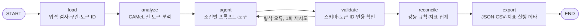

# Tashkeel Check — 프로젝트 계획 및 진행 기록

- 프로젝트/레포 이름: `tashkeel-check`
- 마지막 업데이트: 2026-10-20
- 현재 단계: 단계 1 구현 완료, 실험(EXP-001·002) 미실행. 사우디 시장 조사(가격·고객 수), 사업성 검토 사우디 기준 재계산, 수요·공급·경쟁 조사 완료
- 문서 역할: 현재 계획, 진행 상황, 실험, ADR, 트러블슈팅을 관리하는 작업용 기준 문서. 외부용 소개는 `README.md`, 사업 근거는 `사업성 검토 아랍어 문서 검증 도구.md`, 시장 조사 기록은 `docs/market/`에 있다.

> **작업을 시작하기 전에 이 문서를 읽는다. 작업 중 계획·범위·구조·데이터·평가 방식이 바뀌면 해당 본문을 최신 상태로 수정하고, 변경 이력에 이유와 영향을 기록한다. 중요한 기술적 결정은 ADR에, 문제와 해결 과정은 트러블슈팅에, 측정 결과는 실험 기록에 남긴다. 작업을 마칠 때 체크리스트와 다음 작업을 갱신한다.**
>
> 완료 여부는 실제 구현·실행·확인 결과를 기준으로 쓴다. 실행하지 않은 실험이나 검증을 완료했다고 기록하지 않는다.

### 근거 표기

| 표시 | 뜻 |
| --- | --- |
| [확인] | 이 프로젝트에서 직접 실행하거나 조회한 결과 |
| [문헌○] | 조사로 확인한 외부 자료. 인용 전에 원문을 다시 확인한다 |
| [제안] | 아직 확정·검증하지 않은 설계안이나 수치 |
| [가설] | 실험으로 확인할 추정 |
| [미확인] | 아직 모르는 값 |

## 1. 정의와 목표

> **정의:** 아랍어를 못 읽는데 아랍어 문서에 책임을 지는 사람을 위한 검수 도구. 아랍어 → 영어 번역에서 독법이나 표기가 갈리는 구간, 특히 고유명사와 짧은 필드를 드러내고, 근거 없이 확정하지 않는다.

번역기가 아니다. 제품이 약속하는 것은 "정확한 번역"이 아니라 "모호 구간을 얼마나 잡아내는가"다. 사업 판단과 시장·경제성 추산은 `사업성 검토 아랍어 문서 검증 도구.md`에 있다.

### 1.1 해결하려는 문제

- 아랍어는 단모음을 생략해서 같은 철자에 여러 독법이 생긴다. 문맥이 있는 본문은 최신 LLM이 대부분 풀 것으로 본다 [가설, 미측정]. 문맥으로 풀리지 않는 곳은 인명·회사명·지명과 표의 셀, 서명란 같은 짧은 필드다.
- 서류의 이름 표기는 신분증과 맞아야 한다. ADGM 공증 안내는 위임장의 이름을 UAE 거주자는 Emirates ID, 비거주자는 여권에 적힌 대로 쓰라고 한다 [문헌○]. 표기는 아랍어 실력이 아니라 외부 근거로 확정된다.
- 같은 아랍어 이름이 여러 로마자로 쓰인다. Wikidata에서 سعيد رشيد القبيسي의 레이블은 "Saeed Rashid Al Qubaisi", 별칭은 "Saeed Rashed Al-Qubaisi"다 [확인]. 아랍어 이름을 음성 전사 방식으로 옮기는 관행이 제각각이라 데이터베이스 간 이름 대조에 혼란이 생긴다는 ICAO 자료가 있다 [문헌○].
- 번역하는 LLM은 모호한 곳을 표시하지 않고 하나로 정해 넘길 수 있다 [가설, 질문 Q1]. 이 프로젝트는 이것을 "모호성 은폐"라 부른다. 의도적 조작이 아니라 specification gaming의 한 형태다. 읽는 사람은 아랍어를 모르니 그 선택이 있었다는 사실조차 알 수 없다.

### 1.2 단계 1에서 답할 질문

| ID | 질문 | 데이터 | 실험 |
| --- | --- | --- | --- |
| Q0 | 형태소 분석기가 실제 걸프 인명에서 독법 후보를 얼마나 내는가, 그 후보가 실제 영문 표기를 포함하는가 | 실제(Wikidata) | EXP-001 |
| Q1 | 에이전트가 정말 말없이 찍는가 | 합성 문서 | EXP-002 C0 |
| Q2 | "모호하면 표시하라"는 지시만으로 해결되는가 | 합성 문서 | EXP-002 C1 대 C0 |
| Q3 | 형태소 분석기를 주면 더 잡는가 | 합성 문서 | EXP-002 C2·C3 대 C1 |

어느 질문도 답을 가정하지 않는다. Q0의 결과가 Q3의 해석을 좌우한다. 분석기가 이름에서 후보를 거의 못 내면 C2·C3의 이득은 일반 단어에서만 나올 수 있다.

## 2. 전체 계획에서의 위치

원칙: **기능은 적게, 측정은 많이.** 단계 1의 단일 에이전트는 제품 시제품이 아니라 1.2절 질문에 답하는 실험 장치이고, 단계 3에서 멀티 에이전트 구조를 정당화할 때 비교 대상이 되는 베이스라인이다.

| 단계 | 내용 | 사업 검증 순서와의 관계 |
| --- | --- | --- |
| 1 (지금) | Q0 실측 + 단일 에이전트 실험 장치(조건 C0~C3) | 사전 감사에서 쓸 측정 도구. 사전 감사의 "고유명사 후보 열거 성공률"을 고객 문서 없이 먼저 잰다 |
| 2 | 묶음 내 서류 검색, 이름 사전, 사람 검토 | 무료 진단에서 실제 서류 묶음이 들어온 뒤 |
| 3 | 멀티 에이전트(번역자 / 격리된 검증자 / 중재자)를 단계 1과 같은 지표로 비교 | 단계 2 이후 |
| 별도 | 문자 인식(스캔본) 오류 측정 | 모음 기인 오류와 섞이지 않게 따로 |

사업 검증 순서(인터뷰 → 중단 임계값 기록 → 사전 감사 → 가치 제안 확정 → 무료 진단 → 해외 경로)는 사업성 검토 문서 "다음 순서"를 따른다.

## 3. 범위

### 단계 1에 넣는 것

- **입력:** 텍스트가 살아 있는 아랍어 문서(구간 단위로 나눌 수 있는 일반 텍스트). 스캔본은 뺀다. 문자 인식 오류가 섞이면 틀린 원인이 모음인지 인식인지 구분할 수 없다.
- **에이전트가 하는 일:**
  1. 아랍어 → 영어 번역
  2. 독법이 갈리는 구간마다 후보, 채택한 독법, 이유, 확신도를 내거나 기권
  3. 고유명사마다 로마자 후보, 채택 표기, 근거를 내고, 근거가 없으면 보류
- **도구:** 형태소 분석기(CAMeL Tools) 하나
- **측정:** 6절 지표 전부를 실행마다 기록

### 단계 1에서 뺀 것

필요해 보여도 추가하지 않는다.

- 스캔 PDF와 문자 인식
- 묶음 내 서류 검색, RAG, 벡터 DB. 같은 사람이 나오는 서류 묶음이 있어야 시험할 수 있는데 공개 자료로는 구하기 어렵다(ADR-003)
- 이름 사전(고객별 확정 표기 저장)
- 사람 검토를 위한 중단·재개(LangGraph interrupt). 보류 목록은 결과 파일로만 낸다
- 웹 화면, 인증·보안, 한글 표기, 멀티 에이전트
- 번역 문장 품질 평가

### 정한 것 (2026-10-13, 사용자 확정)

- LLM: OpenAI. 기본 모델 `openai:gpt-6.1-sol`, `.env`의 `MODEL`로 바꾼다(ADR-006)
- EXP-001 판단 기준: M5(방언 허용) 50%
- 고확신 무근거 확정 기준: 확신도 0.8
- EXP-002 규모: 평가 문서 30개 × 반복 3회(개발 문서 10개는 디버깅용)
- RAG·벡터 DB: 단계 2용 틀만 만들고 단계 1 조건에는 붙이지 않는다(ADR-007)

### 아직 정하지 않은 것

- `temperature` 지원 여부(모델이 지원하면 0으로 둔다. 확인 전이라 기본값은 보내지 않음)

## 4. 시스템 구조

### 4.1 설계 원칙

| 원칙 | 이유 |
| --- | --- |
| 분석기는 모든 조건에서 항상 실행하고, 조건은 LLM에게 보여 주는 방식만 바꾼다 | 측정이 LLM의 호출 여부에 따라 달라지면 조건을 비교할 수 없다 |
| 처분 누락 확인과 지표 계산은 코드가 한다 | LLM에게 자기 누락을 세게 하면 같은 실패가 한 단계 뒤에서 반복된다 |
| LLM은 대상을 토큰 ID로 지목한다 | 아랍어 문자열을 다시 쓰면 함자 하나만 달라도 토큰과 맞춰지지 않아 가짜 누락이 생긴다 |
| 고유명사는 근거 없이 확정하지 않는다 | "가장 흔한 표기"는 근거가 아니다. 단계 1에서 유효한 근거는 같은 문서 안의 라틴 문자 표기뿐이다 |
| 인용은 코드가 원문과 대조한다 | 구조화 출력은 형식이 맞아도 사실 검증이 필요하다(참고 사이트 개념 사전) |
| 조건 사이에서 한 번에 하나만 바꾼다 | 여러 요소를 한꺼번에 바꾸면 무엇이 효과를 냈는지 모른다(참고 사이트 LangSmith 실패 사례) |
| LLM이 필요 없는 검증·계산은 일반 함수로 둔다 | 모든 노드를 agent로 만들 필요는 없다(참고 사이트 LangGraph 실무 사례) |
| 분석기를 설치하지 못하면 LLM으로 대체하지 않고 멈춘다 | 분석기가 LLM과 독립된 신호라는 점이 Q3의 전제다 |

참고 사이트: [ai-flow-learning-lab](https://ai-flow-learning-lab.vercel.app/). 단계 1은 그중 01 기본 체인(C0), 05 조건 분기와 반복(그래프), 06 Agent·Tool(C2), LangSmith 관찰·실험 비교를 쓴다. 02~04(RAG, Vector DB, Parent–Child)는 단계 2의 묶음 검색, 06의 사람 승인은 단계 2의 사람 검토, 07(Multi-Agent)은 단계 3에서 쓴다.

### 4.2 그래프



| 노드 | 하는 일 | LLM |
| --- | --- | --- |
| load | 유니코드 NFC, 원문 보존, 구간 분할, 토큰 ID 부여, 라틴 문자 구간 표시 | 없음 |
| analyze | 모든 아랍어 토큰을 분석. 토큰별 분석 수(0 포함), 후보(모음 표기, 로마자, lemma, 품사, 뜻), 모호 여부, noun_prop 분석 여부를 저장 | 없음 |
| agent | 조건별 동작(4.4절) | 있음 |
| validate | 스키마 검사, 토큰 ID 실재 확인, 인용 문자열이 원문에 있는지 확인. 형식 오류면 1회 재시도(`MAX_RETRIES = 1`), 그래프에 `recursion_limit` 설정 | 없음 |
| reconcile | 강등 규칙(4.5절) 적용, 6절 지표 계산 | 없음 |
| export | 구간별 결과 JSON, 고유명사 대조표 CSV, 지표 JSON, 실행 메타 저장 | 없음 |

**모호 판정 규칙(analyze) [제안, EXP-001 전에 고정]:** 격어미와 탄윈을 뺀 모음 표기가 서로 다른 후보가 둘 이상이면 모호로 본다. 격어미만 달라도 표기가 갈리므로 원시 분석 수로 판정하면 본문 명사 대부분이 모호로 잡힐 것으로 본다 [가설]. 원시 분석 수는 따로 기록한다.

### 4.3 산출물 형식

- `segments.json`: 구간마다 아랍어 원문, 영어 번역, 항목 목록
- `proper_nouns.csv`: 아랍어 원문, 토큰 ID, 로마자 후보와 후보 출처(analyzer / llm), 채택 표기, 처분, 근거 위치, 분석기 분석 수
- `metrics.json`: 6절 지표
- `run_meta.json`: 조건, 모델 ID와 버전, 프롬프트 해시, 문서 ID, seed, 분석기·DB 버전, 토큰 사용량, 실행 시간

### 4.4 실험 조건

같은 문서, 같은 모델, 같은 설정(지원하면 temperature 0)으로 돌린다. 평가 문서 30개를 문서마다 3회 반복한다 [확정].

| 조건 | LLM에 주는 것 | 출력 | 직전 조건 대비 바뀐 것 | 답하는 질문 |
| --- | --- | --- | --- | --- |
| C0 기본 번역 | "영어로 번역하라" | 자유 텍스트 | — | Q1 |
| C1 지시 | C0 + 처분 규칙 지시 | 구조화 출력(4.5절) | 지시와 출력 형식 | Q2 |
| C2 지시 + 도구 | C1 + `analyze_tokens` 툴(호출 여부는 LLM이 정함) | 구조화 출력 | 도구 | Q3 |
| C3 지시 + 결과 주입 | C1 + analyze 결과를 프롬프트에 항상 포함 | 구조화 출력 | 도구 대신 결과 주입 | Q3 보조 |

- C0는 참고 사이트 01 기본 체인(`prompt | model | parser`)으로, C1~C3는 골격의 `create_agent`(`response_format` 사용)로 만든다.
- C0 → C1은 지시와 출력 형식을 함께 바꾼다. 구조화 출력이 없으면 처분을 셀 수 없기 때문이다. 이 점을 한계로 기록한다.
- C3는 "도구를 주는 것"과 "결과가 항상 보이는 것"의 차이를 본다. 탐지를 LLM 판단에 맡기면 모호성 은폐가 한 단계 앞에서 반복될 수 있다는 가설을 확인한다.

### 4.5 출력 스키마와 강등 규칙 (C1~C3)

```json
{
  "translation": [{"segment_id": "s03", "english": "..."}],
  "items": [{
    "token_ids": [41, 42],
    "type": "proper_noun",
    "candidates": [{"reading": "مُسَلَّم", "romanized": "Musallam", "source": "analyzer"}],
    "decision": "hold",
    "adopted": null,
    "reason": "...",
    "confidence": 0.4,
    "evidence": null
  }]
}
```

| 유형 | 허용 처분 |
| --- | --- |
| 일반 단어 (`word`) | 채택(`adopt`, 이유·확신도 필수) / 기권(`abstain`) |
| 고유명사 (`proper_noun`) | 근거 채택(`evidence_adopt`, `evidence`에 구간 ID와 인용 필수) / 보류(`hold`, 후보 나열) |

reconcile이 코드로 적용하는 규칙:

- 고유명사에 근거 없이 `adopt`를 쓰면 "근거 없는 확정"으로 센다. 보류로 바꿔 주지 않는다. 실패를 지우지 않기 위해서다.
- `evidence_adopt`의 인용이 원문에 없거나 채택 표기와 맞지 않으면 보류로 내리고 "근거 검증 실패"로 센다.
- 존재하지 않는 토큰 ID를 가리키는 항목은 무효 항목으로 센다.
- 정답 고유명사와 분석기 모호 토큰 가운데 어느 항목에도 덮이지 않은 것은 "미처리"로 결과에 넣고 센다.
- LLM이 말한 확신도는 기록만 하고 판정에 쓰지 않는다.

### 4.6 툴 (단계 1)

LLM이 호출하는 툴은 하나다. 나머지는 노드 안의 일반 함수다. 단계 2용 `search_bundle`은 틀만 있고 꺼져 있다(ADR-007). 상세는 [docs/툴-설계.md](docs/툴-설계.md).

| 이름 | 입력 | 출력 | 호출 시점 | 실패 시 |
| --- | --- | --- | --- | --- |
| `analyze_tokens` | `token_ids: list[int]` | 토큰마다 `token_id`, `surface`, `analysis_count`, `candidates[{diac, romanized, lemma, pos, gloss}]`, `ambiguous` | C2에서 LLM이 정함 | 없는 ID는 해당 ID에 오류 항목을 돌려준다. 분석기 예외는 오류 결과로 돌려주고 툴 로그에 남긴다. LLM 추정으로 대신 채우지 않는다 |

일반 함수: 정규화, 토큰화, `romanize`(모음 표기 아랍어 → ASCII 로마자), `match_spelling`(표기 일치 판정, 정규화 규칙을 EXP-001 개발용 표본에서 고친 뒤 고정), 강등 규칙, 지표 계산.

툴 설계 문서에는 툴마다 이름, 입력과 출력 스키마, 호출 시점, 실패했을 때의 동작을 적는다.

### 4.7 기술 스택

코드 골격은 `~/Documents/skala_langgraph`의 노트북을 따른다 [확인].

| 구성 | 골격에서 확인한 방식 | 단계 1에서 쓰는 방식 |
| --- | --- | --- |
| 모델 | `init_chat_model("<provider>:<model>")`. 노트북마다 Gemini, OpenAI를 씀 | `init_chat_model("openai:gpt-6.1-sol")`. 모델 문자열은 `.env`의 `MODEL`(ADR-006) |
| Agent | `create_agent(model, tools, system_prompt, response_format)` | C1~C3 |
| 그래프 | `StateGraph(TypedDict)`, `add_edge`, `add_conditional_edges`, `draw_mermaid` | 4.2절 그래프 |
| 체인 | `prompt | model | StrOutputParser()` | C0 |
| 추적 | `@traceable`, `.env`의 `LANGSMITH_API_KEY`·`LANGSMITH_TRACING`·`LANGSMITH_PROJECT` | 실행마다 6.3절 메타데이터. 키가 없으면 추적만 꺼지고 나머지는 동작 |
| 키 없을 때 | 연습 모드(가짜 모델) | 가짜 모델(스크립트된 tool call)로 그래프와 reconcile 테스트. 실제 실험은 키가 필요 |
| 벡터 DB | Qdrant 메모리 모드, `langchain_qdrant` | 단계 2 틀(`rag/bundle.py`)에만 쓴다. 단계 1 조건에는 붙이지 않음(ADR-003, ADR-007) |

- Python 3.11 이상(camel-tools 1.6.0 요구 사항), uv, pytest.
- CAMeL Tools 1.6.0과 기본 형태소 DB calima-msa-r13. DB는 `camel_data`로 내려받는다. 패키지 이름은 공식 문서에서 확인한다.
- calima-msa-r13은 GPL v2다(ADR-005). README에 적는다.

### 4.8 저장소 구조 [확인, 2026-10-13 구현]

계획 초안의 `scripts/`는 CLI 하위 명령(`uv run tashkeel <명령>`)으로 바꿨다.

```text
pyproject.toml, uv.lock      Python 3.11, uv
.env.example                 골격 .env와 같은 키 이름 + MODEL, 판단 기준, 실험 규모
src/tashkeel_check/
  config.py                  설정, 조건, LangSmith 켜짐 여부
  text.py                    정규화, 구간·토큰 ID
  analyzer.py                CAMeL 래퍼, 격어미 제거, 모호 판정
  romanize.py                romanize, match_spelling (v0)
  schemas.py                 구조화 출력 AgentOutput
  prompts.py                 C0~C3 프롬프트
  tools.py                   analyze_tokens
  fake.py                    가짜 모델(연습 모드, 테스트)
  graph.py                   StateGraph
  reconcile.py               강등 규칙, 지표
  export.py                  JSON·CSV·run_meta
  runner.py                  문서 1개 실행, LangSmith 메타데이터
  cli.py                     run / fetch-wikidata / make-synthetic / bundle-search / exp001 / exp002
  data/                      names.py(이름 정렬), wikidata.py, synthetic.py
  experiments/               exp001.py, exp002.py
  rag/                       bundle.py (단계 2 틀)
data/wikidata/  data/synthetic/{dev,eval}/  data/bundles/sample/
results/                     평가 실행 결과는 보존, results/debug/는 git 제외
tests/
docs/                        요구사항-분석.md, 아키텍처-설계.md, 툴-설계.md, experiments/
```

주요 명령:

| 명령 | 하는 일 |
| --- | --- |
| `uv run tashkeel run --doc data/synthetic/dev/dev_001.json --condition all --fake` | 문서 1개를 C0~C3로 실행(연습 모드), `results/debug/`에 JSON·CSV |
| `uv run tashkeel run --doc ... --condition C2` | 실제 OpenAI 모델로 실행(키 필요) |
| `uv run tashkeel fetch-wikidata` | Wikidata 스냅숏과 이름 풀 |
| `uv run tashkeel make-synthetic` | 합성 문서 dev 10개·eval 30개와 샘플 묶음 |
| `uv run tashkeel exp001 --split dev` | EXP-001 |
| `uv run tashkeel exp002 --split eval --yes` | EXP-002(360회, 비용 발생) |
| `uv run pytest` | 테스트(실제 LLM 테스트는 `live` 마커, 키가 없으면 건너뜀) |

## 5. 데이터

### 5.1 실제 데이터: Wikidata 걸프 인명

| 항목 | 내용 |
| --- | --- |
| 조회 | SPARQL. 국적(P27)이 UAE·사우디·카타르·쿠웨이트·바레인·오만인 사람(Q5) 가운데 아랍어와 영어 레이블이 모두 있는 항목 |
| 규모 [확인, 2026-10-13] | 공식 WDQS 개수 조회 7,683개(그중 영어 별칭 있는 항목 3,304개). 저장한 스냅숏은 QLever 미러에서 받은 7,678개(별칭 있는 항목 3,303개). 미러의 갱신 시차로 보인다 [가설] |
| 스냅숏 [확인] | `data/wikidata/gcc_persons.json`(조회 2026-10-13T06:03Z, 엔드포인트 `https://qlever.dev/api/wikidata`), 쿼리 `query.rq`. 공식 WDQS가 요청 제한(TS-002)으로 받지 못해 같은 Wikidata 데이터를 QLever 미러로 받았다. `tashkeel fetch-wikidata --endpoint wdqs`로 공식 엔드포인트에서 다시 받을 수 있다 |
| 이름 풀 [확인] | `data/wikidata/name_tokens.json`. 레이블 정렬 성공 5,613명, 실패 2,065명. 이름 단위 3,338개 |
| 이용 조건 | Wikidata 구조화 데이터는 CC0 [문헌○] |
| 용도 | EXP-001(Q0 실측), 합성 문서의 이름 토큰 풀 |
| 재현 | 쿼리 파일, 조회 날짜, 엔드포인트, 결과 스냅숏을 `data/wikidata/`에 저장. 나라별 원자료는 `raw/`에 캐시(git 제외) |

**정렬 규칙 v0의 거르기 [확인, 구현]:** 별칭이 부분 이름이면 단위 수만 같고 엉뚱한 짝이 생긴다(예: الصباح ↔ "al Ahmad"). 그래서 이름 단위마다 영문 첫 글자가 아랍어 첫 글자(관사 뒤)와 대응해야 하고, 영문 표기는 두 글자 이상의 ASCII여야 한다. ASCII 조건은 여권 MRZ가 A~Z만 쓴다는 ICAO 자료를 따랐다 [문헌○]. 학술 음역("Makabūla")과 머리글자("M")는 이 조건으로 빠진다. 이 거르기가 EXP-001 결과에 주는 영향은 dev 표본에서 확인한다.

주의:

- 공개 인물(왕족, 관료, 운동선수 등) 위주라 일반 고객 서류의 이름 분포와 다를 수 있다 [가설].
- 레이블이 그 사람의 여권 표기라는 보장은 없다. "실제로 쓰이는 영문 표기"로만 쓴다.
- 레이블에 직함("H.E. Dr")이나 설명("of Dubai")이 섞여 있다 [확인]. 정규화로 걷어 내고, 걷어 내지 못한 쌍은 정렬 실패로 센다.
- 회사명 조회는 하위 클래스를 따라가는 쿼리가 시간 초과(HTTP 504)로 실패했다 [확인]. 단순한 쿼리로 다시 시도하고, 안 되면 단계 1에서 뺀다.
- 개발용 표본(고정 seed, 토큰 300개 [제안])으로 정규화·정렬·`match_spelling` 규칙을 고친 뒤 고정하고, 나머지로 한 번만 측정한다.

### 5.2 합성 문서: 실제 업무 규칙 기반

합성 문서는 아래 규칙만 반영한다. 출처가 없는 서식은 지어내지 않는다.

| ID | 규칙 | 출처 |
| --- | --- | --- |
| R1 | 위임장은 아랍어 또는 아랍어·영어 이중 언어로 쓰고, 분쟁 시 아랍어본이 우선한다 | [Virtuzone](https://virtuzone.com/blog/poa/), [ADGM 공증 FAQ](https://assets.adgm.com/download/assets/ADGM+Notary+Public+-+FAQs+23122024.pdf/295b27ce45cc11efb265024ee1b41222) [문헌○] |
| R2 | 위임인·대리인의 이름은 Emirates ID(거주자) 또는 여권(비거주자) 표기와 같아야 한다 | ADGM 공증 FAQ [문헌○] |
| R3 | 법인이 당사자면 상업 면허상의 상호, 법인 형태, 면허 발급 기관, 등록 번호, 주소와 서명자의 국적·신분증 번호·자격을 적는다 | ADGM 공증 FAQ [문헌○] |
| R4 | 걸프 인명은 이름 + بن/بنت + 아버지 이름 (+ 할아버지 이름) + 가문명(주로 ال 접두) 구조가 흔하다 | Wikidata 레이블 예: راشد بن حميد النعيمي [확인] |
| R5 | 같은 아랍어 이름에 영문 표기가 여럿 있다 | Wikidata 별칭 [확인], [ICAO 관련 자료](https://platform.keesingtechnologies.com/transliteration-of-arabic-in-mrtds/) [문헌○] |

- 상업 면허 인쇄 서식(필드 배치, 번호 형식)은 출처를 찾지 못했다 [미확인]. R3에 나온 필드만 쓴다.
- **생성:** 결정적 스크립트(seed 고정)가 템플릿에 5.1절 이름 토큰을 조합해 넣는다. 조합한 전체 이름이 Wikidata 레이블과 같으면 버린다. 실존 인물은 들어가지 않는다.
- **문서 유형:** 위임장(개인 위임인 → 대리인, 회사 관련 권한), 법인 당사자 정보가 들어간 확인서.
- **근거 유무:** 일부 문서는 이중 언어로 만들어 영문 이름 필드를 넣는다(문서 안 근거). 나머지는 아랍어만.
- **정답 라벨:** 생성기가 함께 낸다. 이름 토큰 ID, 문서 안 근거 유무와 위치, Wikidata상 영문 표기 수, 분석기 모호 여부.
- **표시:** 파일 머리와 메타데이터에 합성 데이터임을 적는다.
- **분할:** 개발용(프롬프트 디버깅, seed 1001)과 평가용(seed 2002)을 다른 seed로 만든다. 평가용은 조건 비교에 한 번만 쓴다. 개발 10개, 평가 30개 문서 [확정].
- **이중 언어 비율:** 문서의 약 50%를 이중 언어로 만든다 [제안, 생성기 설정값].
- **한계:** 템플릿의 아랍어 문장은 사람이 검수하지 않는다(팀 내 아랍어 검수자 [미확인]). 측정 대상이 이름이라 문장 오류의 영향은 제한적이라고 본다 [가설]. 결과는 "합성 문서 기준"으로만 보고하고 실제 서류 성능으로 일반화하지 않는다.

## 6. 측정

### 6.1 EXP-001 — Q0: 분석기가 고유명사에서 내는 후보 (실제 데이터)

- **단위:** 정렬된 (아랍어 토큰, 실제 영문 표기 집합) 고유 쌍
- **정렬 규칙 [제안]:** بن/بنت ↔ bin/bint, ال+X ↔ Al X / Al-X / AlX / El X, عبد + X ↔ Abdul X / Abdel X / 붙여 쓴 형태. 정렬하지 못한 이름은 빼고 개수를 보고한다.

| 지표 | 정의 |
| --- | --- |
| M1 | 분석이 0개인 토큰의 비율 |
| M2 | 토큰당 분석 수 분포 (0 / 1 / 2~5 / 6 이상) |
| M3 | 모호 판정 규칙(4.2절)으로 모호인 토큰의 비율 |
| M4 | noun_prop 분석이 하나라도 있는 토큰의 비율 |
| M5 | 분석기 후보의 로마자 가운데 하나라도 실제 영문 표기와 일치하는 토큰의 비율. 엄격 일치와, 걸프 방언 대응(ق ↔ g)을 허용한 일치를 따로 낸다 |
| M6 | 아랍어 토큰당 실제 영문 표기 수 분포와 2개 이상인 비율 |

- 이름 위치(이름 / 아버지 이름 / 가문명)별, 빈도 상위·하위별로 나눠 본다.
- 가설: 가문명(ال 접두)은 분석기 사전에 없는 경우가 많다 [가설]. 걸프 방언 발음을 따른 표기(예: القرق → Gurg)는 표준 아랍어 분석기 후보에 없다 [가설].
- 판단 [확정, 2026-10-13 사용자]: M5(방언 허용)가 50% 미만이면 분석기를 이름 독법의 근거로 쓰지 않고 일반 단어 탐지기로만 쓴다. 이름은 LLM 추출과 외부 근거(단계 2)에 의존한다고 계획에 적는다.

### 6.2 EXP-002 — Q1~Q3: 조건 비교 (합성 문서)

**정답 기준:** 고유명사가 나올 때마다, 문서 안 근거가 있으면 기대 처분은 근거 채택(인용 포함), 없으면 보류다. 일반 단어의 정답 독법은 아랍어 검수자 없이 정할 수 없으므로 처리 여부만 센다.

| 지표 | 정의 | 조건 |
| --- | --- | --- |
| 말없이 찍음 비율 (주 지표) | 근거 없는 고유명사 가운데 표시도 보류도 없이 하나로 옮긴 비율 | C0~C3 |
| 근거 없는 확정 비율 | 항목은 냈지만 근거 없이 `adopt`한 비율 | C1~C3 |
| 보류율 | 근거 없는 고유명사 가운데 보류한 비율 | C1~C3 |
| 근거 채택 검증 통과율, 근거 검증 실패 수 | 문서 안 근거가 있는 고유명사에서 | C1~C3 |
| 미처리 수 | 정답 고유명사와 분석기 모호 토큰 가운데 처분이 없는 것 | C1~C3 |
| 과잉 표시 수 | 고유명사도 분석기 모호 토큰도 아닌 토큰에 붙은 항목 | C1~C3 |
| 고확신 무근거 확정 수 | 확신도 0.8 이상 [확정]으로 근거 없이 확정한 고유명사 | C1~C3 |
| 문서 내 표기 불일치 수 | 같은 정규화 아랍어 이름이 서로 다른 표기로 옮겨진 경우 | C0~C3 |
| 도구 사용 | 호출 수, 모호 토큰 중 조회된 비율, 조회한 토큰 중 모호 토큰 비율 | C2 |
| 비용·지연 | 입력·출력 토큰, 실행 시간, 문서당 | 전체 |
| 반복 간 일치율 | 같은 문서 3회 실행의 처분 일치 | 전체 |

- **C0 판정 규칙 [제안, 실행 전 고정]:** 번역문에 그 이름의 후보 표기가 둘 이상 나오거나 불확실 표시("[?]", "or", "/" 등)가 붙어 있으면 표시한 것으로 본다. 후보 표기는 분석기 로마자와 Wikidata 표기의 합집합이다. 자동 판정 결과 20건을 사람이 확인한다.
- **분해:** Wikidata 표기가 2개 이상인 이름과 1개인 이름, 분석기 분석이 0개인 이름과 1개 이상인 이름을 나눠 본다.
- **보고:** 조건별 값과 반복 간 범위를 함께 낸다. 표본이 작으면 그렇게 적는다. 문서 단위 부트스트랩 구간 [제안].
- **해석:** Q1은 C0의 말없이 찍음 비율, Q2는 C1 대 C0, Q3는 C2·C3 대 C1이다. 전부 보류해서 지표를 맞추는 경우는 과잉 표시 수로 드러난다.

### 6.3 실행마다 기록할 것

LangSmith 메타데이터와 로컬 `run_meta.json`에 같은 값을 남긴다: 조건, 모델 ID·버전, 프롬프트 해시, 문서 ID, seed, 분석기·DB 버전, 탐지 후보 수, 처분별 개수, 미처리 수, 분석기가 후보를 못 낸 고유명사 수, 툴 호출 수, 토큰 사용량, 실행 시간. LangSmith 키가 있으면 평가용 문서를 Dataset으로, 조건별 실행을 Experiment로 묶는다.

## 7. 산출물과 문서 규칙

| 산출물 | 내용 |
| --- | --- |
| `docs/요구사항-분석.md` | 기능 요구사항, 비기능 요구사항, 범위 밖 항목. 요구사항마다 충족하는 노드나 툴을 연결 |
| `docs/아키텍처-설계.md` | 4절 요약, mermaid 그래프, 조건 C0~C3 |
| `docs/툴-설계.md` | 툴마다 이름, 입력·출력 스키마, 호출 시점, 실패 시 동작. 일반 함수의 정규화·일치 규칙 |
| `docs/experiments/EXP-001.md`, `EXP-002.md` | 12절 형식의 실험 기록 |
| `docs/market/` | 시장 조사 기록(가격·고객 수, 긍정 근거), 출처 목록(`sources.csv`), 사업성 검토 경제성 재계산 스크립트(`recalc_economics.py`, 긍정 근거 시나리오 `recalc_upside.py`, 수요·공급 계산 `recalc_demand_supply.py`). 수요·공급·경쟁 보고서는 `reports/`, 그 조사 노트 다섯 갈래는 `research_notes/`에 있다. 사업성 검토의 가정을 출처 있는 값으로 바꾸는 근거 |
| 코드·데이터·테스트 | 명령 한 줄로 EXP-001, 명령 한 줄로 합성 문서 1개 실행(JSON·CSV 출력) |

문서는 과제 보고서에 들어가므로 각각 한두 쪽으로 짧게, 결론부터 쓴다. 구현하다 설계가 바뀌면 문서도 같이 고친다.

문서 표현 규칙:

- "번역기 정확도가 떨어진다"는 일반 주장은 쓰지 않는다.
- "reward hacking" 대신 "모호성 은폐(specification gaming의 한 형태)"라고 쓴다.
- 제품이 약속하는 것은 "모호 구간을 얼마나 잡아내는가"다.
- 확인한 사실과 가정을 구분하고, 출처 없는 수치는 만들지 않는다.
- 합성 문서 결과를 실제 서류의 오류율이나 포착률로 쓰지 않는다.

테스트:

- analyze, reconcile, romanize, match_spelling은 LLM 없이 도는 단위 테스트를 둔다.
- 그래프 전체는 가짜 모델(스크립트된 tool call)로 결정적 테스트를 둔다. 강등 규칙, 미처리 집계, 인용 검증, 토큰 ID 검증을 확인한다.
- 실제 LLM이 필요한 테스트는 pytest 마커(`live`)로 분리한다. 번역 문장이 아니라 처분 종류, 근거 유무, 미처리 수 같은 구조만 확인한다.

## 8. 단계별 체크리스트

### 단계 1 — 실험 장치 (우선순위 순)

- [x] uv 환경(Python 3.11), camel-tools 1.6.0 설치, calima-msa-r13 내려받기 (2026-10-13)
- [x] Wikidata 조회 코드와 스냅숏 (QLever 미러, TS-002)
- [x] 정규화, 토큰 ID, romanize, match_spelling과 단위 테스트
- [ ] EXP-001 개발용 표본으로 규칙 고정 → 나머지로 측정 → 실험 기록. 코드와 사전 등록은 끝, **실행하지 않음**(2026-10-13 사용자 지시)
- [x] 합성 문서 생성기와 정답 라벨(dev 10개 seed 1001, eval 30개 seed 2002)
- [x] 그래프(load → analyze → agent → validate → reconcile → export)와 조건 C0~C3, OpenAI 연결
- [x] 가짜 모델 결정적 테스트, analyze·reconcile 단위 테스트 (50개 통과, live 1개는 키가 없어 건너뜀)
- [x] 문서 3종: [요구사항 분석](docs/요구사항-분석.md), [아키텍처 설계](docs/아키텍처-설계.md), [툴 설계](docs/툴-설계.md)
- [x] 단계 2 틀: 묶음 검색(RAG·벡터 DB), 꺼짐(ADR-007)
- [ ] EXP-002 실행·기록. 코드와 사전 등록은 끝, **실행하지 않음**(사용자 지시, API 키 없음)

### 단계 2 — 실제 서류 묶음 (무료 진단 이후)

- [ ] 묶음 내 서류 검색 툴: 아랍어 철자 정확 일치로 이중 언어 필드 찾기, 로마자 유사 일치, 필요하면 벡터 검색
- [ ] 이름 사전(정규화 아랍어 키, 정확 일치, 사람이 확정한 뒤 별도 명령으로 기록)
- [ ] 보류 항목의 사람 검토(interrupt)
- [ ] 실제 서류에서 EXP-002 지표 재측정

### 단계 3 — 멀티 에이전트 비교

- [ ] 번역자 / 격리된 검증자 / 중재자 구조를 같은 데이터·지표로 단계 1과 비교

## 9. 현재 상태와 다음 작업

### 완료 (2026-10-20): 수요·공급·경쟁 조사

[docs/market/reports/아랍어 문서 검수 수요 공급 분석.md](docs/market/reports/아랍어%20문서%20검수%20수요%20공급%20분석.md), 계산 `docs/market/recalc_demand_supply.py`(저장소 밖에서 `python3 -I <경로>`로 실행, 기존 기본·바우처 시나리오를 assert로 재현), 출처 [sources.csv](docs/market/sources.csv)의 S110~S180. 사용자가 경쟁사 IR·공시, 컨설팅 리포트, 기사 스크랩으로 수요·경쟁·pain point와 공급(구현 시간·비용)을 계산하고 "이 프로젝트를 해야 하는 비즈니스적 이유"를 정리하라고 했다. 조사 노트 다섯 갈래는 `docs/market/research_notes/`에 있다.

- 이 도구 형태에 고객이 돈을 냈거나 내겠다는 직접 증거는 이번에도 0건이다. 한국 쪽 설문·기사·세미나는 언어를 상위 애로로 꼽지 않는다 [문헌○]
- 반면 아랍어 원문의 양과 법적 무게를 늘리는 사우디 규정은 늘었다: 근로계약 아랍어 우선, 2026-04-15부터 Qiwa 계약 기준 사우디화율, 2025-04-03 상호법, 2026년 영문 이름 수정 전자 서비스(Muqeem·Absher) [문헌○]
- 같은 일(이름 독법 후보 + 근거 + 보류)을 하는 제품은 검색 범위 안에서 0곳, 인접 제품은 43곳이다. 가장 그럴듯한 진입자는 HUMAIN의 투자를 받은 Arabic.AI(구 Tarjama)다 [문헌○]
- 상장사 선례: Straker의 단독 검증 제품 Verify는 반기 구독 증분 NZ$0.2m에 그쳐 플랫폼(arbitr)에 흡수되는 중이다. 고정 구독으로 파는 법률 AI(RELX Legal)는 기초 성장 10%다 [문헌○]
- 공급: 유료 파일럿까지 현금 약 299만 원(인건비 포함 약 4,465만 원), 사우디 외국계 기업 대상 엔터프라이즈 준비에 3.55억~4.15억 원과 6~12개월 [계산, 가정 포함]
- 새로 드러난 위험: 장당 공헌의 부호를 검수자 시급이 정한다. 사우디 기준 가격(4,873원)에서는 시급 약 31달러가 넘으면 장마다 적자다. 날짜 없는 ProZ 프로필의 시급(35~45달러)이면 바우처 흑자 조합도 5년 누적 −2.55억 원이 된다 [계산, 시급은 요약·근거 약함]
- 바우처 경로의 약한 고리: 관찰된 사우디 대상 통번역 바우처 이용은 연 약 4.8건이다(단일 조회). 바우처 손익분기 56곳의 1/12이다 [계산]
- 결론: 지금 수익 사업이라는 이유는 성립하지 않는다. 남는 이유는 (1) 결정적 검증 비용 약 230만 원이 기본 시나리오 필요 자금 8.28억 원의 0.28%라는 옵션 가치, (2) 아랍어 이름의 모호성 은폐를 재는 측정 자체의 연구·과제 가치다. 빈 틈새, 검증 계층으로의 이동, 바우처는 그 검증이 확인해 줘야 성립하는 가설이다. 상업 경로는 단독 SaaS보다 부품(API·OEM)일 가능성이 크다 [가설]

### 완료 (2026-10-16): 사우디 시장 조사 — 가격과 고객 수

[docs/market/사우디-가격-고객수-조사.md](docs/market/사우디-가격-고객수-조사.md), 출처 [sources.csv](docs/market/sources.csv). 범위는 사용자가 정했다: 가격과 고객 수만, 공개 자료와 공개 요약만, 사우디 기준.

- 사우디 공인 번역 공개 가격은 375단어 한 장 기준 중앙값 62.5리얄(약 2.4만 원)이다. 사업성 검토의 두바이 기준(150디르함, 약 6.0만 원)의 41%이고, 20% 규칙이면 장당 약 4,900원(−59%)이다 [문헌○, 업체 5곳]
- 한국 업체의 아랍어→한국어 번역료는 단어당 중앙값 230원으로 사우디 현지 아랍어↔영어의 3.5배다. 어느 쪽을 가격 기준으로 삼을지는 구매자와 출력 언어에 달려 있다 [문헌○, 12곳]
- 번역 단가는 하락 방향이고, 폭은 공개 자료에 없다 [문헌○]
- 사우디에 있는 한국 쪽 고객 후보는 70여 곳(KOTRA)~251곳(수출입은행 정상 법인, 재확인 필요)이다. 사업성 검토의 "1,000개사"는 이라크·이란을 포함한 7개국 수출 기업 수라 사우디 고객 수로 쓸 수 없다 [문헌○]
- 사우디 쪽 상한은 외국인 보유 상업등기 38,640건(2025년 2분기)이다. 아랍어권 투자자 비중이 커서 실제 대상은 더 적다 [문헌○ / 비율은 미확인]
- 사업성 검토를 사우디 기준으로 다시 계산했다(아래)

### 완료 (2026-10-16): 사업성 검토 사우디 기준 재계산

`사업성 검토 아랍어 문서 검증 도구.md`를 개정했다. 이전 판(UAE 기준)은 커밋 `ecff159`에 있다. 계산은 `docs/market/recalc_economics.py`로 재현한다.

계산 방식:

- 이전 판의 경제성 모델을 먼저 재현했다. 기본·비관·민감도·대학생 팀 수치는 재현됐다 [확인]
- 낙관 수치(+64.3억 원)는 재현되지 않았다. 같은 입력으로 계산하면 +71.4억 원이다 [확인]
- 재현된 방식에 사우디 값을 넣었다. 바꾼 값은 다음과 같다 [가정 포함]
  - 장당 가격 12.5리얄(4,873원)
  - 검수자 시급 41.7리얄(16,248원). 이전 판과 같은 환산 방식이다
  - 5년차 한국 고객 약 25곳. 후보 251곳에 10% 침투율을 적용했다

결과:

- 장당 공헌이익은 약 2,900원(60%)이다
- 손익분기는 고객 약 270곳이다. 사우디의 한국 쪽 후보 전체보다 많다
- 기본 시나리오는 5년 내내 적자다. 5년 누적은 약 −8.3억 원, NPV는 약 −3.1억 원이다
- 시나리오별 NPV는 비관 −3.3억 원, 낙관 +0.9억 원이다
- 5년 누적이 0이 되려면 장당 가격이 번역료의 73%(약 17,800원)이거나, 5년차 해외 고객이 약 1,100곳이어야 한다
- 대학생 팀 조건에서는 5년 누적이 약 +0.05억 원이다
- 참고 계산: 한국 본사가 한국어로 읽는다면 가격 기준이 국내 아랍어→한국어 번역료가 된다. 이때 손익분기는 약 71곳이다
- "1,000개사"를 바로잡았다. 산업통상부 2026-03-05 자료의 1,063개사로, 이라크·이란을 포함한 7개국 수출 기업이고 사우디만 센 수치는 없다

### 완료 (2026-10-16): 사업성 긍정 근거 조사

[docs/market/긍정-근거-조사.md](docs/market/긍정-근거-조사.md), 출처 [sources.csv](docs/market/sources.csv)의 S70~S107. 사용자가 "비즈니스적으로 조금이라도 의미가 있다는 근거"를 찾으라고 했다. 반대 증거도 같이 적었다.

- 문제는 있다. GPT-4o는 모음 없는 아랍어 고유명사의 모음 복원에서 아랍어만 주면 36.7~55.9%만 맞혔다. 이름 표기 차이로 법원 결정이 파기되거나 은행 거래가 막힌 공식 사례·규정이 있다 [문헌○]
- 같은 문제(아랍어 이름 변이)에 돈을 내는 이름 스크리닝 시장은 크다. 다만 은행·정부가 데이터와 엔진을 묶어 산다 [문헌○]
- 사우디 번역업 상업등기는 1년 새 20% 늘었고, 아랍어 특화 AI 번역사 Tarjama는 2025년 매출 2,000만 달러에 1,500만 달러를 투자받았다 [문헌○]
- 숫자를 흑자로 돌리는 조합이 하나 있다. 한국 중소 수출기업에 수출바우처(국고 70%)로 팔고, 5년차 한국 고객이 중동 수출기업 1만4천 곳의 약 1%(140곳)면 5년 누적 약 +3.8억 원, NPV 약 −0.2억 원이다. 손익분기는 56곳이다 [계산, 가정 포함]
- 그 조합의 전제는 모두 미확인이다: 도구가 바우처 통번역 메뉴("통·번역을 목적으로 하는 서비스")로 인정되는지, 아랍어 원문을 매달 받는 한국 기업이 그만큼 있는지, 한국 고객이 영어 출력을 받아들이는지. 한국어 검수가 필요하면 5년 누적이 다시 −0.5억 원이 된다 [미확인]
- 이 도구 형태에 돈을 낸다는 직접 증거는 없다. 가장 가까운 상장사 사례(Straker의 단독 검증 제품)는 채택이 예상보다 느렸고, "모호할 수 있다"고 지시만 해도 LLM의 모호성 인식이 빠르게 좋아졌다는 2026년 연구가 있다 [문헌○]
- 사업 판정은 바뀌지 않는다. 다음 확인의 순서가 바뀐다(아래 사업 쪽 다음 작업)
- 이전 조사에서 "찾지 못했다"고 쓴 헤럴드경제 2026-03-08 기사는 있었다. 시장 조사와 사업성 검토의 해당 문장을 고쳤다

### 완료 (2026-10-13)

- 방향 전환: 음성 근거 기반 모음 검수 계획을 삭제하고 아랍어 문서 검수로 다시 씀(ADR-001)
- 단계 1 실험 장치 구현(8절 체크리스트). 실제 확인한 것:
  - camel-tools 1.6.0과 calima-msa-r13 설치, 분석기 호출 [확인]
  - 테스트 50개 통과, 실제 OpenAI 호출 테스트 1개는 키가 없어 건너뜀 [확인]
  - 연습 모드(가짜 모델)로 합성 문서 `dev_004`를 C0~C3 모두 실행해 JSON·CSV·지표·메타가 나오는 것 [확인]
  - `exp002`가 `--yes` 없이는 실행 계획(360회)만 보여 주고 멈추는 것 [확인]
  - 묶음 검색 틀이 샘플 묶음에서 출처가 붙은 결과를 내는 것 [확인]. 검색 품질은 재지 않았다
- Wikidata 스냅숏과 이름 풀, 합성 문서 dev 10개·eval 30개(이중 언어 21개), 샘플 묶음 생성 [확인]

### 구현 중 본 것 (측정 아님)

- 연습 모드 실행에서 `dev_004`의 아랍어 토큰 57개 가운데 26개가 모호 판정 규칙(격어미 제거 후 후보 ≥ 2)에 걸렸다 [관찰, 문서 1개]. 격어미를 빼도 접어(و، ب 등) 분석 차이로 후보가 갈리는 것으로 보인다 [가설]. 이 규칙대로면 C1~C3에서 LLM이 처분해야 할 일반 단어가 많아 "미처리(일반 단어)" 수가 커질 수 있다. 규칙을 바꾸려면 EXP-002 실행 전에 정해야 한다.
- CAMeL 데이터 목록에 걸프 아랍어 DB(`morphology-db-glf-01`, CC BY 4.0, 8.0MB)가 있다 [확인, `camel_data -l`]. 라이선스가 GPL이 아니고 걸프 방언용이라 이름 후보 비교 대상으로 검토할 만하다 [제안, 미채택].

### 실행 환경 (2026-10-13, 이 장비)

| 항목 | 결과 |
| --- | --- |
| Python·도구 | Python 3.11.15, uv, 주요 패키지는 `uv.lock`(langchain 1.4.5, langgraph 1.2.15, langsmith 0.14.8, langchain-openai 1.7.1, camel-tools 1.6.0) |
| 디스크 | 여유 약 619GB |
| API 키 | OpenAI·LangSmith 키 없음(환경 변수와 `.env` 모두). `.env.example`만 있다 |

### 아직 하지 않은 것

- EXP-001, EXP-002 실행(사용자 지시로 보류)
- 실제 OpenAI 모델로 한 번이라도 돌려 본 것. 구조화 출력·tool call이 `gpt-6.1-sol`에서 안정적인지 모른다 [미확인]
- `temperature` 지원 여부 확인
- C0 판정 규칙의 사람 확인(20건)

### 다음 작업

1. `.env`에 `OPENAI_API_KEY`(필요하면 `LANGSMITH_API_KEY`)를 넣는다.
2. 연습 모드 대신 실제 모델로 dev 문서 1개를 C1·C2로 돌려 구조화 출력이 나오는지 본다(`uv run tashkeel run --doc data/synthetic/dev/dev_004.json --condition C2`).
3. 모호 판정 규칙을 유지할지 정한다(위 "구현 중 본 것").
4. EXP-001: dev로 규칙 고정 → main 1회.
5. EXP-002: `uv run tashkeel exp002 --split eval --yes`(360회).

사업 쪽:

1. 2026년 수출바우처 통번역 메뉴의 수행기관 등록 요건과, "AI 번역 + 사람 검수 + 보류 표시" 묶음이 "통·번역을 목적으로 하는 서비스"로 인정되는지 확인한다. 인정되지 않으면 긍정 근거 조사의 흑자 시나리오가 모두 사라진다. 관찰된 사우디 대상 통번역 바우처 이용이 연 약 4.8건(단일 조회)이라는 점도 같이 본다.
2. 실무자 인터뷰에서 "누가 사서 영어로 읽는가, 한국어로 읽는가"를 확인한다. 이것으로 가격 기준이 정해지고, 언어쌍 결정을 다시 볼지가 갈린다. 사우디 수출 중소기업에는 아랍어 원문 문서를 매달 받는지, 몇 장인지, 바우처로 번역을 산 적이 있는지도 묻는다. 공개 자료에 손실 사례가 없으므로 실제 사건(계좌 거부, 재제출, 반려, 분쟁)의 건수와 비용도 묻는다.
3. 아랍어-영어 검수자를 장당 원가 약 1,600원(시급 약 41.7리얄)에 구할 수 있는지 확인한다. 2026-10-20 조사로 이 항목이 단위 경제의 부호를 정하는 값이 됐다. 사우디 기준 가격에서 손익이 0이 되는 시급은 약 31달러다. 사우디·이집트 현지 검수자 단가를 2~3곳 받아 본다.
4. 수출입은행 사우디 누적·정상 법인 수(343곳·251곳)를 재확인한다. KOTRA 2025년판 누적 285곳 + 이후 신규 61곳 = 346곳으로 일부 뒷받침됐다.

### 사용자가 정할 것

- 모호 판정 규칙 유지 여부(위 관찰)
- 실험 실행 시점과 API 비용 한도
- 사우디 기준 결과(5년 NPV 약 −3.1억 원)를 보고 다음에 무엇을 할지: 사업 범위를 걸프 전체로 넓혀 다시 볼지, 가격 기준(한국어 출력)을 바꿔 볼지, 인터뷰 결과를 기다릴지
- 조사 판정 기준의 숫자(예: 단가 하락 폭, 한국 기업 수 하한). 이번 조사는 기준 없이 수집만 했다
- 긍정 근거 조사에서 보인 방향 전환 선택지를 검토할지: 이름 스크리닝 업체에 아랍어 독법 후보 열거를 부품으로 공급, 사우디 수출 화장품·식품의 아랍어 라벨 일치 검증(번역 방향이 반대). 둘 다 지금 범위 밖이다
- 수요·공급 조사가 제안한 상업 경로를 받아들일지: 단독 SaaS 대신 측정된 부품(API·OEM)으로 번역관리시스템, 걸프 법률 AI, 국내 번역사 검토 공정에 넣기. 지금 범위 밖이다

### 위험 목록

| 위험 | 대응 |
| --- | --- |
| camel-tools가 설치되지 않는다 | LLM으로 대체하지 않고 멈춘다. Python 버전을 바꿔 다시 시도하고 기록한다 |
| Wikidata 인명이 고객 서류 이름 분포와 다르다 | 결과에 데이터 범위를 적고, 실제 서류(단계 2)에서 다시 잰다 |
| 합성 문서가 실제보다 쉽거나 어렵다 | "합성 문서 기준"으로만 보고한다 |
| C0의 자동 판정이 틀린다 | 규칙을 실행 전에 고정하고 20건을 사람이 확인한다 |
| 전부 보류로 지표를 맞춘다 | 과잉 표시 수를 함께 본다 |
| LangSmith로 문서 원문이 나간다 | 단계 1은 합성·공개 데이터만 쓴다. 실제 서류 전에는 마스킹이나 추적 제외 정책을 정한다 |
| GPL DB를 배포 경로에 넣게 된다 | ADR-005 |

## 10. 계획 변경 이력

> **계획이 바뀌면 이력만 추가하지 말고 관련 본문도 수정한다.**

| 날짜 | 변경 내용 | 이유 | 영향/관련 기록 |
| --- | --- | --- | --- |
| 2026-10-13 | 이전 계획(음성 근거 기반 아랍어 모음 검수)을 전부 삭제하고, 아랍어 문서 검수 계획으로 다시 씀. 단계 1을 단일 에이전트 실험 장치로 정의 | 사업성 검토에서 방향을 바꿈. 사용자가 이전 계획 삭제를 요청 | ADR-001~006. 이전 계획은 git 기록(커밋 `f3d70cf`까지)에만 있다. README와 `AGENTS.md`의 초기 개발 방향 문장도 고침 |
| 2026-10-13 | 단계 1 구현: 그래프·조건 C0~C3·대조 노드·CLI·테스트·문서 3종, Wikidata 스냅숏, 합성 문서 40개. 모델 OpenAI(`gpt-6.1-sol`), 판단 기준 50%·0.8, 평가 30개 × 3회 확정. RAG·벡터 DB 틀 추가(꺼짐). 실험은 돌리지 않음 | 사용자 지시("만들기만, 실험은 하지 말 것") | ADR-006 갱신, ADR-007 추가, TS-002. `scripts/` 대신 CLI 하위 명령. 정렬 규칙에 첫 글자 대응·ASCII 거르기 추가(5.1절) |
| 2026-10-16 | 시장 조사 추가: 가격과 고객 수만, 사우디 기준, 공개 자료와 공개 요약만. 기록 `docs/market/` 신설 | 사업성 검토의 가격·고객 수가 대부분 근거 없는 가정이었음. 범위는 사용자 지시 | 가격 기준이 두바이 대비 41%로, 한국 쪽 고객 풀이 70~251곳으로 나옴. 코드·실험 계획은 바뀌지 않음 |
| 2026-10-16 | 사업성 검토를 사우디 기준으로 재계산하고 "1,000개사" 서술을 산업통상부 원 출처(1,063개사, 7개국 수출 기업)로 바로잡음 | 사용자 지시 | 경제성 판정이 "4년차 연 흑자"에서 "5년 안에 연 흑자 없음"으로 바뀜(NPV −1.9억 → −3.1억 원). 시장성 판정은 중간에서 낮음으로. 이전 판은 커밋 `ecff159`. 코드·실험 계획은 바뀌지 않음 |
| 2026-10-16 | 사업성 긍정 근거 조사 추가(`docs/market/긍정-근거-조사.md`, `recalc_upside.py`). `recalc_economics.py`는 출력을 `main()`으로 감싸 불러 쓸 수 있게 함(출력 동일 확인). 헤럴드경제 2026-03-08 기사를 "찾지 못했다"고 쓴 문장을 고침 | 사용자 지시("의미가 있다는 근거를 찾아봐") | 사업 판정은 그대로. 수출바우처 경로가 유일한 흑자 조합으로 나와, 사업 쪽 다음 작업 1번에 바우처 요건 확인을 넣고 인터뷰 질문을 늘림. 코드·실험 계획은 바뀌지 않음 |
| 2026-10-20 | 수요·공급·경쟁 조사 추가(`docs/market/reports/`, `research_notes/`, `recalc_demand_supply.py`, 출처 S110~S180). 사업성 검토에 보강 메모와 베링랩 확인 결과를 넣음 | 사용자 지시(경쟁사 IR·공시, 컨설팅 리포트, 기사 스크랩으로 수요·공급을 계산하고 해야 하는 이유 정리) | 사업 판정은 그대로(지금 수익 사업 아님). 해야 하는 이유를 "검증 비용 약 230만 원의 옵션 가치"와 "측정의 연구·과제 가치"로 정리. 검수자 시급이 단위 경제의 부호를 정하는 위험으로 드러나 사업 쪽 다음 작업 3번으로 올림. 코드·실험 계획은 바뀌지 않음 |

추가 형식: `날짜 / 바뀐 내용 / 변경 이유·근거 / 일정·범위·평가에 미치는 영향 / 관련 ADR·실험`.

## 11. ADR — 기술적 의사결정 기록

> **결정이 바뀌면 기존 기록을 지우지 말고 새 ADR을 추가하여 연결한다.**

### ADR-001 — 음성 모음 검수에서 아랍어 문서 검수로 방향을 바꾸고 이전 계획을 삭제한다

- 날짜: 2026-10-13
- 상태: 채택
- 배경과 문제: 이전 계획은 TTS 데이터 팀을 위한 음성 근거 기반 모음 검수였다. 사업성 검토에서 구매자를 "아랍어를 못 읽는데 아랍어 문서에 책임을 지는 사람"으로, 언어쌍을 아랍어 → 영어로 다시 정했다.
- 검토한 대안: 이전 계획을 보류로 남기고 새 계획을 추가 / 두 계획을 병행.
- 결정: 이전 계획 본문을 삭제하고 이 문서를 새로 쓴다. 이전 ADR은 이어받지 않는다.
- 선택 이유와 근거: 사용자 요청. 두 계획이 한 문서에 있으면 작업자가 범위를 잘못 읽는다.
- 영향: 이전 데이터(ClArTTS, ArVoice 등)와 모델 조사는 쓰지 않는다. 필요하면 git 기록에서 찾는다.

### ADR-002 — 단일 에이전트를 기능은 적고 측정은 많은 실험 장치로 만들고, 조건 C0~C3로 비교한다

- 날짜: 2026-10-13
- 상태: 채택
- 배경과 문제: Q1~Q3(1.2절)에 답해야 하고, 단계 3의 멀티 에이전트 비교에 쓸 베이스라인이 필요하다.
- 검토한 대안: 제품 시제품부터 구현 / 탐지 노드를 강제하는 단일 구성만 구현.
- 결정: 같은 그래프에서 LLM에게 보여 주는 것만 바꾸는 조건 C0~C3를 둔다(4.4절). 분석기·검증·집계는 모든 조건에서 같은 코드로 돈다.
- 선택 이유와 근거: 조건이 설정값이라 기능을 늘리지 않고 질문마다 비교 대상을 만들 수 있다. 한 번에 한 요소만 바꾼다.
- 영향: 조건 × 문서 × 반복만큼 LLM 비용이 든다.
- 재검토 조건: C2와 C3의 차이가 반복 간 범위 안이면 단계 2부터 하나로 줄인다.

### ADR-003 — 단계 1의 도구는 형태소 분석기 하나로 하고, RAG·벡터 DB·이름 사전은 실제 서류 묶음이 들어오면 붙인다

- 날짜: 2026-10-13
- 상태: 채택. 같은 날 ADR-007로 보완(묶음 검색의 틀은 먼저 만들되 단계 1 조건에는 붙이지 않음)
- 배경과 문제: 묶음 내 서류 검색은 같은 사람이 여러 서류에 나오는 묶음이 있어야 시험할 수 있다. 공개 자료로는 구하기 어렵다.
- 검토한 대안: 합성 참고 자료 묶음으로 검색 툴까지 구현.
- 결정: 단계 1은 CAMeL 분석기만 쓴다. 벡터 DB, 임베딩, 텍스트 분할, 이름 사전은 단계 2로 미룬다.
- 선택 이유와 근거: 합성 묶음에서는 검색이 근거를 찾는지가 생성기 설계에 달려 측정 의미가 약하다. 기능을 줄이면 측정에 집중할 수 있다.
- 영향: 단계 1의 고유명사 근거는 같은 문서 안의 라틴 문자 표기뿐이다. 골격의 Qdrant 부분은 쓰지 않는다.
- 재검토 조건: 무료 진단에서 실제 서류 묶음을 받을 때. 과제 요건상 RAG가 반드시 필요할 때(그 경우 단계 2 설계를 앞당긴다).

### ADR-004 — 분석기는 항상 실행하고, 처분 확인과 지표는 코드가 한다

- 날짜: 2026-10-13
- 상태: 채택
- 배경과 문제: 측정하려는 실패가 "LLM이 모호한 곳을 말없이 넘기는 것"이다. 탐지나 누락 확인을 LLM에 맡기면 같은 실패가 측정 단계에서 반복된다.
- 검토한 대안: 분석기를 툴로만 제공 / LLM이 자기 처분을 요약.
- 결정: analyze 노드는 모든 조건에서 돈다. LLM은 토큰 ID로 지목하고, reconcile이 강등 규칙과 지표를 코드로 계산한다(4.5절).
- 영향: 결과가 LLM 호출 여부와 무관하게 비교 가능하다. LLM의 확신도는 판정에 쓰지 않는다.

### ADR-005 — CAMeL Tools 기본 DB(GPL v2)는 내부 측정에만 쓴다

- 날짜: 2026-10-13
- 상태: 채택
- 배경과 문제: CAMeL Tools 코드는 MIT지만 기본 형태소 DB calima-msa-r13은 GPL v2다([공식 문서](https://camel-tools.readthedocs.io/en/latest/api/morphology/database.html), 사업성 검토 문서).
- 결정: 단계 1의 연구·측정에 쓴다. 고객 환경 설치 등 배포 형태로 넘어가기 전에 법률 검토를 한다. README에 적는다.
- 재검토 조건: 배포형 제품을 설계할 때.

### ADR-006 — 골격의 LangChain·LangGraph·LangSmith 방식을 따르고, 모델은 OpenAI를 설정값으로 둔다

- 날짜: 2026-10-13
- 상태: 채택
- 배경과 문제: 코드 골격(`~/Documents/skala_langgraph`)이 `init_chat_model`, `create_agent`, `StateGraph`, `@traceable`, `.env` 형식을 쓴다. 노트북마다 모델 제공사가 다르다(Gemini, OpenAI). 사용자가 OpenAI를 쓰기로 정했다.
- 결정: 골격의 방식을 그대로 쓴다. 기본 모델은 `openai:gpt-6.1-sol`이다. OpenAI 모델 문서가 균형형으로 소개하는 모델이다([문헌○](https://developers.openai.com/api/docs/models), 2026-10-13 조회). `.env`의 `MODEL`로 바꿀 수 있고, 한 실험 안에서는 모든 조건에 같은 모델을 쓴다. 모델 ID는 실행마다 기록한다. 구조화 출력은 모델과 무관하게 같은 방식이 되도록 `ToolStrategy`로 고정한다. `temperature`는 지원 여부를 확인하지 못해 기본값으로는 보내지 않는다.
- 영향: 실제 실행에는 `OPENAI_API_KEY`가 필요하다. 키가 없으면 연습 모드(가짜 모델)로만 돈다.
- 재검토 조건: 첫 실행에서 구조화 출력이나 tool call이 안정적으로 나오지 않을 때.

### ADR-007 — 서류 묶음 검색(RAG·벡터 DB)은 틀만 먼저 만들고 꺼 둔다

- 날짜: 2026-10-13
- 상태: 채택(ADR-003 보완)
- 배경과 문제: 사용자가 RAG와 벡터 DB의 틀을 먼저 만들어 두기를 원했다. 단계 1 조건에 붙이면 C0~C3 비교가 흔들린다(ADR-003).
- 결정: `rag/bundle.py`에 묶음 검색을 만든다. 아랍어 철자 정확 일치(이중 언어 줄의 라틴 표기 회수), 로마자 유사 일치(`match_spelling`), Qdrant 메모리 벡터 검색(Child로 찾고 Parent를 돌려줌)을 합치고, 결과마다 출처를 붙인다. 임베딩은 키가 있으면 `text-embedding-3-small`, 없으면 골격과 같은 연습용 문자 n-gram이다. `ENABLE_BUNDLE_SEARCH=true`와 `--bundle`을 함께 줄 때만 `search_bundle` 툴이 붙고, `exp002`는 쓰지 않는다.
- 영향: 검색 품질은 재지 않았다. 묶음 밖 인용을 `verify_evidence`가 아직 검증하지 못한다(단계 2 작업).
- 재검토 조건: 실제 서류 묶음을 받을 때.

### 새 ADR 작성 템플릿

```markdown
### ADR-XXX — 결정 제목
- 날짜:
- 상태: 제안 / 채택 / 보류 / 폐기 / 다른 ADR로 대체
- 배경과 문제:
- 검토한 대안:
- 결정:
- 선택 이유와 근거:
- 비용·성능·구조에 미치는 영향:
- 재검토 조건:
- 관련 코드·실험·트러블슈팅:
- 대체하거나 대체된 ADR:
```

## 12. 트러블슈팅 기록

> **재현 가능한 오류, 반복되는 문제, 원인 분석에 시간이 든 문제를 기록한다. 실제 확인한 원인과 추정인 원인을 구분한다. 비밀키와 원본 개인정보는 기록하지 않는다.**

### TS-001 — Wikidata 회사명 쿼리 시간 초과

- 발생일: 2026-10-13
- 상태: 조사 중
- 증상: 걸프 6개국 회사(`wdt:P31/wdt:P279* wd:Q4830453`)의 개수 쿼리가 HTTP 504(upstream request timeout)로 실패했다.
- 원인: 하위 클래스 전체를 따라가는 경로 탐색이 무겁다는 추정 [가설].
- 다음 확인: 하위 클래스 탐색 없이 직접 분류만 쓰거나 국가별로 나눠 조회한다. 단계 1의 필수 데이터는 아니다.

### TS-002 — Wikidata 공식 쿼리 서비스(WDQS) 요청 제한

- 발생일 / 해결일: 2026-10-13 / 2026-10-13(임시 대응)
- 상태: 임시 대응
- 증상: 인물 쿼리가 HTTP 429로 거부됐다. 응답 메시지는 "Aggressively rate-limiting to 1 req / min - this rule was created during active wdqs outage", 이어진 요청에는 `Retry-After: 1000`(약 17분)이 왔다.
- 원인: WDQS 장애 중 걸린 요청 제한 [확인, 응답 메시지]. 처음 코드는 Retry-After를 그대로 따라 20분 넘게 멈춰 있었고 진행 기록이 없어 원인을 바로 알 수 없었다.
- 시도한 방법과 결과: (1) 분당 1회로 간격을 두고 재시도 → `Retry-After: 1000` 때문에 진행 불가. (2) 같은 Wikidata 데이터를 제공하는 QLever 공개 미러(`https://qlever.dev/api/wikidata`)로 조회 → 6개국 약 13초에 성공.
- 해결 또는 임시 대응: `fetch-wikidata --endpoint {wdqs,qlever}` 선택을 추가하고, 나라별 결과를 캐시하고, 진행 기록을 남기고, Retry-After가 180초를 넘으면 기다리지 않고 멈추게 했다. 스냅숏에 엔드포인트를 기록한다.
- 남은 문제: 미러는 공식 서비스보다 갱신이 늦을 수 있다(개수 7,678 대 7,683). 공식 서비스가 정상화되면 `--endpoint wdqs`로 다시 받아 비교할 수 있다.

```markdown
### TS-XXX — 문제 제목
- 발생일 / 해결일:
- 상태: 조사 중 / 임시 대응 / 해결 / 재발
- 환경·모델·데이터 버전:
- 증상과 영향:
- 재현 입력·명령·조건:
- 관찰한 로그·증거:
- 원인: 확인된 사실 / 가설 구분
- 시도한 방법과 결과:
- 해결 또는 임시 대응:
- 해결 확인 방법과 실제 결과:
- 남은 문제·재발 방지:
- 관련 코드·ADR·실험:
```

## 13. 실험 기록

> **모델, 프롬프트, 규칙, 도구 정책이 바뀌면 비교 가능한 실험 기록을 남긴다.** 세부 기록은 `docs/experiments/`에 두고 여기에는 요약과 링크를 둔다.

| ID | 질문 | 상태 |
| --- | --- | --- |
| [EXP-001](docs/experiments/EXP-001.md) | Q0 분석기의 고유명사 후보 (Wikidata) | 코드·사전 등록 완료, 미실행 |
| [EXP-002](docs/experiments/EXP-002.md) | Q1~Q3 조건 C0~C3 비교 (합성 문서, 30개 × 3회) | 코드·사전 등록 완료, 미실행 |

```markdown
### EXP-XXX — 실험 제목
- 날짜:
- 확인할 질문:
- 비교 대상(조건):
- 데이터·분할·표본 수:
- 모델·코드·프롬프트·설정 버전:
- 실행 방법·장비·예산:
- 지표 정의(실행 전 고정한 것):
- 결과와 대표 사례:
- 시간·비용·도구 호출 수:
- 결과 파일 위치:
- 해석과 한계:
- 다음 행동·계획 변경 여부:
```

## 14. 문서 관리 원칙

- 이 문서를 현재 계획과 진행 상황의 기준으로 유지한다.
- `README.md`는 외부용 소개다. 정의, 범위, 진행 단계, 알려진 한계가 바뀌면 이 문서와 함께 갱신한다.
- 작업 시작 시 9절을 읽고, 종료 시 실제 결과에 맞게 갱신한다.
- 세부 기록이 길어지면 `docs/adr/`, `docs/troubleshooting/`, `docs/experiments/`로 분리하고 여기에 요약과 링크를 둔다.
- 대용량 데이터와 실험 산출물은 문서에 직접 넣지 않고 저장 위치와 재현 방법을 기록한다.
