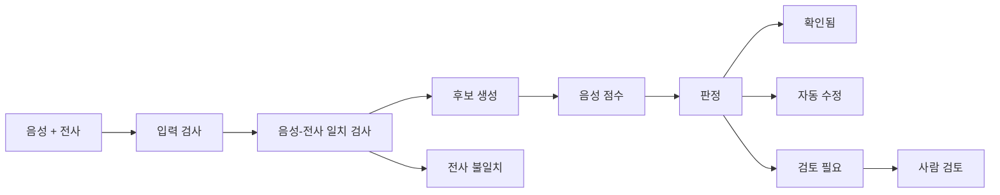

# Tashkeel Check

음성 근거 기반 아랍어 모음(tashkeel) 검수 서비스

*Audio-grounded QA for Arabic diacritics: check every word's vowel marks against the recording, handle the confident ones automatically, and send the rest to a human reviewer with evidence.*

> **현재 상태 (2026-10-05): 계획 단계입니다.** 코드, 실험, 성능 측정 결과는 아직 없습니다. 아래에 나오는 수치 목표는 제안값이며 측정한 값이 아닙니다.

## 무엇을 하는가

아랍어 음성과 전사를 받아, 전사에 적힌 모음 표기가 실제 발음과 맞는지 단어 단위로 확인합니다. 음성 근거가 충분한 단어는 자동으로 확인하거나 고치고, 판단하기 어려운 단어만 근거와 함께 사람에게 넘깁니다.

모음을 새로 지어내는 복원기가 아니라, 정해진 후보 가운데 어느 것이 음성과 맞는지 가리는 검증기입니다.

## 왜 필요한가

아랍어 글에는 단모음이 적히지 않아서 같은 글자가 여러 발음을 가집니다.

| 글자 | 발음 | 뜻 |
| --- | --- | --- |
| كتب | kataba | 그가 썼다 |
| كتب | kutiba | 쓰였다 |
| كتب | kutub | 책들 |

음성 합성(TTS)이나 발음 평가 모델을 만들려면 화자가 발음한 대로 모음이 적힌 전사가 필요합니다. 지금은 이렇게 만듭니다.

- **사람이 음성을 들으며 고칩니다.** 전문 인력이 필요하고 느립니다. 텍스트 기준 시간당 300~600단어 수준입니다(Bouamor 외 2015).
- **텍스트만 보는 자동 도구를 씁니다.** 음성을 듣지 못하므로 실제 발음과 다른 형태를 고릅니다. 음성 전사에서 공개 도구 세 종의 모음 오류율은 19~29%였습니다(Shatnawi 외 2024).
- **어느 단어를 믿어도 되는지 알 수 없습니다.** 자동 결과에 단어별 신뢰도가 없어서 결국 사람이 전부 다시 듣습니다.

이 프로젝트는 세 번째 문제를 줄입니다. 대상 사용자는 아랍어 TTS·발음 평가 모델의 학습 데이터를 만드는 팀과 데이터 공급사의 검수 담당입니다.

## 어떻게 동작하는가



1. **후보를 모읍니다.** 단어마다 가능한 모음 표기를 몇 개 놓습니다: 지금 적힌 표기, 텍스트 모델의 결과, 음성 모델의 결과.
2. **음성과 대조해 점수를 매깁니다.** 후보마다 그렇게 발음했을 가능성을 음향 모델로 계산하고, 1위와 2위의 차이(마진)를 봅니다.
3. **규칙으로 판정합니다.**

| 판정 | 뜻 |
| --- | --- |
| 확인됨 | 적힌 표기가 음성과 맞음 |
| 자동 수정 | 다른 후보가 뚜렷하게 더 맞음 |
| 검토 필요 | 판단하기 어려움. 사람이 후보와 점수를 보고 선택 |
| 전사 불일치 | 글자 자체가 음성과 맞지 않음. 고치지 않고 표시만 함 |

예를 들어 전사에 شَرِبَتْ(마셨다)라고 적혀 있는데 음성은 شُرِّبَتْ(마시게 됐다) 쪽 점수가 훨씬 높으면 자동 수정하고, 점수 차이가 작으면 사람에게 넘깁니다.

4. **단어마다 근거를 남깁니다.** 후보, 점수, 통과한 검사, 모델 버전을 기록합니다.

## 설계 원칙

없는 내용을 만들어 내지 않고, 판정 과정을 설명할 수 있게 하는 것이 목표입니다.

- **자음 글자는 바뀌지 않습니다.** 출력에서 모음 기호를 지운 결과가 입력과 다르면 저장하지 않습니다.
- **후보는 닫혀 있습니다.** 최종 표기는 후보 목록 중 하나이고, 후보마다 출처가 남습니다.
- **모델은 제안하고 규칙이 판정합니다.** 모델과 LLM은 후보와 점수만 냅니다.
- **음성 근거 없이는 고치지 않습니다.**
- **임계값은 통계 절차로 정합니다.** 정답이 있는 데이터에서 "자동 수정 중 틀린 비율"의 상한을 정하고 기록합니다(Learn-then-Test).
- **모르면 사람에게 넘깁니다.**
- **같은 입력에는 같은 결과가 나옵니다.** 기본 경로에는 난수와 LLM이 없습니다.
- **음성을 외부로 보내지 않습니다.** 기본 경로는 로컬 추론입니다.

음향 모델 내부는 여전히 블랙박스입니다. 그 출력을 판정에 쓰는 과정은 전부 공개된 규칙입니다.

## 범위

| 하는 것 | 하지 않는 것 |
| --- | --- |
| 표준·고전 아랍어 낭독 음성 | 방언, 자연 발화, 코드 스위칭 |
| 발화 단위 음성 + 전사 입력 | 음성만 받아 전사부터 생성(음성 인식) |
| 공개 모델을 추론에만 사용 | 모델 학습, 파인튜닝 |
| 배치 처리, 검수 화면, 단어별 근거 기록 | 실시간 처리, 다중 고객 관리, 과금 |

## 진행 상황

| 단계 | 내용 | 상태 |
| --- | --- | --- |
| 0 | 계획, 환경·데이터·모델 확인 | 진행 중 (계획과 문헌 조사 완료) |
| 1 | 전제 검증: 음성 근거가 강한 텍스트 모델보다 나은지 측정, 진행/중단 판단 | 시작 전 |
| 2 | 검증 엔진: 후보 점수, 판정 규칙, 임계값 보정 | 시작 전 |
| 3 | 서비스 층: 배치 처리, 검수 화면, 보고서 | 시작 전 |
| 4 | Agent 추가 검증 실험 | 시작 전 |
| 5 | 최종 평가와 정리 | 시작 전 |

## 쉽게 풀어 쓴 설명

처음 보는 사람을 위해, 위 내용을 비유로 다시 적은 것입니다. 2026-10-06 논의를 정리했습니다.

### 이 프로젝트는 한마디로

> 아랍어 녹음과 전사를 넣으면, 단어마다 모음 표기가 실제 발음과 맞는지 음성으로 확인해서, 확실한 것은 자동으로 처리하고 애매한 것만 근거와 함께 사람에게 넘겨 주는 검수 도구.

시험 채점과 비슷합니다. 학생이 쓴 답(전사)을 정답지(음성)와 대조해서 단어마다 네 가지 중 하나를 매깁니다.

| 결과 | 뜻 | 사람이 할 일 |
| --- | --- | --- |
| 확인됨 | 적힌 대로 발음했다 | 없음 |
| 자동 수정 | 다른 표기가 훨씬 더 맞는다 | 없음 (기록은 남음) |
| 검토 필요 | 애매하다 | 후보와 점수를 보고 선택 |
| 전사 불일치 | 모음이 아니라 글자 자체가 녹음과 다르다 | 표시만 보고 판단 |

사람은 "검토 필요" 단어만 들으면 됩니다. 이것이 이 도구의 가치입니다.

### 예측 모델인가?

아닙니다. 값을 예측하는 모델이 아니라 "맞다 / 틀리다 / 모르겠다"를 가리는 **검증기**입니다. 안에서 음향 모델이 하는 일은 후보 표기마다 "이렇게 발음됐을 가능성" 점수를 매기는 **채점**이고, 판정은 점수 차이와 통계적으로 정한 기준선이 합니다. 모델을 새로 학습하지도 않습니다. 공개 모델을 추론에만 쓰고, 개발 노력은 판정 규칙·오류율 보정·검수 화면·평가에 들어갑니다.

"자동 수정 중 틀린 비율이 2%를 넘지 않는다" 같은 기준선은 사람이 감으로 정하지 않고, 정답이 있는 데이터로 통계 절차를 돌려 정하고 그 근거를 기록합니다.

### agent는 무슨 역할인가?

agent는 시스템 전체가 아니라 **한 단계의 선택지**입니다. 파이프라인이 끝나면 "검토 필요" 단어가 남는데, 사람에게 넘기기 전에 한 번 더 조사해서 확인됨이나 자동 수정으로 바꿀 수 있는지 시도하는 단계가 있습니다. 추가 조사 도구는 다섯 가지입니다.

| 추가 조사 | 하는 일 |
| --- | --- |
| 문맥 넓혀 다시 점수 | 앞뒤 단어까지 포함해 다시 들어 봄 |
| 다른 모델로 다시 점수 | 두 번째 음향 모델에게 물어봄 |
| 음소 대조 | 소리 단위 인식 결과와 후보를 비교 |
| 후보 추가 | 사전·형태소 분석기에서 후보를 더 가져옴 |
| 보류 | 더 해 봐야 소용없다. 사람에게 넘김 |

여기서 두 방식을 비교합니다.

- **고정 규칙(B1)**: 모든 단어에 정해진 순서로 같은 조사를 합니다.
- **agent(A1)**: LLM이 단어의 상태(점수, 후보, 실패한 검사)를 보고 "이 경우엔 이 조사부터"라고 순서를 고릅니다. 예산(단어당 최대 2회)은 같습니다.

병원에 비유하면 agent는 **추가 검사 순서를 고르는 의사**이지 **진단을 내리는 의사가 아닙니다.** 조사 결과가 나오면 판정은 다시 원래 규칙이 합니다. agent는 음성을 직접 듣지 않고, 기준선을 바꾸거나 검사를 건너뛸 수 없으며, "90% 확신한다" 같은 LLM의 자기 확신은 무시합니다. 이렇게 묶어 둔 이유는 LLM이 판정까지 하면 오류율 약속을 할 수 없고 설명도 안 되기 때문입니다.

솔직한 기대치: 도구가 다섯 개뿐이고 로컬 실행이 싸서, 그냥 다 해 보는 고정 규칙과 큰 차이가 없을 수 있습니다. 그래서 agent는 기본값이 아니라 실험(단계 4)이고, 서비스는 고정 규칙으로 먼저 완성합니다. 실험에서 "같은 품질을 더 적은 호출로" 내지 못하면 agent를 빼고 결과를 기록합니다.

### 사이드카 예측 모델은 무엇인가? [제안]

> 아직 계획에 없는 제안입니다. 채택하면 [PROJECT_PLAN.md](PROJECT_PLAN.md)에 옮기고 ADR로 범위를 정합니다.

사이드카는 메인 시스템 옆에 붙어서 **기록을 읽기만 하고 판정에는 손대지 않는** 보조 모델입니다.

**왜 필요한가.** "자동 수정 중 틀린 비율 2% 이하"라는 약속은 보정할 때 쓴 데이터와 비슷한 데이터에서만 성립합니다. 새 고객이 다른 마이크, 다른 화자, 다른 분야의 녹음을 가져오면 조용히 깨질 수 있습니다. 깨졌는지 확인하려면 자동 수정 단어를 사람이 다시 들어야 하는데, 검수가 끝나야 결과가 나오고(며칠), 통계적으로 의미 있으려면 수백 건이 쌓여야 합니다. 그 사이에 틀린 자동 수정이 에러 없이 조용히 나갑니다.

**무엇을 하나.** 일기예보처럼, 결과가 오기 전에 미리 추정합니다.

| 일기예보 | 사이드카 |
| --- | --- |
| 구름, 습도, 기압 | 점수 차이가 기준선 근처에 몰린 비율, 두 모델이 다른 답을 낸 비율, 녹음 잡음, 보정 때 데이터와의 차이 |
| 내일 실제로 비가 왔나 | 며칠 뒤 검수자가 확인한 실제 틀린 비율 |
| "비 올 확률 70%" | "이 작업의 자동 수정은 3%쯤 틀렸을 것" |

입력 신호는 메인 시스템이 단어마다 남기는 근거 기록에 이미 있어서 새로 모을 것이 없습니다.

**예측이 나오면.**

```text
1.5% 미만   정상. 기록만
1.5~2%      주의. 자동 수정 단어 중 사람이 다시 볼 표본을 늘림
2% 이상     경보. 이 작업의 자동 수정을 전부 "검토 필요"로 내리고 운영자에게 알림
```

사이드카는 **조심하는 쪽으로만 개입**합니다. 자동 수정을 검토 필요로 내릴 수는 있어도 그 반대나 기준 완화는 못 합니다. 그래서 사이드카가 틀려도 메인 시스템의 약속은 깨지지 않고, 사람 일이 조금 늘어날 뿐입니다.

**학습과 재학습.** 메인 시스템(음향 모델)은 학습하지 않지만, 사이드카는 작은 회귀 모델이라 학습·재학습을 합니다. 그래서 "모델을 학습하지 않는다"는 원칙과 "예측 → 실제값 지연 도착 → 드리프트 → 재학습 → 게이트 → 재배포"라는 운영 루프가 충돌 없이 같이 성립합니다. 비교 기준(직전 작업의 실측치를 그대로 쓰는 방식, 항상 2%라고 하는 방식)을 못 이기면 사이드카를 뺍니다.

**조건.**

- 감사 표본이 필요합니다. 검수자는 검토 필요 단어만 보므로 자동 수정이 맞았는지 아무도 확인하지 않습니다. 자동 수정 일부(예: 10%)를 섞어 보여줘야 정답이 생깁니다. 검수 부담이 조금 늘어납니다.
- 모델이 "자신 있게 틀리는" 경우는 점수만으로 못 잡습니다. 사이드카는 보정 절차를 대체하지 않고 보조합니다.
- "점수 분포가 실제 오류율과 상관이 있다"는 가설입니다. 단계 1~2의 공개 데이터 결과로 먼저 확인합니다.

### 수업 템플릿(예측 모델 서빙·MLOps·AIOps)과의 관계

| 템플릿 | 이 프로젝트 |
| --- | --- |
| 예측 대상: 다음날 종가 | 단어별 판정 (사이드카를 붙이면: 작업별 오수정률) |
| 모델 학습 → 배포 | 공개 모델 그대로 사용. 학습 없음 (사이드카만 학습) |
| 배포 게이트: RMSE ≤ $4 | 검증 세트 오수정률 ≤ 2% (보정 프로필 승격 조건) |
| 드리프트 신호 | 점수 분포·자동 처리율 변화, 실측 오수정률 상승 |
| 재학습 | 재보정 (기준선을 다시 정함). 사이드카는 재학습 |
| 실제값이 다음날 도착 | 검수자의 선택이 라벨로 뒤늦게 도착 |

"게이트 → 모니터링 → 자동 대응" 구조는 그대로 쓰고, "모델을 학습·재학습한다"는 부분만 "보정·재보정한다"로 바뀝니다.

## 서빙·운영 설계 메모 [제안]

> 2026-10-06에 모델 서빙·MLOps·AIOps 강의 자료(SKALA)를 검토하며 정리한 제안입니다. 구현하거나 검증한 내용이 아니며, [PROJECT_PLAN.md](PROJECT_PLAN.md)에는 아직 반영하지 않았습니다. 단계 3(서비스 층)을 설계할 때 채택 여부를 정합니다.

이 프로젝트는 모델을 학습하지 않으므로 강의 자료의 "드리프트 감지 → 자동 재학습" 자리에 "드리프트 감지 → 보정 프로필 재보정"을 놓습니다.

| 강의 자료의 개념 | 이 프로젝트에 적용하는 방식 |
| --- | --- |
| 학습·서빙 전처리 일치 (스케일러를 다시 fit하지 않음) | 16kHz 변환, 유니코드 정규화, 자음 골격 추출, 점수 정규화를 한 모듈에 두고 보정·평가·서빙이 같이 씁니다. 보정 프로필에 모델 리비전과 전처리·규칙 버전을 묶고, 로드된 버전과 다르면 자동 수정을 끄고 전부 검토 필요로 보냅니다. |
| 모델 레지스트리, 배포 게이트, 승격 | 버전 관리 대상은 "모델 리비전 + 규칙 버전 + 보정 프로필" 묶음입니다. 새 묶음은 검증 세트의 실측 오수정률·오확인률이 상한 이하일 때만 승격하고, 통과하지 못하면 기존 묶음을 유지합니다. 현재 운영 묶음 대비 자동 처리율이 크게 떨어지지 않는지도 함께 봅니다. |
| 드리프트 감지 → 알림 → 재학습 → 게이트 재검증 | 알림 → 자동 수정 중지 → 고객 표본으로 재보정 → 게이트 → 승격. 라벨 없이 보는 신호는 마진 분포, 자동 처리율, 검토 필요 비율, 전사 불일치 비율입니다. 라벨로 보는 신호는 검수자 선택으로 계산한 실측 오수정률입니다. |
| 충분한 표본이 쌓인 뒤 판정 (오탐 방지) | 판정 윈도우는 보정 절차의 최소 표본 수 이상으로 잡습니다(상한 2%면 149건 이상). |
| Eager 로딩, 헬스체크 | 워커를 시작할 때 모델을 모두 올려 파일·의존성 문제를 기동 시점에 드러냅니다. `/health`에 모델 로드 여부, 모델 리비전, 적용 중인 프로필 ID를 넣습니다. |
| 승격 후 서빙 캐시 갱신 | 프로필이나 모델을 바꾸면 워커가 다시 로드합니다. 실제로 쓴 버전을 응답과 근거 레코드에 남기고 그것으로 확인합니다. |
| 긴 작업을 요청 처리와 분리 | 추론은 작업 큐에서 돌리고 API는 작업 ID를 바로 돌려줍니다. |
| 입력 스키마 검증, 구조화 로그 | 형식 오류는 422, 내용 오류(음성 길이, 허용 밖 문자)는 400으로 구분합니다. JSON 로그에 단계별 소요 시간, 상태, 실패 사유를 남깁니다. |
| 컨테이너로 환경 일관성 확보 | 의존성과 모델 리비전을 고정하고, "같은 입력 재실행 시 결과 일치" 테스트를 컨테이너 안에서도 돌립니다. |
| 에러 없이 결과만 틀어지는 "조용한 실패" | 단어 인덱스 정렬, 점수 정규화, 임계값 비교 방향, 후보 치환 위치에 테스트를 집중합니다. |

결정이 필요한 점:

- **감사 표본.** 검수자는 "검토 필요" 단어만 보므로 자동 수정·확인됨 단어에는 라벨이 쌓이지 않습니다. 자동 판정의 일부를 무작위로 검수에 넣어야 운영 중 오수정률을 감시할 수 있습니다. 평가·보정 방식에 영향을 주므로 채택하려면 ADR로 다룹니다.
- **컨테이너와 MPS.** Mac의 Docker 컨테이너에서는 MPS를 쓸 수 없어 CPU 추론이 됩니다. 속도와, 로컬 실행 결과와의 일치 여부를 확인해야 합니다.
- **MLflow.** 필수로 보지 않습니다. 보정 프로필 파일과 실험 기록으로 버전을 추적할 수 있습니다.

적용하지 않는 것: 자동 재학습·파인튜닝(범위 밖, ADR-001), WebSocket·WebRTC(실시간 처리 범위 밖).

## 알려진 한계

- 현대 표준 아랍어에서는 음성의 이점이 아직 입증되지 않았습니다. 고전 아랍어로 학습한 공개 음성 모델은 현대 표준 아랍어에서 단어 오류율이 약 40%입니다(Marew 외 2026). 단계 1에서 가장 먼저 확인합니다.
- 공개된 평가용 실제 음성은 화자가 적습니다.
- 사람끼리도 모음 표기가 1.6~5.6% 어긋나므로 그보다 낮은 오류율은 약속할 수 없습니다.
- 이 문제에 비용을 내려는 구매자가 있는지는 확인하지 못했습니다.

## 사용 예정인 공개 자산

| 역할 | 자산 |
| --- | --- |
| 음성 기반 모음 디코딩과 후보 점수 | [DiaCTC](https://github.com/rufaelfekadu/DiaCTC) |
| 텍스트 기반 모음 복원 | [CATT](https://github.com/abjadai/catt) |
| 평가 데이터 | [ClArTTS](https://huggingface.co/datasets/MBZUAI/ClArTTS), [ArVoice](https://huggingface.co/datasets/MBZUAI/ArVoice) |

실행 가능 여부와 이용 조건은 단계 0에서 확인합니다. 전체 목록은 [PROJECT_PLAN.md](PROJECT_PLAN.md) 5절에 있습니다.

## 문서 구성

| 문서 | 내용 |
| --- | --- |
| README.md | 프로젝트 소개 (이 문서) |
| [PROJECT_PLAN.md](PROJECT_PLAN.md) | 작업용 기준 문서: 상세 계획, 진행 체크리스트, 의사결정 기록(ADR), 실험, 트러블슈팅, 참고 문헌 |
| [AGENTS.md](AGENTS.md) | 작업 지침 |

## 참고 문헌

- Marew, Keleg, Aldarmaki. [Constrained CTC Decoding for Efficient Diacritic Restoration](https://arxiv.org/abs/2607.18946), 2026
- Shatnawi, Alqahtani, Aldarmaki. [Automatic Restoration of Diacritics for Speech Data Sets](https://arxiv.org/abs/2311.10771), NAACL 2024
- Cao 외. [Segmentation-free Goodness of Pronunciation](https://arxiv.org/abs/2507.16838), 2025
- Angelopoulos 외. [Learn then Test](https://arxiv.org/abs/2110.01052), 2021
- Bouamor 외. [A Pilot Study on Arabic Multi-Genre Corpus Diacritization Annotation](https://aclanthology.org/W15-3209/), 2015

전체 목록과 확인 수준은 [PROJECT_PLAN.md](PROJECT_PLAN.md) 5절에 있습니다.
