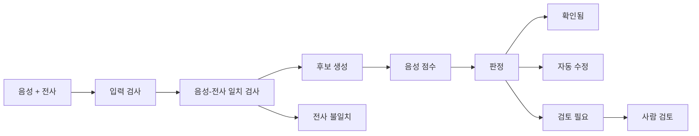

# Tashkeel Check

음성 근거 기반 아랍어 모음(tashkeel) 검수 서비스

*Audio-grounded QA for Arabic diacritics: check every word's vowel marks against the recording, handle the confident ones automatically, and send the rest to a human reviewer with evidence.*

> **현재 상태 (2026-10-05): 계획 단계입니다.** 코드, 실험, 성능 측정 결과는 아직 없습니다. 아래에 나오는 수치 목표는 제안값이며 측정한 값이 아닙니다.

## 무엇을 하는가

아랍어 음성과 전사를 받아, 전사에 적힌 모음 표기가 실제 발음과 맞는지 단어 단위로 확인합니다. 음성 근거가 충분한 단어는 자동으로 확인하거나 고치고, 판단하기 어려운 단어만 근거와 함께 사람에게 넘깁니다.

모음을 새로 지어내는 복원기가 아니라, 정해진 후보 가운데 어느 것이 음성과 맞는지 가리는 검증기입니다.

## 왜 필요한가

아랍어 글에는 단모음이 적히지 않아서 같은 글자가 여러 발음을 가집니다.

| 글자 | 발음 | 뜻 |
| --- | --- | --- |
| كتب | kataba | 그가 썼다 |
| كتب | kutiba | 쓰였다 |
| كتب | kutub | 책들 |

음성 합성(TTS)이나 발음 평가 모델을 만들려면 화자가 발음한 대로 모음이 적힌 전사가 필요합니다. 지금은 이렇게 만듭니다.

- **사람이 음성을 들으며 고칩니다.** 전문 인력이 필요하고 느립니다. 텍스트 기준 시간당 300~600단어 수준입니다(Bouamor 외 2015).
- **텍스트만 보는 자동 도구를 씁니다.** 음성을 듣지 못하므로 실제 발음과 다른 형태를 고릅니다. 음성 전사에서 공개 도구 세 종의 모음 오류율은 19~29%였습니다(Shatnawi 외 2024).
- **어느 단어를 믿어도 되는지 알 수 없습니다.** 자동 결과에 단어별 신뢰도가 없어서 결국 사람이 전부 다시 듣습니다.

이 프로젝트는 세 번째 문제를 줄입니다. 대상 사용자는 아랍어 TTS·발음 평가 모델의 학습 데이터를 만드는 팀과 데이터 공급사의 검수 담당입니다.

## 어떻게 동작하는가

1. **후보를 모읍니다.** 단어마다 가능한 모음 표기를 몇 개 놓습니다: 지금 적힌 표기, 텍스트 모델의 결과, 음성 모델의 결과.
2. **음성과 대조해 점수를 매깁니다.** 후보마다 그렇게 발음했을 가능성을 음향 모델로 계산하고, 1위와 2위의 차이(마진)를 봅니다.
3. **규칙으로 판정합니다.**

| 판정 | 뜻 |
| --- | --- |
| 확인됨 | 적힌 표기가 음성과 맞음 |
| 자동 수정 | 다른 후보가 뚜렷하게 더 맞음 |
| 검토 필요 | 판단하기 어려움. 사람이 후보와 점수를 보고 선택 |
| 전사 불일치 | 글자 자체가 음성과 맞지 않음. 고치지 않고 표시만 함 |

예를 들어 전사에 شَرِبَتْ(마셨다)라고 적혀 있는데 음성은 شُرِّبَتْ(마시게 됐다) 쪽 점수가 훨씬 높으면 자동 수정하고, 점수 차이가 작으면 사람에게 넘깁니다.

4. **단어마다 근거를 남깁니다.** 후보, 점수, 통과한 검사, 모델 버전을 기록합니다.

## 설계 원칙

없는 내용을 만들어 내지 않고, 판정 과정을 설명할 수 있게 하는 것이 목표입니다.

- **자음 글자는 바뀌지 않습니다.** 출력에서 모음 기호를 지운 결과가 입력과 다르면 저장하지 않습니다.
- **후보는 닫혀 있습니다.** 최종 표기는 후보 목록 중 하나이고, 후보마다 출처가 남습니다.
- **모델은 제안하고 규칙이 판정합니다.** 모델과 LLM은 후보와 점수만 냅니다.
- **음성 근거 없이는 고치지 않습니다.**
- **임계값은 통계 절차로 정합니다.** 정답이 있는 데이터에서 "자동 수정 중 틀린 비율"의 상한을 정하고 기록합니다(Learn-then-Test).
- **모르면 사람에게 넘깁니다.**
- **같은 입력에는 같은 결과가 나옵니다.** 기본 경로에는 난수와 LLM이 없습니다.
- **음성을 외부로 보내지 않습니다.** 기본 경로는 로컬 추론입니다.

음향 모델 내부는 여전히 블랙박스입니다. 그 출력을 판정에 쓰는 과정은 전부 공개된 규칙입니다.

## 범위

| 하는 것 | 하지 않는 것 |
| --- | --- |
| 표준·고전 아랍어 낭독 음성 | 방언, 자연 발화, 코드 스위칭 |
| 발화 단위 음성 + 전사 입력 | 음성만 받아 전사부터 생성(음성 인식) |
| 공개 모델을 추론에만 사용 | 모델 학습, 파인튜닝 |
| 배치 처리, 검수 화면, 단어별 근거 기록 | 실시간 처리, 다중 고객 관리, 과금 |

## 진행 상황

| 단계 | 내용 | 상태 |
| --- | --- | --- |
| 0 | 계획, 환경·데이터·모델 확인 | 진행 중 (계획과 문헌 조사 완료) |
| 1 | 전제 검증: 음성 근거가 강한 텍스트 모델보다 나은지 측정, 진행/중단 판단 | 시작 전 |
| 2 | 검증 엔진: 후보 점수, 판정 규칙, 임계값 보정 | 시작 전 |
| 3 | 서비스 층: 배치 처리, 검수 화면, 보고서 | 시작 전 |
| 4 | Agent 추가 검증 실험 | 시작 전 |
| 5 | 최종 평가와 정리 | 시작 전 |

## 알려진 한계

- 현대 표준 아랍어에서는 음성의 이점이 아직 입증되지 않았습니다. 고전 아랍어로 학습한 공개 음성 모델은 현대 표준 아랍어에서 단어 오류율이 약 40%입니다(Marew 외 2026). 단계 1에서 가장 먼저 확인합니다.
- 공개된 평가용 실제 음성은 화자가 적습니다.
- 사람끼리도 모음 표기가 1.6~5.6% 어긋나므로 그보다 낮은 오류율은 약속할 수 없습니다.
- 이 문제에 비용을 내려는 구매자가 있는지는 확인하지 못했습니다.

## 사용 예정인 공개 자산

| 역할 | 자산 |
| --- | --- |
| 음성 기반 모음 디코딩과 후보 점수 | [DiaCTC](https://github.com/rufaelfekadu/DiaCTC) |
| 텍스트 기반 모음 복원 | [CATT](https://github.com/abjadai/catt) |
| 평가 데이터 | [ClArTTS](https://huggingface.co/datasets/MBZUAI/ClArTTS), [ArVoice](https://huggingface.co/datasets/MBZUAI/ArVoice) |

실행 가능 여부와 이용 조건은 단계 0에서 확인합니다. 전체 목록은 [PROJECT_PLAN.md](PROJECT_PLAN.md) 5절에 있습니다.

## 문서 구성

| 문서 | 내용 |
| --- | --- |
| README.md | 프로젝트 소개 (이 문서) |
| [PROJECT_PLAN.md](PROJECT_PLAN.md) | 작업용 기준 문서: 상세 계획, 진행 체크리스트, 의사결정 기록(ADR), 실험, 트러블슈팅, 참고 문헌 |
| [AGENTS.md](AGENTS.md) | 작업 지침 |

## 참고 문헌

- Marew, Keleg, Aldarmaki. [Constrained CTC Decoding for Efficient Diacritic Restoration](https://arxiv.org/abs/2607.18946), 2026
- Shatnawi, Alqahtani, Aldarmaki. [Automatic Restoration of Diacritics for Speech Data Sets](https://arxiv.org/abs/2311.10771), NAACL 2024
- Cao 외. [Segmentation-free Goodness of Pronunciation](https://arxiv.org/abs/2507.16838), 2025
- Angelopoulos 외. [Learn then Test](https://arxiv.org/abs/2110.01052), 2021
- Bouamor 외. [A Pilot Study on Arabic Multi-Genre Corpus Diacritization Annotation](https://aclanthology.org/W15-3209/), 2015

전체 목록과 확인 수준은 [PROJECT_PLAN.md](PROJECT_PLAN.md) 5절에 있습니다.
