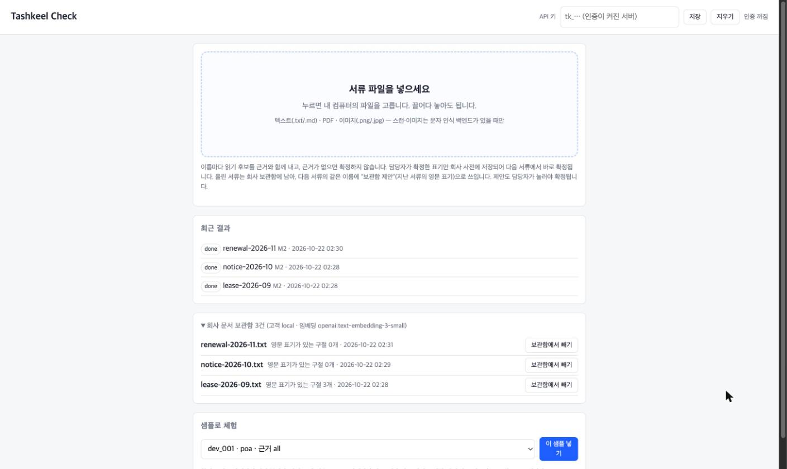
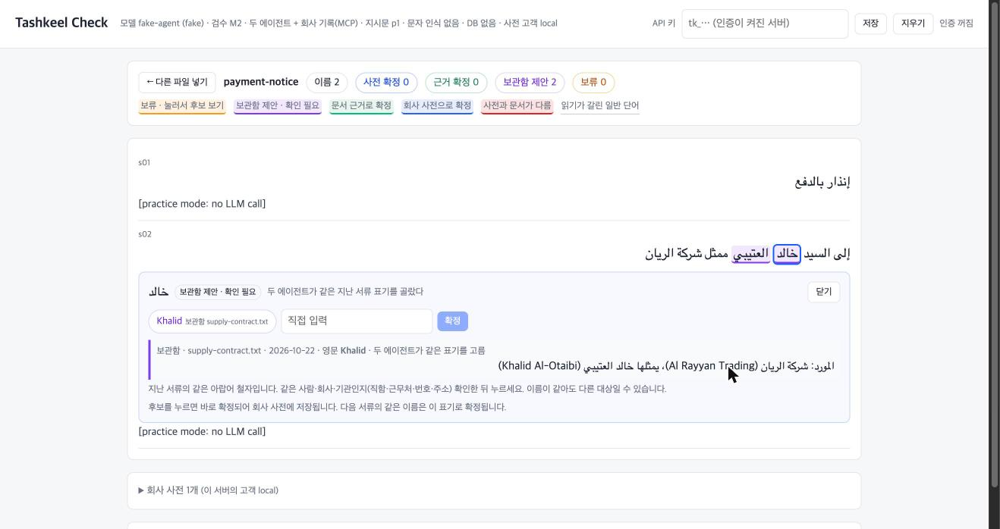
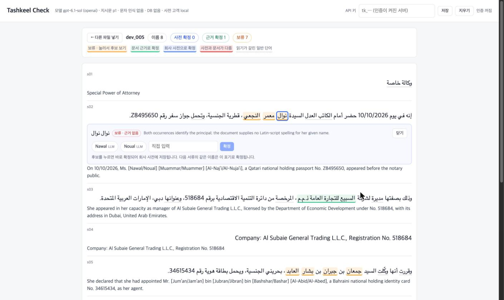
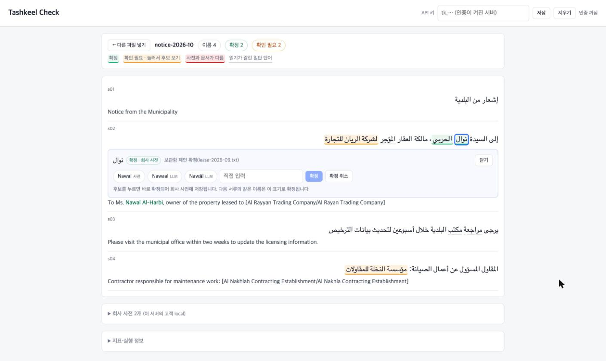

# Tashkeel Check

아랍어 서류를 영어로 읽어야 하는 사람을 위한 검수 도구.

아랍어는 단모음을 적지 않아서 같은 철자의 이름이 여러 가지로 읽힌다. مسلم은 Muslim일 수도 Musallam일 수도 있다. 번역 LLM은 이런 자리를 표시 없이 하나로 정해 버릴 수 있고, 아랍어를 모르는 읽는 사람은 그런 선택이 있었다는 사실조차 모른다.

이 도구는 문서를 넣으면 고유명사(사람·회사·기관 이름)마다 읽기 후보를 문서 안 근거와 함께 보여 주고, 근거가 없으면 확정하지 않고 보류한다. 이 회사가 전에 올린 서류에 같은 이름의 영문 표기가 있으면 "보관함 제안"으로 출처와 함께 보여 준다. 사람이 후보를 골라 확정하면 회사 사전에 저장되고, 다음 서류의 같은 이름은 처음부터 확정으로 나온다. 대상은 걸프(사우디·UAE)에 진출한 외국 중소기업이 아랍어 서류를 내부 검토용으로 읽는 경우다.

## 사용 흐름



1. `#/upload`에서 점선 상자를 누르면 로컬 파일 선택 창이 열린다. `.txt`, `.md`, 텍스트 층이 있는 `.pdf`를 받고, 스캔·이미지는 OCR 백엔드를 켰을 때만 읽는다.
2. 추출 → 분석이 끝나면 결과 페이지로 넘어간다. 원문의 이름은 세 가지 색으로 표시된다. 초록은 확정(같은 문서 안의 영문 표기나 회사 사전이 근거), 주황은 확인 필요(근거가 없어 보류. 지난 서류에 같은 이름의 영문 표기가 있으면 그것이 첫 후보로 나온다), 빨강은 회사 사전과 이 문서의 표기가 다른 경우다. 근거가 무엇인지는 이름을 누르면 나온다. 이 절의 사진은 색을 셋으로 줄이기 전에 찍어서 파랑(사전 확정)·보라(지난 서류 후보)가 보인다.
3. 이름을 누르면 그 자리에 후보가 열린다. 사전 표기, 보관함 제안, 문서 근거, LLM 후보, 직접 입력 순이다. 보관함 제안에는 지난 서류 이름·날짜·그 구절과 "두 에이전트가 같은 표기를 고름 / 한쪽만"이 함께 나온다.






4. 후보를 누르면 바로 회사 사전에 저장되고 번역문의 `[Nawal/Noual]`이 `Nawal`로 바뀐다. 같은 문서를 다시 넣으면 모델 출력은 여전히 보류지만 사전이 덧씌워져 처음부터 확정(초록, 근거는 회사 사전)으로 나온다.



사전은 사람이 후보를 누를 때만 쌓인다. 검수 결과를 자동으로 사전에 넣지 않는다. 문서 근거와 사전이 다르면 확정하지 않고 충돌로 보여 준다. 보관함 제안도 확정이 아니다. 같은 철자가 다른 사람·회사일 수 있어서, 사람이 출처 구절을 보고 눌러야 사전에 들어간다. 올린 서류는 검수가 끝나면 회사 보관함에 들어가고, 업로드 페이지에서 목록을 보고 뺄 수 있다.

## 설계 배경과 실험 결과

처음 가설은 "형태소 분석기(CAMeL Tools)를 LLM에 주면 모호한 이름을 더 잘 잡는다"였다. 그래서 기능보다 측정 장치를 먼저 만들었다. LangGraph 그래프(입력 → 분석기 → 에이전트 → 검증 → 대조 → 출력)에 조건 네 개를 두고, 업무 규칙으로 만든 합성 서류와 자동 채점으로 비교했다.

| 조건 | 내용 |
| --- | --- |
| C0 | 지시 없는 번역 |
| C1 | "근거 없이 확정하지 말라"는 지시문만 |
| C2 | C1 + 분석기를 툴로 호출 |
| C3 | C1 + 분석기 결과를 입력에 미리 넣음 |

결과는 가설과 달랐다. 동명이인, 다른 사람의 영문 표기, 회사명·이메일 같은 함정, 긴 문서를 섞은 어려운 시험지 70개(이름 부분 1,457개)에서 지시문만 준 C1이 99.93%를 냈고, 분석기를 준 C2·C3와 차이가 없었다([EXP-003](docs/experiments/EXP-003.md)).

| 조건 | 엄격 정확도 | 안전 정확도 | 문서당 시간 | 문서당 토큰 | 문서당 비용[추정] |
| --- | --- | --- | --- | --- | --- |
| C0 지시 없음 | 0.5546 | 0.5546 | 7초 | 765 | $0.004 |
| C1 옛 지시문 p0 | 0.9266 | 0.9300 | 69초 | 7,247 | $0.060 |
| C1 지시문 p1 | 0.9993 | 1.0000 | 62초 | 6,635 | $0.053 |
| C2 p1 + 분석 툴 | 0.9979 | 1.0000 | 59초 | 15,000 | $0.073 |
| C3 p1 + 분석 블록 | 0.9993 | 1.0000 | 86초 | 18,782 | $0.103 |


엄격 정확도는 철자까지 맞아야 하고, 안전 정확도는 "말없이 틀리지 않음"만 본다. 모델은 `gpt-6.1-sol`, 반복 1회, 350회에 약 21분·약 $10이 들었다. 비용은 기본 단가(입력 $2·출력 $10/100만 토큰)로 계산한 추정값이다.

차이를 만든 것은 분석기가 아니라 지시문이었다. 옛 지시문 p0는 "모호하면 표시하라"였고, p1은 근거의 원칙(같은 문서 안의 영문 표기만, 글자 그대로 인용, 다른 사람의 표기는 근거가 아니다)을 적었다. p0의 오류 107건은 다른 사람의 표기를 근거로 쓴 것 49건, 그 사람 표기로는 부족한데 확정한 것 43건, 함정 10건, 보류 5건이다. p1의 오류는 1건으로, `ASA'AD`와 MRZ의 `ASAAD`를 다른 철자로 보고 보류한 것이다. 지시 없는 C0는 절반 가까이 말없이 찍었다(626건).

그래서 방향을 바꿨다([ADR-021](docs/adr/ADR-021.md)). 읽기 자체는 지시문으로 거의 해결되므로, 제품의 가치를 근거 찾기·검증·기록·재사용에 두고 회사 사전과 파일 업로드 화면을 만들었다. 분석기는 측정 지표용으로만 남겼다. 그 전에 만들었던 KYC용 서류 묶음 검수(같은 대상 ID의 다른 서류와 대조)는 코드만 두고 보류했다.

그다음 기본 경로를 조건 M2로 바꿨다([ADR-022](docs/adr/ADR-022.md)). 지시문만 쓰는 C1이 문서 하나 안의 읽기를 이미 풀었으므로, 새 구조는 문서 밖 근거를 맡는다. 예를 들어 지난달 계약서에는 영문 표기가 있었는데 이번 통지에는 아랍어만 있는 경우다.

- 두 agent(번역, 번역 결과를 보지 않는 검증)가 동시에 돈다.
- 두 agent는 MCP 서버의 회사 기록 툴로 사전과 지난 서류(보관함)를 직접 찾는다(RAG).
- 코드 중재자는 C1·M1과 같은 규칙으로만 확정한다.

M2는 측정하지 않은 채 기본값이 됐다(사용자 결정: 실험은 빼고 완제품부터). `REVIEW_CONDITION=C1`로 되돌릴 수 있다.

이 99%는 합성 문서에서 잰 C1의 값이고, 지금 서비스 기본값인 M2의 값이 아니다. 시험지와 정답 규칙과 지시문을 같은 작업자가 설계했고, 자동 판정 오류의 사람 확인은 아직이다. 실제 서류로 일반화하지 않는다.

## 시스템 구성

| 부분 | 내용 |
| --- | --- |
| 그래프 | `graph.py`의 6노드. 구조화 출력이 형식에 안 맞으면 agent 노드를 1회 재시도한다. 처분 누락 확인과 지표 계산은 LLM이 아니라 코드가 한다 |
| 기본 경로 M2 | `multi_agent_m2.py`. agent 노드가 하위 그래프(번역 agent ∥ 검증 agent → 코드 중재자)로 바뀐다. 두 agent는 C1 입력(분석기 블록 없음)과 p1 규칙을 쓰고 회사 기록 툴을 역할당 최대 2번 부른다. 중재자는 M1의 `arbitrate`(둘 다 문서 근거로 같은 철자일 때만 확정)를 그대로 쓰고, 보관함 선택은 확정과 따로 적는다 |
| 회사 문서 보관함 | `archive/`. 업로드·붙여넣기 서류의 구간 가운데 근처에 라틴 문자가 있는 것을 남긴다. 같은 아랍어 이름이 단어 단위로 있는 구절을 찾고, 이번 서류 문맥과 임베딩이 비슷한 순으로 놓는다. 메모리 또는 Postgres(`archive_passages`) |
| 보관함 덧씌움 | `archive_apply.py`. 사전 덧씌움 다음에 돈다. 보관함 원문으로 다시 확인한다(같은 고객, 이번 서류 아님, 이름이 구절에 있음, 철자가 글자 그대로 있음). 통과한 것만 "보관함 제안", 철자가 갈리면 충돌. 확정은 하지 않는다 |
| 사전 덧씌움 | `dictionary_apply.py`. 결과를 고치지 않고 그 위에 덧씌움만 만든다. 보류 + 사전 적중이면 사전 확정, 문서 근거와 다르면 충돌. 키는 고객 + 정규화한 아랍어 |
| 입력 | `ocr/`. `.txt`·`.md` 그대로, `.pdf`는 `pypdf` 텍스트 층 먼저, 아랍어가 없으면 OCR. 백엔드는 `Protocol`이라 갈아끼울 수 있고 지금은 `none`과 무료 API `ocrspace`가 있다 |
| 서비스 | FastAPI(`web/app.py`), 작업 스레드와 SSE 진행 이벤트(`web/jobs.py`), Postgres + Alembic(`web/db.py`, 없으면 메모리), Vue 3 한 파일 화면 |
| MCP | 회사 기록 서버 `mcp/records.py`(FastMCP, 툴 `search_company_records`): M2의 두 agent가 같은 프로세스의 메모리 전송으로 부른다. 고객 범위는 도구 인자가 아니라 작업마다 발급하고 끝나면 없애는 토큰(`_meta`)으로만 정하고, 쓰기 도구는 없다. 분석기 서버 `mcp/server.py`(stdio): 툴 `analyze_tokens`·`search_bundle`, 리소스 `document://synthetic/...`, 프롬프트 `review_instructions`. `USE_MCP_TOOLS=true`면 C2의 툴 호출이 MCP로 간다 |
| 의존성 주입 | `Settings` → `build_runtime()` → `Runtime(model, analyzer, dictionary, ocr)`. 모델은 `make_model(fake=...)`로 진짜·가짜를 바꾸고 테스트는 가짜를 넣는다 |
| 묶음 검수 | `bundle/`. 같은 대상 ID가 붙은 다른 서류의 영문 칸만 근거로 쓰고 정확히 일치할 때만 확정. 여권 MRZ 해독 포함. 보류 중 |
| 멀티 에이전트 | `multi_agent.py`의 M1: 번역자 → 격리된 검증자 → 규칙 중재자(순서대로, C3 입력, `MULTI_AGENT=true`일 때만). M2가 이 틀에 회사 기록 툴을 더해 동시에 돌린다 |
| 실험 | `experiments/`. `plan.json`에 문서 해시·프롬프트 해시·설정을 고정하고 `runs.jsonl`로 재개한다. API 오류는 완료로 치지 않는다 |
| 추적 | `runner.py`의 LangSmith `@traceable`. 키가 있으면 켜지고 없으면 추적만 꺼진다 |
| 테스트 | pytest 559개(Postgres 포함). 골든 스냅샷 160건은 리팩토링 전후 결과가 같은지 보는 기준값이라 고치지 않는다([ADR-013](docs/adr/ADR-013.md)). ruff, mypy |

모듈 계층과 코드 대조는 [docs/architecture.md](docs/architecture.md)에 있다.

## 설치 및 실행

Python 3.11과 [uv](https://docs.astral.sh/uv/)가 필요하다.

```bash
uv sync
uv run camel_data -i morphology-db-msa-r13
cp .env.example .env     # OPENAI_API_KEY. 없으면 LLM_BACKEND=fake
```

```bash
LLM_BACKEND=openai AUTH=disabled uv run tashkeel serve --port 8000
# http://127.0.0.1:8000/#/upload   (API 문서 /docs, 상태 /health)
```

API로 쓰려면:

```bash
curl -s -F file=@계약서.txt localhost:8000/v1/reviews/upload          # 202 job_id
curl -s localhost:8000/v1/jobs/<job_id>/result | jq '.dictionary'
curl -s -X POST localhost:8000/v1/dictionary -H 'content-type: application/json' \
  -d '{"job_id": "<job_id>", "token_ids": [11, 86], "english_name": "Nawal"}'
curl -s localhost:8000/v1/dictionary                                    # DELETE /v1/dictionary/{id}로 취소
curl -s localhost:8000/v1/jobs/<job_id>/result | jq '.archive'          # 보관함 제안(지난 서류·구절·hit_id)
curl -s -X POST localhost:8000/v1/dictionary -H 'content-type: application/json' \
  -d '{"job_id": "<job_id>", "token_ids": [11], "archive_hit_id": "<hit_id>"}'   # 제안을 확정
curl -s localhost:8000/v1/archive                                       # 보관함 목록, DELETE /v1/archive/{document_id}로 빼기
```

가짜 모델(`LLM_BACKEND=fake`)은 비용이 없지만 번역하지 않고, 회사 기록(사전·보관함)에서 찾은 이름만 보류로 낸다. 그래서 첫 서류에는 이름 항목이 없고, 영문 표기가 있는 서류를 넣은 뒤 같은 이름이 나오는 서류에서 보관함 제안이 보인다. 실제 모델은 C1 기준으로 문서 하나에 60~100초, 약 $0.05가 든다. 기본값 M2는 두 agent라 약 2배로 추정한다(재지 않음). `REVIEW_CONDITION=C1`이면 측정한 설정으로 돈다. 스캔·이미지는 `OCR_BACKEND=ocrspace OCR_API_KEY=...`가 있어야 읽히고, 무료 API는 파일을 제3자 서버로 보낸다. Postgres를 쓰려면 `DATABASE_URL`을 준다. `run.sh`는 키·포트 검사와 `alembic upgrade head`까지 해 준다. Docker Compose와 API 키 발급은 [docs/deploy.md](docs/deploy.md)에 있다.

실험과 CLI:

```bash
uv run tashkeel run --doc data/synthetic/dev/dev_001.json --condition all --fake   # 네 조건 연습 실행
uv run tashkeel exp003 --split dev --fake --repeats 1 --workers 4                  # 연습, 비용 없음
uv run tashkeel exp003-errors                                                       # 사람 확인용 errors.csv
uv run tashkeel make-bundles                                                        # 합성 묶음 생성
```

```bash
uv run pytest -m "not live"      # db 마커는 DATABASE_URL이 닿을 때만, live는 실제 모델 호출
uv run ruff check . && uv run ruff format --check . && uv run mypy
```

## 알려진 한계

- 에이전트 실험은 합성 문서로 했다. 실제 서류의 오류율이나 포착률로 일반화하지 않는다.
- 서비스 기본값 M2(두 agent + 회사 기록)는 정확도·비용·시간을 재지 않았다. 두 agent가 일치해야 확정하므로 C1보다 보류가 늘 수 있다.
- M2에서 검증 agent가 이름을 통째로(성·이름을 한 항목으로) 내고 번역 agent가 단어별로 내면, 둘이 짝지어지지 않아 전체 이름이 보류 항목으로 더해지고 화면에서 단어별 항목을 덮는다. 그때는 단어별 후보를 누를 수 없고, 전체 이름을 확정하면 다음 서류의 단어별 재사용이 맞지 않는다(2026-10-22 실제 모델 dev_005에서 확인, 미해결).
- 보관함 제안은 같은 아랍어 철자를 찾는 것이라 이름이 같은 다른 사람·회사가 걸린다. 확정은 사람이 출처를 보고 하지만, 잘못된 제안이 얼마나 나오는지는 모른다.
- 실제 모델 서비스에서 보관함 구절의 순서를 정하는 임베딩은 OpenAI로 간다. DB 없이 돌리면 서버를 다시 띄울 때 보관함이 비어 있다.
- 단일 문서에서 근거로 인정하는 것은 같은 문서 안의 영문 표기와 회사 사전뿐이다.
- 회사 사전은 고객 안에서 같은 아랍어 철자를 같은 이름으로 본다. 같은 철자의 다른 사람이면 잘못 확정할 수 있고, 문서 근거와 다를 때만 충돌로 잡는다.
- 문자 인식 성능은 재지 않았고, 인식 오류와 독법 오류를 구분해 보고하지 못한다.
- 현재 모델은 temperature를 0으로 고정할 수 없어 같은 입력에도 실행마다 결과가 다를 수 있다.
- CAMeL Tools의 형태소 DB(calima-msa-r13)는 GPL v2다. 측정에만 쓰고, 배포 전 법률 검토가 필요하다.

## 향후 계획

1. M2 측정(EXP-005 [제안]): 합성 시험지 dev에서 C1 대비 하락 여부, "근거가 지난 서류에만 있는" 합성 사례에서 제안 적중률과 이름이 같은 다른 대상을 잘못 제안하는 비율, 코드만 쓰는 보관함 조회와 비교. 결과가 나쁘면 C1로 되돌린다.
2. 외부 MCP 클라이언트용 `/mcp` 공개(API 키로 고객 결정).
3. M2에서 검증 agent의 전체 이름 항목이 단어별 항목을 덮는 문제 해결([TS-005](docs/troubleshooting.md)). 중재자에서 겹치는 항목을 짝짓는 방향을 검토한다.
4. 자기 회사 표기 감시. 자기 회사를 거래처 0번으로 등록하고 서류의 회사명·등기번호·세금번호가 다르면 경고한다.
5. OCR 실제 호출 1회(키가 생기면)와 무료 등급 제한 확인. 민감 서류용 로컬 백엔드는 요구가 생기면.
6. Postgres에 사전을 둔 실행과 `docker compose up --build` 재확인.
7. 중소기업 서류(거래처 계약, 정부 통지, 임대차, 인보이스, 근로계약)로 합성 문서 생성기 v3.
8. EXP-003 `errors.csv`의 사람 확인과, 공개 이중언어 문서로 실제 서류 측정.
9. 사전 키를 거래처 단위로 나눌지 결정.

## 관련 문서

- [PROJECT_PLAN.md](PROJECT_PLAN.md): 현재 상태, 다음 작업, 정할 것
- [docs/README.md](docs/README.md): 문서 지도(정의·범위·구조·데이터·측정·로드맵·ADR·변경 이력)
- [docs/experiments/](docs/experiments/README.md): EXP-001~003 기록
- [docs/과제2-테스트-기록.md](docs/과제2-테스트-기록.md): 기능별·예외 테스트의 입력·예상·실제
- [docs/business/feasibility.md](docs/business/feasibility.md): 사업성 검토
