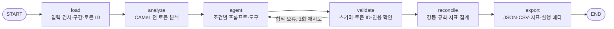

# 시스템 구조

- 기준: 분할 전 `PROJECT_PLAN.md` 4절, `docs/아키텍처-설계.md`·`docs/툴-설계.md`(2026-10-13), 9절 실행 환경. 절 번호는 분할 전 번호를 그대로 둔다(다른 문서의 "N.M절" 참조가 이 번호를 가리킨다). 문서 지도는 [docs/README.md](README.md).
- 마지막 업데이트: 2026-10-21

## 4.1 설계 원칙

| 원칙 | 이유 |
| --- | --- |
| 분석기는 모든 조건에서 항상 실행하고, 조건은 LLM에게 보여 주는 방식만 바꾼다 | 측정이 LLM의 호출 여부에 따라 달라지면 조건을 비교할 수 없다 |
| 처분 누락 확인과 지표 계산은 코드가 한다 | LLM에게 자기 누락을 세게 하면 같은 실패가 한 단계 뒤에서 반복된다 |
| LLM은 대상을 토큰 ID로 지목한다 | 아랍어 문자열을 다시 쓰면 함자 하나만 달라도 토큰과 맞춰지지 않아 가짜 누락이 생긴다 |
| 고유명사는 근거 없이 확정하지 않는다 | "가장 흔한 표기"는 근거가 아니다. 단계 1에서 유효한 근거는 같은 문서 안의 라틴 문자 표기뿐이다 |
| 인용은 코드가 원문과 대조한다 | 구조화 출력은 형식이 맞아도 사실 검증이 필요하다(참고 사이트 개념 사전) |
| 조건 사이에서 한 번에 하나만 바꾼다 | 여러 요소를 한꺼번에 바꾸면 무엇이 효과를 냈는지 모른다(참고 사이트 LangSmith 실패 사례) |
| LLM이 필요 없는 검증·계산은 일반 함수로 둔다 | 모든 노드를 agent로 만들 필요는 없다(참고 사이트 LangGraph 실무 사례) |
| 분석기를 설치하지 못하면 LLM으로 대체하지 않고 멈춘다 | 분석기가 LLM과 독립된 신호라는 점이 Q3의 전제다 |

참고 사이트: [ai-flow-learning-lab](https://ai-flow-learning-lab.vercel.app/). 단계 1은 그중 01 기본 체인(C0), 05 조건 분기와 반복(그래프), 06 Agent·Tool(C2), LangSmith 관찰·실험 비교를 쓴다. 02~04(RAG, Vector DB, Parent–Child)는 단계 2의 묶음 검색, 06의 사람 승인은 단계 2의 사람 검토, 07(Multi-Agent)은 단계 3에서 쓴다.

## 4.2 그래프



| 노드 | 하는 일 | LLM |
| --- | --- | --- |
| load | 유니코드 NFC, 원문 보존, 구간 분할, 토큰 ID 부여, 라틴 문자 구간 표시 | 없음 |
| analyze | 모든 아랍어 토큰을 분석. 토큰별 분석 수(0 포함), 후보(모음 표기, 로마자, lemma, 품사, 뜻), 모호 여부, noun_prop 분석 여부를 저장 | 없음 |
| agent | 조건별 동작(4.4절) | 있음 |
| validate | 스키마 검사, 토큰 ID 실재 확인, 인용 문자열이 원문에 있는지 확인. 형식 오류면 1회 재시도(`Settings.max_retries`, 기본 1). 재귀 한도는 둘이다: 안쪽 `create_agent` 툴 루프 `Settings.recursion_limit`(기본 25), 바깥 그래프 `Reviewer.run`의 50 | 없음 |
| reconcile | 강등 규칙(4.5절) 적용, [6절](evaluation.md) 지표 계산 | 없음 |
| export | 구간별 결과 JSON, 고유명사 대조표 CSV, 지표 JSON, 실행 메타 저장 | 없음 |

**모호 판정 규칙(analyze) [제안, EXP-001 전에 고정]:** 격어미와 탄윈을 뺀 모음 표기가 서로 다른 후보가 둘 이상이면 모호로 본다. 격어미만 달라도 표기가 갈리므로 원시 분석 수로 판정하면 본문 명사 대부분이 모호로 잡힐 것으로 본다 [가설]. 원시 분석 수는 따로 기록한다.

## 4.3 산출물 형식

- `segments.json`: 구간마다 아랍어 원문, 영어 번역, 항목 목록
- `proper_nouns.csv`: 아랍어 원문, 토큰 ID, 로마자 후보와 후보 출처(analyzer / llm), 채택 표기, 처분, 근거 위치, 분석기 분석 수
- `metrics.json`: [6절](evaluation.md) 지표
- `run_meta.json`: 조건, 모델 ID와 버전, 프롬프트 해시, 문서 ID, seed, 분석기·DB 버전, 토큰 사용량, 실행 시간

## 4.4 실험 조건

같은 문서, 같은 모델, 같은 설정(지원하면 temperature 0)으로 돌린다. 평가 문서 30개를 문서마다 3회 반복한다 [확정].

| 조건 | LLM에 주는 것 | 출력 | 직전 조건 대비 바뀐 것 | 답하는 질문 |
| --- | --- | --- | --- | --- |
| C0 기본 번역 | "영어로 번역하라" | 자유 텍스트 | — | Q1 |
| C1 지시 | C0 + 처분 규칙 지시 | 구조화 출력(4.5절) | 지시와 출력 형식 | Q2 |
| C2 지시 + 도구 | C1 + `analyze_tokens` 툴(호출 여부는 LLM이 정함) | 구조화 출력 | 도구 | Q3 |
| C3 지시 + 결과 주입 | C1 + analyze 결과를 프롬프트에 항상 포함 | 구조화 출력 | 도구 대신 결과 주입 | Q3 보조 |

- C0는 참고 사이트 01 기본 체인(`prompt | model | parser`)으로, C1~C3는 골격의 `create_agent`(`response_format` 사용)로 만든다.
- C0 → C1은 지시와 출력 형식을 함께 바꾼다. 구조화 출력이 없으면 처분을 셀 수 없기 때문이다. 이 점을 한계로 기록한다.
- C3는 "도구를 주는 것"과 "결과가 항상 보이는 것"의 차이를 본다. 탐지를 LLM 판단에 맡기면 모호성 은폐가 한 단계 앞에서 반복될 수 있다는 가설을 확인한다.

## 4.5 출력 스키마와 강등 규칙 (C1~C3)

```json
{
  "translation": [{"segment_id": "s03", "english": "..."}],
  "items": [{
    "token_ids": [41, 42],
    "type": "proper_noun",
    "candidates": [{"reading": "مُسَلَّم", "romanized": "Musallam", "source": "analyzer"}],
    "decision": "hold",
    "adopted": null,
    "reason": "...",
    "confidence": 0.4,
    "evidence": null
  }]
}
```

| 유형 | 허용 처분 |
| --- | --- |
| 일반 단어 (`word`) | 채택(`adopt`, 이유·확신도 필수) / 기권(`abstain`) |
| 고유명사 (`proper_noun`) | 근거 채택(`evidence_adopt`, `evidence`에 구간 ID와 인용 필수) / 보류(`hold`, 후보 나열) |

reconcile이 코드로 적용하는 규칙:

- 고유명사에 근거 없이 `adopt`를 쓰면 "근거 없는 확정"으로 센다. 보류로 바꿔 주지 않는다. 실패를 지우지 않기 위해서다.
- `evidence_adopt`의 인용이 원문에 없거나 채택 표기와 맞지 않으면 보류로 내리고 "근거 검증 실패"로 센다. 채택 표기가 인용과 맞는지는 근거 검사 규칙으로 본다. v1(EXP-002)은 인용 안 연속 단어열과 일치 규칙 v1로 맞으면 통과한다. v2(EXP-003, ADR-017)는 단어 묶음마다 인용 안 단어열과 엄격 철자가 같아야 하고, 순서·대소문자·MRZ `<`는 무시한다. 규칙은 `Settings.evidence_rule`로 고르고 실험 코드가 정한다.
- 존재하지 않는 토큰 ID를 가리키는 항목은 무효 항목으로 센다.
- 정답 고유명사와 분석기 모호 토큰 가운데 어느 항목에도 덮이지 않은 것은 "미처리"로 결과에 넣고 센다. 중립 토큰(합성 문서의 지명·국가명·발급 기관·법인 형태)은 처분을 기대하지도 감점하지도 않는다(ADR-014).
- 한 토큰을 여러 항목이 덮으면 고유명사 항목을 대표로 판정한다. 정답 이름 상태와 근거 없는 확정 집계가 같은 기준을 쓴다(ADR-014).
- LLM이 말한 확신도는 기록만 하고 판정에 쓰지 않는다.

## 4.6 툴 (단계 1)

LLM이 호출하는 툴은 하나다. 나머지는 노드 안의 일반 함수다. 단계 2용 `search_bundle`은 틀만 있고 꺼져 있다(ADR-007). 상세는 4.9절.

| 이름 | 입력 | 출력 | 호출 시점 | 실패 시 |
| --- | --- | --- | --- | --- |
| `analyze_tokens` | `token_ids: list[int]` | 토큰마다 `token_id`, `surface`, `analysis_count`, `candidates[{diac, romanized, lemma, pos, gloss}]`, `ambiguous` | C2에서 LLM이 정함 | 없는 ID는 해당 ID에 오류 항목을 돌려준다. 분석기 예외는 오류 결과로 돌려주고 툴 로그에 남긴다. LLM 추정으로 대신 채우지 않는다 |

일반 함수: 정규화, 토큰화, `romanize`(모음 표기 아랍어 → ASCII 로마자), `match_spelling`(표기 일치 판정. 2026-10-20 EXP-001 개발용 표본에서 v1로 고쳐 고정: 모음은 같아야 하고, 영문 e·o는 가능한 아랍어 모음으로 펼치며, 자음 쪽 한 글자 차이만 허용한다. ADR-015), 강등 규칙, 지표 계산.

툴 설계 문서에는 툴마다 이름, 입력과 출력 스키마, 호출 시점, 실패했을 때의 동작을 적는다.

**MCP 노출 [제안, 단계 1.5, 미구현]:** 과제 2가 MCP Tool·Resource·Prompt를 요구하므로 최소 범위로 둔다. 실험 경로(CLI `run`, `exp001`, `exp002`)는 지금처럼 in-process 툴을 쓴다(ADR-004: 분석기는 코드에서 항상 돈다). 서비스 경로에서 `USE_MCP_TOOLS=true`일 때만 C2의 `analyze_tokens`를 MCP 서버의 같은 이름 툴로 바꿔 끼우고(`build_graph`의 `extra_tool_factories` 경로), 툴 로그에 `via: "mcp"`를 남긴다. 노출 항목은 툴 `analyze_tokens`, 리소스 `document://synthetic/{split}/{doc_id}`(합성 문서, gold 제외), 프롬프트 `review_instructions(condition)`(`prompts.system_prompt`) 세 개다. MCP 서버가 죽으면 작업을 실패로 기록하고 in-process로 대체하지 않는다.

## 4.7 기술 스택

코드 골격은 `~/Documents/skala_langgraph`의 노트북을 따른다 [확인].

| 구성 | 골격에서 확인한 방식 | 단계 1에서 쓰는 방식 |
| --- | --- | --- |
| 모델 | `init_chat_model("<provider>:<model>")`. 노트북마다 Gemini, OpenAI를 씀 | `init_chat_model("openai:gpt-6.1-sol")`. 모델 문자열은 `.env`의 `MODEL`(ADR-006) |
| Agent | `create_agent(model, tools, system_prompt, response_format)` | C1~C3 |
| 그래프 | `StateGraph(TypedDict)`, `add_edge`, `add_conditional_edges`, `draw_mermaid` | 4.2절 그래프 |
| 체인 | `prompt | model | StrOutputParser()` | C0 |
| 추적 | `@traceable`, `.env`의 `LANGSMITH_API_KEY`·`LANGSMITH_TRACING`·`LANGSMITH_PROJECT` | 실행마다 [6.3절](evaluation.md) 메타데이터. 키가 없으면 추적만 꺼지고 나머지는 동작 |
| 키 없을 때 | 연습 모드(가짜 모델) | 가짜 모델(스크립트된 tool call)로 그래프와 reconcile 테스트. 실제 실험은 키가 필요 |
| 벡터 DB | Qdrant 메모리 모드, `langchain_qdrant` | 단계 2 틀(`rag/bundle.py`)에만 쓴다. 단계 1 조건에는 붙이지 않음(ADR-003, ADR-007). 제품 경로에서는 M3에서 Postgres pgvector로 교체(ADR-011) |
| 웹·API [제안, 단계 1.5, 미구현] | 골격에 없음. 제공 ZIP(`all_total_vue_student/`)의 FastAPI lifespan·`/health`·SSE(`graph.astream(stream_mode="updates")` → `data: [DONE]`) 패턴, Vue 3 CDN 무빌드 HTML + `EventSource` 진행 표시 | FastAPI가 정적 HTML을 직접 서빙(ZIP의 프록시 서버는 쓰지 않음). 그래프 노드가 동기이므로 작업은 스레드에서 돌리고, 진행은 노드 단위 이벤트만 SSE로 보낸다. 토큰 스트리밍은 구조화 출력에 의미가 없어 넣지 않는다 |
| 저장 [제안, 단계 1.5, 미구현] | ZIP은 SQLite(`session_store.py`) | 쓰지 않는다. Postgres + SQLAlchemy 2 + psycopg 3 + Alembic(ADR-011). 단계 1.5에서는 `documents`·`jobs`·`runs`·`name_items` 네 테이블만. `results/` 파일 쓰기는 유지 |
| MCP [제안, 단계 1.5, 미구현] | ZIP의 FastMCP 서버 + stdio 클라이언트(서버별 세션·lock, `find_prompt`·`find_resource_template`), `with_retry` | 4.6절 "MCP 노출". 서비스 경로에서만 |

- Python 3.11 이상(camel-tools 1.6.0 요구 사항), uv, pytest.
- CAMeL Tools 1.6.0과 기본 형태소 DB calima-msa-r13. DB는 `camel_data`로 내려받는다. 패키지 이름은 공식 문서에서 확인한다.
- calima-msa-r13은 GPL v2다(ADR-005). README에 적는다.

## 4.8 저장소 구조 [확인, 2026-10-13 구현, 2026-10-20 리팩토링 반영]

계획 초안의 `scripts/`는 CLI 하위 명령(`uv run tashkeel <명령>`)으로 바꿨다.

```text
pyproject.toml, uv.lock      Python 3.11, uv. ruff·mypy·pytest 설정(ADR-013)
.env.example                 골격 .env와 같은 키 이름 + MODEL, 판단 기준, 실험 규모, DATA_DIR·RESULTS_DIR
.pre-commit-config.yaml      ruff·mypy 훅(uv.lock 버전 사용)
.github/workflows/ci.yml     ruff·mypy·pytest(live·camel 제외)
src/tashkeel_check/
  config.py                  설정(검증하는 pydantic 모델, 환경 변수는 load_settings만 읽음), 조건, LangSmith
  errors.py                  TashkeelError → InputError(400·종료 2) / ConfigError·AnalyzerUnavailable(503·종료 3)
  text.py                    정규화, 구간·토큰 ID
  analyzer.py                CAMeL 래퍼, 격어미 제거, 모호 판정
  romanize.py                romanize, match_spelling (v1), 엄격 철자 strict_* (s1, ADR-017)
  schemas.py                 구조화 출력 AgentOutput
  prompts.py                 C0~C3 프롬프트, 지시문 판 p0(EXP-002)·p1(EXP-003)
  tools.py                   analyze_tokens
  fake.py                    가짜 모델(연습 모드, 테스트)
  graph.py                   StateGraph
  reconcile.py               강등 규칙(근거 검사 v1·v2), 지표
  scoring_v2.py              gold 형식 2의 이름 부분별 안전·엄격 판정(채점 v2, ADR-017)
  results.py                 결과 형식 ReviewResult(파일·API·DB 공통 계약, 모르는 키는 오류)
  export.py                  JSON·CSV·run_meta (ReviewResult에서 씀)
  runner.py                  Reviewer(그래프 한 번 빌드, 문서마다 재사용), run_document(편의 래퍼), LangSmith
  cli.py                     run / fetch-wikidata / make-synthetic / make-synthetic-hard / inspect-gold / bundle-search /
                             exp001 / exp002 / exp002-status / exp003 / exp003-status / exp003-errors / exp003-rescore
  data/                      names.py(이름 정렬), wikidata.py, synthetic.py, synthetic_hard.py(어려운 시험지, ADR-017)
  experiments/               exp001.py, harness.py(재개·동시 실행 장치, 통계), exp002.py, exp003.py
  rag/                       bundle.py (단계 2 틀)
data/wikidata/  data/synthetic/{dev,eval}/  data/synthetic-hard/{dev,eval}/  data/bundles/sample/
results/                     평가 실행 결과는 보존, results/debug/는 git 제외
tests/                       golden/(골든 스냅숏 160건), golden_cases.py, test_llm_inputs.py(LLM 입력 해시)
docs/                        README.md(문서 지도), problem-and-goals, scope, architecture, data, evaluation, roadmap,
                             changelog, troubleshooting, adr/, experiments/, business/ (2026-10-20 재구성)
```

단계 1.5에서 추가할 것 [제안, 미구현]:

```text
src/tashkeel_check/
  web/                       app.py(FastAPI·엔드포인트·SSE·정적 파일), jobs.py(스레드 실행·진행 큐·DB 저장),
                             db.py(엔진·세션·DATABASE_URL), models.py(documents·jobs·runs·name_items),
                             static/index.html(Vue 3 폼 화면)
  mcp/                       server.py(FastMCP 툴·리소스·프롬프트), client.py(stdio + with_retry),
                             tools.py(MCP 툴을 graph ToolFactory로 감쌈)
alembic/, alembic.ini        초기 마이그레이션 1개
docker-compose.yml, Dockerfile   app + postgres(pgvector 이미지, M3 대비)
run.sh                       키·포트·DB 검사 → alembic upgrade → uv run tashkeel serve → /health 대기
tests/test_web_api.py, tests/test_mcp.py
docs/과제2-테스트-기록.md    기능별 입력·결과, 예외 테스트(실행한 것만)
```

CLI에 `tashkeel serve` 하위 명령, `config.py`에 `DATABASE_URL`·`LLM_BACKEND`(`openai` 기본, `fake`는 명시)·`USE_MCP_TOOLS`(기본 false)·`WEB_HOST`/`WEB_PORT`를 더한다. 의존성 추가 후보: `fastapi`, `uvicorn[standard]`, `sqlalchemy>=2`, `psycopg[binary]`, `alembic`, `fastmcp`, `mcp`, dev에 `httpx`. `runner.Reviewer`에 노드 진행 콜백(`on_node`)을 더하고 내부를 `graph.stream`으로 바꾼다(결과 동일, 골든 테스트로 확인). 서비스는 기동할 때 `Reviewer`를 하나 만들어 두고, `InputError`·`ConfigError`를 400·503으로 바꾸며, 응답은 `ReviewResult`를 그대로 쓴다. 과제 안내 파일과의 대응표는 README에 둔다.

주요 명령:

| 명령 | 하는 일 |
| --- | --- |
| `uv run tashkeel run --doc data/synthetic/dev/dev_001.json --condition all --fake` | 문서 1개를 C0~C3로 실행(연습 모드), `results/debug/`에 JSON·CSV |
| `uv run tashkeel run --doc ... --condition C2` | 실제 OpenAI 모델로 실행(키 필요) |
| `uv run tashkeel fetch-wikidata` | Wikidata 스냅숏과 이름 풀 (`--pool-only`: 재조회 없이 저장된 스냅숏으로 이름 풀만) |
| `uv run tashkeel make-synthetic` | 합성 문서 dev 10개·eval 30개와 샘플 묶음 |
| `uv run tashkeel exp001 --split dev` | EXP-001 |
| `uv run tashkeel exp002 --split eval --workers 4 --max-runs 8 --yes` | EXP-002(360회, 비용 발생). 멈추면 종료 코드 4, `--resume`으로 이어서. `--token-budget`, 실행 폴더의 `STOP` 파일로도 멈춘다(ADR-016) |
| `uv run tashkeel exp002-status` | EXP-002 최근 실행의 진행·토큰·예상 총량(결과 지표는 보이지 않음) |
| `uv run tashkeel make-synthetic-hard --split dev` | 어려운 합성 문서 synthetic-hard(gold 형식 2). eval은 한 번만 만들고, 이미 있으면 거부(ADR-017) |
| `uv run tashkeel inspect-gold --case C2 --n 2` | synthetic-hard 문서의 구간별 정답(기대 처분·유형)을 읽기 좋게 출력 |
| `uv run tashkeel exp003 --split dev --fake --repeats 1 --workers 4` | EXP-003(어려운 시험지, 99% 기준). 실행 장치·옵션은 exp002와 같다. 실제 실행은 `--split eval ... --yes` |
| `uv run tashkeel exp003-status` / `exp003-errors` / `exp003-rescore` | 진행·사용량 / 자동 판정 오류 전부와 정답 표본을 사람 확인용 `errors.csv`로 / 저장된 출력을 지금 채점 코드로 다시 채점(참고 값) |
| `uv run pytest -m "not live"` | 테스트(골든 포함). `live` 마커는 실제 OpenAI를 부르므로 키가 있으면 `uv run pytest`가 비용을 낸다 |
| `uv run ruff check . && uv run ruff format --check . && uv run mypy` | 린트·서식·타입 검사(CI와 같음) |


## 4.9 툴 상세 (구 `docs/툴-설계.md`)

### 결론

LLM이 호출하는 툴은 `analyze_tokens` 하나이고 C2에서만 묶는다. 구조화 출력 `AgentOutput`은 LangChain `ToolStrategy`가 출력용 툴로 노출한다. 단계 2용 `search_bundle`은 틀만 있고 꺼져 있다. 탐지, 검증, 집계는 툴이 아니라 노드 안의 일반 함수다. LLM이 부를지 말지 고르게 두면 측정하려는 실패(모호한 곳을 말없이 넘김)가 같은 자리에서 반복되기 때문이다.

### LLM이 호출하는 툴

#### analyze_tokens

| 항목 | 내용 |
| --- | --- |
| 하는 일 | 토큰 ID에 대해 CAMeL 형태소 분석기의 독법 후보를 돌려준다 |
| 입력 | `{"token_ids": list[int]}` |
| 출력 | 토큰마다 `{token_id, surface, analysis_count, ambiguous, candidates[{reading, romanized, pos, gloss}], candidates_truncated}` |
| 호출 시점 | C2에서 LLM이 정한다. 결과는 `analyze` 노드가 미리 계산한 값이라 조건과 무관하게 같다 |
| 실패 시 | 없는 ID는 `{"token_id", "error": "unknown token id"}`, 아랍어가 아닌 토큰은 `"not an Arabic token"`을 돌려준다. 분석기 자체를 쓸 수 없으면 그래프가 `analyze` 단계에서 멈춘다. LLM 추정으로 대신 채우지 않는다 |
| 기록 | 호출마다 `tool_log`에 조회한 토큰과 오류 수를 남긴다. 지표: 호출 수, 모호 토큰 중 조회된 비율, 조회한 토큰 중 모호 토큰 비율 |

#### AgentOutput (구조화 출력)

| 항목 | 내용 |
| --- | --- |
| 입력(LLM이 채움) | `translation[{segment_id, english}]`, `items[{token_ids, type, candidates[{reading, romanized, source}], decision, adopted, reason, confidence, evidence{segment_id, quote}}]` |
| 허용 처분 | `word`: `adopt` / `abstain`. `proper_noun`: `evidence_adopt` / `hold` |
| 호출 시점 | C1~C3의 마지막 응답 |
| 실패 시 | 스키마 오류는 `ToolStrategy`가 LLM에게 되돌려 다시 쓰게 한다. 구간이 빠지면 `validate`가 1회 재시도한다. 그래도 실패하면 실패한 채로 대조·저장한다 |

#### search_bundle (단계 2 틀, 꺼짐)

| 항목 | 내용 |
| --- | --- |
| 하는 일 | 고객 참고 자료 묶음에서 같은 이름이 어떻게 적혔는지 찾는다 |
| 입력 | `{"token_ids": list[int], "romanized_candidates": list[str]}` |
| 출력 | `[{method, source, parent_id, line_no, text, latin_candidates, score}]`. method는 `arabic_exact` / `romanized` / `vector` |
| 호출 시점 | `ENABLE_BUNDLE_SEARCH=true`이고 `--bundle`을 줄 때만. C0~C3 비교에는 쓰지 않는다 |
| 실패 시 | 결과가 없으면 빈 목록. 근거가 없으면 보류가 맞는 처분이다 |
| 비고 | 묶음 밖의 인용은 아직 `verify_evidence`가 검증하지 못한다(단계 2 작업) |

### 노드 안의 일반 함수

| 함수 | 규칙 | 버전 |
| --- | --- | --- |
| 모호 판정 (`summarize`) | 격어미·탄윈·수쿤을 뗀 모음 표기(`strip_case_ending`)가 서로 다른 후보가 둘 이상이면 모호. 원시 분석 수는 따로 기록 | 계획 4.2절 |
| `romanize` | 모음 표기 아랍어 → ASCII. 단모음, 장모음, 샷다(겹자음), 관사(al-)를 살린다 | v0 |
| `match_spelling` | 관사·하이픈·아포스트로피를 걷고, 붙여 쓴 Abdul을 abd로, 영문 e는 a·i·u, o·ou는 u·aw로 펼치고, th·dh·z·d와 q·k를 같게 보고, 겹글자를 접은 정규형이 같으면 같은 이름. 아니면 대표형끼리 자음 한 글자 차이(또는 y↔i, w↔u)만 허용하고 모음 차이는 다른 이름. 방언 옵션은 q↔g를 더함 | v1, EXP-001 dev에서 고정(2026-10-20, ADR-015) |
| `verify_evidence` | 인용한 구간이 있고, 인용에 라틴 문자가 있고, 인용이 그 구간 원문에 있고, 채택 표기가 인용 안에 있어야 통과. 실패하면 보류로 내리고 실패 사유를 남긴다 | — |
| 강등 규칙 | 고유명사 `adopt`는 "근거 없는 확정"으로 센다. 고유명사 `abstain`은 보류로, 일반 단어 `hold`는 기권으로 바꾸고 유형·처분 불일치로 센다 | 계획 4.5절 |
| C0 판정 | 번역문에 후보 표기가 둘 이상 나오거나, 일치한 표기 바로 앞뒤 3자 안에 불확실 표시가 있거나, "/"·"?"가 든 괄호 안에 있으면 표시한 것으로 본다 | v0, 실행 전 고정, 20건 수동 확인 예정 |

## 4.10 실행 환경과 구현 중 관찰 (구 9절)

### 구현 중 본 것 (측정 아님)

- 연습 모드 실행에서 `dev_004`의 아랍어 토큰 57개 가운데 26개가 모호 판정 규칙(격어미 제거 후 후보 ≥ 2)에 걸렸다 [관찰, 문서 1개]. 격어미를 빼도 접어(و، ب 등) 분석 차이로 후보가 갈리는 것으로 보인다 [가설]. 이 규칙대로면 C1~C3에서 LLM이 처분해야 할 일반 단어가 많아 "미처리(일반 단어)" 수가 커질 수 있다. 규칙을 바꾸려면 EXP-002 실행 전에 정해야 한다.
- CAMeL 데이터 목록에 걸프 아랍어 DB(`morphology-db-glf-01`, CC BY 4.0, 8.0MB)가 있다 [확인, `camel_data -l`]. 라이선스가 GPL이 아니고 걸프 방언용이라 이름 후보 비교 대상으로 검토할 만하다 [제안, 미채택].

### 실행 환경 (2026-10-13, 이 장비)

| 항목 | 결과 |
| --- | --- |
| Python·도구 | Python 3.11.15, uv, 주요 패키지는 `uv.lock`(langchain 1.4.5, langgraph 1.2.15, langsmith 0.14.8, langchain-openai 1.7.1, camel-tools 1.6.0) |
| 디스크 | 여유 약 619GB |
| API 키 | 2026-10-13: OpenAI·LangSmith 키 없음. 2026-10-20: `.env`에 OpenAI 키가 있다(`MODEL=openai:gpt-6.1-sol`). LangSmith 키는 없다 |

## 4.11 코드 대조 [확인, 2026-10-20]

`src/tashkeel_check/`를 직접 읽어 위 설계와 맞춘 결과다. 구 `docs/아키텍처-설계.md`(2026-10-13)의 내용은 여기에 흡수했다.

### 한 줄 요약

LangGraph 그래프 하나(노드 6개)가 아랍어 문서 1건을 받아 번역과 이름별 처분(확정/보류)을 내고, 검증·강등·지표 계산은 코드가 한다. LLM은 `agent` 노드 하나에만 있다. 조건 C0~C3는 `agent`가 LLM에게 무엇을 보여 주는지만 바꾼다.

### 실행 경로

```text
CLI (uv run tashkeel <cmd>)
 ├─ run            → runner.run_document → graph
 ├─ exp002         → experiments/exp002 → runner.run_document(실행마다 모델·그래프 새로) → 반복 × 문서 × 조건, 동시 실행, runs.jsonl로 재개
 ├─ exp002-status  → experiments/exp002.status (plan.json + runs.jsonl만 읽음)
 ├─ exp003(-status·-errors·-rescore) → experiments/exp003 → harness.run(Spec: p1·v2, 99% 판정) → 같은 장치
 ├─ exp001         → experiments/exp001 (그래프를 쓰지 않음: analyzer + data/names.align + romanize)
 ├─ fetch-wikidata → data/wikidata (SPARQL → gcc_persons.json → name_tokens.json)
 ├─ make-synthetic → data/synthetic (name_tokens.json + 템플릿 → dev 10 / eval 30 + gold)
 ├─ make-synthetic-hard → data/synthetic-hard (dev 20 / eval 70 + gold 형식 2, 유형 17가지)
 └─ bundle-search  → rag/bundle (단계 2 틀, 그래프 밖에서만)
```

### 그래프 (`graph.py`)

```text
START → load → analyze → agent → validate ─(valid)→ reconcile → export → END
                          ▲          │
                          └─(invalid, attempts ≤ Settings.max_retries=1)┘
```

| 노드 | 역할 | LLM | 핵심 함수 |
| --- | --- | --- | --- |
| load | 조건 검사, NFC, 구간 → 토큰 ID, usage·errors 초기화 | 없음 | `text.tokenize` |
| analyze | 모든 아랍어 토큰을 CAMeL로 분석(모든 조건) | 없음 | `analyzer.analyze_tokens` |
| agent | 조건별 프롬프트·툴로 LLM 호출 | 있음 | `prompts.system_prompt`·`user_message`, `tools.make_analyze_tool`, `create_agent` |
| validate | 모든 segment_id에 번역이 있는지 | 없음 | `reconcile.parse_c0` |
| reconcile | 토큰 ID·인용 검증, 강등, 지표 | 없음 | `reconcile.reconcile` |
| export | `ReviewResult`로 검증한 뒤 JSON·CSV·메타 저장 | 없음 | `export.write_outputs` |

상태(`GraphState`): `doc_id`, `condition`, `segments`, `gold`(reconcile 전용. `runner.split_gold`가 떼어 넘기고 프롬프트에는 들어가지 않음), `out_dir`, `meta`, `tokens`, `analyses`, `output`, `tool_log`, `usage`, `attempts`, `errors`, `valid`, `reconciled`, `result`.

### 조건 (agent 노드 안에서만 분기)

| 조건 | 호출 방식 | 툴 | 시스템 프롬프트 | 사용자 메시지 |
| --- | --- | --- | --- | --- |
| C0 | `ChatPromptTemplate \| model`, 자유 텍스트 | 없음 | `C0_SYSTEM` | 원문만 |
| C1 | `create_agent(..., response_format=ToolStrategy(AgentOutput))` | extra만 | `C1_SYSTEM` | 원문 + 토큰 표 |
| C2 | C1과 같음 | `analyze_tokens` + extra | C1 + `C2_TOOL_LINE` | C1과 같음 |
| C3 | C1과 같음 | extra만 | C1 + `C3_ANALYZER_LINE` | C1 + ANALYZER 블록 |

- `analyze_tokens` 툴은 analyze 노드가 이미 계산한 결과를 돌려주고 `tool_log`에 호출을 남길 뿐, 분석기를 다시 돌리지 않는다.
- `extra_tool_factories`(단계 2 `search_bundle`용 훅, `ToolFactory = Callable[[tokens, tool_log], BaseTool]`)는 C1·C2·C3 모두에 붙는다. C2 전용이 아니다.

### 모듈 계층 (import 방향, 아래 → 위)

```text
errors, text, schemas, fake                (내부 의존 없음)
romanize    → text
analyzer    → errors, romanize, text       (CAMeL 래퍼, 격어미 제거, 모호 판정. 없으면 AnalyzerUnavailable)
config      → errors                       (Settings는 frozen. load_settings만 .env를 읽음)
results     → schemas                      (ReviewResult: 파일·API·DB 공통 계약, extra=forbid)
prompts     → analyzer, errors, text       (PROMPT_VERSION, prompt_hash)
tools       → analyzer, text
reconcile   → analyzer, romanize, text     (527줄, 강등 규칙·지표 전부)
export      → results
graph       → 위 전부
runner      → graph, fake, config, prompts (Reviewer, make_model, @traceable)
cli         → config, errors (+ 지연 import: runner, data, experiments, rag)
data/names  → text ; data/wikidata → text, names ; data/synthetic → text
experiments/exp001 → analyzer, names, romanize, text
experiments/harness → config, runner, analyzer, results          (재개·동시 실행·멈춤·사용량, Spec, Clopper–Pearson·부트스트랩)
experiments/exp002 → harness, config, analyzer, prompts, romanize   (PASS_BAR, judge: stop / pass / fail; plan.json 고정값, p0·v1)
experiments/exp003 → harness, scoring_v2, data/synthetic_hard        (99% 두 기준, service_claim; p1·v2)
scoring_v2  → reconcile, romanize, analyzer ; data/synthetic_hard → romanize, text, synthetic
rag/bundle  → romanize, text               (Qdrant 메모리 모드, 기본 꺼짐)
```

### 설정·오류·가짜 모델

- `Settings`: model `openai:gpt-6.1-sol`, temperature None, max_retries 1, recursion_limit 25, high_confidence 0.8, dev 10 / eval 30 / repeats 3, max_candidates 10, enable_bundle_search False.
- 오류: `InputError`(종료 코드 2) / `ConfigError`·`AnalyzerUnavailable`(종료 코드 3).
- `fake.FakeAgentModel`은 LLM만 대체한다. `--fake`로 돌려도 CAMeL DB는 필요하다. 가짜 분석기는 `tests/conftest.py`의 `fake_analyze`뿐이고 `analyze_fn` 인자로 주입한다.

### 실험용인가 제품용인가

실험 장치다. 다만 그래프·`Reviewer`·`ReviewResult`는 단계 1.5 서비스 경로에서 그대로 호출하고(ADR-012), 단계 2는 `extra_tool_factories`로 `search_bundle`을 더하며(`rag/bundle.py` 틀: 아랍어 정확 일치, 로마자 유사 일치, 벡터 검색, Parent–Child), 단계 3은 `agent` 노드만 번역자 / 격리된 검증자 / 중재자 하위 그래프로 바꾼다. `load`·`analyze`·`validate`·`reconcile`·`export`와 지표는 그대로 써서 단계 1과 같은 기준으로 비교한다. 제품 여부 자체는 EXP-002 판정 뒤에 정해진다.

### 알려진 작은 불일치 (코드는 이번에 고치지 않음)

1. `errors.py` docstring이 가리키는 `cli.EXIT_CODES`는 없고 실제 이름은 `cli._exit_code()`다.
2. `rag/bundle.py`가 지연 import하는 `sklearn`(연습 임베딩)은 `pyproject.toml` 의존성에 없다.
3. `results/m0/`은 `src/`의 기본 출력 경로가 아니라 수동 `--out`으로 만든 것으로 보인다.
