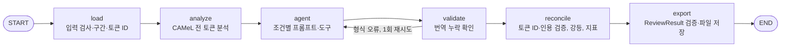
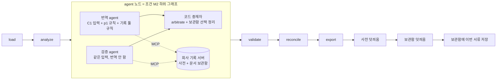

# 시스템 구조

> **보관본(2026-10-23).** 서류 검수 제품(제출본 2026-10-22) 기준 문서다. 원래 위치 `docs/architecture.md`. 지금 기준 문서는 TTS 전환(ADR-023) 뒤 다시 쓴 [docs/](../../README.md)에 있다. 이 보관본은 링크 경로와 이 안내 줄만 고쳤다.

- 기준: 제출본(2026-10-22). 절 번호는 2026-10-20 문서 분할 전 번호를 그대로 쓴다(코드 주석·ADR·실험 기록이 이 번호를 인용한다). 문서 지도는 [docs/README.md](../../README.md).
- 마지막 업데이트: 2026-10-22 (제출본 기준으로 다시 씀)

**요약.** 아랍어 문서 1건은 LangGraph 그래프 하나(노드 6개)를 지난다. LLM은 `agent` 노드에만 있고, 검증·강등·지표 계산은 코드가 한다. 서비스 기본 조건 M2에서는 `agent` 노드가 하위 그래프(번역 agent ∥ 검증 agent → 코드 중재자)가 되고, 두 agent는 회사 기록 MCP 툴로 회사 사전과 문서 보관함을 찾는다. 그래프가 끝나면 코드가 사전 덧씌움과 보관함 덧씌움을 만든다. 확정하는 길은 둘뿐이다. 하나는 이번 문서 안 근거(두 agent 일치 + 코드 근거 검사)이고, 다른 하나는 사람이 확정한 회사 사전이다. 보관함과 LLM은 제안만 한다.

## 4.1 설계 원칙

| 원칙 | 이유 |
| --- | --- |
| 분석기는 모든 조건에서 항상 실행하고, 조건은 LLM에게 보여 주는 것만 바꾼다 | 측정이 LLM의 호출 여부에 따라 달라지면 조건을 비교할 수 없다(ADR-004) |
| 처분 누락 확인과 지표 계산은 코드가 한다 | LLM에게 자기 누락을 세게 하면 같은 실패가 한 단계 뒤에서 반복된다 |
| LLM은 대상을 토큰 ID로 지목한다 | 아랍어 문자열을 다시 쓰면 함자 하나만 달라도 토큰과 맞춰지지 않아 가짜 누락이 생긴다 |
| 고유명사(사람·회사·기관 등 명명된 대상)는 근거 없이 확정하지 않는다 | "가장 흔한 표기"는 근거가 아니다. 유효한 근거는 같은 문서 안의 라틴 문자 표기와 사람이 확정한 회사 사전뿐이다. 지난 서류(보관함)는 제안까지만 한다 |
| 인용은 코드가 원문과 대조한다 | 구조화 출력은 형식이 맞아도 사실 검증이 필요하다 |
| 결과(`ReviewResult`)는 고치지 않고 덧씌움으로만 보강한다 | 실험 경로·골든 테스트와 같은 결과 형식을 지키고, 사전·보관함이 무엇을 바꿨는지 따로 보인다 |
| 고객 범위는 서버가 정한다 | LLM이 고르는 도구 인자로 고객을 받으면 다른 고객의 기록을 부를 길이 생긴다(ADR-022) |
| 조건 사이에서 한 번에 하나만 바꾼다 | 여러 요소를 한꺼번에 바꾸면 무엇이 효과를 냈는지 모른다 |
| LLM이 필요 없는 검증·계산은 일반 함수로 둔다 | 모든 노드를 agent로 만들 필요는 없다. 멀티 에이전트의 중재자도 규칙 함수다 |
| 분석기를 설치하지 못하면 LLM으로 대체하지 않고 멈춘다 | 분석기가 LLM과 독립된 신호라는 점이 측정의 전제다 |

패턴 참고: [ai-flow-learning-lab](https://ai-flow-learning-lab.vercel.app/)(기본 체인, 조건 분기, Agent·Tool, RAG, Multi-Agent, LangSmith).

## 4.2 그래프



| 노드 | 하는 일 | LLM | 핵심 함수 |
| --- | --- | --- | --- |
| load | 조건 검사, 유니코드 NFC, 원문 보존, 구간 → 토큰 ID, 라틴 문자 구간 표시 | 없음 | `text.tokenize` |
| analyze | 모든 아랍어 토큰을 분석해 토큰별 분석 수(0 포함), 후보(모음 표기, 로마자, lemma, 품사, 뜻), 모호 여부, noun_prop 여부를 저장. 모든 조건에서 돈다 | 없음 | `analyzer.analyze_tokens` |
| agent | 조건별 동작(4.4절). M1·M2에서는 하위 그래프(4.7절) | 있음 | `prompts.system_prompt`·`user_message`, `create_agent`, `multi_agent.run_engine`, `multi_agent_m2.run_engine_m2` |
| validate | 모든 `segment_id`에 번역이 있는지 확인. 형식 오류면 1회 재시도(`Settings.max_retries`) | 없음 | `reconcile.parse_c0` |
| reconcile | 토큰 ID 실재 확인, 인용 검증, 강등 규칙(4.5절), [6절](evaluation.md) 지표 | 없음 | `reconcile.reconcile` |
| export | `ReviewResult`로 검증한 뒤 JSON·CSV·실행 메타 저장 | 없음 | `export.write_outputs` |

재귀 한도는 둘이다. 안쪽 `create_agent` 툴 루프는 `Settings.recursion_limit`(기본 25), 바깥 그래프는 `Reviewer.run`의 50이다. 서비스는 `on_node` 콜백으로 노드가 끝날 때마다 진행 이벤트를 받는다. 콜백이 있으면 `graph.stream(stream_mode="updates")`로 돌지만 결과는 `invoke`와 같다.

서비스 기본 조건 M2의 `agent` 노드와 그래프 뒤 처리(그래프 뒤는 서비스 작업 관리자 `web/jobs.py`가 한다):



## 4.3 산출물 형식

**API 결과**(`GET /v1/jobs/{job_id}/result`): `ReviewResult.model_dump()`에 서비스 필드를 더한 JSON이다.

| 키 | 내용 |
| --- | --- |
| `doc_id`, `condition`, `segments`, `translation`, `items`, `unprocessed`, `suspected_missed_names`, `gold_status`, `proper_nouns`, `metrics`, `meta` | `ReviewResult`(`results.py`). 파일·API·DB가 같이 쓰는 계약이고 모르는 키는 오류다(`extra="forbid"`). `items`는 코드 검사 결과(`valid`, `final_decision`, `flags`, `evidence_failure`)가 붙은 항목, `meta`는 실행 메타(`RunMeta`, [6.3절](evaluation.md)) |
| `errors` | 실행 중 오류(`metrics.errors`) |
| `job` | 작업 요약(상태, 조건, 시각, 노드, 보관함 적재 수 등) |
| `dictionary` | 회사 사전 덧씌움(`DictionaryOverlay`): `dictionary_adopt`(보류 → 사전 표기로 확정) / `conflict`(문서 근거와 사전 표기가 다름, 확정 안 함) / `agree` |
| `archive` | 보관함 덧씌움(`ArchiveOverlay`): `archive_suggest`(`agreement: both | one`) / `archive_conflict`, `suggestions[{spelling, hit_id, by, document_id, document_label, document_date, segment_id, quote}]`. 확정이 아니다 |
| `tokens` | 토큰 위치. 화면이 문자열 치환이 아니라 토큰 위치로 이름을 표시한다 |
| `dictionary_customer` | 사전을 조회한 고객(인증을 끈 서버는 `local`) |

**파일 산출물**(`export.write_outputs`): CLI는 `results/debug/` 또는 `--out`, 서비스는 `results/web/<job_id>/`(git 제외)에 쓴다.

- `segments.json`: 구간마다 아랍어 원문, 영어 번역, 항목 목록, 미처리 토큰
- `proper_nouns.csv`: 아랍어 원문, 토큰 ID, 후보와 출처(analyzer / llm), 채택 표기, 처분, 근거, 분석기 분석 수, 플래그
- `metrics.json`: [6절](evaluation.md) 지표(M1·M2는 `engine`에 역할별 사용량·중재 통계·보관함 선택)
- `run_meta.json`: 조건, 모델, 프롬프트 판·해시, 일치 규칙·분석기·패키지 버전, 토큰 사용량, 실행 시간

DB가 있으면 결과 전체를 `runs.result`(JSONB)에 두고, `name_items`에는 `proper_noun` 항목만 펼친다.

## 4.4 조건

| 조건 | 쓰임 | LLM에 주는 것 | 출력 | 호출 방식 |
| --- | --- | --- | --- | --- |
| C0 기본 번역 | 실험(EXP-002·003) | "영어로 번역하라", 원문만 | 자유 텍스트 | `ChatPromptTemplate \| model` |
| C1 지시 | 실험, 서비스 되돌리기용(`REVIEW_CONDITION=C1`) | 처분 규칙 지시문(판 p0 / p1) + 원문·토큰 표 | 구조화 출력(4.5절) | `create_agent(..., response_format=ToolStrategy(AgentOutput))` |
| C2 지시 + 도구 | 실험 | C1 + `analyze_tokens` 툴(호출 여부는 LLM이 정함) | 구조화 출력 | C1과 같음 |
| C3 지시 + 결과 주입 | 실험 | C1 + 분석기 결과(ANALYZER 블록)를 항상 포함 | 구조화 출력 | C1과 같음 |
| M1 멀티 에이전트 틀 | `MULTI_AGENT=true`일 때만 | 번역자(C3 입력) → 격리 검증자 → 규칙 중재자, 순서대로 | `AgentOutput` 모양 | 하위 그래프(4.7절) |
| M2 서비스 기본 | 서비스(`REVIEW_CONDITION`, 기본 `M2`) | 번역 agent ∥ 검증 agent(C1 입력, 지시문 p1), 회사 기록 툴 → 코드 중재자 | `AgentOutput` 모양 + 보관함 선택 | 하위 그래프(4.7절) |

- 서비스가 받는 조건은 C0~C3과 M2이고, M1은 `MULTI_AGENT=true`일 때만 받는다. 묶음 검수 경로는 M2를 받지 않는다(묶음은 대상 ID로만 잇는다, ADR-018).
- C0~C3은 `CONDITIONS`, M1·M2는 `ENGINE_CONDITIONS`에 따로 둔다. 실험 계획·골든·해시 열거가 `CONDITIONS`에 묶여 있어서다.
- C0 → C1은 지시와 출력 형식을 함께 바꾼다. 구조화 출력이 없으면 처분을 셀 수 없기 때문이고, 한계로 기록한다. C3는 "도구를 주는 것"과 "결과가 항상 보이는 것"의 차이를 본다.
- 실험은 같은 문서·같은 모델·같은 설정으로 돈다. 현재 모델은 temperature 0을 받지 않아 `temperature`를 보내지 않는다.
- 측정한 것은 C0~C3(EXP-002·003)뿐이다. M1·M2는 재지 않았다.

## 4.5 출력 스키마와 강등 규칙 (C1~C3, M1·M2 공통)

```json
{
  "translation": [{"segment_id": "s03", "english": "..."}],
  "items": [{
    "token_ids": [41, 42],
    "type": "proper_noun",
    "candidates": [{"reading": "مُسَلَّم", "romanized": "Musallam", "source": "analyzer"}],
    "decision": "hold",
    "adopted": null,
    "reason": "...",
    "confidence": 0.4,
    "evidence": null
  }]
}
```

| 유형 | 허용 처분 |
| --- | --- |
| 일반 단어 (`word`) | 채택(`adopt`, 이유·확신도 필수) / 기권(`abstain`) |
| 고유명사 (`proper_noun`) | 근거 채택(`evidence_adopt`, `evidence`에 구간 ID와 인용 필수) / 보류(`hold`, 후보 나열) |

M2의 번역 agent는 항목마다 `archive{hit_id, spelling} | null`을 더한 `AgentOutputM2`를 낸다. 중재자가 `archive`를 떼어 낸 뒤의 모양은 위와 같다.

reconcile이 코드로 적용하는 규칙:

- 고유명사에 근거 없이 `adopt`를 쓰면 "근거 없는 확정"으로 센다. 보류로 바꿔 주지 않는다. 실패를 지우지 않기 위해서다.
- `evidence_adopt`의 인용이 원문에 없거나 채택 표기와 맞지 않으면 보류로 내리고 "근거 검증 실패"로 센다. 채택 표기가 인용과 맞는지는 근거 검사 규칙으로 본다. v1(EXP-002)은 인용 안 연속 단어열과 일치 규칙 v1로 맞으면 통과한다. v2(EXP-003, ADR-017)는 단어 묶음마다 인용 안 단어열과 엄격 철자가 같아야 하고, 순서·대소문자·MRZ `<`는 무시한다. 규칙은 `Settings.evidence_rule`로 고른다. 기본값 v1은 골든·EXP-002에 묶여 있고, 실험 코드는 각자 값을 정하며, 서비스는 `EVIDENCE_RULE`을 따로 주지 않으면 v2를 쓴다(`web.app.build_runtime`).
- 존재하지 않는 토큰 ID를 가리키는 항목은 무효 항목으로 센다.
- 정답 고유명사와 분석기 모호 토큰 가운데 어느 항목에도 덮이지 않은 것은 "미처리"로 결과에 넣고 센다. 중립 토큰(합성 문서의 지명·국가명·발급 기관·법인 형태)은 처분을 기대하지도 감점하지도 않는다(ADR-014).
- 한 토큰을 여러 항목이 덮으면 고유명사 항목을 대표로 판정한다. 정답 이름 상태와 근거 없는 확정 집계가 같은 기준을 쓴다(ADR-014).
- 고유명사 `abstain`은 보류로, 일반 단어 `hold`는 기권으로 바꾸고 유형·처분 불일치로 센다.
- LLM이 말한 확신도는 기록만 하고 판정에 쓰지 않는다.

## 4.6 툴

LLM이 부르는 툴은 셋이고, 나머지(탐지·검증·집계)는 노드 안의 일반 함수다. LLM이 부를지 말지 고르게 두면 측정하려는 실패(모호한 곳을 말없이 넘김)가 같은 자리에서 반복되기 때문이다. 구조화 출력 `AgentOutput`은 LangChain `ToolStrategy`가 출력용 툴로 노출한다. 상세는 4.9절.

| 툴 | 쓰는 조건 | 붙는 방식 | 상태 |
| --- | --- | --- | --- |
| `analyze_tokens` | C2 | in-process 툴(실험 경로). 서비스에서 `USE_MCP_TOOLS=true`면 stdio MCP 서버의 같은 이름 툴로 바꿔 끼운다(LLM이 보는 이름·인자·설명은 글자 단위로 같음, `tests/test_mcp.py`) | 쓰는 중. `USE_MCP_TOOLS` 기본은 끔 |
| `search_company_records` | M2 | 회사 기록 MCP 서버(같은 프로세스, 메모리 전송). 역할당 최대 2회 | 서비스 기본 경로 |
| `search_bundle` | C1~C3(`extra_tool_factories`) | LangChain 툴(`rag/bundle.py`). `ENABLE_BUNDLE_SEARCH=true`와 `--bundle`을 함께 줄 때만 | 꺼짐(ADR-007) |

MCP 서버는 둘이다.

| 서버 | 노출 항목 | 쓰는 곳 |
| --- | --- | --- |
| 회사 기록 서버 `mcp/records.py`(FastMCP) | 툴 `search_company_records` | M2의 두 agent. `build_runtime`이 Runtime의 사전·보관함을 그대로 쓰는 서버를 만들어 `FastMCPTransport`로 붙인다. 고객 범위는 작업마다 발급하고 끝나면 없애는 128비트 범위 토큰(MCP `_meta`)으로만 정한다. 쓰기·확정 도구는 없다. 외부 클라이언트용 `/mcp`는 열지 않았다 |
| 분석기 서버 `mcp/server.py`(FastMCP, stdio, `python -m tashkeel_check.mcp.server`) | 툴 `analyze_tokens`·`search_bundle(documents, entity_id, arabic_name)`, 리소스 `document://synthetic/{split}`·`document://synthetic/{split}/{doc_id}`(gold 제외)·`document://synthetic/bundles/{split}[/{bundle_id}]`, 프롬프트 `review_instructions(condition)` | 서비스에서 `USE_MCP_TOOLS=true`일 때 C2의 `analyze_tokens`. `search_bundle`은 외부 에이전트용 부품이고 그래프에는 끼우지 않는다 |

실험 경로(CLI `run`, `exp001`~`exp003`)는 in-process 툴만 쓴다(ADR-004). 클라이언트(`mcp/client.py`)는 전용 스레드의 이벤트 루프에서 한 번 연결해 잠금으로 하나씩 보내고, 타임아웃만 지수 백오프로 재시도한다. MCP 서버가 죽으면 작업을 실패로 기록하고 in-process로 대체하지 않는다.

## 4.7 멀티 에이전트: M1 틀과 서비스 기본 M2

M1과 M2 모두 그래프의 `agent` 노드만 하위 그래프로 바뀌고 `validate`·`reconcile`·`export`는 그대로다. 형식 재시도 때는 두 역할이 다 다시 돈다.

**중재 규칙(`multi_agent.arbitrate`, M1·M2 공통, LLM 없음):** 번역은 번역 쪽 것을 쓴다. `word`는 통과한다. `proper_noun`은 토큰 집합이 같은 검증 쪽 항목과 짝지어, **둘 다 근거 채택 + 철자 정확 일치(`strict_form`) + 둘 다 `reconcile.verify_evidence` 통과**일 때만 확정한다. 아니면 보류이고, 사유 코드(`translator_unsupported_adopt | verifier_missing | verifier_hold | spelling_disagree | evidence_failed`)를 남기며 후보는 합집합이다. 검증 쪽만 낸 이름은 보류로 더한다. 보류로 바뀐 이름이 번역문에 채택 철자 그대로 있으면 `[c1/c2]`로 고쳐 쓴다(`n_translation_rewritten`). 다수결이나 근거 생성은 없다. 통계는 `metrics.engine`에 남는다.

| | M1 (`multi_agent.py`) | M2 (`multi_agent_m2.py`) |
| --- | --- | --- |
| 켜는 법 | `MULTI_AGENT=true` + `condition=M1` | 서비스 기본(`REVIEW_CONDITION=M2`) |
| 실행 순서 | 번역자 → 검증자 → 중재자(순서대로) | 번역 agent와 검증 agent가 START에서 동시에 갈라져 중재자에서 합친다. 같은 단계에서 돌기 때문에 사용량·툴 기록·오류를 역할별 키(`t_*`·`v_*`)에 따로 쓴다 |
| 번역 쪽 입력·지시문 | C3 입력(원문·토큰 표·분석기 블록) + 묶음 참고 블록(있을 때), C3 지시문 | C1 입력(분석기 블록 없음), `C1_SYSTEM_P1` + 규칙 8(기록 툴, `M2_RECORDS_RULE`) |
| 검증 쪽 | 같은 입력, `M1_VERIFIER_SYSTEM`(번역 안 함, 고유명사마다 처분). 번역 쪽 출력은 보지 않는다 | 같은 입력, `M2_VERIFIER_SYSTEM`(M1 검증 규칙 + 나뉜 이름 규칙 + 기록 툴 규칙). 번역 쪽 출력은 보지 않는다 |
| 출력 | `AgentOutput` / `VerifierOutput` | `AgentOutputM2` / `VerifierOutputM2`(항목마다 `archive` 선택) |
| 툴 | extra 툴만(`search_bundle` 훅, 꺼짐). 묶음 LLM 검수에서는 다른 서류·사전의 영문 표기를 `BUNDLE EVIDENCE` 블록으로 참고만 준다 | `search_company_records`, 역할당 최대 2회(`ToolCallLimitMiddleware`) |
| 측정 | 안 함. 가짜 모델로만 테스트 | 안 함. 실제 모델 작동 확인 2회(`docs/과제2-테스트-기록.md` 8.3절) |

**M2 부품이 맡은 일(ADR-022):**

| 부품 | 하는 일 | 코드 |
| --- | --- | --- |
| agent | 두 agent가 이름 목록(토큰 ID 묶음)을 한 번에 넘겨 기록 툴을 직접 부른다. 아랍어와 문맥은 래퍼가 토큰 표에서 만든다(LLM이 아랍어를 다시 쓰지 않게) | `multi_agent_m2.py`, `mcp/records.py` |
| RAG | 같은 고객이 전에 올린 서류의 구절 가운데 같은 아랍어 이름이 단어 단위로 있는 것을 고르고(접두 و·ب·ل·ف·ك 허용, 공백 뺀 3글자 미만은 찾지 않음), 이번 서류의 이름 주변 문맥(구간 ±1)과 임베딩이 비슷한 순서로 이름당 최대 4개 돌려준다. 사람이 확정한 사전 표기가 있으면 그것만 돌려준다. 이름은 임베딩만으로 잘 잡히지 않으므로 아랍어 일치가 주 경로이고 임베딩은 순서만 정한다 | `archive/search.py` |
| MCP | 회사 기록을 고객 범위로 묶어 내준다(4.6절) | `mcp/records.py` |
| 코드 중재자 | 항목에서 `archive`를 떼고 `arbitrate()`를 그대로 부른다(확정 규칙이 M1과 같다). 보류로 남은 이름의 보관함 선택은 그 역할의 툴이 실제로 돌려준 `hit_id`만 받아 `metrics.engine.archive`에 적는다 | `multi_agent_m2.archive_claims` |

**보관함 선택은 확정을 바꾸지 못한다.** 화면에 낼지는 그래프 뒤의 보관함 덧씌움(`archive_apply.apply_archive`)이 정한다. 사전 덧씌움 다음에 돌고 사전이 이긴다. 보류(`hold`)이거나 근거 검증에 실패한 확정(`adopt_unsupported`)이면서 사전 덧씌움이 없는 항목만 본다. 보관함 원문을 다시 읽어 (1) 같은 고객인가 (2) 이번 서류가 아닌가(ID와 파일 해시) (3) 이름이 그 구절에 단어 단위로 있는가 (4) 철자가 구절 안 라틴 문자와 글자 그대로 같은가(`strict_words_in_quote`, 근거 검사 v2)를 확인한다. 통과한 철자가 하나면 `archive_suggest`(두 agent가 같은 철자를 골랐으면 `agreement: both`), 둘 이상이면 `archive_conflict`다. 사람이 제안을 누르면(`POST /v1/dictionary`의 `archive_hit_id`) 사전에 등록되고 근거 서류는 그 지난 서류로 남는다.

**보관함에 넣는 것:** 검수를 마친 업로드·붙여넣기 서류만 넣는다(합성 샘플·묶음 서류는 넣지 않는다). 조건과 무관하게 넣으므로 C1 작업도 보관함을 채운다. 아랍어가 있고 그 구간이나 다음 구간에 라틴 문자가 있는 구간만 구절로 남긴다(구절당 600자 상한). 저장은 메모리(재시작하면 비어 있음) 또는 Postgres `archive_documents`·`archive_passages`다. 임베딩은 실수 배열로 두고 유사도는 Python에서 계산한다(pgvector는 쓰지 않는다, ADR-011·022). 실제 모델 서비스는 OpenAI 임베딩(`EMBEDDING_MODEL`, 기본 `text-embedding-3-small`)이라 보관함 글이 OpenAI로 간다. 가짜 모델이면 연습용 문자 n-gram 임베딩이다.

**M2가 바꾸지 않는 것:** 문서 안 근거로만 확정한다는 규칙, 근거 검사, C0~C3·M1의 지시문·스키마·해시, 골든 160건, 실험 경로. M2 지시문은 p1에서만 정의한다(`prompt_hash("M2")`는 판과 무관).

**재지 않은 것:** M2의 정확도·비용·시간. 합성 시험지의 99%(EXP-003)는 C1 값이다. 비교 실험(EXP-005 [제안])은 하지 않았다. 알려진 문제: 두 agent가 이름을 다른 단위로 내면(전체 이름 한 항목 / 단어별) 짝지어지지 않아 한쪽 항목이 따로 보류로 더해진다([TS-005](../../troubleshooting.md), 미해결).

## 4.8 저장소 구조

```text
pyproject.toml, uv.lock      Python 3.11, uv. ruff·mypy·pytest 설정(ADR-013)
.env.example                 설정 키(MODEL, LLM_BACKEND, REVIEW_CONDITION, DATABASE_URL, AUTH, OCR_*, EMBEDDING_MODEL, 실험 규모 등)
.pre-commit-config.yaml      ruff·mypy 훅
.github/workflows/ci.yml     ruff·mypy·pytest(live·camel 제외)
Dockerfile, docker-compose.yml, .dockerignore   완제품 패키지: app + postgres(pgvector/pgvector:pg16 이미지)
run.sh                       키·포트·DB 검사 → alembic upgrade → tashkeel serve → /health 대기
scripts/smoke.sh             패키지 스모크(docs/deploy.md)
alembic/, alembic.ini        마이그레이션 0001~0004
src/tashkeel_check/
  config.py                  Settings(검증하는 pydantic 모델, 환경 변수는 load_settings만 읽음), 조건 목록, LangSmith 설정
  errors.py                  TashkeelError → InputError(400·종료 2) / ConfigError·AnalyzerUnavailable(503·종료 3)
  text.py                    정규화, 구간·토큰 ID, normalize_key
  analyzer.py                CAMeL 래퍼, 격어미 제거, 모호 판정, thread_safe_analyze
  romanize.py                romanize, match_spelling(v1), 엄격 철자 strict_*(ADR-017)
  schemas.py                 구조화 출력 AgentOutput
  prompts.py                 C0~C3 지시문(판 p0·p1), M1·M2 역할 지시문, prompt_hash
  tools.py                   analyze_tokens 툴
  fake.py                    가짜 모델(연습 모드·테스트. M2는 번역하지 않고 기록 툴로 찾은 이름만 보류로 낸다)
  graph.py                   StateGraph(6노드)
  multi_agent.py             M1 틀: 번역자 → 격리 검증자 → 규칙 중재자(arbitrate)
  multi_agent_m2.py          M2: 두 역할 동시 실행, 기록 툴, archive_claims
  reconcile.py               강등 규칙(근거 검사 v1·v2), 지표
  scoring_v2.py              gold 형식 2의 이름 부분별 안전·엄격 판정(채점 v2, ADR-017)
  results.py                 결과 형식 ReviewResult(파일·API·DB 공통 계약)
  export.py                  JSON·CSV·run_meta 쓰기
  runner.py                  Reviewer(그래프 한 번 빌드, 문서마다 재사용), make_model, LangSmith @traceable
  dictionary_apply.py        회사 사전 덧씌움(ADR-021)
  archive_apply.py           보관함 제안 덧씌움(ADR-022)
  archive/                   store.py(구절·서류 형식, 메모리 저장소), search.py(CompanyArchive: 색인·찾기·제안 확인, 임베딩)
  ocr/                       base.py(OcrBackend 프로토콜), extract.py(extract_text), ocrspace.py(무료 OCR API)
  mcp/                       records.py(회사 기록 서버·범위 토큰·LLM용 툴 래퍼), server.py(분석기 stdio 서버),
                             client.py(MCPClient: stdio·메모리 전송, 재시도), tools.py(MCP 툴을 그래프 툴로 감쌈)
  web/                       app.py(build_runtime·create_app·엔드포인트·정적 파일), jobs.py(작업 스레드·SSE·덧씌움·보관함 적재),
                             db.py(엔진·세션), models.py(표 11개), auth.py(API 키), customers.py, usage.py,
                             archive.py(보관함 Postgres 저장소), bundles.py·bundle_jobs.py(묶음 검수, 보류),
                             static/index.html(Vue 3 한 파일 화면: #/upload, #/result/{id}, #/bundle)
  bundle/                    묶음 검수(ADR-018, 보류): schemas, loader, extractor, evidence, rules, dictionary(DictionaryLookup),
                             pipeline, mrz, upload, draft
  rag/bundle.py              묶음 검색 틀(Qdrant 메모리 모드, 꺼짐), 연습용 임베딩 PracticeEmbeddings
  data/                      names.py(이름 정렬), wikidata.py, synthetic.py, synthetic_hard.py, bundles.py, kyc_bundles.py
  experiments/               harness.py(재개·동시 실행·통계·단계 판단), exp001.py, exp002.py, exp003.py, tiers.py(flex 처리 등급)
  cli.py                     tashkeel 하위 명령(아래 표)
data/                        wikidata/, synthetic/{dev,eval}/, synthetic/bundles/{dev,eval}/, synthetic-hard/{dev,eval}/, bundles/sample/
results/                     실험 결과(exp001은 git에 보존, 나머지·debug·web은 git 제외)
tests/                       pytest. golden/(골든 스냅숏 160건), test_llm_inputs.py(LLM 입력 해시), 기능별 테스트
docs/                        문서(docs/README.md가 지도)
```

**기술 스택**

| 층 | 쓰는 것 | 비고 |
| --- | --- | --- |
| 언어·환경 | Python 3.11, uv, ruff, mypy, pytest | Docker 이미지는 `python:3.11-slim` |
| 아랍어 분석 | CAMeL Tools 1.6.0 + 형태소 DB calima-msa-r13 | GPL v2라 측정에만 쓴다(ADR-005). 분석기는 모든 조건에서 돌지만 판정은 LLM 처분과 코드 검사로 한다 |
| LLM | OpenAI `openai:gpt-6.1-sol`, `init_chat_model`, `.env`의 `MODEL`로 교체 | ADR-006 |
| 에이전트·그래프 | LangGraph `StateGraph`, LangChain `create_agent` + `ToolStrategy` 구조화 출력, `ToolCallLimitMiddleware` | langchain 1.4.5, langgraph 1.2.15 |
| RAG(보관함) | 아랍어 이름 단어 일치 → 임베딩 코사인 순서, OpenAI `text-embedding-3-small`(가짜 모델이면 n-gram) | 벡터 DB 없음. Qdrant는 묶음 검색 틀(꺼짐)에만 있다 |
| MCP | FastMCP 4.1.3 서버 + `mcp` 2.3.0 클라이언트 | 회사 기록 서버는 메모리 전송, 분석기 서버는 stdio |
| API·화면 | FastAPI 0.156.4 + uvicorn, SSE, Vue 3.5(CDN, 빌드 없는 한 파일) | 그래프 노드가 동기라 작업은 스레드에서 돌리고 진행은 노드 단위 이벤트만 보낸다 |
| 저장 | Postgres 16, SQLAlchemy 2, psycopg 3, Alembic. `DATABASE_URL`이 없으면 메모리 | ADR-011. pgvector 확장은 쓰지 않는다 |
| 입력 | pypdf(텍스트 층), OCR 백엔드 `none` / `ocrspace`(무료 API, 파일이 제3자에게 간다) | 인식 성능은 재지 않았다(ADR-021) |
| 인증 | API 키(`tk_` + 48자, sha256만 저장), `X-API-Key` / Bearer / SSE는 `?api_key=` | ADR-019 |
| 관측 | LangSmith `@traceable`(키가 있을 때만), `run_meta.json` | 범위 토큰은 `Reviewer.run`의 추적 입력에서 뺀다 |
| 배포 | Docker Compose(app + postgres), `run.sh` | [deploy.md](../../deploy.md) |

**서비스 기동.** `web.app.build_runtime(settings)`가 모델·분석기·DB·저장소(사전·고객·사용량·묶음·보관함)·OCR 백엔드·회사 기록 MCP 서버·(켰으면) 분석기 MCP 클라이언트·`Reviewer`를 먼저 만든다. 하나라도 실패하면 `ConfigError`이고 `tashkeel serve`는 종료 코드 3으로 멈춘다. `create_app(runtime)`이 엔드포인트를 붙인다. `InputError`는 400, `ConfigError`는 503, 인증 실패는 401(`kind: "auth"`)이다. `DATABASE_URL`이 없으면 메모리·파일만으로 돌고, 있는데 닿지 않으면 기동은 하되 `/health`의 `db: false`와 작업 생성 503이다.

**API 엔드포인트**(`web/app.py`). `/v1/*`는 모두 API 키 인증을 거친다(`AUTH=auto`면 고객이 하나라도 있을 때만 필수).

| 묶음 | 엔드포인트 | 하는 일 |
| --- | --- | --- |
| 상태 | `GET /health` | 모델·백엔드·분석기·DB·MCP·인증·조건 목록·기본 조건·보관함·OCR·사전 고객 |
| 단일 문서 검수 | `POST /v1/reviews/upload` | 파일 하나 → 추출 → 구간 → 검수 작업(202). 조건을 비우면 `REVIEW_CONDITION` |
| | `POST /v1/reviews` | 붙여넣은 텍스트·구간 또는 합성 dev 문서(`doc_id`)로 검수 작업(202) |
| | `POST /v1/extract` | 추출만 |
| | `GET /v1/samples`, `GET /v1/samples/{doc_id}` | 합성 dev 샘플 |
| 작업 | `GET /v1/jobs`, `GET /v1/jobs/{job_id}` | 목록·상태 |
| | `GET /v1/jobs/{job_id}/events` | SSE 진행(`queued` → `node` … → `done` / `error`) |
| | `GET /v1/jobs/{job_id}/result` | 결과(4.3절) |
| 회사 사전 | `POST /v1/dictionary` | 사람이 확정한 표기 등록(`job_id + token_ids`, 선택 `english_name`·`archive_hit_id`) |
| | `GET /v1/dictionary`, `DELETE /v1/dictionary/{entry_id}` | 목록·취소 |
| 보관함 | `GET /v1/archive`, `DELETE /v1/archive/{document_id}` | 보관함 서류 목록·빼기 |
| 사용량 | `GET /v1/usage` | 고객별 작업 사용량(`from`·`to`) |
| 묶음 검수(보류) | `POST /v1/bundles/review`, `POST /v1/bundles`, `POST /v1/bundles/draft`, `GET /v1/bundles`, `GET /v1/bundles/samples[/{bundle_id}]`, `GET /v1/bundles/{bundle_id}[/items|/pending]`, `POST /v1/bundles/{bundle_id}/reviews`, `GET /v1/bundles/{bundle_id}/reviews/{review_id}[/events]` | ADR-018·019. 코드와 테스트는 있고 추가 개발은 하지 않는다 |
| 화면 | `/`(정적 파일) | `#/upload`, `#/result/{job_id}`, `#/bundle` |

**Postgres 표 11개**(`web/models.py`, Alembic):

| 표 | 내용 | 마이그레이션 |
| --- | --- | --- |
| `documents` | 입력 문서(정규화 원문, 구간, 토큰, 해시, 고객) | 0001(0004에서 `customer_id` 색인·되채우기) |
| `jobs` | 작업 상태(조건, 고객, 노드, 시각, 오류) | 0001(0003에서 `customer_id`) |
| `runs` | 실행 결과(모델, 프롬프트 해시, 지표, 메타, 사용량, `result` JSONB) | 0001 |
| `name_items` | 고유명사 항목 펼침(처분, 근거 출처·서류·구간·인용) | 0001(0002에서 `evidence_document_id`) |
| `bundles`, `review_items` | 묶음 입력과 묶음 검수 결과(보류 기능) | 0002 |
| `name_dictionary` | 회사 사전. 유일 키 (고객, 대상 ID, 정규화 아랍어). 단일 문서 경로는 대상 ID `"*"` | 0002 |
| `customers`, `usage` | 고객·API 키 해시, 사용량 | 0003 |
| `archive_documents`, `archive_passages` | 보관함 서류와 구절(임베딩 실수 배열) | 0004 |

**주요 명령**

| 명령 | 하는 일 |
| --- | --- |
| `uv run tashkeel serve` 또는 `./run.sh` | 서비스(API·화면). `.env`의 `LLM_BACKEND`·`REVIEW_CONDITION`·`DATABASE_URL`·`AUTH`·`OCR_*`·`USE_MCP_TOOLS`·`WEB_PORT`. 키·분석기·MCP가 없으면 기동 거부(종료 코드 3) |
| `uv run alembic upgrade head` | Postgres 표 11개 생성·갱신(`DATABASE_URL` 필요) |
| `uv run tashkeel customers add --name X` / `list` / `revoke <id>` | 고객과 API 키. 키는 발급 때 한 번만 출력. `DATABASE_URL` 필요 |
| `docker compose up -d --build` / `./scripts/smoke.sh` | 완제품 패키지 기동 / 스모크([deploy.md](../../deploy.md)) |
| `uv run tashkeel run --doc data/synthetic/dev/dev_001.json --condition all --fake` | 문서 1개를 C0~C3로 실행(연습 모드), `results/debug/`에 파일 |
| `uv run tashkeel run --doc ... --condition C2` | 실제 OpenAI 모델로 실행(키 필요) |
| `uv run tashkeel fetch-wikidata` (`--pool-only`) | Wikidata 스냅숏과 이름 풀 / 저장된 스냅숏으로 이름 풀만 |
| `uv run tashkeel make-synthetic` / `make-synthetic-hard --split dev` / `make-bundles` | 합성 문서 / 어려운 합성 문서(eval은 이미 있으면 거부) / 합성 묶음 |
| `uv run tashkeel inspect-gold --case C2 --n 2` | synthetic-hard 문서의 구간별 정답을 읽기 좋게 출력 |
| `uv run tashkeel exp001 --split dev` | EXP-001 |
| `uv run tashkeel exp002 ...` / `exp002-status` | EXP-002(재개·동시 실행·멈춤, ADR-016) / 진행·사용량 |
| `uv run tashkeel exp003 --split dev --fake --repeats 1 --workers 4` | EXP-003 연습. 실제 실행은 `--split eval --workers 16 --service-tier flex|default --yes`(ADR-020) |
| `uv run tashkeel exp003-status` / `exp003-errors` / `exp003-rescore` | 진행·사용량 / 사람 확인용 `errors.csv` / 저장된 출력을 지금 채점 코드로 다시 채점(참고 값) |
| `uv run tashkeel bundle-search` | 묶음 검색 틀 직접 시험 |
| `uv run python -m tashkeel_check.mcp.server` | 분석기 MCP 서버(stdio) 단독 실행 |
| `uv run pytest -m "not live"` | 테스트(골든 포함). `live`는 실제 OpenAI를 부른다. `db` 마커는 `DATABASE_URL`이 닿을 때만 |
| `uv run ruff check . && uv run ruff format --check . && uv run mypy` | 린트·서식·타입 검사(CI와 같음) |

**묶음 검수 데이터 흐름(보류 기능, LLM 없음):** 묶음 JSON → `extract_names`(라벨 칸의 아랍어 값) → `search_evidence`(같은 묶음·다른 서류·같은 `entity_id`의 영문 칸. 여권 성·이름 칸은 합치고 MRZ는 해독하되, 같은 서류에 인쇄 칸이 있으면 MRZ는 뺀다) → `validate_evidence` → `decide_status` → `ReviewItem`. LLM 경로는 서류마다 단일 문서 그래프(C1~C3, 켜면 M1)를 돌려 같은 판정 함수에 합류시킨다.

## 4.9 툴 상세

### LLM이 호출하는 툴

#### analyze_tokens

| 항목 | 내용 |
| --- | --- |
| 하는 일 | 토큰 ID에 대해 CAMeL 형태소 분석기의 독법 후보를 돌려준다 |
| 입력 | `{"token_ids": list[int]}` |
| 출력 | 토큰마다 `{token_id, surface, analysis_count, ambiguous, candidates[{reading, romanized, pos, gloss}], candidates_truncated}` |
| 호출 시점 | C2에서 LLM이 정한다. 결과는 `analyze` 노드가 미리 계산한 값이라 조건과 무관하게 같다(분석기를 다시 돌리지 않는다) |
| 실패 시 | 없는 ID는 `{"token_id", "error": "unknown token id"}`, 아랍어가 아닌 토큰은 `"not an Arabic token"`. 분석기 자체를 쓸 수 없으면 그래프가 `analyze` 단계에서 멈춘다. LLM 추정으로 대신 채우지 않는다 |
| 기록 | 호출마다 `tool_log`에 조회한 토큰과 오류 수(MCP 경유면 `via: "mcp"`). 지표: 호출 수, 모호 토큰 중 조회된 비율, 조회한 토큰 중 모호 토큰 비율 |

#### search_company_records (M2, MCP)

| 항목 | 내용 |
| --- | --- |
| 하는 일 | 고객의 회사 기록을 찾는다: 사람이 확정한 사전 표기, 없으면 전에 올린 서류의 같은 아랍어 이름 구절(근처 라틴 문자 포함) |
| 입력(LLM) | `{"names": list[list[int]]}`(이름마다 토큰 ID 묶음, 한 번에 최대 40개). 아랍어·문맥은 래퍼가 토큰 표에서 만든다. 고객 범위는 MCP `_meta`의 작업별 토큰으로만 |
| 출력 | 이름마다 `{token_ids, arabic, dictionary{english, entry_id} | null, hits[{hit_id, document, date, text, latin_candidates, similarity}]}`. 사전이 있으면 `hits`는 비운다 |
| 호출 시점 | M2의 번역·검증 agent가 정한다. 역할당 최대 2회 |
| 실패 시 | 범위 토큰이 없으면 부르지 않고 빈 목록, 거부되면 `[{"error"}]`를 LLM에게 돌려주고 기록한다. MCP 서버가 실행 중 끊기면 작업을 실패로 기록한다 |
| 기록 | `tool_log`에 역할·이름 수·사전 적중 수·돌려준 `hit_id`·`via: "mcp"`. 중재자는 그 역할이 받은 `hit_id`만 보관함 선택으로 인정한다 |
| 비고 | 결과는 근거가 아니다. `verify_evidence`는 이번 문서 구간만 받는다. 화면에 내는 제안은 `archive_apply`가 원문으로 다시 확인한다 |

#### AgentOutput (구조화 출력)

| 항목 | 내용 |
| --- | --- |
| 입력(LLM이 채움) | `translation[{segment_id, english}]`, `items[{token_ids, type, candidates[{reading, romanized, source}], decision, adopted, reason, confidence, evidence{segment_id, quote}}]` |
| 허용 처분 | `word`: `adopt` / `abstain`. `proper_noun`: `evidence_adopt` / `hold` |
| 호출 시점 | C1~C3과 M1·M2 번역 쪽의 마지막 응답 |
| 실패 시 | 스키마 오류는 `ToolStrategy`가 LLM에게 되돌려 다시 쓰게 한다. 구간이 빠지면 `validate`가 1회 재시도한다. 그래도 실패하면 실패한 채로 대조·저장한다 |

#### search_bundle (묶음 검색 틀, 꺼짐)

| 항목 | 내용 |
| --- | --- |
| 하는 일 | 고객 참고 자료 묶음에서 같은 이름이 어떻게 적혔는지 찾는다 |
| 입력 | `{"token_ids": list[int], "romanized_candidates": list[str]}` |
| 출력 | `[{method, source, parent_id, line_no, text, latin_candidates, score}]`. method는 `arabic_exact` / `romanized` / `vector` |
| 호출 시점 | `ENABLE_BUNDLE_SEARCH=true`이고 `--bundle`을 줄 때만. C0~C3 비교에는 쓰지 않는다 |
| 실패 시 | 결과가 없으면 빈 목록. 근거가 없으면 보류가 맞는 처분이다 |
| 비고 | 묶음 밖의 인용은 `verify_evidence`가 검증하지 못한다. 묶음 검수의 교차 서류 확정은 `bundle/rules.decide_status`가 한다(ADR-018) |

### 노드 안의 일반 함수

| 함수 | 규칙 | 버전 |
| --- | --- | --- |
| 모호 판정 (`summarize`) | 격어미·탄윈·수쿤을 뗀 모음 표기(`strip_case_ending`)가 서로 다른 후보가 둘 이상이면 모호. 원시 분석 수는 따로 기록 | EXP-001 전에 고정 |
| `romanize` | 모음 표기 아랍어 → ASCII. 단모음, 장모음, 샷다(겹자음), 관사(al-)를 살린다 | v0 |
| `match_spelling` | 관사·하이픈·아포스트로피를 걷고, 붙여 쓴 Abdul을 abd로, 영문 e는 a·i·u, o·ou는 u·aw로 펼치고, th·dh·z·d와 q·k를 같게 보고, 겹글자를 접은 정규형이 같으면 같은 이름. 아니면 대표형끼리 자음 한 글자 차이(또는 y↔i, w↔u)만 허용하고 모음 차이는 다른 이름. 방언 옵션은 q↔g를 더함 | v1(ADR-015) |
| 엄격 철자 `strict_*` | 대소문자·공백·하이픈·아포스트로피·MRZ `<`·연결어(bin·bint·ibn)만 무시하고 모음·자음은 글자 그대로 | s1(ADR-017) |
| `verify_evidence` | 인용한 구간이 있고, 인용에 라틴 문자가 있고, 인용이 그 구간 원문에 있고, 채택 표기가 인용과 맞아야 통과(v1: `match_spelling`, v2: `strict_words_in_quote`). 실패하면 보류로 내리고 실패 사유를 남긴다 | v1·v2(4.5절) |
| 강등 규칙 | 4.5절 | — |
| C0 판정 | 번역문에 후보 표기가 둘 이상 나오거나, 일치한 표기 바로 앞뒤 3자 안에 불확실 표시가 있거나, "/"·"?"가 든 괄호 안에 있으면 표시한 것으로 본다 | v0 → t2(EXP-003, 잘린 창 버그 수정). 20건 수동 확인은 안 했다 [미확인] |
| `dictionary_apply.apply_dictionary` | 고유명사마다 고객 + `"*"` + 정규화 아랍어로 회사 사전을 조회해 덧씌움을 만든다. 보류·근거 검증 실패 + 적중 → `dictionary_adopt`, 문서 근거 확정과 표기가 다르면 `conflict`, 같으면 `agree`. `name_text`가 같은 이름의 여러 등장을 묶은 항목("نوال نوال")의 반복을 걷어 키를 만든다 | ADR-021 |
| `archive_apply.apply_archive` | 4.7절 "보관함 선택은 확정을 바꾸지 못한다" | ADR-022 |
| `ocr.extract_text` | .txt/.md는 그대로, .pdf는 `pypdf` 텍스트 층에 아랍어 토큰이 있으면 그대로, 없으면 OCR 백엔드, 이미지는 OCR 백엔드. 업로드 상한 `UPLOAD_MAX_BYTES`(기본 5MB), OCR 상한 `OCR_MAX_BYTES`(기본 1MB) | ADR-021 |

## 4.10 실행 환경

| 항목 | 내용 |
| --- | --- |
| Python·패키지 | Python 3.11(camel-tools 1.6.0 요구 사항, `requires-python >=3.11,<3.13`). 버전은 `uv.lock`(langchain 1.4.5, langgraph 1.2.15, langsmith 0.14.8, langchain-openai 1.7.1, camel-tools 1.6.0, fastapi 0.156.4, fastmcp 4.1.3, mcp 2.3.0, sqlalchemy 2.1.5) |
| 형태소 DB | `uv run camel_data -i morphology-db-msa-r13`로 받는다. `--fake`로 돌려도 필요하다(가짜 모델은 LLM만 대체) |
| 키 | 실제 모델·임베딩은 `OPENAI_API_KEY`. 선택: `LANGSMITH_API_KEY`(추적), `OCR_API_KEY`(`OCR_BACKEND=ocrspace`). 키가 없으면 `LLM_BACKEND=fake`로만 돈다(조용히 가짜로 바뀌지 않는다) |
| 모델 설정 | `gpt-6.1-sol`은 temperature 0을 거부해 보내지 않는다. 같은 입력도 실행마다 결과가 다를 수 있다 |
| 걸프 방언 DB | CAMeL 목록에 `morphology-db-glf-01`(CC BY 4.0)이 있다. 이름 후보 비교 대상으로 검토할 만하다 [제안, 미채택] |

## 4.11 코드 대조

`src/tashkeel_check/`를 직접 읽어 위 설계와 맞춘 결과다(2026-10-22 제출본).

### 한 줄 요약

LangGraph 그래프 하나(노드 6개)가 아랍어 문서 1건을 받아 번역과 이름별 처분(확정/보류)을 내고, 검증·강등·지표 계산은 코드가 한다. LLM은 `agent` 노드에만 있다. 조건 C0~C3는 `agent`가 LLM에게 무엇을 보여 주는지만 바꾸고, M1·M2는 `agent`를 하위 그래프로 바꾼다. 서비스는 같은 그래프를 `Reviewer`로 부르고, 결과 위에 사전·보관함 덧씌움을 얹는다.

### 실행 경로

```text
서비스 (uv run tashkeel serve)
 └─ web.app.create_app → web.jobs.JobManager(스레드)
      → runner.Reviewer.run(doc, condition, on_node, records_scope) → graph
      → dictionary_apply.apply_dictionary → archive_apply.apply_archive → archive.CompanyArchive.index_document
      → web.db(runs·name_items·usage)

CLI (uv run tashkeel <cmd>)
 ├─ run            → runner.run_document → graph
 ├─ exp002(-status) → experiments/exp002 → harness.run → runner(실행마다 모델·그래프 새로), runs.jsonl로 재개
 ├─ exp003(-status·-errors·-rescore) → experiments/exp003 → harness.run(Spec: p1·v2, 99% 판정, 참고 조건 C1p0, 단계 판단)
 ├─ exp001         → experiments/exp001 (그래프를 쓰지 않음: analyzer + data/names.align + romanize)
 ├─ fetch-wikidata → data/wikidata (SPARQL → gcc_persons.json → name_tokens.json)
 ├─ make-synthetic / make-synthetic-hard / make-bundles → data/synthetic·synthetic_hard·bundles·kyc_bundles
 ├─ inspect-gold   → synthetic-hard 정답 출력
 ├─ bundle-search  → rag/bundle (그래프 밖에서만)
 ├─ customers      → web.customers (DATABASE_URL 필요)
 └─ serve          → 위 서비스
```

### 그래프 상태 (`graph.GraphState`)

`doc_id`, `condition`, `segments`, `gold`(reconcile 전용. `runner.split_gold`가 떼어 넘기고 프롬프트에는 들어가지 않음), `out_dir`, `meta`, `tokens`, `analyses`, `output`, `tool_log`, `usage`, `attempts`, `errors`, `valid`, `reconciled`, `result`, `bundle_evidence`(M1 묶음 참고용), `engine`(M1·M2 역할별 사용량·중재 통계·보관함 선택), `records_scope`(M2 범위 토큰).

### 조건 분기 (agent 노드 안에서만)

| 조건 | 호출 방식 | 툴 | 시스템 프롬프트 | 사용자 메시지 |
| --- | --- | --- | --- | --- |
| C0 | `ChatPromptTemplate \| model`, 자유 텍스트 | 없음 | `C0_SYSTEM` | 원문만 |
| C1 | `create_agent(..., response_format=ToolStrategy(AgentOutput))` | extra만 | `C1_SYSTEM`(p0) / `C1_SYSTEM_P1`(p1) | 원문 + 토큰 표 |
| C2 | C1과 같음 | `analyze_tokens` + extra | C1 + `C2_TOOL_LINE` | C1과 같음 |
| C3 | C1과 같음 | extra만 | C1 + `C3_ANALYZER_LINE` | C1 + ANALYZER 블록 |
| M1 | `run_engine`: 번역자 → 검증자 → `arbitrate` | extra만 | `engine_system_prompts`(C3 지시문, `M1_VERIFIER_SYSTEM`) | C3 입력(+ 묶음 참고 블록) |
| M2 | `run_engine_m2`: 두 역할 동시 → `arbitrate` | `search_company_records` | `C1_SYSTEM_P1` + `M2_RECORDS_RULE`, `M2_VERIFIER_SYSTEM` | C1 입력 |

`extra_tool_factories`(`search_bundle`용 훅, `ToolFactory = Callable[[tokens, tool_log], BaseTool]`)는 C1·C2·C3 모두에 붙는다. C2의 `analyze_tokens`만 바꾸는 훅은 `analyze_tool_factory`(MCP), M2의 기록 툴은 `records_tool_factory`다.

### 모듈 계층 (import 방향, 아래 → 위)

```text
errors, text, schemas, fake, bundle/schemas, bundle/mrz, ocr/base, experiments/tiers, web/models   (내부 의존 없음)
romanize    → text
analyzer    → errors, romanize, text            (CAMeL 래퍼, 모호 판정. 없으면 AnalyzerUnavailable)
config      → errors                            (Settings는 frozen. load_settings만 .env를 읽음)
results     → schemas                           (ReviewResult, extra=forbid)
prompts     → analyzer, config, errors, text    (지시문 판 p0·p1, M1·M2 역할 지시문, prompt_hash)
tools       → analyzer, text
reconcile   → analyzer, romanize, text          (강등 규칙·지표 전부)
export      → results
bundle/*    → text, errors, results, romanize   (dictionary: DictionaryLookup, evidence: strict_form, pipeline: review_bundle)
dictionary_apply → bundle/dictionary, bundle/evidence, results, text
rag/bundle  → romanize, text                    (Qdrant 메모리 모드, PracticeEmbeddings)
archive/store → text ; archive/search → archive/store, bundle/dictionary, rag/bundle, romanize, text
archive_apply → archive/search, dictionary_apply, results, romanize, text
mcp/client  → errors
mcp/records → mcp/client, archive/search, bundle/dictionary, dictionary_apply, errors, text
multi_agent → analyzer, bundle/evidence, config, prompts, reconcile, schemas, text
multi_agent_m2 → multi_agent, mcp/records, config, prompts, romanize, schemas, text
graph       → analyzer, config, errors, export, mcp/records, multi_agent, multi_agent_m2, prompts, reconcile, results, schemas, text, tools
runner      → graph, analyzer, config, errors, fake, mcp/records, prompts, results, romanize   (Reviewer, make_model, @traceable)
mcp/tools   → mcp/client, graph, analyzer, text ; mcp/server → analyzer, bundle/*, config, prompts, runner, text
ocr/extract → ocr/base, config, errors, text ; ocr/ocrspace → ocr/base, errors
web/db      → web/models, results, text ; web/{customers, usage, archive, bundles} → web/db (+ archive/store, bundle/*)
web/auth    → web/customers, config, errors ; web/bundle_jobs → web/jobs, web/bundles, bundle/*, config, text
web/jobs    → runner, dictionary_apply, archive_apply, archive/*, mcp/client, mcp/records, bundle/dictionary, results, errors, text, web/db, web/usage
web/app     → web/*, runner, analyzer, archive/*, bundle/*, config, dictionary_apply, errors, mcp/*, ocr, text
data/names  → text ; data/wikidata → text, names ; data/synthetic → text ; data/synthetic_hard → romanize, text, synthetic
data/kyc_bundles → data/bundles, bundle/evidence, bundle/mrz
scoring_v2  → analyzer, reconcile, romanize
experiments/exp001 → analyzer, data/names, romanize, text
experiments/harness → analyzer, config, errors, results, runner   (재개·동시 실행·멈춤·사용량, Spec, Clopper–Pearson·부트스트랩)
experiments/exp002 → harness, analyzer, config, prompts, romanize (PASS_BAR, judge: stop / pass / fail; p0·v1)
experiments/exp003 → harness, analyzer, config, data/synthetic_hard, prompts, reconcile, romanize, runner, text (99% 두 기준, service_claim; p1·v2)
cli         → config, errors (+ 지연 import: runner, data, experiments, rag, web)
```

### 설정·오류·가짜 모델

- `Settings` 기본값: model `openai:gpt-6.1-sol`, temperature None, max_retries 1, recursion_limit 25, high_confidence 0.8, prompt_version p1, evidence_rule v1(서비스는 v2로 덮음), dev 10 / eval 30 / repeats 3, max_candidates 10, llm_backend openai, use_mcp_tools False, auth auto, multi_agent False, review_condition M2, ocr_backend none, upload_max_bytes 5MB, enable_bundle_search False, embedding_model `text-embedding-3-small`. 실험 코드는 실험마다 판·규칙을 덮어쓴다(EXP-002 p0·v1, EXP-003 p1·v2).
- 오류: `InputError`(400, 종료 코드 2) / `ConfigError`·`AnalyzerUnavailable`(503, 종료 코드 3).
- `fake.FakeAgentModel`은 LLM만 대체한다. `--fake`·`LLM_BACKEND=fake`로 돌려도 CAMeL DB는 필요하다. 가짜 분석기는 `tests/conftest.py`의 `fake_analyze`뿐이고 `analyze_fn` 인자로 주입한다.

### 실험 경로와 제품 경로

둘은 같은 그래프·`Reviewer`·`ReviewResult`를 쓴다. 실험 경로(CLI)는 C0~C3을 같은 기준으로 비교하는 장치이고, 결과는 `results/`와 [experiments/](experiments-README.md)에 있다. 제품 경로(서비스)는 기본 M2로 돌고, 그 위에 사전·보관함 덧씌움, 인증·고객 분리·사용량, 저장을 더한다. 그래서 M2를 재게 되면 같은 지표(4.5절, [6절](evaluation.md))로 C1과 바로 비교할 수 있다.

### 알려진 작은 불일치 (코드는 고치지 않음)

1. `errors.py` docstring이 가리키는 `cli.EXIT_CODES`는 없고 실제 이름은 `cli._exit_code()`다.
2. `rag/bundle.PracticeEmbeddings`가 지연 import하는 `sklearn`은 `pyproject.toml`의 직접 의존성에 없고 camel-tools를 거쳐 설치된다. 가짜 모델 서비스의 보관함 임베딩도 이 클래스를 쓴다.
