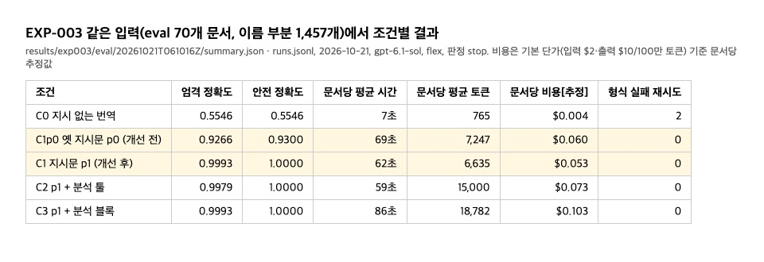

# EXP-003 — 어려운 시험지에서 조건 C0~C3 비교 (99% 기준)

- 상태: **사전 등록 중, 실행 전.** 코드·dev 생성, 확인 지점 A, dev 실제 모델 점검과 재점검, eval 생성, 실행 방식 고정(ADR-020), **eval 실행 완료(2026-10-21, 판정 `stop`)**. 사전 등록한 사람 확인(자동 판정 오류 전부 + 정답 표본)은 남았다
- 확인할 질문:
  - Q1′: 어려운 경우가 섞여도 지시 없는 번역(C0)이 이름을 말없이 찍는가
  - Q2′: 원칙만 분명히 한 지시(C1, p1)로 99%를 넘는가
  - Q3′: 분석기를 주면(C2·C3) C1이 못 넘은 기준을 넘는가
- 배경: EXP-002 반복 1회에서 C1~C3가 모두 만점이었다. 쉬운 시험지 때문이라고 본다[가설]. EXP-002는 보류했다([EXP-002](EXP-002.md), [ADR-017](../adr/ADR-017.md))
- 데이터: `data/synthetic-hard/eval/` 70개(생성기 synthetic-hard-v2, gold 형식 2, seed 4002 첫 시도에서 최소 수량 충족). [고정, 2026-10-21 생성]
  - 이름 부분 1,457개, 아랍어 토큰 1,573개
  - 어려운 비율 0.642, 확정 비율 0.566, arguable 518개, 긴 문서 24개, 일반 단어 쪽 토큰 99개
  - 문서 유형: 위임장 18(이름 부분 217), 고용 확인서 18(140), 상업등기 17(529), 의사록 17(571)
  - 문서 해시: 파일마다 sha256 앞 16자리이고, 실행 때 `plan.json`의 `docs`에 들어간다. 그 목록(이름 → 해시)을 키 순서로 JSON 직렬화한 sha256 앞 16자리는 `655c37f7f86d712f`다.
  - 유형별 수는 `data/synthetic-hard/quota_eval.json`에 있다. Claude가 5개 문서(heval_001·002·003·004·046)의 정답을 규칙과 대조했고, 정답 오류는 없었다(사람 검수 아님). dev 20개(seed 3001)는 프롬프트·형식 점검에만 쓴다. 유형과 정답 규칙은 [data.md 5.3절](../data.md)
- 모델: `openai:gpt-6.1-sol`, 모든 조건에 같은 모델
- 지시문 p1, 근거 검사 v2, 채점 v2, 번역문 판정 t2, C0 판정 v1: `plan.json`에 고정한다

## 실행 전에 고정한 것 (2026-10-21)

- **주 지표:** 안전 정확도와 엄격 정확도. 이름 부분이 나올 때마다 센다. 정의와 오류 종류는 [evaluation.md 6.4절](../evaluation.md)
- **합격선:** 두 정확도 모두 0.99 이상(점추정, eval 70개 × 반복을 합친 값). 코드는 `experiments/exp003.py`의 `PASS_BAR`·`judge`다
- **"서비스 기준 99% 달성" 문구(`service_claim`):** 두 정확도 모두에서 아래가 0.99 이상일 때만 쓴다
  - 점추정
  - 반복마다의 한쪽 95% Clopper–Pearson 하한 중 가장 낮은 값
  - 문서 단위 부트스트랩 한쪽 95% 하한
- **판정과 그 뜻(실행 전에 적음):**
  - `stop`(C1이 두 기준 모두 넘음):
    - 어려운 시험지에서도 지시만 준 범용 LLM이 99%를 넘는다
    - 서비스는 지시문만으로 만들 수 있지만, G4상 단독 제품의 근거는 약하다. 사업 판단은 EXP-002의 중단 경로와 같이 본다
    - `service_claim`이 거짓이면 "점추정으로는 넘었지만 99%를 보장한다고는 말할 수 없다"로 보고한다
  - `pass`(C1은 못 넘고, C2나 C3가 두 기준을 넘으며 C1이 못 넘은 기준마다 C1 − 그 조건 차이의 95% 구간이 0 아래):
    - 분석기가 99% 기준에 필요한 차이를 만든다. 단계 2로 간다
  - `fail`(그 밖):
    - 어느 조건도 99%에 못 미치거나 차이가 우연 수준이다. 프롬프트 재설계 또는 단계 3(번역자/격리된 검증자/중재자)을 검토한다
    - 분석기는 독법 후보를 주는 도구이고, 어려운 유형의 상당수는 "이 표기가 누구의 것인가"를 가르는 문제다. 그래서 `fail`이 분석기가 쓸모없다는 뜻은 아니다
- **C0:** 판정에 쓰지 않고 Q1′로 보고한다(C0 판정 규칙 v1)
- **참고 조건 C1p0(ADR-020):**
  - 조건 C1에 옛 지시문 p0를 쓴다. 근거 검사 v2와 채점 v2는 같다.
  - 반복 1회에만 돈다. 판정(`judge`)에 쓰지 않는다.
  - "C1 − C1p0"(반복 1회끼리, 문서 단위 부트스트랩 95% 구간)로 지시문 변경의 효과를 참고로 보고한다.
- **반복과 단계 규칙(ADR-020):** 반복은 최대 3회다.
  - 반복 1회가 모든 조건에서 끝나면 코드가 판단한다(`exp003.stage_gate`).
  - C1·C2·C3의 안전·엄격 정확도 점추정 6개 가운데 하나라도 [0.98, 0.995) 안이거나 값이 없으면 반복 2·3을 돈다.
  - 하나도 없으면 반복 1회로 마친다.
  - 판정·`service_claim`은 실제로 돈 반복으로 낸다. 진행 확인에는 결정만 보이고 값은 보이지 않는다.
- **실행 환경(ADR-020):**
  - 모델 `openai:gpt-6.1-sol`, 동시 16개(속도 제한 시 8개)
  - 처리 등급은 flex dev 점검 뒤 규칙으로 정한다. 동시 16개 기준 반복 1~3회 최대 소요가 3.5시간 이하면 flex, 아니면 기본 등급이다.
  - 등급은 모델 출력과 무관해 세션 기록에 남는다.
- **예상 비용·시간 [추정, dev 실측, 단가 입력 $2·출력 $10/100만 토큰]:**
  - 기본 등급: 반복 1회(5조건 × 70) 약 $18.4, 반복 2·3회(4조건 × 70 × 2) 약 $30
  - flex: 그 절반(최대 약 $24)
  - 기본 등급·동시 16 시간: 반복 1회 약 30분, 최대 약 1.3시간
- **보조 지표(판정에 쓰지 않음):** arguable을 뺀 민감도, 문서 단위 전부 정답 비율, 후보 완전성, 일반 단어 쪽 토큰을 이름으로 표시한 비율, 사람·부분 기준 표기 불일치, 유형별 정확도, 오류 종류별 수, 비용
- **실행 뒤 확인:** 자동 판정 오류 전부와 정답으로 판정한 것 50개를 사람이 확인한다(`exp003-errors`). 채점 버그가 나오면 다시 채점한 값(`exp003-rescore`)을 나란히 보고하고, 판정은 사전 등록한 채점으로 낸다
- **결과 보고:** "합성 문서(synthetic-hard) 기준"으로만 보고한다. 이 99%는 이 유형 구성(어려운 유형 약 2/3, 문서 유형 넷)에서 잰 값이고 실제 서류로 일반화하지 않는다. 기준값 99%는 사용자가 정한 서비스 요구이고 외부 근거는 없다(ADR-008)

## 실행 방식 결정의 근거 (2026-10-21)

- **사용자 결정:** 참고 조건을 넣는다. 반복은 단계적으로 한다. 비용과 시간을 최대한 줄이고 4시간 안에 끝낸다. 대안과 이유는 [ADR-020](../adr/ADR-020.md)에 있다(Batch API는 4시간을 보장할 수 없어 뺐다).
- **flex 확인 [확인]:** 짧은 호출 1번에서 응답의 `service_tier`가 `flex`였다(3.8초).
- **flex dev 점검 [확인, 실험 결과 아님]:** `results/exp003/dev/20261021T054936Z/`, v2 dev 2개(hdev_002, hdev_007) × 5조건 × 1회 = 10회, 동시 16개, flex.
  - 10회 모두 형식 통과, 합계 99.5k 토큰.
  - 실행당 시간: C0 4~12초, C1 53~80초, C2 41~84초, C3 75~149초, C1p0 49~77초. 같은 문서의 기본 등급 재점검보다 느리지 않았다.
  - flex 용량 부족 429가 한 번 났다(hdev_002 C2 첫 시도). 그래프의 재시도 1회 예산을 써서 두 번째 시도로 끝났다.
    - 재시도 예산은 형식 실패용이라, flex 사정이 결과에 끼지 않게 `experiments/tiers.FlexChatOpenAI`를 더했다.
    - flex 429는 모델 안에서 5초·20초 뒤 다시 부르고, 그래도 안 되면 그 호출만 기본 등급으로 보낸다(같은 모델·같은 요청).
    - 다시 부른 수와 기본 등급으로 보낸 수는 실행이 끝날 때 출력한다.
  - 결과 [관찰, dev]: C1~C3는 47/47이었다. C1p0는 46/47이었고, 틀린 1건은 hdev_002 고용 확인서의 가문명을 회사명 "Al Hajri General Trading"을 근거로 확정한 것(`unsupported_decoy`)이다. C0는 0.638이었다.
- **등급 결정 [규칙 적용]:** 위 실행당 평균 시간(C0 8초, C1 67초, C2 63초, C3 112초, C1p0 63초)으로 동시 16개일 때를 계산했다.
  - 반복 1회 약 23분, 반복 2·3회 약 36분, 최대 약 1시간이다.
  - 3.5시간 이하이므로 **flex**를 쓴다.
  - 기본 등급 평균 시간으로 계산해도 최대 약 1.3시간이다.
  - 예상 비용은 반복 1회 약 $9, 최대 약 $24다[추정].
- **비용 재추정 [계산, 2026-10-21]:** dev 실행 14회(C0~C3)의 조건별 토큰을 이름 부분 수에 대한 직선으로 맞추고, eval 문서 70개의 이름 부분 수에 적용했다.
  - 반복 1회는 280회, 입력 약 1.41M·출력 약 1.24M 토큰, 약 $15다(단가 입력 $2·출력 $10/100만 토큰, 제3자 집계 값).
  - 조건별로는 C0 $0.3, C1 $3.4, C2 $4.7, C3 $6.9다.
  - 동시 4개로 약 1.5시간이다(dev 실행 평균 C0 13초, C1 81초, C2 100초, C3 119초).
- **반복:**
  - 판정은 반복을 합친 점추정으로 낸다(조건마다 이름 부분 1,457 × 반복).
  - `service_claim`은 반복마다의 Clopper–Pearson 하한 중 가장 낮은 값을 본다. 반복 하나에서 오류 8개 이하(하한 0.9901)여야 한다[계산].
- **참고 조건 C1p0:** 반복 1회에 약 $3.4(기본 등급)다[추정].
- ~~선택 사항: dev 3~5개로 실제 모델 점검~~ 했다(아래 "dev 실제 모델 점검"). p1 문구는 바꾸지 않았다

## 확인 지점 A (eval 생성 전)

- dev 유형별 예시(`uv run tashkeel inspect-gold --case B3 --n 2` 등)와 정답 규칙을 사용자에게 보인다. Claude가 dev 문서를 읽어 확인했고 사람 검수는 아니다
- 규칙에 이견이 있으면 dev에서 고친 뒤 유형 목록·수량·정답 규칙·p1 문구를 고정한다
- **결과(2026-10-21, 사용자 확인): 정답 규칙을 지금 그대로 고정했다.** hdev_003의 예시 셋을 보고 정했다.
  - 아들 이름에 아버지 쪽 표기만 근거로 있으면 보류(파트너 7의 아버지 이름 غالب. Ghaleb은 파트너 3 본인의 표기다)
  - 한 사람의 표기가 둘로 갈리면 그 부분만 보류하고 두 철자를 후보로, 같은 부분은 확정(파트너 3의 EL-AWADI / AL AWADI)
  - 라벨 없는 서명란의 전체 이름은 근거로 인정(서명란의 Aseel Abdullah Al Qatari)
  - 따로 묻지 않은 규칙(회사명·이메일·URL은 근거 아님, 이니셜 보류, El ≠ Al)과 어려운 유형 비율 하한 0.60도 그대로다. 사용자는 계획 승인으로 확인했다
  - p1 문구는 dev 실제 모델 점검 뒤에 고정한다(형식 문제를 고치는 경우만 바꾼다)

## dev 실제 모델 점검 (2026-10-21, 실험 결과 아님)

- **목적:** eval 전에 형식·출력 길이·채점 버그를 본다. 정확도를 올리려고 지시문을 고치지 않는다(사용자 동의, 약 $1~2).
- **실행:** `results/exp003/dev/20261021T044031Z/`, 생성기 v1 dev 4개 × C0~C3 × 1회 = 16회.
  - hdev_007: 상업등기, 이름 부분 37개로 가장 많음
  - hdev_008: 의사록, 37개
  - hdev_001: 위임장, 14개
  - hdev_002: 고용 확인서, 10개
- **형식 [확인]:** 16회 모두 형식 통과, 재시도 0, API 오류 0. 가장 긴 문서의 출력은 최대 9.4k 토큰이었고 잘리지 않았다.
- **사용량 [확인]:** 입력 85.2k, 출력 76.4k, 합계 161.6k 토큰. 실행당 평균은 C0 0.9k, C1 6.8k, C2 13.7k, C3 19.1k다. 단가를 `.env`에 넣지 않아 금액은 기록에 없다. 이전 추정 단가로 약 $1이다[추정].
- **채점 [관찰, dev]:**

  | 조건 | 엄격 | 안전 | 자동 판정 오류 |
  | --- | --- | --- | --- |
  | C0 | 0.490 | 0.490 | silent_pick 47, wrong_spelling 3 |
  | C1 | 0.939 | 0.980 | unsupported_decoy 2, hold_instead_of_adopt 4 |
  | C2 | 0.939 | 0.980 | C1과 같은 6개 |
  | C3 | 0.939 | 0.980 | C1과 같은 6개 |

  - 이름 부분은 조건마다 98개다.
  - **오류 전부를 원래 출력과 맞춰 봤다(Claude 확인, 사람 확인 아님).** 채점 버그는 없었다. C1~C3의 오류 6개는 두 가지였다.
    - hdev_002, 안전 오류 2개: 문서가 "문의는 OO 씨에게 아래 이메일로"라고 잇고 개인 주소 `y.alhajri@…`를 줬다. 모델은 그 이메일에서 가문명 `alhajri`를 확정했다. p1 원칙으로는 틀렸다고 하기 어렵고, 정답 규칙("이메일은 근거 아님")과 갈렸다. eval에서는 최대 약 35개로, 안전 정확도가 약 2%p 떨어질 수 있었다.
    - hdev_007, 엄격 오류 4개: 파트너가 "المدير: السيد حسن اليافعي"처럼 다른 역할로 짧게 다시 나왔다. 모델은 같은 사람이라고 문서가 밝히지 않았다며 보류했다. 정답은 확정(arguable)이다. eval에서는 최대 약 40개로, 엄격 정확도가 약 2.8%p 떨어질 수 있었다.
  - C0의 50개는 표시 없이 한 표기를 쓴 것(기대 보류 47)과 El을 Al로 쓴 것(3)이다. 판정 규칙대로다.
- **사용자 결정(2026-10-21):** 정답 규칙과 p1은 그대로 두고 문서를 고쳤다(생성기 v2, [data.md 5.3절](../data.md)).
  - 문의처는 인사부 주소로 바꿨다.
  - 관리자·서명권자 줄에는 파트너 번호를 붙였다.
- **함께 고친 것:**
  - 생성기: eval 크기 시험 생성에서 B6 미달이 잦아(v1 커밋본은 10개 중 3개만 통과), 생략 표기에 쓸 사람을 떼어 두고, 최소 수량을 못 채우면 다음 seed로 넘어가게 했다.
  - 채점: 번역문 판정 t2. 정답대로 답하는 가짜 응답기의 C0 445/447을 447/447로 고쳤다([evaluation.md 6.4절](../evaluation.md)). 위 16회를 다시 채점해도 값이 같았다(`summary_rescored_v2.json`).
- **v2 재점검(2026-10-21, 사용자 동의):** `results/exp003/dev/20261021T051055Z/`, v2 dev 2개 × C0~C3, 8회.
  - 문서: hdev_002(고용 확인서, 인사부 주소), hdev_007(상업등기, 관리자·서명권자 4개 부분 모두 기대 확정)
  - 형식 전부 통과, 합계 73.5k 토큰. C1·C2·C3는 모두 47/47로 오류가 없었다[관찰, dev]. 인사부 이메일로는 확정하지 않았고, 파트너 번호가 붙은 관리자 줄은 확정했다.
  - C0는 0.638이고 오류는 표시 없는 한 표기 15, El→Al 2다.
  - 의사록 결의 문장(참석자를 관리자로 임명 등)은 바꾸지 않았고, 재점검에도 넣지 않았다. v1 점검의 hdev_008 한 개에서만 모델이 참석자와 이었다. eval에서 모델이 이런 짧은 재등장을 보류하면 엄격 오류로 센다(arguable).
- **dev 점검 비용 [추정]:** 두 번 합쳐 235k 토큰, 약 $1.4다(단가 입력 $2·출력 $10/100만 토큰, 제3자 집계 값).

## 실행 명령

```bash
uv run tashkeel inspect-gold --split dev --case C2 --n 2          # 유형별 정답 예시
uv run tashkeel make-synthetic-hard --split eval                   # eval 한 번만 생성(이미 있으면 거부)
uv run tashkeel exp003 --split dev --fake --repeats 1 --workers 4  # 가짜 모델로 배선 확인(비용 없음)
LANGSMITH_TRACING=false uv run tashkeel exp003 --split eval --workers 16 --service-tier flex --yes
                                                                   # 실제 실행(비용, 동의 필요). 단계 규칙은 자동
uv run tashkeel exp003-status                                      # 진행·토큰·단계 결정(결과 지표 없음)
uv run tashkeel exp003-errors                                      # 완료 뒤 사람 확인 표
```

## 결과 (2026-10-21, 합성 문서 synthetic-hard 기준)

- **실행:** `results/exp003/eval/20261021T061016Z/`
  - 커밋 `8e14021`, flex, 동시 16개
  - 5조건 × 70문서 = 350회, 반복 1회 뒤 단계 판단 "끝"
  - 합계 3.39M 토큰(입력 1.67M·출력 1.72M), 약 21분
  - 비용은 flex 단가로 약 $10이다[추정, 단가 입력 $2·출력 $10/100만 토큰의 절반, 제3자 집계 값].
- **판정(사전 등록 코드): `stop`.** C1(원칙만 분명히 한 지시문 p1)이 두 99% 기준을 넘었다.
- **조건별 [확인, 자동 채점 v2·t2]:** 조건마다 이름 부분 1,457개.

  | 조건 | 엄격 | 안전 | 자동 판정 오류 | `service_claim` |
  | --- | --- | --- | --- | --- |
  | C0 (지시 없는 번역) | 0.5546 | 0.5546 | silent_pick 626, wrong_spelling 18, not_found 5 | 거짓 |
  | C1 (지시문 p1) | 0.9993 | 1.0 | hold_instead_of_adopt 1 | 참 |
  | C2 (+ 분석 툴) | 0.9979 | 1.0 | hold_instead_of_adopt 3 | 참 |
  | C3 (+ 분석 블록) | 0.9993 | 1.0 | hold_instead_of_adopt 1 | 참 |
  | C1p0 (참고, 옛 지시문 p0) | 0.9266 | 0.9300 | 다른 사람 표기 49, 그 사람 표기로는 부족 43, 함정(회사명·이메일) 10, 보류 5 | 거짓 |

  - `service_claim` 하한(엄격): C1·C3는 Clopper–Pearson 0.9967·부트스트랩 0.998, C2는 0.9947·0.9952다. 안전은 셋 다 0.9979·1.0이다.
- **문서당 시간·토큰·비용 [확인, 비용은 추정]:** 시간은 `runs.jsonl` 실행당 평균(C0은 다시 돌린 1회 포함 71회), 토큰은 `summary.json`의 조건별 입력+출력을 문서 70개로 나눈 값, 비용은 기본 단가(입력 $2·출력 $10/100만 토큰)로 계산한 값이다. 실제 실행은 flex라 실제 비용은 약 절반이다. 2026-10-22까지 README에 있던 표와 그림을 여기로 옮겼다.

  | 조건 | 엄격 | 안전 | 문서당 시간 | 문서당 토큰 | 문서당 비용 [추정] |
  | --- | --- | --- | --- | --- | --- |
  | C0 지시 없음 | 0.5546 | 0.5546 | 7초 | 765 | $0.004 |
  | C1p0 옛 지시문 | 0.9266 | 0.9300 | 69초 | 7,247 | $0.060 |
  | C1 지시문 p1 | 0.9993 | 1.0000 | 62초 | 6,635 | $0.053 |
  | C2 p1 + 분석 툴 | 0.9979 | 1.0000 | 59초 | 15,000 | $0.073 |
  | C3 p1 + 분석 블록 | 0.9993 | 1.0000 | 86초 | 18,782 | $0.103 |

  
- **비교 [확인, 문서 단위 부트스트랩 95% 구간]:**
  - C0 − C1: 엄격 −0.445 (−0.489~−0.404)
  - C1 − C2: 엄격 +0.0014 (0~0.0045), 안전 0
  - C1 − C3: 0
  - C1 − C1p0(참고, 반복 1회): 엄격 +0.073 (0.049~0.097), 안전 +0.070 (0.047~0.093)
- **보조 지표 [확인]:**
  - arguable을 뺀 엄격 정확도: C1·C3 0.9989, C2 0.9968
  - 문서 전부 정답 비율: C1·C3 0.986, C2 0.971
  - 충돌 후보 완전성: C1 0.984, C2·C3 0.968
  - 일반 단어 쪽 토큰을 이름으로 표시: 0
  - 사람·부분 표기 불일치: C1~C3 0, C1p0 2
- **판정의 뜻(실행 전에 적은 대로):**
  - 어려운 시험지에서도 지시만 준 범용 LLM이 99%를 넘었다. 분석기(C2·C3)는 C1이 못 넘은 기준이 없어 차이를 만들 자리가 없었다.
  - 서비스는 지시문만으로 만들 수 있지만, G4상 단독 제품의 근거는 약하다. 사업 판단은 EXP-002의 중단 경로와 같이 본다.
  - 차이를 만든 것은 지시문이다[관찰]. 옛 지시문(p0)으로는 C1이 0.93에 그쳤고, 오류는 함정 유형(A1·C3·C2)에 몰렸다.
- **C1~C3 오류 5건(Claude 확인, 사람 확인 아님):** 모두 확정해야 할 것을 보류한 엄격 오류다. 원인은 같다.
  - heval_027 أسعد(C1·C2·C3): `ASA'AD`와 MRZ `ASAAD`
  - heval_023 السالمي·الكعبي(C2): `EL-SALEMI`와 `EL<SALEMI`
  - 지시문 p1의 "글자 그대로(대소문자·띄어쓰기는 바뀌어도 됨)"를 따라 모델은 이 둘을 서로 다른 철자로 보고 보류했다. 엄격 철자 규칙 s1은 아포스트로피·하이픈·`<`를 무시해 같은 철자로 본다.
  - 채점 버그는 아니고 지시문 문구와 엄격 철자 정의가 갈린 경계다. 판정은 사전 등록한 채점대로 둔다.
- **실행 중 생긴 일과 처리 [확인]:**
  - flex 용량 부족 429가 dev 점검과 다른 문구("Flex does not have sufficient resources…", 코드 `flex_unavailable`)로 와서 `FlexChatOpenAI`가 못 잡았다. C0 두 번에서 그래프 재시도를 썼다.
    - heval_007 C0은 두 번째 시도로 정상 결과를 얻었다.
    - heval_013 C0은 두 번 다 실패했다. 그런데 하네스가 langchain이 감싼 오류(`OpenAIRateLimitError`)를 API 오류로 알아보지 못해, "완료(형식 실패)"로 기록됐다.
  - 사전 규칙(API 오류는 완료가 아니다, ADR-016)대로 판별을 고쳤다([TS-004](../troubleshooting.md)). 그 한 회만 같은 실행 폴더에서 다시 돌렸다(세션 2, 코드 해시가 바뀐 것은 기록에 남음).
  - 처음 summary는 `summary_session1_before_api_fix.json`으로 남겼다. C1~C3와 단계 판단에는 영향이 없었다.
- **한계:**
  - 합성 문서 결과다. 이 99%는 이 유형 구성(어려운 유형 약 2/3, 문서 유형 넷)에서 잰 값이고 실제 서류로 일반화하지 않는다.
  - 시험지·정답 규칙·지시문 p1을 같은 작업(Claude)이 설계했다. p1은 함정 유형을 나열하지 않고 원칙만 적었지만, 원칙과 함정 유형이 서로를 염두에 두고 만들어졌다.
  - dev 점검 뒤 문서가 p1 원칙과 정답 규칙을 다르게 읽히게 하던 두 곳(개인 이메일 문의 문장, 파트너 번호 없는 관리자 줄)을 고쳤다(생성기 v2). 고치기 전에는 eval에서 최대 약 75개의 오류가 날 수 있었다[추정].
  - 반복 1회라 실행마다 흔들리는 정도는 재지 않았다(단계 규칙대로).
  - 아랍어 문장은 사람이 검수하지 않았다.
- **남은 것:** 사전 등록한 사람 확인이다. `errors.csv`(자동 판정 오류 761건 + 정답 표본 50건)에서 C1~C3 오류 5건과 정답 표본을 사람이 확인한다. 채점 버그가 나오면 `exp003-rescore`로 다시 채점한 값을 나란히 보고한다.
