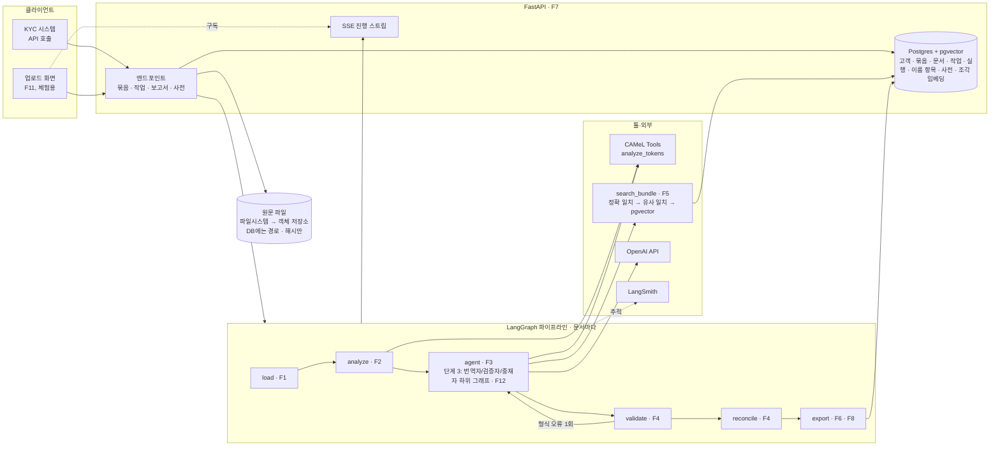

# 주요 기능, 기술 스택·시스템 구성, 개발 계획

- 작성: 2026-10-20, 마지막 업데이트: 2026-10-22 (조건 M2·회사 문서 보관함, ADR-022. 구 `docs/개발-계획.md`. 4·5절은 분할 전 `PROJECT_PLAN.md` 8·9절에서 옮김)
- 기준: [problem-and-goals.md](problem-and-goals.md) 1절(문제·서비스 목표 G1~G7), [scope.md](scope.md) 3절(범위), ADR-008·009. 이 문서는 단계 1~3을 하나의 제품 관점으로 묶은 설계·계획이고, 세부 측정 설계는 [evaluation.md](evaluation.md), 진행 기록은 [changelog.md](changelog.md)와 `PROJECT_PLAN.md`에 둔다.
- 근거 표기는 [docs/README.md](README.md)와 같다. [확인] 구현·실행한 것, [제안] 아직 확정·검증하지 않은 설계, [가정] 추산용으로 둔 값.

## 결론

- **제품은 "아랍어 서류 묶음을 받아 이름별 확인 대기 목록을 돌려주는 API"다.** 핵심 기능은 모호 구간 탐지, 근거 기반 확정·보류, 묶음 안 근거 검색, 코드 검증 네 가지이고, 번역은 그 재료다.
- **기술 스택은 이미 있는 것을 그대로 쓴다.** Python 3.11 + LangGraph + LangChain(OpenAI) + CAMeL Tools + LangSmith가 단계 1에서 동작한다 [확인]. 제품화에 추가하는 것은 FastAPI, Postgres(+pgvector), Docker 셋뿐이다 [제안, ADR-011]. 과제 2 요건으로 단일 문서 범위의 API·화면·DB(M4 일부)와 최소 MCP가 M1.5로 앞당겨졌다 [제안, ADR-012, 미구현].
- **개발은 측정 관문을 먼저 통과한다.** EXP-001·002(약 2~3주, 11만 원 이하)에서 G4(지시만 준 LLM보다 낫다)가 깨지면 제품화 대신 공개 벤치마크로 마무리한다. 통과하면 묶음 근거 검색 → API → 멀티 에이전트 비교 순서로 약 10주를 쓴다 [제안].

## 1. 주요 기능 선정

### 선정 기준

1. 서비스 목표 G1~G7 가운데 하나 이상을 직접 달성한다.
2. 1순위 고객(KYC·컴플라이언스 팀)의 온보딩 서류 묶음 흐름에 들어간다.
3. 사람 검수 없이 자동 측정으로 달성 여부를 잴 수 있다(ADR-008).
4. 기존 수단(사람 번역가, 범용 LLM, 이름 매칭 벤더)이 하지 않는 일이다.

네 기준 중 하나라도 못 채우면 "나중" 또는 "제외"로 둔다.

### 기능 목록

| ID | 기능 | 하는 일 | 목표 | 우선순위 | 단계 | 상태 |
| --- | --- | --- | --- | --- | --- | --- |
| F1 | 문서 입력과 토큰 ID | 텍스트 문서를 정규화하고 구간·토큰 ID를 붙인다. LLM은 아랍어를 다시 쓰지 않고 ID로 지목한다 | G1, G6 | 핵심 | 1 | [확인] 구현 |
| F2 | 모호 구간 탐지 | 형태소 분석기로 모든 토큰의 독법 후보를 열거하고, 모호 토큰을 코드가 표시한다. LLM 판단과 독립된 신호 | G1 | 핵심 | 1 | [확인] 구현. 이름에서 유효한지는 EXP-001이 정함 |
| F3 | 번역과 항목별 처분 | 영어 번역과 함께, 갈리는 구간마다 후보·채택·이유·확신도 또는 기권, 고유명사마다 근거 채택 또는 보류 | G1, G2 | 핵심 | 1 | [확인] 구현(C1~C3) |
| F4 | 코드 검증과 강등 | 스키마·토큰 ID·인용을 코드가 확인하고, 근거 없는 확정을 실패로 센다. 미처리·과잉 표시·표기 불일치 집계 | G2, G3 | 핵심 | 1 | [확인] 구현 |
| F5 | 묶음 근거 검색 [보류, ADR-021] | 같은 묶음의 다른 서류(여권 사본, 영문 등기, 이중 언어 문서)에서 이름의 라틴 문자 표기를 찾아 근거로 쓴다. 아랍어 정확 일치 → 로마자 유사 일치 → 벡터 검색 순 | G2, G3, G5 | 핵심 | 2 | [확인] 2026-10-21 구현(`bundle/evidence.py`, 대상 ID 기준, ADR-018). 벡터 경로는 후보 힌트(`rag/bundle.py`), pgvector 이전은 남음 |
| F6 | 확인 대기 목록(묶음) [보류, ADR-021] | 결과를 이름 단위로 묶어 돌려준다. 이름마다 채택 표기, 근거 위치·인용, 확정/보류, 서류 간 표기 불일치. 담당자가 여권을 보고 항목을 닫을 수 있는 형태 | G5 | 핵심 | 2 | [확인] 2026-10-21 구현(`ReviewItem` 확정/대기 + 사유, `/v1/bundles/{id}/pending`, 화면 대기 목록). 서류 간 충돌은 `cross_document_conflict` |
| F7 | API | 서류 묶음 업로드 → 검수 작업 → 보고서 조회. 진행 상태 스트림. 판매 형태(ADR-009) | G5 | 핵심 | 1.5 → 2 | [확인] 단일 문서 + 묶음 API(2026-10-21): 업로드·검수·대기 목록·SSE. 2026-10-21 API 키 인증·고객 분리·사용량(ADR-019). 남은 것: `GET /v1/dictionary?customer=` |
| F8 | 측정과 추적 | 실행마다 지표·실행 메타(모델, 프롬프트 해시, 데이터 범위)를 남기고 LangSmith에 묶는다. 제품 경로에서도 끄지 않는다 | G6 | 핵심 | 1~3 | [확인] 구현(단계 1) |
| F9 | 이름 사전 | 고객이 여권 등 외부 근거로 확정한 표기를 정규화 아랍어 키 + 고객 ID로 저장한다. 같은 고객의 다음 묶음에서 적중하면 근거 출처 `glossary`로 자동 확정한다. 다른 고객의 사전은 보지 않는다(ADR-010) | G2, G5 | 지원 | 2 | [확인] 2026-10-21 구현(`name_dictionary`, 키에 대상 ID 추가, `POST /v1/dictionary`, ADR-018) |
| F10 | 합성 KYC 묶음 생성기 [보류, ADR-021] | 아랍어 상업등기 + 영문 여권 MRZ + 정관으로 된 묶음과 정답을 만든다. F5·F6의 측정 데이터 | G6 | 지원 | 2 | [확인] 2026-10-21 `data/kyc_bundles.py`(상업등기 + 여권 인쇄 칸·MRZ + 정관, 사례 8 × dev·eval). 실제 서식 재현은 아님 |
| F11 | 업로드 화면 | 셀프서브 체험용 최소 화면. 묶음 올리기, 진행 보기, 확인 대기 목록 보기 | G5(2순위 고객) | 지원 | 1.5 → 2 | [확인] 단일 문서 폼 + 묶음 탭(샘플·JSON·파일 업로드·진행 스트림). 2026-10-21 3단계(파일로 초안 → 대상 지정 → 검수)와 API 키 입력(ADR-019) |
| F12 | 멀티 에이전트 검증 | 번역자 / 번역 결과를 보지 않는 격리된 검증자 / 근거 없으면 보류하는 중재자. 같은 지표로 단일 에이전트와 비교 | G1, G4 | 핵심(2026-10-22부터 기본 경로) | 3 → 2 | 틀 구현(2026-10-21, ADR-019): 조건 `M1`. **2026-10-22 조건 `M2`로 서비스 기본 경로가 됨(ADR-022)**: M1 틀 + 회사 기록 툴(F20), 두 역할 동시 실행, C1 입력·p1 규칙. 가짜 모델 테스트와 실제 모델 작동 확인뿐이고 비교 실험(EXP-005 [제안])은 하지 않았다 [미측정] |
| F13 | 공개 이중언어 문서 측정 | 공식 영문본이 있는 공개 문서로 EXP-002 지표를 다시 잰다. 사람 라벨 없이 실제 문서를 재는 유일한 경로 | G6 | 지원 | 2 | 문서 공개 여부·이용 조건 [미확인] |
| F14 | MCP 노출 | (2026-10-22) 회사 기록 서버 `search_company_records`를 서비스 기본 경로(M2)의 두 agent가 메모리 전송으로 부른다(ADR-022). 외부 클라이언트용 `/mcp` 공개는 미룸. (2026-10-21) 형태소 분석(`analyze_tokens`)을 MCP 서버의 툴로, 합성 문서를 리소스(`document://synthetic/{split}/{doc_id}`)로, 조건 지시문을 프롬프트(`review_instructions(condition)`)로 노출해 다른 에이전트 환경에서 부품으로 쓴다. 서비스 경로에서 `USE_MCP_TOOLS=true`일 때만 C2 툴로 쓰고, 실험 경로는 in-process 툴 유지(ADR-004). 단계 2에서 `search_bundle` 툴을 더한다 | G5, 과제 2 요건 | 지원 | 1.5 → 2 | [확인] 2026-10-21 구현(`mcp/`). `USE_MCP_TOOLS`는 플래그로 끼우되 기본은 끔(사용자 결정 2026-10-21). 리소스 `document://synthetic/{split}`(목록)도 더함 |
| F15 | 파일 입력과 문자 인식 | 서류 파일 하나(.txt/.md/.pdf/이미지)를 올리면 텍스트를 뽑아 바로 검수한다. PDF는 텍스트 층 먼저, 없으면 OCR 백엔드. 백엔드는 설정으로 바꾼다(기본 none, 무료 API ocrspace) | G5 | 핵심 | 2 | [확인] 2026-10-21 구현(`ocr/`, `POST /v1/reviews/upload`, `/v1/extract`, ADR-021). 인식 성능은 재지 않는다(사용자 결정) |
| F16 | 회사 사전을 아무 문서에 | 단일 문서 결과의 고유명사마다 고객 사전(대상 ID 없이 `"*"`)을 조회해 보류를 사전 표기로 확정하고, 문서 근거와 다르면 충돌로 둔다. 등록은 사람이 후보를 누를 때만 | G2, G5 | 핵심 | 2 | [확인] 2026-10-21 구현(`dictionary_apply.py`, `POST/GET/DELETE /v1/dictionary`, ADR-021). 실제 모델로 dev_005 두 번 돌려 확인 |
| F17 | 두 페이지 화면 | 파일 넣기(로컬 파일 선택·끌어 놓기 → 진행 → 결과로 이동)와 결과(원문·번역 본문에 이름을 색으로 표시, 누르면 후보 토글, 후보를 누르면 확정·저장, 확정 취소, 회사 사전 목록) | G5 | 핵심 | 2 | [확인] 2026-10-21 구현(`static/index.html` `#/upload`·`#/result/{id}`, 캡처 `docs/images/screen-upload.jpg`·`screen-result*.jpg`) |
| F20 | 회사 문서 보관함 제안(RAG) | 고객이 전에 올린 서류에서 같은 고유명사(사람·회사·기관)의 영문 표기를 찾아 "보관함 제안"으로 보여 준다. 같은 철자가 다른 대상일 수 있어 확정하지 않고, 사람이 누르면 사전에 들어간다(근거 서류는 그 지난 서류). 두 agent가 MCP 툴로 찾고, 코드가 원문으로 다시 확인한다 | G2, G5 | 핵심 | 2 | [확인] 2026-10-22 구현(`archive/`, `archive_apply.py`, `mcp/records.py`, `/v1/archive`, Alembic 0004, ADR-022). 제안 적중률·잘못된 제안 비율은 재지 않았다 [미측정] |
| F19 | 자기 회사 표기 감시 | 자기 회사를 거래처 0번으로 두고 등록한 회사명·등기번호·세금번호와 다르게 적힌 서류를 경고한다. 전자세금계산서 명칭·번호 요건, 상호법(2025) [확인 필요] | G5 | 지원 | 다음 | [제안] 2026-10-21 사용자 선택. 나머지 후보(이중언어 어긋남, 기한·만료 추적, 번역사 요청서, 서명권자 대조, 검토 흔적 보고서)는 검토했으나 보류 |

**나중(단계 3 이후, 할 수 있게 되면):** 보류 항목의 사람 검토(LangGraph interrupt), 이름 외 보류 구간의 번역가 연결, 고객 환경 설치형 배포(형태소 DB를 `glf-01`로 교체 검토, ADR-005), SOC 2·ISO 27001, 사우디 PDPL·UAE 개인정보 검토.

**제외(목표가 아님, [problem-and-goals.md](problem-and-goals.md) 1.2절):** 스캔본 문자 인식, 번역 문장 품질 평가·개선, 제출용 공인 번역 대체, 한국어 출력.

### 핵심 기능의 흐름 (KYC 온보딩 묶음)

1. 담당자가 묶음(아랍어 상업등기, 정관, 대표자 여권 사본의 텍스트)을 올린다 (F7).
2. 문서마다 구간·토큰 ID를 붙이고(F1), 모든 토큰을 형태소 분석기로 분석한다(F2).
3. 에이전트가 번역하고, 이름마다 묶음 안에서 근거를 찾는다(F3, F5). 여권의 라틴 문자 표기가 있으면 인용과 함께 확정하고, 없으면 보류한다.
4. 코드가 인용이 실제로 그 서류에 있는지, 채택 표기와 맞는지 확인한다. 근거 없는 확정은 실패로 센다(F4).
5. 이름별 확인 대기 목록과 서류 간 불일치를 돌려준다(F6). 담당자는 보류 항목만 여권을 보고 닫고, 확정 표기를 이름 사전에 넣는다(F9).
6. 실행마다 지표와 메타를 남긴다(F8).

### 고유명사 확정 규칙

애매한 고유명사는 후보만 내는 것이 아니라, **근거가 있을 때만** 확정한다. 근거는 아래 순서로 찾고, 어느 것도 없으면 보류다.

| 순서 | 근거 | 단계 | 상태 |
| --- | --- | --- | --- |
| ① | 같은 문서 안의 라틴 문자 표기(이중 언어 서류의 영문 줄) | 1 | [확인] 구현. `prompts.py` C1 규칙 4, `reconcile.verify_evidence` |
| ② | 같은 묶음의 다른 서류(여권 사본, 영문 등기, 정관의 영문본) | 2 | [확인] 2026-10-21 구현(`bundle/evidence.py`). 같은 대상 ID(`entity_id`)가 붙은 다른 서류의 영문 칸만 근거이고, 이름이 같다고 연결하지 않는다(ADR-018). `rag/bundle.py`는 후보 힌트 |
| ③ | 같은 고객의 이름 사전(F9) | 2 | [확인] 2026-10-21 구현(`bundle/dictionary.py`, `name_dictionary`). 키는 고객 + 대상 ID + 정규화 아랍어(ADR-018). 근거와 다르면 충돌로 대기 |
| ④ | 없음 → 보류. 번역문에는 `[Musallam/Muslim]`처럼 후보를 나란히 쓴다 | 1 | [확인] 구현 |

근거로 치지 않는 것: 가장 흔한 표기, 형태소 분석기 후보, LLM이 말한 확신도. 분석기 후보는 "갈리는 자리를 찾는 신호"이고, 확신도는 기록만 한다.

코드가 하는 검증(`reconcile.check_items`):

- 인용이 그 서류 원문에 실제로 있는지, 채택 표기와 맞는지 확인한다. 실패하면 보류로 내리고 "근거 검증 실패"로 센다.
- 에이전트가 근거 없이 `adopt`를 쓰면 보류로 고쳐 주지 않고 `adopt_unsupported`로 집계한다. 실패를 지우지 않기 위해서다.
- 단계 2에서는 근거가 가리키는 서류가 같은 묶음의 다른 파일일 수 있으므로, 인용 대조 범위를 묶음 전체로 넓힌다. [확인] 2026-10-21: `bundle.evidence.validate_evidence`가 서류 존재·구간 존재·인용 포함·영문 포함을 대조한다. 확정 비교는 정확 일치(대소문자·공백만 무시)이고, 변이 일치는 제안에만 쓴다(ADR-018).

출력 스키마 확장 [제안, 단계 2]: `Evidence`에 `source: "document" | "bundle" | "glossary"`와 `document_id`를 더한다. 단계 1 스키마(`schemas.py`)는 실험 비교를 위해 그대로 둔다.

이름 사전(F9)의 규칙(ADR-010):

- 키는 `text.normalize_key`로 정규화한 아랍어 전체 이름 + 고객 ID + **대상 ID**(2026-10-21, ADR-018)다. 같은 철자라도 다른 고객이거나 다른 대상이면 적중하지 않는다.
- 적중하면 근거 출처 `glossary`로 자동 확정하고, 보고서에 `glossary_hit`를 표시한다. 담당자가 한 번 여권으로 확정한 이름을 다음 묶음에서 다시 보류하면 도구의 가치가 없기 때문이다.
- 등록은 담당자가 보류 항목을 닫을 때(`POST /v1/dictionary`, 구 `/v1/glossary`)만 한다. 근거 채택 결과를 사람 확인 없이 자동 등록하지 않는다. 오류가 사전에 굳으면 이후 묶음 전체로 번진다.
- 같은 고객 안에서 같은 철자가 다른 사람인 경우는 막지 못한다. 이 위험은 "서류 간 표기 불일치"로 드러나므로, 불일치 항목은 사전 적중이어도 확인 대기 목록에 올린다 [제안].

## 2. 기술 스택과 시스템 구성

### 2.1 기술 스택

| 층 | 선택 | 근거·상태 |
| --- | --- | --- |
| 언어·환경 | Python 3.11, uv, pytest | [확인] camel-tools 1.6.0 요구 사항. 단계 1 동작 |
| 아랍어 처리 | CAMeL Tools 1.6.0 + calima-msa-r13 | [확인] 동작. GPL v2라 SaaS 내부 사용에 한정(ADR-005). 설치형 배포 시 `glf-01`(CC BY 4.0) 검토 |
| LLM | OpenAI, `init_chat_model("openai:gpt-6.1-sol")`, `.env`의 `MODEL`로 교체 | [확인] 코드. 실제 모델로 구조화 출력·tool call 안정성은 [미확인], [ADR-006](adr/ADR-006.md) |
| 에이전트·그래프 | LangGraph `StateGraph`, LangChain `create_agent` + `response_format`(구조화 출력), `@tool` | [확인] 단계 1. 단계 3은 `agent` 노드만 하위 그래프로 교체 |
| 검색(F5) | 아랍어 정확 일치·로마자 유사 일치(일반 함수) + Postgres pgvector 벡터 검색(보조), OpenAI 임베딩 `text-embedding-3-small` | 틀 [확인]은 Qdrant로 되어 있고 M3에서 pgvector로 바꾼다(ADR-011). 이름은 임베딩 유사도로 잘 안 잡혀 1·2가 주 경로, 벡터는 계약서 같은 긴 문서용 보조 |
| API(F7) | FastAPI + Pydantic(단계 1 `schemas.py` 재사용), 비동기 작업은 `BackgroundTasks` + 작업 상태 테이블, 진행 상태는 SSE | [제안]. 미니 프로젝트 규모에서는 큐 서버를 두지 않는다. 동시 요청이 늘면 Redis 기반 큐로 바꾼다 |
| 저장 | Postgres 16 + pgvector 하나. 관계 데이터(고객·묶음·문서·작업·실행·이름 항목·사전)와 결과 JSON(JSONB). 원문 파일은 파일시스템(배포 시 S3 계열 객체 저장소)에 두고 DB에는 경로·SHA-256만. 접근은 SQLAlchemy 2 + psycopg 3, 마이그레이션은 Alembic | [제안, ADR-011]. 로컬 개발도 Docker의 Postgres를 써서 SQLite와 갈라지지 않게 한다. 단계 1 실험 결과(`results/`)는 재현·보존을 위해 파일로 유지한다. 데이터 모델은 2.5절. 고객 데이터가 들어오면 암호화·보존 기간·삭제 정책이 필요 |
| 관측(F8) | LangSmith(Dataset·Experiment), `run_meta.json`, 구조화 로그 | [확인] 단계 1. 실제 서류 전에는 LangSmith로 원문이 나가지 않게 마스킹 또는 추적 제외 정책을 정한다 |
| 화면(F11) | FastAPI가 서빙하는 정적 HTML + SSE 구독 | [제안]. 프런트엔드 프레임워크를 넣지 않는다. 체험용이라 최소로 둔다 |
| 배포 | Docker Compose: 앱 1개 + Postgres(pgvector 이미지) 1개 + 원문 볼륨. `.env`로 키·모델·`DATABASE_URL` 주입 | [제안]. 관리형 DB(RDS 등)로 옮길 때는 `DATABASE_URL`만 바꾼다. 리전·데이터 상주는 고객 요구가 생기면 정한다(사업성 검토 2절) |
| 툴 노출(F14) | FastMCP 서버(stdio): 툴 `analyze_tokens`, 리소스 `document://synthetic/{split}/{doc_id}`, 프롬프트 `review_instructions(condition)`. 단계 2에 `search_bundle` 추가. 클라이언트는 서버별 세션 + lock, `with_retry` | 범위 포함(사용자 결정 2026-10-20), 구현 방식은 [제안, M1.5, ADR-012]. 다른 에이전트 환경에서 부품으로 쓰는 경로. 서비스 경로에서만 쓰고 실험 경로는 in-process 툴(ADR-004). 서버·클라이언트 패턴은 과제 2 제공 ZIP(`all_total_vue_student`의 `mcp_server.py`·`agent/mcp_client.py`)에서 가져온다 |

정한 원칙([architecture.md](architecture.md) 4.1절)은 제품 경로에서도 유지한다. 분석기는 항상 실행하고, 처분 누락·인용 검증·지표 계산은 코드가 하며, LLM은 토큰 ID로 지목하고, 분석기를 설치하지 못하면 LLM으로 대체하지 않고 멈춘다.

### 2.2 시스템 구성

- **파이프라인은 단계 1 그래프 그대로다.** 묶음은 문서 단위로 그래프를 돌리고, 묶음 수준 집계(서류 간 표기 불일치, 이름별 확인 대기 목록)는 `export` 뒤의 일반 함수가 한다.
- **단계 2에서 바뀌는 것은 두 곳이다.** `agent`에 `search_bundle` 툴이 켜지고(`build_graph(extra_tool_factories=[...])`), 근거의 범위가 "같은 문서 안"에서 "같은 묶음 안"으로 넓어진다. `reconcile`의 인용 검증은 근거가 가리키는 서류의 원문과 대조하도록 확장한다.
- **단계 3에서 바뀌는 것은 한 곳이다.** `agent` 노드를 아래 세 역할의 하위 그래프로 바꾼다. 나머지 노드와 지표는 그대로여서 단계 1 결과와 바로 비교된다.

| 에이전트 | 보는 것 | 내는 것 | 보지 못하는 것 | LLM |
| --- | --- | --- | --- | --- |
| 번역자 | 원문, 토큰 표, 분석기 결과, `search_bundle`, 이름 사전 | 영어 번역 + 모든 항목의 1차 처분(후보, 채택/보류, 근거 인용) | — | 있음 |
| 격리된 검증자 | 원문, 분석기 후보, `search_bundle`, 이름 사전 | 고유명사마다 독립적인 처분(근거 인용 또는 보류). 번역은 하지 않음 | 번역자의 번역과 처분 전부 | 있음 |
| 중재자 | 번역자와 검증자의 처분 둘 다 | 둘이 같고 근거가 검증되면 확정, 다르거나 근거가 없으면 보류. 불일치 사유를 기록 | 원문. 새 근거를 만들거나 다수결로 정하지 않는다 | 없음, 규칙 함수 [제안] |

  - 검증자를 격리하는 이유는 하나다. 번역자가 고른 표기를 보면 같은 답에 끌려 "두 번째 확인"이 되지 않는다. 이 격리가 단일 에이전트(C2·C3)보다 말없이 찍는 비율을 실제로 낮추는지가 단계 3 측정이다.
  - 중재자를 규칙 함수로 두는 것은 [architecture.md](architecture.md) 4.1절 원칙(LLM이 필요 없는 검증은 일반 함수)을 따른 것이다. 두 처분이 다를 때 LLM 중재자가 "그럴듯한 쪽"을 고르면 모호성 은폐가 한 단계 뒤에서 반복된다.

### 2.3 API 초안 [제안]

**M1.5 부분집합(단일 문서, 과제 2) [제안, ADR-012, 미구현]:**

| 메서드·경로 | 입력 | 출력 |
| --- | --- | --- |
| `GET /health` | — | 모델 라벨, 백엔드(openai / fake), 분석기 버전, DB 연결 여부, MCP 사용 여부 |
| `GET /v1/samples` | — | 합성 dev 문서 목록(id, 근거 배치 `evidence_layout`). MCP가 켜져 있으면 리소스 목록에서, 아니면 파일에서 |
| `GET /v1/samples/{doc_id}` | — | 문서 segments(gold 제외) |
| `POST /v1/reviews` | `text`(빈 줄·줄 단위로 구간 분할) 또는 `segments`, `condition`(기본 C3), `doc_id`(선택) | `job_id`. 빈 입력·아랍어 토큰 0개·조건 오류는 400 |
| `GET /v1/jobs/{id}` | — | 상태(queued / running / done / failed), 현재 노드, 오류 |
| `GET /v1/jobs/{id}/events` | — | SSE: 노드 진행(load·analyze·agent·validate·reconcile·export, 재시도 횟수), 완료 시 `done`, 실패 시 `error` |
| `GET /v1/jobs/{id}/result` | — | `segments`(번역 + 항목), `proper_nouns`(확인 대기 목록), `metrics`, `run_meta`, `errors` |
| `GET /v1/jobs?limit=` | — | 최근 작업 목록 |

그래프 노드가 동기이므로 작업은 스레드에서 돌리고(`asyncio.to_thread`), 진행은 노드 단위 이벤트만 큐로 받아 SSE로 보낸다. 토큰 스트리밍은 넣지 않는다. 아래 묶음 API는 단계 2에서 이 위에 더한다.

**단계 2 묶음 검수 [확인, 2026-10-21 구현, ADR-018] (가이드 8단계 경로 `/bundles/...`에 `/v1` 접두사):**

| 메서드·경로 | 입력 | 출력 |
| --- | --- | --- |
| `POST /v1/bundles/review` | 묶음 JSON(`bundle_id`, `customer_id`?, `entities`?, `documents[document_id, document_type, segments[segment_id, text, entity_id?, translated_name?]]`) | 동기. `counts{confirmed, pending}`, `items[]`(상태·사유·근거·제안). 구조 오류 400, DB 불통 503 |
| `GET /v1/bundles/{id}/items` · `/pending` · `/` | — | 전체 결과 / 대기만 / 묶음 입력. 없는 묶음 404 |
| `GET /v1/bundles`, `GET /v1/bundles/samples[/{id}]` | — | 최근 묶음 요약 / 합성 샘플 묶음(gold 제외) |
| `POST /v1/bundles/{id}/reviews?condition=` | 저장된 묶음, 조건 C1~C3 | 202 `review_id`, 서류별 `job_id`. 라벨 칸 없는 문장의 고유명사를 LLM이 뽑아 합류 |
| `GET /v1/bundles/{id}/reviews/{review_id}` | — | 서류별 작업 상태, 끝나면 합류한 `items`·`counts`, 실행 오류(`errors`) |
| `GET /v1/bundles/{id}/reviews/{review_id}/events` | — | 묶음 단위 SSE: `start`(서류별 작업 ID) → `document`(서류별 작업 이벤트, `job_event`·`node`) → `done`(`counts`·`errors`). 끝난 검수는 재생 뒤 바로 `done` |
| `POST /v1/bundles` | multipart `files`(묶음 JSON 1개, 또는 서류 `.json`/`.txt`/`.md` 여러 개), `bundle_id`?·`customer_id`?·`document_type`?·`entities`? | 201. 업로드한 파일로 묶음을 만들고 바로 라벨 경로로 검수(`documents`·`counts`·`items`). 텍스트 서류는 대상 ID가 없어 "대상 ID 없음" 대기. 형식 오류·UTF-8 아님·2 MB 초과·20개 초과는 400 |
| `POST /v1/dictionary` | `bundle_id`, `mention_id`, `english_name`? | 담당자가 대기 항목을 닫으며 등록한 사전 항목(201). 자동 등록 없음 |
| `POST /v1/bundles/draft` | multipart `files`(+ `bundle_id`?·`customer_id`?·`document_type`?) | 업로드 초안(ADR-019): `fields[서류, 구간, 칸, 값, 제안 그룹]`·`groups`·`bundle`(대상 ID 없음). 저장하지 않는다. 화면이 대상을 붙여 `/v1/bundles/review`로 보낸다 |
| `GET /v1/usage?from=&to=` | ISO 날짜(기본 최근 30일, `to` 제외) | 키의 고객 사용량: `totals{jobs, *_tokens, llm_calls, segments, arabic_tokens}`, `by_day`, `by_kind` |
| (인증) | `X-API-Key: tk_…` 또는 `Authorization: Bearer`, SSE는 `?api_key=` | 모든 `/v1/*`. 없거나 틀리면 401 `kind:"auth"`. `/health`·화면·`/docs`는 공개. `AUTH=auto`는 활성 고객이 있을 때만 요구. 인증된 요청의 묶음·작업·사전·목록은 키의 고객에 묶이고 본문 `customer_id`가 다르면 400(ADR-019) |
| (조건 `M1`) | `condition=M1` (`/v1/reviews`, `/v1/bundles/{id}/reviews`) | `MULTI_AGENT=true`일 때만. 결과 `metrics.engine{translator, verifier, arbiter, prompt_version}` |

**단일 문서 확장 [확인, 2026-10-21, ADR-021]:** `POST /v1/reviews/upload`(multipart `file` 1개, `condition` 기본 C1 → 추출 → 검수, 202 `job_id`·`extracted`), `POST /v1/extract`(추출만), `GET /v1/jobs/{id}/result`에 `tokens`·`dictionary`(덧씌움)·`dictionary_customer`, `POST /v1/dictionary`에 `{job_id, token_ids, english_name}` 형태, `GET /v1/dictionary?limit=`(키의 고객, 인증을 끈 서버는 `local`), `DELETE /v1/dictionary/{id}`. `/health`에 `prompt_version`·`ocr`·`dictionary_customer`.

아직 없는 것: 고객당 여러 사용자·권한, 키 교체(revoke 뒤 add만 있음).

- 인증은 API 키 헤더로 시작한다. 조직·권한 모델, 감사 로그, 키 회전은 엔터프라이즈 단계로 둔다.
- 보고서의 이름 항목 형식은 단계 1 `proper_nouns.csv` 열(아랍어 원문, 토큰 ID, 후보와 출처, 채택 표기, 처분, 근거 위치, 분석 수)에 `document_id`, `evidence_document_id`, `inconsistent_with[]`, `glossary_hit`을 더한다.
- 보류 항목의 "닫기"는 `POST /v1/glossary`로 표기를 확정하는 것이고, 제품 안에서 사람 검토 상태를 관리하지 않는다(ADR-008).

### 2.4 데이터와 보안의 경계

| 데이터 | 단계 1 | 단계 2~3 |
| --- | --- | --- |
| 입력 문서 | 합성 문서, Wikidata 실명(CC0), 공개 이중언어 문서 | 같음 + 합성 KYC 묶음. 실제 고객 서류는 추후 과제 |
| LLM·LangSmith로 나가는 것 | 전부(합성·공개뿐이라 문제 없음) | 실제 서류를 받기 전에 마스킹 또는 추적 제외 정책을 정한다 |
| 저장 | `results/`(평가 실행 보존, debug는 git 제외) | Postgres(결과·메타·이름 항목·사전), 원문은 파일시스템 또는 객체 저장소. 보존 기간, 삭제 API, 저장 시 암호화는 셀프서브 출시 전 PDPL 검토와 함께 정한다 |

### 2.5 데이터 모델 초안 [제안]

Postgres 테이블이다. 단계 1 산출물(`segments.json`, `proper_nouns.csv`, `metrics.json`, `run_meta.json`)이 어느 테이블로 가는지 비고에 적었다. M1.5에서는 `documents`·`jobs`·`runs`·`name_items` 네 개만 먼저 만들고(`documents`에 `source: paste / sample` 추가, `bundle_id`·`customer_id`는 nullable), 나머지는 M3·M4에서 더한다 [제안, ADR-012].

| 테이블 | 주요 열 | 비고 |
| --- | --- | --- |
| `customers` | id, name, api_key_hash, key_prefix, active, created_at, revoked_at | API 키 인증 [확인] 2026-10-21 Alembic 0003(ADR-019). `usage(customer_id, kind, job_id, bundle_id, review_id, condition, *_tokens, llm_calls, n_segments, n_arabic_tokens)`도 같이. `jobs.customer_id`, `bundles` 유일 키 `(customer_id, bundle_id)` |
| `bundles` | id, bundle_id UNIQUE, customer_id, payload JSONB, created_at, updated_at | [확인] 2026-10-21(Alembic 0002). 묶음 입력 전체. 같은 bundle_id는 덮어쓴다 |
| `review_items` | id, bundle_pk, mention_id, document_id, segment_id, entity_id, entity_type, arabic_name, arabic_key, translated_name, status(confirmed / pending), reason, evidence JSONB, suggestion, detail | [확인] 2026-10-21. 묶음 검수 결과(`bundle.schemas.ReviewItem`) |
| `documents` | id, bundle_id, doc_type, file_path, sha256, text_normalized, segments JSONB, tokens JSONB | 원문은 파일, 정규화 텍스트·구간·토큰 표는 DB |
| `jobs` | id, bundle_id, condition, status, started_at, finished_at, error | 작업 상태. SSE는 이 행의 변화를 흘린다 |
| `runs` | id, job_id, document_id, condition, model, prompt_hash, analyzer_version, metrics JSONB, run_meta JSONB, usage JSONB | 지금의 `metrics.json`·`run_meta.json` |
| `segments_out` | run_id, segment_id, english, items JSONB | 지금의 `segments.json` |
| `name_items` | id, run_id, document_id, token_ids int[], arabic_key, candidates JSONB, adopted, decision, final_decision, evidence_source(document / bundle / glossary), evidence_document_id, evidence_quote, glossary_hit, flags text[] | 지금의 `proper_nouns.csv` + 단계 2 확장. F6 확인 대기 목록의 원천 |
| `name_dictionary` (구 `glossary`) | id, customer_id, entity_id, entity_type, arabic_key, arabic_name, english_name, evidence_document_id, evidence_segment_id, evidence_quote, verified_by, verified_at. UNIQUE(customer_id, entity_id, arabic_key) | [확인] 2026-10-21. ADR-010 + ADR-018(대상 ID가 키에 들어감) |
| `bundle_chunks` | id, document_id, parent_id, child_text, embedding vector(1536) | pgvector. `search_bundle`의 세 번째 경로 |

- `arabic_key`는 `text.normalize_key`의 결과다.
- M1.5 결정(2026-10-21): 번역을 포함한 `ReviewResult` 전체를 `runs.result`(JSONB)에 둔다. `segments_out`는 M4에서 묶음 보고서가 필요해질 때 만든다. `name_items`는 LLM이 낸 `proper_noun` 항목만 펼친다(정답 기반 `unprocessed` 행은 `runs.result.proper_nouns`에만 있다).
- 묶음 수준 집계(서류 간 표기 불일치, 이름별 확인 대기 목록)는 `name_items`를 `bundle_id`로 모아 계산하는 일반 함수다.
- 원문 파일을 DB에 넣지 않는 이유는 백업이 무거워지고 삭제 정책이 복잡해지기 때문이다. 미니 프로젝트는 로컬 볼륨, 배포 시 객체 저장소로 바꾼다.

## 3. 개발 계획

### 3.1 원칙

- **관문을 먼저 통과한다.** M1·M2의 측정 결과가 제품화 여부를 정한다. 결과를 보기 전에 중단 기준과 목표값을 적는다.
- **조건 사이에서 한 번에 하나만 바꾼다.** 단계 2의 묶음 검색, 단계 3의 멀티 에이전트도 단계 1과 같은 데이터·지표로 비교한다.
- **매 실행을 기록한다.** 실험은 `docs/experiments/`, 결정은 ADR, 재현 가능한 오류는 트러블슈팅에 남긴다.
- **인력 가정:** 개발자 1명 [가정]. 기간은 그 기준이고, 시작일은 사용자가 정한다.

### 3.2 마일스톤 [제안]

| 마일스톤 | 기간(누적) | 하는 일 | 산출물 | 통과 기준 | 비용 |
| --- | --- | --- | --- | --- | --- |
| M0 실행 전 고정 | 1주 (1주) | `.env` 키 설정, 실제 모델로 dev 문서 1개를 C1·C2로 실행해 구조화 출력·tool call 확인, `temperature` 지원 확인, 모호 판정 규칙 확정, G1·G3 목표값과 EXP-002 중단 기준 확정 | `run_meta.json` 1건, scope.md 3절·evaluation.md 6절 갱신 | 실제 모델에서 C1·C2가 스키마대로 나온다 | 수백 원 |
| M1.5 과제 2 서비스화 | 2~3주 (M0 뒤, 실험 M1·M2와 병행 가능) | F7·F11의 단일 문서 범위(2.3절 M1.5 부분집합), Postgres 네 테이블 + Alembic + `docker-compose.yml`, F14 MCP 3종, `tashkeel serve`·`run.sh`·`Dockerfile`, API·MCP 테스트, `docs/과제2-테스트-기록.md`와 화면 캡처, README 실행 방법·대응표. 사용자 지시 후 착수 | 실행 가능한 화면·API, 테스트 기록, 캡처 | 가짜 모델로 화면에서 샘플 문서를 실행해 확인 대기 목록·지표가 표시되고, 결과가 DB와 `results/` 양쪽에 남으며, API·MCP 테스트가 통과한다. 예외 7종(빈 입력, 아랍어 없음, 조건 오류, 형식 오류 재시도, 키 없음 기동 거부, DB 불통, MCP 서버 다운)이 기록된다 | 실제 모델 실행분만(수백 원) |
| M1 EXP-001 | 1주 (2주) | dev 표본으로 정렬 규칙 고정 → main 1회 실행 → 기록 | `docs/experiments/EXP-001.md`, M1~M6 값 | M5(방언 허용) 50% 이상이면 분석기를 이름 근거로 쓴다. 미만이면 일반 단어 탐지기로만 쓰고 계획을 고친다 | 0원 |
| M2 EXP-002 | 1~2주 (3~4주) | 평가 문서 30개 × 4조건 × 3회(360회) 실행, C0 자동 판정 20건 사람 확인(영어만), 기록 | `docs/experiments/EXP-002.md`, 조건별 지표와 반복 간 범위 | **관문.** C1이 C2·C3와 반복 간 범위 안에서 같으면 "지시만으로 충분": M3 이후를 멈추고 공개 벤치마크·연구 산출물로 마무리한다. 차이가 나면 계속 | 11만 원 이하 |
| M2b EXP-003 어려운 시험지 [ADR-017] | 1~2주 (EXP-002 보류 뒤) | 어려운 합성 문서 synthetic-hard(유형 17가지, eval 70개·이름 부분 약 1,400~1,600개) × 4조건 × 반복(실행 전 결정), 채점 v2(안전·엄격 정확도), 지시문 p1, 자동 판정 오류 전부 사람 확인 | `docs/experiments/EXP-003.md`, 조건별 두 정확도·서비스 기준 하한·유형별 값 | **관문.** 두 정확도 모두 0.99 이상(점추정)인 조건이 있는지. C1이 넘으면 `stop`(지시만으로 충족), 도구 조건만 넘고 우연 이상이면 `pass`(M3로), 아니면 `fail`(프롬프트 재설계·M5 앞당김). "99% 달성" 문구는 한쪽 95% 하한까지 넘을 때만 | 반복 1회 약 $20~25 [추정, eval 생성 뒤 다시 계산] |
| M3 묶음 근거 검색 | 2~3주 (5~7주) | F10 합성 KYC 묶음 생성기, F5 `search_bundle` 켜기와 묶음 수준 인용 검증(`rag/bundle.py`의 Qdrant를 pgvector로 교체, `langchain-qdrant`·`qdrant-client` 의존성 제거), F6 확인 대기 목록 집계. 합성 묶음에서 근거 확정률·근거 없는 확정 비율 측정 | `data/bundles/` 합성 묶음, 실험 기록 EXP-004 [제안](2026-10-21 EXP-003을 어려운 시험지 실험에 쓰며 번호를 바꿈), F6 출력 형식 | 근거 확정률이 M0에서 정한 목표 이상이고 근거 없는 확정이 0. 확정률이 낮으면 KYC 판매 문구를 "확인 대기 목록"으로 낮춘다 | API 비용만 |
| M4 API와 저장 | 2주 (7~9주) | F7 FastAPI 엔드포인트·작업 상태·SSE, Postgres 스키마(2.5절)와 Alembic 마이그레이션, `export`의 DB 쓰기 경로(파일 쓰기는 유지), F9 이름 사전, F11 최소 업로드 화면, F14 MCP 서버에 `search_bundle` 추가, Docker, API 수준 테스트. 단일 문서 범위의 API·화면·DB 네 테이블·MCP 3종·Docker는 M1.5에서 먼저 하고, M4는 묶음·사전·나머지 테이블을 더한다 | 실행 가능한 서비스, API 문서(OpenAPI), `docker compose up`(앱 + Postgres) | 묶음 업로드부터 보고서 조회까지 HTTP로 끝난다. 가짜 모델로 API 테스트가 돈다 | API 비용만 |
| M5 멀티 에이전트 비교 | 2주 (9~11주) | F12 번역자/검증자/중재자 하위 그래프, 단계 1·M3과 같은 데이터·지표로 비교, ADR 기록 | 실험 기록 EXP-005 [제안], 판매 형태 ADR | 말없이 찍음 비율이 C2·C3보다 낮으면 멀티 에이전트 API로, 아니면 단일 에이전트 API로 판다. "독립된 두 번째 확인" 문구는 통과 시에만 쓴다 | API 비용만 |
| M6 공개 문서 측정 | M3~M5와 병행 | F13 공개 이중언어 문서의 공개 여부·이용 조건 확인 → 구하면 EXP-002 지표 재측정 | 실험 기록 | 구하지 못하면 합성 문서 결과만 보고하고 한계로 적는다 | API 비용만 |

- 합계는 약 10~11주 [제안]이고, 사업성 검토 2절의 "A 판정 2~4주, B 제품화 3~6개월"보다 짧다. 미니 프로젝트 범위로 F11을 최소로 두고 엔터프라이즈 항목(인증, 권한 모델, 데이터 상주)을 뺐기 때문이다.
- M2에서 멈추는 경우의 산출물은 EXP-001·002 결과, 합성 문서·생성기, 측정 코드다. 이것만으로도 "2026년 모델이 아랍어 이름을 말없이 찍는가"에 대한 공개 측정이 된다.

### 3.3 테스트 전략

| 수준 | 무엇을 | 어떻게 |
| --- | --- | --- |
| 단위 | 정규화, 토큰 ID, 분석기 래퍼, romanize, match_spelling, 강등 규칙, 지표, 설정·오류 | LLM 없이 pytest [확인] 2026-10-20 기준 전체 238개 통과(live 제외) |
| 회귀(골든) | dev 10 × C0~C3 × 분석기 2종 × 응답기 2종의 반환값과 산출 파일, LLM 입력 해시 | `tests/golden/` 기준값과 비교. 리팩토링 중에는 기준값을 고치지 않는다(ADR-013) [확인] |
| 정적 검사 | 린트·서식·타입 | ruff·mypy, GitHub Actions(live·camel 제외) [확인, 2026-10-20 PR #1과 `main`에서 통과] |
| 그래프 | 조건 C0~C3, 검증·강등·미처리·인용 검증 | 가짜 모델(스크립트된 tool call)로 결정적 테스트 [확인] |
| 묶음(M3) | `search_bundle` 세 경로, 묶음 수준 인용 검증, 불일치 집계 | 합성 묶음 + 가짜 모델 |
| API(M1.5) | 샘플 목록, 검수 작업 생성 → 완료 → 결과, 400 응답 3종, 형식 오류 재시도 1회 기록, 키 없음 기동 거부, DB 불통 503 | FastAPI 테스트 클라이언트 + 가짜 모델. DB는 `DATABASE_URL`이 닿을 때만(`db` 마커) [확인] `tests/test_web_api.py` 15개(2026-10-21) |
| MCP(M1.5) | 툴·리소스·프롬프트 3종 호출, 없는 토큰 ID·없는 문서 오류, 죽은 서버는 ConfigError, C2 교체 경로 | 서버를 stdio로 띄워 호출 [확인] `tests/test_mcp.py` 9개(툴·C2 교체는 `camel` 마커, 2026-10-21) |
| API(M4) | 엔드포인트, 작업 상태 전이, SSE, 이름 사전 | FastAPI 테스트 클라이언트 + 가짜 모델 |
| 실제 모델 | 처분 종류·근거 유무·미처리 수 같은 구조만 | `live` 마커, 키가 없으면 건너뜀 |
| 측정 | [evaluation.md](evaluation.md) 6절 지표 전부 | 실험 명령 한 줄로 재현, 결과 보존 |

### 3.4 위험과 대응 (요약)

전체 목록은 아래 5절에 있다. 여기에는 개발 계획에 직접 걸리는 것만 적는다.

| 위험 | 걸리는 마일스톤 | 대응 |
| --- | --- | --- |
| 실제 모델에서 구조화 출력·tool call이 불안정 | M0 | 재시도 1회, 실패율을 기록. 모델 교체는 `.env`로 |
| 범용 LLM이 지시만으로 충분 | M2 | 중단 기준을 실행 전에 적고, 해당하면 벤치마크로 마무리 |
| 합성 묶음이 실제보다 쉽다 | M3 | "합성 묶음 기준"으로만 보고. 공개 문서(M6)로 보완 |
| 멀티 에이전트가 낫지 않다 | M5 | 단일 에이전트 API로 판다. 구조는 유지해 비교 기록만 남긴다 |
| GPL 형태소 DB | M4 이후 설치형 요구 시 | SaaS에 한정. `glf-01` 교체 검토 |
| 실제 서류가 LangSmith·LLM으로 나간다 | M4 이후 | 실제 서류 전에 마스킹·추적 제외 정책. 단계 1~3은 합성·공개 데이터만 |

### 3.5 사용자가 정할 것

- M0 시작일과 API 비용 한도
- G1(말없이 찍음 비율)·G3(묶음 근거 확정률) 목표값과 EXP-002 중단 기준
- M1.5 착수 시점과 `all_total_vue_student/` 삭제 시점
- MCP(F14)를 C2 서비스 경로에 실제로 끼울지(`USE_MCP_TOOLS`), 아니면 외부 노출용으로만 두고 `/v1/samples`의 리소스 조회로 연동 확인을 갈음할지
- M4의 화면(F11)을 묶음 업로드까지 넓힐지, M1.5의 단일 문서 폼으로 둘지
- 원문 파일을 객체 저장소로 옮기는 시점(기본: 배포 시)

## 4. 단계별 체크리스트 (구 `PROJECT_PLAN.md` 8절)

### 단계 1 — 실험 장치 (우선순위 순)

- [x] uv 환경(Python 3.11), camel-tools 1.6.0 설치, calima-msa-r13 내려받기 (2026-10-13)
- [x] Wikidata 조회 코드와 스냅숏 (QLever 미러, TS-002)
- [x] 정규화, 토큰 ID, romanize, match_spelling과 단위 테스트
- [x] EXP-001 개발용 표본으로 규칙 고정(2026-10-20, 일치·정렬 규칙 v1, dev 키 목록 고정, ADR-015)
- [x] EXP-001 나머지(main)로 한 번 측정 → 실험 기록(2026-10-20, M5 방언 허용 0.502, 기준 통과)
- [x] 합성 문서 생성기와 정답 라벨(dev 10개 seed 1001, eval 30개 seed 2002). 2026-10-20 synthetic-v1로 바꿈(근거 배치 없음·일부·전부, ADR-014), 같은 날 이름 풀을 정렬 v1로 다시 만들어 synthetic-v2(ADR-015)
- [x] 그래프(load → analyze → agent → validate → reconcile → export)와 조건 C0~C3, OpenAI 연결
- [x] 가짜 모델 결정적 테스트, analyze·reconcile 단위 테스트 (50개 통과, live 1개는 키가 없어 건너뜀)
- [x] 문서 3종: 요구사항 분석, 아키텍처 설계, 툴 설계(2026-10-20 문서 재구성으로 [problem-and-goals.md](problem-and-goals.md) 1.4절, [architecture.md](architecture.md) 4.9·4.11절에 흡수)
- [x] 단계 2 틀: 묶음 검색(RAG·벡터 DB), 꺼짐(ADR-007)
- [x] M0 실행 전 고정(3.2절, 2026-10-20). 항목 2(실제 모델로 dev_004·dev_001 C1·C2, 모두 첫 시도에 스키마 통과), 항목 3(temperature 0 미지원), 항목 4(모호 판정 규칙은 유지하고 지표 보고 방식을 바꿈, ADR-014), 항목 5(합격선·중단 기준 확정, `exp002.PASS_BAR`·`judge`로 고정)
- [x] EXP-002 전 채점 정의·합성 문서 수정(ADR-014, 2026-10-20): 중립 토큰 제외, 과잉 표시·근거 없는 확정 토큰 단위, 보류 후보 적중률, synthetic-v1, 집계에서 조건에 없는 지표를 None으로. 골든 재생성, 테스트 230개 통과(live 제외)
- [x] EXP-002 실행 장치: 재개(`plan.json`·`runs.jsonl`), 반복 → 문서 → 조건 순서, 동시 실행, 멈춤 조건, API 오류 차단, `exp002-status`(ADR-016, 2026-10-21). 테스트 250개 통과
- [x] EXP-002 dev 실제 모델 점검: dev_001 C0~C3 각 1회, 모두 첫 시도에 형식 통과, 약 $0.22(2026-10-21)
- [ ] EXP-002 eval 실행·기록. **보류**(2026-10-21, 120/360회, 반복 1회에서 C1~C3 모두 만점이라 EXP-003으로 넘어감, ADR-017). 판정 없음
- [x] EXP-003 준비(ADR-017, 2026-10-21): 서비스 목표 G7(99%), 어려운 합성 문서 생성기 synthetic-hard와 dev 20개, 엄격 철자, 근거 검사 v2, 채점 v2, 지시문 p1, 판정·서비스 기준 문구, 실행 장치 공유(`experiments/harness.py`), CLI 6개. 테스트 293개 통과, 실제 모델 실행 없음
- [x] EXP-003 확인 지점 A: dev 유형별 정답 예시를 사용자가 검토하고 정답 규칙·유형·수량·p1 문구 고정(2026-10-21, 규칙 그대로)
- [x] (선택, 동의 필요) dev 3~5개로 실제 모델 점검(약 $1~2). 긴 문서 출력 한도 확인(2026-10-21, v1 dev 4개 × 4조건, 형식 전부 통과·출력 최대 9.4k 토큰. 오류 6개를 보고 생성기 v2·번역문 판정 t2로 고침)
- [x] (선택, 동의 필요) v2 문서로 실제 모델 재점검(고용 확인서·상업등기 각 1개 × 4조건, 약 $0.5)(2026-10-21, C1~C3 47/47)
- [x] EXP-003 eval 생성(한 번만), 비용 재추정(2026-10-21, 이름 부분 1,457개, 반복 1회 약 $15)
- [x] EXP-003 반복 횟수·참고 조건(C1+p0)·비용 한도 결정(2026-10-21, ADR-020: C1p0 반복 1회, 단계적 반복 최대 3회, flex·동시 16, flex dev 점검 통과)
- [x] EXP-003 eval 실행·기록(2026-10-21, 판정 `stop`: C1 엄격 0.9993·안전 1.0, 반복 1회)
- [ ] EXP-003 자동 판정 오류 사람 확인(`errors.csv`)

### 단계 1.5 전 리팩토링 (ADR-013, 2026-10-20 완료)

- [x] 골든 스냅숏 160건(dev 10 × C0~C3 × 분석기 2종 × 응답기 2종)과 LLM 입력 해시 고정 테스트. 만드는 과정에서 C0 대조의 해시 seed 의존 버그를 찾아 고침(TS-003)
- [x] ruff·mypy·pytest-cov·pre-commit, GitHub Actions CI(live·camel 제외). ruff format 일괄 적용 커밋은 `.git-blame-ignore-revs`에 등록
- [x] 설정 검증(pydantic), `data_dir`·`results_dir`, 예외 체계와 CLI 종료 코드, logging과 `--verbose`
- [x] `Reviewer`(그래프 한 번 빌드), 결과 형식 `ReviewResult`, `reconcile._structured` 분해
- [x] 동작 동일 확인: 골든·LLM 입력 해시가 R1 이후 바뀌지 않음, dev_004 C0~C3 산출 파일이 리팩토링 전 코드(71704ee)와 바이트 단위로 같음(`run_meta.json`의 `elapsed_s` 제외)
- [x] CI 첫 실행과 `main` 병합(PR #1, 2026-10-20). PR과 병합 뒤 `main`에서 모두 통과: ruff·mypy, 테스트 141개(live·camel 84개 제외)

### 단계 1.5 — 과제 2 서비스화 (ADR-012, 2026-10-21 구현. 실제 모델 1회 실행과 compose 빌드는 남음)

- [x] API와 작업 실행(2026-10-21): `GET /health`, `GET /v1/samples`, `GET /v1/samples/{doc_id}`, `POST /v1/reviews`(텍스트 또는 segments, 조건 기본 C3; 빈 입력·아랍어 토큰 0개·조건 오류는 400), `GET /v1/jobs/{id}`, `GET /v1/jobs/{id}/events`(SSE 노드 진행), `GET /v1/jobs/{id}/result`, `GET /v1/jobs`. 입력 텍스트는 빈 줄·줄 단위로 구간 분할(기존 `text.segment_text` 사용, 신설 없음)
- [x] Postgres(2026-10-21): `documents`·`jobs`·`runs`·`name_items`, Alembic 초기 마이그레이션, `docker-compose.yml`(pgvector 이미지). 결과는 DB와 `results/web/` 양쪽에. 로컬 Postgres 17에서 `alembic upgrade head`·저장 확인
- [x] 화면(2026-10-21): 입력 textarea + 샘플 선택 + 조건 선택 → 진행 6단계(재시도 횟수 표시) → 구간별 원문·번역(항목 토큰 강조), 확인 대기 목록 표(아랍어·후보와 출처·채택 표기·처분·근거 인용·플래그), 지표 요약, 오류·재시도 기록, 최근 작업 목록. 읽기 전용(사람 검토·사전 등록 없음). 캡처 `docs/images/`
- [x] MCP 최소 3종(2026-10-21)([architecture.md](architecture.md) 4.6절): 툴 `analyze_tokens`, 리소스 `document://synthetic/{split}/{doc_id}`, 프롬프트 `review_instructions(condition)`. `USE_MCP_TOOLS=true`일 때 C2 서비스 경로에서 사용, `/v1/samples`도 리소스에서 읽음. 기본은 끔(사용자 결정)
- [x] `tashkeel serve`, `run.sh`(uv 기준), `Dockerfile`·`docker-compose.yml`(2026-10-21). 분석기 로드 실패나 `LLM_BACKEND=openai`인데 키 없음이면 기동 거부(종료 코드 3, 확인). compose 빌드는 [미확인]
- [x] 테스트(2026-10-21): `test_web_api.py`(TestClient + 가짜 모델, DB는 `DATABASE_URL`이 닿을 때만 `db` 마커), `test_mcp.py`(stdio로 띄워 3종 호출, 없는 토큰 ID·없는 문서 오류). 전체 279개 통과
- [x] `docs/과제2-테스트-기록.md`(2026-10-21): 기능별 입력·결과, 예외 테스트(빈 입력, 아랍어 없음, 조건 오류, 형식 오류 재시도, 키 없음 기동 거부, DB 불통, MCP 서버 다운), 화면 캡처(`docs/images/`). 실행한 것만 적는다. 기능 16건·예외 7종 기록, 실제 모델 실행은 EXP-002 뒤
- [x] 실제 모델(`LLM_BACKEND=openai`)로 dev 문서 1개 1회 실행해 기록(2026-10-21, ADR-021 확인 중 dev_001·dev_005, `docs/과제2-테스트-기록.md` 7절)
- [x] `all_total_vue_student/` 정리(2026-10-21 사용자 확인 후 삭제, 출처·구성은 ADR-012에 기록됨)

### 단계 2 — 제품화와 공개 문서 측정 (단계 1 판정 통과 뒤, ADR-008)

가이드(14단계) 번호와 대응. 2026-10-21 구현분은 ADR-018, 기록은 `docs/과제2-테스트-기록.md` 5절.

- [x] 가이드 1·2 — 묶음 JSON 로더(파일 없음·형식 오류 구분)와 구조 `Bundle → Document → Segment(entity_id, translated_name)`, `NameMention`·`BundleEvidence`·`ReviewItem(confirmed/pending, reason)` (`bundle/schemas.py`, `loader.py`)
- [x] 가이드 3 — 라벨 칸 추출(`الاسم`·`اسم الشركة`·`الجهة`·`Name`·`Company Name`·`Organization` …, `|` 분리, 종류 표시) LLM 없이 (`bundle/extractor.py`)
- [x] 가이드 4·5 — 같은 대상 ID의 다른 서류에서만 근거 검색, 서류·구간·인용·영문 대조 (`bundle/evidence.py`). 이름이 같다고 연결하지 않음. `rag/bundle.py`는 `from_documents(entity_id=…)`로 같은 대상만 색인하는 후보 힌트. 벡터 검색의 pgvector 이전은 남음
- [x] 가이드 6 — 판정 규칙(근거 없음 / 서류 간 표기 충돌 / 번역 표기 불일치 / 비교 대상 없음 / 검증 실패 / 근거 일치 + 추출 실패 / 대상 ID 없음 / 실행 오류), 확정은 정확 일치만 (`bundle/rules.py`, `pipeline.py`). 샘플 묶음의 Muslim/Musallam 차이를 대기로 잡음
- [x] 가이드 7 — 표기 사전(고객 + 대상 ID + 정규화 아랍어, 사람이 닫을 때만 등록, 근거와 다르면 충돌) 와 Postgres 표 3개(Alembic 0002), DB 없으면 메모리 (`bundle/dictionary.py`, `web/bundles.py`, `web/models.py`)
- [x] 가이드 8 — API `POST /v1/bundles/review`, `GET /v1/bundles/{id}/items`·`/pending`, 404, `POST /v1/dictionary` (2.3절)
- [x] 가이드 9 — 라벨 칸 없는 문장은 LLM(C1~C3)이 뽑아 같은 판정을 탐. 서류별 작업, API 호출 실패는 `model_error`로 구분 (`web/bundle_jobs.py`, `bundle.pipeline.mentions_from_result`)
- [x] 가이드 10 — 형태소 분석은 기존 그대로(C2 툴·MCP). 별도 래퍼는 두지 않음
- [x] 가이드 12 — MCP `search_bundle` 툴(대상 ID 기준, 없는 ID는 오류)과 리소스 `document://synthetic/bundles/{split}[/{bundle_id}]`
- [x] 가이드 14 — 화면 "서류 묶음" 탭(샘플/JSON → 실행 → 전체 결과 → 대기 목록 → 항목별 원문·번역·근거 비교 → 닫기·사전 등록, 딥링크 `#bundle?sample=…&run=1`), 평가 사례 9개 × 대상 종류 3개 합성 묶음(`tashkeel make-bundles`, `data/synthetic/bundles/`)과 테스트. 캡처 `docs/images/screen-bundle_*.jpg`
- [ ] 가이드 11 나머지 — 벡터 검색을 pgvector로 옮기고 고객·묶음 범위 제한을 DB 수준에서(ADR-011 M3)
- [x] 파일 업로드(`POST /v1/bundles`: 묶음 JSON 또는 서류 파일, 바로 검수)와 묶음 단위 SSE(`/reviews/{review_id}/events`), 화면 업로드·진행 스트림 (2026-10-21, ADR-018 보완)
- [x] 인증과 고객 분리(API 키, `customers`·`usage`, Alembic 0003), 업로드 초안과 화면에서 대상 지정(`/v1/bundles/draft`), Docker Compose 패키지(`docs/deploy.md`, `scripts/smoke.sh`) (2026-10-21, ADR-019)
- [ ] 서류 종류별 우선순위(지금은 서류끼리 다르면 무조건 대기), 고객당 여러 사용자·권한, 키 교체
- [x] 합성 KYC 온보딩 묶음 생성기(`bundles-kyc-v1`, `data/kyc_bundles.py`): 아랍어 상업등기 + 영문 여권(인쇄 칸 + MRZ) + 이중언어 정관, 사례 8개 × dev·eval, 정답은 생성기가 냄. 여권 MRZ 해독(`bundle/mrz.py`)과 성·이름 칸 합성, 같은 서류의 인쇄 칸이 MRZ보다 우선. 테스트 `test_bundle_eval_kyc.py`·`test_bundle_mrz.py` (2026-10-21)
- [ ] 실제 모델로 묶음 LLM 경로 1회 실행(EXP-002 보류 중이라 미실행. 묶음 경로는 ADR-021로 보류)
- [x] 방향 전환(ADR-021, 2026-10-21): 서비스 기본값 p1·C1, 회사 사전 덧씌움(`dictionary_apply`)과 사전 API 3종, 파일 업로드·OCR 인터페이스(`ocr/`, `pypdf`), 두 페이지 화면. 테스트 512개 통과. 실제 모델로 dev_001 1회(C3, 근거 확정 3)·dev_005 2회(C1, 보류 7 → 확정 뒤 재실행에서 사전 확정 1) 확인(`docs/과제2-테스트-기록.md` 7절)
- [ ] 공개 이중언어 문서(공식 영문본을 정답으로)에서 EXP-002 지표 재측정 [제안, 문서 공개 여부·이용 조건 미확인]
- [ ] 추후 과제: 보류 항목의 사람 검토(interrupt), 실제 고객 서류로 재측정, SOC 2, 설치형 배포 시 형태소 DB 교체(`glf-01` 검토)

### 단계 3 — 멀티 에이전트 비교 (판매할 형태)

- [x] 틀: 조건 `M1` = 번역자 / 격리된 검증자(번역자 출력을 보지 않음) / 규칙 중재자(둘 다 근거 채택·철자 동일·근거 검증 통과일 때만 확정, 아니면 보류). `agent` 노드만 바뀜, `MULTI_AGENT` 플래그, 가짜 모델로 테스트(2026-10-21, ADR-019). 실제 모델로는 아직 안 돌림
- [x] 조건 `M2`(2026-10-22, ADR-022): M1 틀 + 회사 기록 툴(MCP), 두 역할 동시 실행, C1 입력·p1 규칙, 서비스 기본값(`REVIEW_CONDITION`, 되돌리면 C1). 가짜 모델 테스트 + 실제 모델 작동 확인 2회(형식 통과·오류 0, `docs/과제2-테스트-기록.md` 8.3절). 정확도는 재지 않음
- [ ] 같은 데이터·지표로 C1과 비교(실제 모델, EXP-005 [제안]: synthetic-hard dev로 단일 문서 하락 확인, "근거가 지난 서류에만 있는" 합성 보관함 사례로 제안 적중·잘못된 제안·고객 간 누출, 코드만 쓰는 보관함 조회 A0 기준)
- [ ] 외부 MCP 클라이언트용 `/mcp`(streamable HTTP, API 키로 고객 결정) 공개
- [x] 결과 화면 이름 상태를 셋으로(확정·확인 필요·사전과 문서가 다름, 2026-10-22, 화면만). 상단 상태 줄 삭제
- [ ] M2 전체 이름·단어별 항목 겹침 해결(TS-005, 제출 뒤). 고친 뒤 실제 모델로 README 사진 세 장 다시 찍기
- [ ] 단일 에이전트(C2·C3)보다 말없이 찍는 비율이 낮을 때만 멀티 에이전트를 판매 형태로 확정한다. 아니면 단일 에이전트 API로 판다

## 5. 위험 목록 (구 `PROJECT_PLAN.md` 9절, 전체)

| 위험 | 대응 |
| --- | --- |
| camel-tools가 설치되지 않는다 | LLM으로 대체하지 않고 멈춘다. Python 버전을 바꿔 다시 시도하고 기록한다 |
| Wikidata 인명이 고객 서류 이름 분포와 다르다 | 결과에 데이터 범위를 적고, 실제 서류(단계 2)에서 다시 잰다 |
| 합성 문서가 실제보다 쉽거나 어렵다 | "합성 문서 기준"으로만 보고한다 |
| C0의 자동 판정이 틀린다 | 규칙을 실행 전에 고정하고 20건을 사람이 확인한다 |
| 전부 보류로 지표를 맞춘다 | 과잉 표시 수를 함께 본다 |
| LangSmith로 문서 원문이 나간다 | 단계 1은 합성·공개 데이터만 쓴다. 실제 서류 전에는 마스킹이나 추적 제외 정책을 정한다 |
| GPL DB를 배포 경로에 넣게 된다 | ADR-005 |
| 범용 LLM이 지시만으로 이름 모호성을 잡는다 | EXP-002 중단 기준을 먼저 적고, 해당하면 단독 판매 대신 공개 벤치마크·연구 산출물로 마무리한다(ADR-008) |
| 사람 검수가 없어 실제 서류의 포착률을 잴 수 없다 | 공개 이중언어 문서의 공식 영문본을 정답으로 쓰고, 결과를 "공개 문서 기준"으로만 보고한다 |
| KYC 고객이 보안 인증(SOC 2)을 먼저 요구한다 | 미니 프로젝트 범위에서는 다음 단계로 적는다. 경제성에는 2년차 SOC 2 첫해 비용을 넣었다(ADR-009) |
| 보류가 KYC 업무 흐름(재현율·경보 효율)에 맞지 않는다 | 보류를 근거 위치가 붙은 확인 대기 항목으로 설계하고, 합성 KYC 묶음에서 확정률을 함께 본다 |
| 멀티 에이전트가 단일 에이전트보다 낫지 않다 | 단계 3 비교가 통과할 때만 멀티 에이전트를 판매 형태로 쓴다 |
