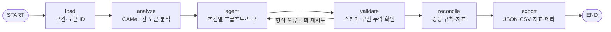

# 아키텍처 설계 — 단일 에이전트 실험 장치 (단계 1)

마지막 업데이트: 2026-10-13

## 결론

LangGraph 그래프 하나에 노드 여섯 개를 둔다. LLM이 들어가는 곳은 `agent` 노드 하나뿐이고, 나머지(입력 처리, 형태소 분석, 출력 검사, 대조·집계, 저장)는 일반 함수다. 실험 조건 C0~C3는 `agent` 노드가 LLM에게 무엇을 보여 주는지만 바꾼다. 분석기와 대조 노드는 모든 조건에서 같은 코드로 돌기 때문에 조건끼리 비교할 수 있다.

## 그래프

| 노드 | 하는 일 | LLM |
| --- | --- | --- |
| load | NFC 정규화(원문 보존), 구간 확인, 토큰 ID 부여 | 없음 |
| analyze | 아랍어 토큰마다 분석 수, 격어미를 뺀 후보, 모호 여부, noun_prop 여부 | 없음 |
| agent | C0: `prompt | model`. C1~C3: `create_agent(..., response_format=ToolStrategy(AgentOutput))` | 있음 |
| validate | 출력이 있는지, 모든 구간이 번역됐는지. 실패하면 1회 재시도 | 없음 |
| reconcile | 토큰 ID 검증, 인용 검증, 강등, 미처리·과잉 표시·불일치·정답 기반 지표 | 없음 |
| export | `segments.json`, `proper_nouns.csv`, `metrics.json`, `run_meta.json` | 없음 |

## 실험 조건

| 조건 | LLM에게 주는 것 | 직전 조건 대비 바뀐 것 | 질문 |
| --- | --- | --- | --- |
| C0 | 번역 지시, 구간 텍스트 | — | Q1 말없이 찍는가 |
| C1 | 처분 규칙 지시, 토큰 표, 구조화 출력 | 지시와 출력 형식 | Q2 지시만으로 되는가 |
| C2 | C1 + `analyze_tokens` 툴 | 도구(호출은 LLM이 정함) | Q3 도구를 주면 더 잡는가 |
| C3 | C1 + 분석기 결과 블록 | 도구 대신 결과를 항상 보여 줌 | Q3 보조 |

같은 문서, 같은 모델로 문서마다 3회 반복한다. 평가는 합성 평가 문서 30개다.

## 상태(State)

`doc_id`, `condition`, `segments`, `gold`(대조 단계 전용), `tokens`, `analyses`, `output`, `tool_log`, `usage`, `attempts`, `errors`, `valid`, `result`, `meta`. `gold`는 `runner.split_gold`가 문서에서 떼어 넘기고, 프롬프트를 만드는 함수는 구간과 토큰만 받는다.

## 기술 구성

| 구성 | 쓰는 방식 | 근거 |
| --- | --- | --- |
| LangGraph | `StateGraph(TypedDict)`, `add_conditional_edges`, `recursion_limit` | 골격 노트북, 참고 사이트 05 |
| LangChain | `init_chat_model("openai:gpt-6.1-sol")`, `create_agent`, `ToolStrategy`, `@tool` | 골격 노트북, 참고 사이트 01·06 |
| LangSmith | `@traceable` 실행 단위, 조건·문서·모델·지표를 메타데이터로 | 골격 노트북, 참고 사이트 LangSmith |
| 형태소 분석 | CAMeL Tools 1.6.0, calima-msa-r13 (GPL v2, 내부 측정 한정) | 계획 ADR-005 |
| 키 없을 때 | `FakeAgentModel`(스크립트된 응답, 연습 모드) | 골격 노트북의 연습 모드 |

## 다음 단계와의 연결

- **단계 2 (서류 묶음 검색):** `build_graph(extra_tool_factories=[...])`로 툴을 더한다. 틀은 `rag/bundle.py`에 있다(아랍어 철자 정확 일치, 로마자 유사 일치, Qdrant 벡터 검색, Parent–Child). 단계 1 조건에는 붙이지 않는다.
- **단계 3 (멀티 에이전트):** `agent` 노드만 번역자 / 격리된 검증자 / 중재자 하위 그래프로 바꾼다. `load`, `analyze`, `validate`, `reconcile`, `export`와 지표는 그대로 써서 단계 1과 같은 기준으로 비교한다.
